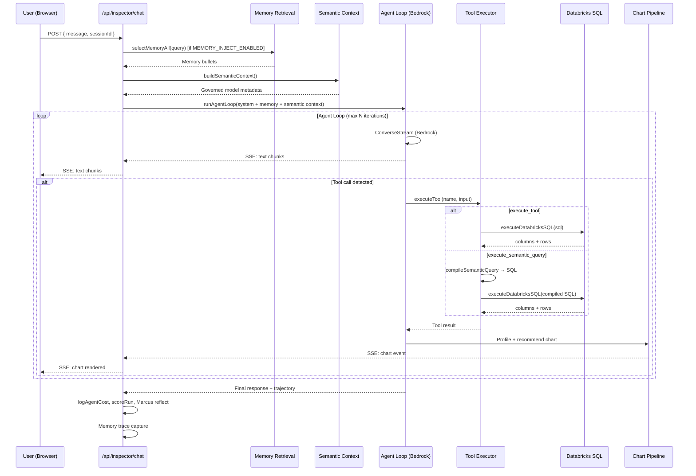
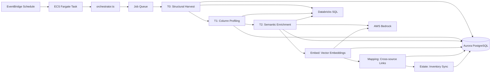

# ALOFT D360 — End-to-End Architecture Reference

> **Product:** Agent Lab — *Design, stage, and operate AI agent pipelines. Powered by ALOFT.*  
> **Brand:** Spinor Labs  
> **Repository:** `aloft-d360` (npm workspaces monorepo)  
> **Last documented:** August 2026

This document is a comprehensive, end-to-end architecture reference for the ALOFT D360 platform. It covers every major subsystem, technique, data flow, and deployment pattern in the codebase.

---

## Table of Contents

1. [Executive Summary](#1-executive-summary)
2. [System Context](#2-system-context)
3. [Technology Stack](#3-technology-stack)
4. [Repository Structure](#4-repository-structure)
5. [Architecture Patterns & Principles](#5-architecture-patterns--principles)
6. [Application Layers](#6-application-layers)
7. [Core Subsystems](#7-core-subsystems)
8. [Data Flows](#8-data-flows)
9. [Authentication & Authorization](#9-authentication--authorization)
10. [Database Architecture](#10-database-architecture)
11. [API Surface](#11-api-surface)
12. [External Integrations](#12-external-integrations)
13. [Deployment & Infrastructure](#13-deployment--infrastructure)
14. [Configuration Reference](#14-configuration-reference)
15. [External APIs & Providers — Detailed + Current Status](docs/external-apis-and-providers.md)
16. [Testing Strategy](#16-testing-strategy)
17. [Design System](#17-design-system)
18. [Migration & Phase Status](#18-migration--phase-status)
19. [Development Guide](#19-development-guide)

---

## 1. Executive Summary

ALOFT D360 is an **enterprise AI analytics and agent-operations platform** built for data-intensive domains (maritime analytics via Spinor Labs). It combines:

| Capability | Description |
|---|---|
| **Inspector** | Conversational data workbench — natural-language questions → SQL/semantic queries → live charts |
| **Dashboard Builder** | Governed, versioned, shareable dashboards composed from semantic definitions |
| **Semantic Layer** | Governed entities, dimensions, measures, intents, lineage, and promotion workflows |
| **Agent Lab** | Memory synthesis (FOER), reputation, teach mode, Marcus reflections, bandit scoring |
| **Data Estate** | Context harvesting pipeline — inventories Databricks objects, profiles, enriches, embeds |
| **Catalog & Staging** | Agent/tool catalogs, policies, RBAC admin, audit logging |

### Architectural Shape

```
┌─────────────────────────────────────────────────────────────────┐
│                     Browser (React 18 + Next.js 15)             │
└────────────────────────────┬────────────────────────────────────┘
                             │
┌────────────────────────────▼────────────────────────────────────┐
│              Vercel — Next.js App Router (Serverless)           │
│  ┌──────────┐ ┌───────────┐ ┌──────────┐ ┌──────────────────┐  │
│  │ NextAuth │ │ Inspector │ │ Semantic │ │ Dashboard/Studio │  │
│  │   RBAC   │ │ Agent Loop│ │ Compiler │ │   Widget Engine  │  │
│  └──────────┘ └─────┬─────┘ └────┬─────┘ └────────┬─────────┘  │
│                     │            │                 │             │
│              137 REST API Routes (src/app/api/)                 │
└──────────┬──────────┬──────────┬─────────────────┬────────────┘
           │          │          │                 │
    ┌──────▼──────┐   │   ┌──────▼──────┐   ┌──────▼──────┐
    │   Aurora    │   │   │  Databricks │   │ AWS Bedrock │
    │ PostgreSQL  │   │   │ SQL Warehouse│   │  LLM/Embed │
    │ + pgvector  │   │   └─────────────┘   └─────────────┘
    └─────────────┘   │
                      │   ┌─────────────────────────────────┐
                      └──►│  ECS Fargate (Context Harvester) │
                          │  EventBridge → orchestrator.ts  │
                          └─────────────────────────────────┘
```

**Key design decision:** The web tier is a **monolithic Next.js full-stack app**. Heavy background work (data estate harvesting, SSR chart rendering) runs on **AWS ECS Fargate**, not Vercel serverless, due to timeout and payload constraints.

---

## 2. System Context

### What Problem Does It Solve?

Organizations with large Databricks data estates need:

1. **Self-service analytics** without writing SQL manually
2. **Governed semantic definitions** so metrics are consistent across teams
3. **AI agents that remember** past interactions and improve over time
4. **Automated data cataloging** — knowing what tables exist, what they mean, and how they relate
5. **Operational control** — RBAC, audit trails, versioned dashboards, promotion gates

### Primary Users

| Persona | Primary Surface |
|---|---|
| Data analyst | Inspector chat, Dashboard Builder |
| Data steward | Semantic Layer authoring, Data Estate mapper |
| Platform admin | Agent Staging (users, policies, audit) |
| Agent operator | Agent Lab (memory, teach mode, bandits) |

### Domain Context

The platform is built for **maritime analytics** (Spinor Labs). Backfill staging tables reference maritime payroll concepts (allotments, victualling, wage accounts). The design system uses Berkeley Navy (`#003262`) and Gold (`#FDB515`) brand colors.

---

## 3. Technology Stack

### Frontend

| Technology | Version | Role |
|---|---|---|
| **Next.js** | 15.5 | App Router, SSR, API routes |
| **React** | 18.2 | UI rendering |
| **TypeScript** | 5.x | Type safety across full stack |
| **Tailwind CSS** | 3.4 | Utility-first styling |
| **Framer Motion** | 12.x | Animations and transitions |
| **Zustand + Immer** | 4.5 / 10.0 | Client state management |
| **TanStack React Query** | 5.x | Server state, caching |
| **TanStack Virtual** | 3.x | Virtualized long lists |
| **ECharts** | 6.x | Primary charting engine |
| **Recharts** | 2.x | Secondary charts |
| **react-grid-layout** | 2.x | Dashboard drag-and-drop layout |
| **@xyflow/react + dagre** | 12.x / 0.8 | Data estate relationship graphs |
| **@aloft/shared** | workspace | Radix UI design system primitives |

### Backend

| Technology | Version | Role |
|---|---|---|
| **Next.js API Routes** | 15.5 | 137 REST endpoints (serverless on Vercel) |
| **Prisma** | 5.22 | ORM — 142 models, PostgreSQL + pgvector |
| **NextAuth** | 4.24 | JWT sessions, Azure AD SSO |
| **jose** | 6.x | Bearer JWT verification (Entra ID) |
| **Zod** | 3.25 | Runtime validation |
| **Ajv** | 8.x | Chart DSL JSON schema validation |
| **bcryptjs** | 3.x | Password hashing (break-glass auth) |

### AI / LLM

| Provider | SDK / Integration | Models |
|---|---|---|
| **AWS Bedrock** (primary) | `@aws-sdk/client-bedrock-runtime` | Claude Sonnet, Nova, Llama, DeepSeek, Mistral, Qwen |
| **AWS Bedrock Titan** | Same SDK | Text embeddings (`embedQuery`, `embedText`) |
| **Azure OpenAI** | `openai` package | GPT models (optional) |
| **Azure AI Foundry** | Custom provider | Grok, Kimi, DeepSeek-V4 |
| **Bedrock Mantle** | OpenAI-compatible endpoint | Alternative Bedrock access |

### Data & Cloud

| Service | Role |
|---|---|
| **Databricks SQL** | Primary data warehouse — OAuth M2M execution |
| **AWS Aurora PostgreSQL** | Application database with pgvector extension |
| **AWS ECS Fargate** | Context harvester background jobs |
| **AWS EventBridge** | Scheduled harvest triggers (daily/weekly) |
| **AWS Secrets Manager** | Aurora + Databricks credentials |
| **AWS CloudWatch Logs** | Harvester logging |
| **AWS ECR** | Container registry (`aloft-context-harvester`) |
| **Vercel** | Web app hosting (serverless functions) |

### Testing & Tooling

| Tool | Role |
|---|---|
| **Vitest** | 4.x — unit and component tests (47 test files) |
| **Testing Library** | React component testing |
| **jsdom** | DOM environment (opt-in per test file) |
| **ESLint** | Linting with `eslint-config-next` |
| **tsx** | TypeScript execution for scripts and seed |

---

## 4. Repository Structure

```
aloft-d360/
├── package.json                    # Root workspace config + scripts
├── next.config.ts                  # Transpile @aloft/shared
├── tsconfig.json                   # Path aliases (@/ → src/)
├── tailwind.config.js              # Design tokens
├── vitest.config.ts                # Test runner config
├── prisma/
│   ├── schema.prisma               # 142 models, pgvector extension
│   ├── seed.ts                     # RBAC permissions/roles bootstrap
│   └── migrations/                 # SQL migration history
├── packages/
│   └── aloft-shared/               # Shared UI component library
│       └── src/components/ui/      # Radix-based primitives
├── src/
│   ├── app/                        # Next.js App Router
│   │   ├── layout.tsx              # Root layout, theme bootstrapping
│   │   ├── page.tsx                # Landing page
│   │   ├── login/                  # Login page
│   │   ├── (agent)/                # Auth-gated application shell
│   │   │   ├── dashboard/          # Home dashboard
│   │   │   ├── inspector/          # Chat + dashboard builder
│   │   │   ├── agent-lab/          # Memory, estate, teach, bandits
│   │   │   ├── agent-staging/      # Users, policies, audit admin
│   │   │   ├── docs/               # In-app documentation
│   │   │   └── performance-lab/    # Performance testing
│   │   └── api/                    # 137 REST route handlers
│   ├── components/                 # ~200 React component files
│   │   ├── inspector/              # Inspector shell, dashboard builder
│   │   ├── workbench/              # Prompt canvas, streaming messages
│   │   ├── teach/                  # Teach mode UI
│   │   ├── estate/                 # Data estate graph (48 files)
│   │   ├── studio/                 # Data studio, chart rails
│   │   ├── agent-lab/              # Agent lab staging UI
│   │   ├── dashboard/              # Home dashboard views
│   │   ├── users/                  # User admin
│   │   ├── shell/                  # App shell (sidebar, header)
│   │   └── providers/              # Theme, query providers
│   ├── hooks/                      # Custom React hooks
│   ├── lib/                        # Core business logic (~211 files)
│   │   ├── auth.ts                 # NextAuth configuration
│   │   ├── rbac.ts                 # Roles, permissions, provisioning
│   │   ├── db.ts / prisma.ts       # Prisma client singleton
│   │   ├── databricks/             # SQL execution chokepoint
│   │   ├── semantic/               # Semantic model compiler + execute
│   │   ├── inspector/              # Agent loop, tools, chart pipeline
│   │   ├── dashboards/             # Dashboard CRUD, widgets, drift
│   │   ├── studio/                 # Chart DSL, profiler, recommender
│   │   ├── memory/                 # Retrieval, synthesis, reputation
│   │   ├── marcus/                 # Reflection engine
│   │   ├── context/                # Data estate harvest pipeline
│   │   ├── knowledge/              # Chunking + embedding (partial)
│   │   ├── lifecycle/              # Cost logging, bandit scoring
│   │   ├── foer/                   # Topic clustering (FOER)
│   │   ├── estate/                 # Estate object browsing
│   │   ├── bandits/                # Multi-armed bandit reporting
│   │   └── boost/                  # Model evaluation suite
│   ├── middleware.ts               # NextAuth edge middleware
│   ├── middleware/auth.ts          # Bearer token auth for API routes
│   └── types/                      # Shared TypeScript types
├── docs/                           # Architecture/build plans
├── infra/context/                  # AWS ECS/EventBridge deploy artifacts
├── staging/                        # Local Postgres+pgvector for dev
├── scripts/                        # Ops, backfill, harvester orchestrator
│   ├── context/orchestrator.ts     # Fargate entry point
│   └── infra/                      # AWS provisioning scripts
├── assets/fonts/
├── public/
└── Dockerfile.harvester            # Context harvester container image
```

---

## 5. Architecture Patterns & Principles

### 5.1 Monolithic Full-Stack (Not Microservices)

The web application is a single deployable Next.js unit. UI and API coexist in one codebase. Background work that exceeds serverless limits is offloaded to ECS Fargate tasks.

### 5.2 Single Chokepoint Pattern

Critical operations have exactly one entry point — never duplicated:

| Operation | Single Module | Why |
|---|---|---|
| Databricks SQL execution | `src/lib/databricks/execute.ts` | Read-only allowlist, row/byte caps, no external_links |
| Semantic query execution | `src/lib/semantic/execute.ts` | Loads governed model → compiles → calls execute.ts |
| User provisioning | `provisionUserByOid()` in `src/lib/rbac.ts` | One path for AAD JIT + API token auth |
| Memory embeddings | `context/embed.ts` (`embedQuery`) vs `knowledge/embed.ts` (`embedText`) | Two distinct modules — never merge |

### 5.3 Domain Layering

```
UI Components (React)
    ↓ fetch / SSE
API Routes (src/app/api/**/route.ts)
    ↓ resolveAuth() → permission checks
Business Logic (src/lib/**)
    ↓
Data Access (Prisma / Databricks SDK / Bedrock SDK)
```

### 5.4 Server/Client Separation

- **Server Components** — Default for pages under `(agent)/`
- **Client Components** — Interactive surfaces (Inspector chat, dashboard builder, estate graph)
- **`server-only` imports** — DB, LLM, and secret access modules marked to prevent client bundling

### 5.5 Org-Scoped Multi-Tenancy

All data access is scoped to an organization via `getDefaultOrg()` / `DEFAULT_ORG_ID`. The schema supports multiple orgs (`PlatformOrg`), but resolution is environment-driven (single-tenant by default).

### 5.6 Feature Flags via Environment Variables

Non-core features are gated behind env vars (e.g., `MEMORY_INJECT_ENABLED`, `MARCUS_REFLECT_ENABLED`). This allows progressive rollout without code changes.

### 5.7 Streaming-First Agent Architecture

Inspector chat uses Server-Sent Events (SSE) to stream:
- Text chunks from the LLM
- Tool call events (suggested → running → result/error)
- Query results (columns, rows, SQL)
- Chart DSL events for live rendering

### 5.8 Advisory Locking for Background Jobs

Memory orchestration and context harvesting use PostgreSQL advisory locks (`src/lib/memory/lock.ts`) to prevent concurrent DAG runs.

---

## 6. Application Layers

### 6.1 Presentation Layer (`src/app/` + `src/components/`)

**App Router structure:**

| Route Group | Path | Purpose |
|---|---|---|
| Public | `/`, `/login` | Landing and authentication |
| Agent shell | `(agent)/*` | Auth-gated app with sidebar + header |
| API | `api/*` | 137 REST endpoints |

**Key UI subsystems:**

- **InspectorShell** — Chat interface with streaming messages, tool call cards, chart rendering
- **Dashboard Builder** — Guided flow (blueprint → refine → assemble → save) + freeform mode
- **Metrics Catalog** — Browse/promote semantic definitions
- **Data Estate** — Object browser, relationship graph (xyflow + dagre), lineage view
- **Teach Mode** — Learning rail, conflict resolver, candidate review
- **Agent Lab** — Memory browser, synthesis runs, reputation leaderboard

### 6.2 API Layer (`src/app/api/`)

Every route follows a consistent pattern:

```typescript
// Typical API route structure
export async function POST(req: Request) {
  const auth = await resolveAuth(req);          // Session or Bearer token
  if (!hasPermission(auth, 'inspector:use'))   // RBAC check
    return Response.json({ error: 'Forbidden' }, { status: 403 });

  const body = await req.json();
  const validated = schema.parse(body);         // Zod validation

  const result = await businessLogic(validated); // lib/* call
  return Response.json(result);
}
```

### 6.3 Business Logic Layer (`src/lib/`)

211 TypeScript modules organized by domain. See [Section 7](#7-core-subsystems) for detailed subsystem breakdown.

### 6.4 Data Access Layer

| Access Path | Technology | Used By |
|---|---|---|
| Application state | Prisma → Aurora PostgreSQL | All domains |
| Vector search | pgvector extension | Memory retrieval, context embeddings, NL intent matching |
| Data warehouse | Databricks SQL API (OAuth M2M) | Inspector queries, semantic execution, harvest pipeline |
| LLM inference | AWS Bedrock ConverseStream | Inspector agent loop, memory synthesis, Marcus reflections |
| Embeddings | AWS Bedrock Titan | Context search, knowledge chunks, intent embeddings |

---

## 7. Core Subsystems

### 7.1 Inspector — Conversational Analytics

**Location:** `src/lib/inspector/`, `src/components/inspector/`, `src/app/api/inspector/`

The Inspector is the primary user-facing product — a conversational data workbench.

#### Agent Loop (`agent-loop.ts`)

The core execution engine uses AWS Bedrock's `ConverseStreamCommand`:

```
User message
  → System prompt (semantic context + memory bullets)
  → LLM generates response (streaming text chunks)
  → If tool_use block detected:
      → executeTool(toolName, input)
      → Tool result appended to conversation
      → Loop continues (max N iterations)
  → Final text response
```

**Supported tools:**

| Tool | Action |
|---|---|
| `execute_tool` | Raw SQL via `executeDatabricksSQL` (read-only) |
| `execute_semantic_query` | Governed semantic query via `compileSemanticQuery` → SQL |
| `reflect` | Marcus reflection on trajectory |
| `teach` | Capture teach-mode candidate |

**Key techniques:**
- **Bedrock prompt caching** — Optional `cacheSystemPrompt` for stable system prefixes
- **Trajectory tracking** — Every tool call logged with seq, duration, status, SQL excerpt
- **Streaming events** — `onTextChunk`, `onToolCallEvent`, `onLoopUsage` callbacks
- **Abort support** — `abortSignal` for user cancellation

#### Chart Pipeline (`chart-pipeline.ts`, `chart-emitter.ts`)

After a query executes:
1. **Profiler** (`studio/profiler.ts`) — Analyzes column types, cardinality, distributions
2. **Recommender** (`studio/recommender.ts`) — Suggests optimal chart type
3. **Compiler** (`studio/compiler.ts`) — Generates ECharts option from Chart DSL
4. **Emitter** — Streams chart events to the UI via SSE

#### LLM Provider Factory (`providers/factory.ts`)

Abstraction over multiple LLM backends:
- Bedrock (default) — Claude, Nova, Llama, etc.
- Azure OpenAI — GPT models
- Azure AI Foundry — Grok, Kimi, DeepSeek
- Bedrock Mantle — OpenAI-compatible endpoint

Provider selection is model-ID driven.

---

### 7.2 Semantic Layer — Governed Metrics

**Location:** `src/lib/semantic/`, `src/app/api/inspector/semantic/`

A governed semantic model system that compiles high-level queries into SQL.

#### Model Structure

```
SemanticModel
  ├── Entities (tables/views)
  │   ├── Dimensions (groupable attributes)
  │   ├── Measures (aggregatable metrics)
  │   └── Joins (relationships between entities)
  ├── Intents (natural-language query templates)
  └── Governance metadata (status, lineage, audit)
```

#### Compilation Pipeline

```
SemanticQuery (JSON)
  → validateSemanticQuery()     — Schema validation
  → filterAccessible()          — Draft vs governed access control
  → compileSemanticQuery()      — Generate SQL with JOINs, GROUP BY, filters
  → executeDatabricksSQL()      — Single execution chokepoint
  → SemanticQueryResult         — SQL + columns + rows + isDraft flag
```

#### Governance Workflow

```
Author creates draft definition
  → Authoring preview (draft execution, stamped "Draft — not governed")
  → Submit for review
  → Reviewer approves/rejects
  → Promotion gate checks (lineage, conflicts, access)
  → Promote to governed status
  → Audit row written
```

**Key files:**
- `compiler.ts` — SQL generation from semantic definitions
- `governance.ts` — Audit trail for semantic changes
- `promotion-gate.ts` — Pre-promotion validation rules
- `lineage.ts` — Dependency tracking between definitions
- `intent-match.ts` — NL intent → semantic query resolution
- `authoring-access.ts` — Draft vs governed access boundaries

---

### 7.3 Dashboard Builder — Governed Dashboards

**Location:** `src/lib/dashboards/`, `src/components/inspector/dashboard-builder/`

Versioned, shareable dashboards composed from semantic queries and saved charts.

#### Dashboard Lifecycle

```
Create dashboard
  → Add widgets (semantic query, saved chart, or raw SQL)
  → Edit layout (react-grid-layout)
  → Save draft (auto-save)
  → Publish version (immutable snapshot)
  → Share with collaborators (owner/editor/viewer)
  → Restore previous version
```

#### Widget Data Resolution

Each widget resolves data through:
1. **Semantic path** — `executeSemanticQuery()` with model + connection binding
2. **Saved chart path** — Load from `platform_charts`, re-execute stored SQL
3. **Raw SQL path** — Direct `executeDatabricksSQL()` with dashboard's connection

#### Key Features

- **Draft beacon** — Visual indicator of unsaved changes
- **Widget drift detection** — Alerts when underlying data schema changes
- **Blueprint flow** — LLM-guided dashboard creation from natural language
- **Collaborator permissions** — Owner/editor/viewer on `platform_dashboard_collaborators`
- **Version history** — Immutable snapshots in `platform_dashboard_versions`

---

### 7.4 Memory System (FOER) — Agent Learning

**Location:** `src/lib/memory/`, `src/app/api/agent-lab/memory/`

A sophisticated memory system that lets AI agents learn from past interactions.

#### Memory Architecture

```
Session (Inspector chat)
  → Trace capture (tool calls, SQL, outcomes)
  → Synthesis (LLM reflects on session → memory bullets)
  → Classification (FOER topic clustering)
  → Storage (PlatformAgentMemory with embeddings)
  → Retrieval (semantic search + MMR diversity)
  → Injection (bullets prepended to future prompts)
  → Reputation (attribution scoring per user)
```

#### Synthesis DAG (`orchestrate.ts`)

Two scheduled job groups:

| Schedule | Jobs | Purpose |
|---|---|---|
| **Nightly** (04:30 UTC) | `synthesize`, `reclassify?` | Reflect on sessions, reclassify if coverage drops |
| **Weekly** (Sunday 05:30 UTC) | `grow_refine`, `reclassify` | Dedup/GC/TTL, always reclassify topics |

#### Retrieval Pipeline (`retrieve.ts`)

1. **Embed query** — Titan embedding of user's question
2. **Vector search** — pgvector cosine similarity against memory embeddings
3. **MMR diversity** — Maximal Marginal Relevance to avoid redundant bullets
4. **Caveat guard** — Filter bullets with stale/invalid caveats
5. **Personal lane** — User-specific memories prioritized
6. **Compression** — Summarize multiple bullets when token budget is tight

#### Reputation System (`reputation/`)

- Season-based scoring with configurable epochs
- Attribution engine tracks which memories led to successful outcomes
- Leaderboard for top contributors
- Rollover between seasons

#### Teach Mode (`teach.ts`, `inspector/teach-*.ts`)

Users can explicitly teach the agent:
1. User corrects agent behavior during a session
2. Teach candidate captured with context
3. Conflict detection against existing memories
4. Admin review and promotion to active memory

---

### 7.5 Data Estate — Context Harvesting

**Location:** `src/lib/context/`, `scripts/context/`, `src/app/api/agent-lab/context/`

Automated pipeline that inventories and enriches a Databricks data estate.

#### Multi-Tier Enrichment Pipeline

| Tier | Job Kind | What It Does |
|---|---|---|
| **T0** | `t0_structural` | Schema/structural harvest from Databricks |
| **T1** | `t1_profile` | Column profiling (stats, distributions, null rates) |
| **T2** | `t2_semantic` | LLM semantic enrichment (Bedrock Sonnet describes columns) |
| **T3** | `t3_connected`, `t3_usage` | Relationship and usage pattern analysis |
| **T4** | `t4_scan`, `t4_entity_propose`, `t4_dim_propose` | Entity/dimension proposal (stubbed — not ported) |
| **Embed** | `embed` | Vector embeddings for semantic search (Titan) |
| **Mapping** | `mapping` | Cross-source semantic mapping |
| **Silo** | `silo_scan` | Cross-source link detection |
| **Estate** | `estate_inventory` | Full estate object sync |
| **Change** | `change_detect` | Detect schema changes since last harvest |

#### Orchestration (`scripts/context/orchestrator.ts`)

```
EventBridge schedule (daily/weekly)
  → ECS Fargate launches container
  → orchestrator.ts claims next job from queue
  → Executes job handler (harvest, profile, enrich, etc.)
  → Writes results to Aurora (platform_context_*)
  → Advances job chain or enqueues next tier
  → Auto-split for long jobs (spawns child Fargate tasks)
```

#### Job Queue (`context/queue.ts`)

- PostgreSQL-backed job queue with status tracking
- ECS dispatch for on-demand and scheduled jobs
- Stale job detection and retry
- Chain advancement for multi-tier pipelines

#### Data Quality Scoring (`context/data-score/`)

Multi-dimensional scoring:
- **Accessible** — Can the data be queried?
- **Actionable** — Does it have semantic enrichment?
- **Discoverable** — Is it embedded and searchable?
- **Trusted** — Profile quality and freshness metrics

---

### 7.6 Studio — Chart Engine

**Location:** `src/lib/studio/`, `src/components/studio/`

The chart generation and recommendation engine.

#### Chart DSL

A JSON schema (validated by Ajv) describing chart intent:

```json
{
  "type": "bar",
  "x": { "field": "month", "label": "Month" },
  "y": { "field": "revenue", "label": "Revenue", "aggregate": "sum" },
  "color": { "field": "region" },
  "title": "Revenue by Month and Region"
}
```

#### Pipeline

```
Query results (columns + rows)
  → Profiler — Analyze types, cardinality, distributions
  → Recommender — Score chart types (bar, line, pie, scatter, table, etc.)
  → Compiler — Generate ECharts option object
  → Theme application (Spinor/Inspector/Aloft dark themes)
  → Render (client-side ECharts or server-side SSR via resvg)
```

#### SSR Rendering (`ssr-render.ts`)

Server-side chart rendering using `@resvg/resvg-js` for:
- Dashboard thumbnails
- Export/sharing
- Runs on Fargate only (too heavy for Vercel serverless)

---

### 7.7 Marcus — Reflection Engine

**Location:** `src/lib/marcus/`

Post-hoc reflection on agent trajectories:

```
Agent completes tool loop
  → Marcus reflect() triggered (if MARCUS_REFLECT_ENABLED)
  → LLM analyzes trajectory (SQL choices, errors, efficiency)
  → Reflection stored in PlatformMarcusReflection
  → Surfaced in workbench UI as reflection cards
```

**Throttling:** `marcus/throttle.ts` prevents excessive reflection calls.

---

### 7.8 Lifecycle & Bandits

**Location:** `src/lib/lifecycle/`, `src/lib/bandits/`, `src/lib/boost/`

Operational intelligence for agent performance:

| Module | Purpose |
|---|---|
| `log-agent-cost.ts` | Track token usage and cost per agent run |
| `score-run.ts` | Score run quality (CTSGV framework) |
| `write-bandit-observation.ts` | Multi-armed bandit observations |
| `report-bandit.ts` | Bandit performance reporting |
| `boost/` | Model evaluation suite — run test cases, score models |

---

### 7.9 Agent Lab Staging

**Location:** `src/app/(agent)/agent-staging/`, `src/app/api/catalog/`, `src/app/api/policies/`

Administrative surfaces:

- **User management** — CRUD, role assignment
- **Agent catalog** — Version, review, fork, diff agent definitions
- **Tool catalog** — Register and manage tool definitions
- **Policy management** — Governance policies
- **Audit log** — Full action audit trail
- **Session management** — View all user sessions (platform_admin)

---

## 8. Data Flows

### 8.1 Inspector Chat (Primary User Journey)



### 8.2 Dashboard Widget Data

```
Widget render request
  → GET /api/inspector/dashboards/[id]/widgets/[widgetId]/data
  → Resolve dashboard connection_id
  → If semantic widget:
      → executeSemanticQuery(model, query, connection)
  → If saved chart widget:
      → Load platform_charts row → re-execute stored SQL
  → If raw SQL widget:
      → executeDatabricksSQL(sql, connection)
  → Return { columns, rows, chartOption }
```

### 8.3 Data Estate Harvest



### 8.4 Memory Synthesis DAG

```
Nightly (04:30 UTC):
  acquireOrchestratorLock()
  → synthesize: Reflect on recent sessions → memory bullets
  → reclassify? (only if topic coverage < COVERAGE_TARGET)
  → releaseOrchestratorLock()

Weekly (Sunday 05:30 UTC):
  acquireOrchestratorLock()
  → grow_refine: Dedup, TTL expiry, garbage collection
  → reclassify: Always refresh topic labels
  → reputation attribution (if MEMORY_REPUTATION_ENABLED)
  → releaseOrchestratorLock()
```

---

## 9. Authentication & Authorization

### 9.1 Authentication Mechanisms

| Method | Provider | Use Case |
|---|---|---|
| **Azure AD SSO** | NextAuth `AzureADProvider` | Primary enterprise login |
| **Credentials** | NextAuth `CredentialsProvider` | Break-glass local admin |
| **Bearer Token** | `jose` JWKS verification | API/SPA clients with Entra tokens |

### 9.2 Session Management

- **Strategy:** JWT (not database sessions)
- **Default duration:** 8 hours
- **Remember me:** 30 days
- **Edge middleware:** `src/middleware.ts` protects all routes except `/`, `/login`, `/_next/*`, `/api/auth/*`

### 9.3 RBAC Model

#### Roles (highest to lowest privilege)

| Role | Capabilities |
|---|---|
| `platform_admin` | All permissions + cross-user session/data visibility |
| `admin` | All app actions, own data only |
| `member` | Inspector use + read-only elsewhere |
| `readonly` | Login and view only |

#### Key Permissions

| Permission | Description |
|---|---|
| `inspector:use` | Create sessions, run queries |
| `session:read:all` | View all users' sessions (platform_admin only) |
| `audit:read` | View audit log |
| `llm:payload:read` | View raw LLM request/response payloads |
| `user:*`, `role:*` | User and role management |

#### AAD Just-in-Time Provisioning

```
User signs in via Azure AD
  → NextAuth callback extracts oid (aadObjectId)
  → provisionUserByOid(oid, email, name, tenantId)
      → Find by aadObjectId → return existing user
      → Not found → create new user with DEFAULT_ROLE ('admin')
      → Email collision → AccountLinkRequiredError (refuse silent linking)
  → Sync platform_admin from AZURE_AD_ADMIN_GROUP_IDS
  → Issue JWT with role + permissions
```

### 9.4 Dashboard-Level Authorization

Separate from RBAC — per-dashboard collaborator roles:
- **Owner** — Full control, delete, transfer ownership
- **Editor** — Modify widgets, save versions
- **Viewer** — Read-only access

Managed via `platform_dashboard_collaborators` table and `src/lib/dashboards/permissions.ts`.

---

## 10. Database Architecture

### 10.1 Overview

- **Engine:** PostgreSQL 16 with `pgvector` extension
- **Production:** AWS Aurora PostgreSQL
- **ORM:** Prisma 5 with `previewFeatures = ["postgresqlExtensions"]`
- **Models:** 142 Prisma models
- **Local dev:** Docker Compose with pgvector on port 5434

### 10.2 Schema Domains

#### Identity & RBAC (8 models)
`User`, `UserProfile`, `LoginEvent`, `Role`, `Permission`, `RolePermission`, `UserRole`, `AuditLog`

#### Platform Core (6 models)
`PlatformOrg`, `PlatformAgent`, `PlatformAgentRun`, `PlatformAgentManifest`, `PlatformDatabricksConnection`, `platform_trajectories`

#### Catalogs (10+ models)
`agent_catalog`, `tool_catalog`, `prompt_catalog`, `schema_catalog`, `bus_*_catalog`, `agent_lab_*` tables

#### Semantic Layer (8 models)
`platform_semantic_models`, `platform_sem_entities`, `platform_sem_dimensions`, `platform_sem_measures`, `platform_sem_joins`, `platform_sem_audit`

#### Dashboards & Charts (6 models)
`platform_dashboards`, `platform_dashboard_versions`, `platform_dashboard_drafts`, `platform_dashboard_collaborators`, `platform_dashboard_audit`, `platform_charts`

#### Memory & Teach (8 models)
`PlatformAgentMemory`, `PlatformMemoryInjection`, `PlatformMemoryContribution`, `PlatformMemorySynthesisRun`, `PlatformMemorySynthesisDetail`, `PlatformMemoryTopic`, `PlatformUserReputation`, `PlatformTeachCandidate`, `PlatformMarcusReflection`

#### Data Estate / Context (10 models)
`PlatformContextSource`, `PlatformContextObject`, `PlatformContextColumn`, `PlatformContextProfile`, `PlatformContextSemantic`, `PlatformContextEmbedding`, `PlatformContextMapping`, `PlatformContextJob`, `PlatformJobLog`, `PlatformContextObjectLink`, `PlatformEstateObject`, `PlatformNlIntentEmbedding`

#### Knowledge (4 models)
`knowledge_sources`, `knowledge_chunks`, and supporting tables

#### Lifecycle & Eval (8 models)
`PlatformEvalSuite/Case/Run/Result`, `agent_eval_*`, `agent_cost_log`, `tool_invocation_log`, `bandit_observations`, `promotion_audit_log`

#### Backfill Staging (6 models)
Maritime payroll domain: `backfill_staging_*` tables (allotments, victualling, wage accounts)

### 10.3 Vector Search

pgvector is used for:
- **Memory embeddings** — `PlatformAgentMemory.embedding` (cosine similarity retrieval)
- **Context embeddings** — `PlatformContextEmbedding` (data estate semantic search)
- **NL intent embeddings** — `PlatformNlIntentEmbedding` (intent matching)

### 10.4 Migrations

Located in `prisma/migrations/`:
- `20260713_rbac_roles_overhaul`
- `20260713_reputation_system`
- `20260715_dashboard_connection_binding`
- `20260720_teach_candidate`
- `20260723_dashboard_drafts`
- `add_aad_sso_support.sql`

---

## 11. API Surface

**Total: 137 REST endpoints** organized by domain.

### Auth & Access (5 routes)
| Method | Path | Purpose |
|---|---|---|
| GET/POST | `/api/auth/[...nextauth]` | NextAuth handlers |
| GET/POST | `/api/access/roles` | Role management |
| GET | `/api/access/permissions` | Permission listing |
| GET/POST | `/api/access/assignments` | Role assignments |

### Users & Admin (6 routes)
| Method | Path | Purpose |
|---|---|---|
| GET/POST | `/api/users` | User list/create |
| GET/PATCH/DELETE | `/api/users/[id]` | User CRUD |
| GET | `/api/audit-log` | Audit trail |
| GET/POST | `/api/policies`, `/api/policies/[id]` | Policy management |
| GET/POST | `/api/sessions`, `/api/sessions/[id]` | Application sessions |

### Catalog (8 routes)
| Method | Path | Purpose |
|---|---|---|
| GET/POST | `/api/catalog/agents` | Agent catalog |
| GET/PATCH/DELETE | `/api/catalog/agents/[id]` | Agent CRUD |
| POST | `/api/catalog/agents/[id]/versions` | Version management |
| POST | `/api/catalog/agents/[id]/review` | Review workflow |
| POST | `/api/catalog/agents/[id]/fork` | Fork agent |
| GET | `/api/catalog/agents/[id]/diff/[otherId]` | Diff two agents |
| GET/POST | `/api/catalog/tools` | Tool catalog |

### Databricks (6 routes)
| Method | Path | Purpose |
|---|---|---|
| GET/POST | `/api/databricks/connections` | Connection management |
| GET/PATCH/DELETE | `/api/databricks/connections/[id]` | Connection CRUD |
| POST | `/api/databricks/connections/[id]/test` | Connection health check |
| POST | `/api/databricks/connections/[id]/execute` | Execute read-only SQL |
| POST | `/api/databricks/connections/[id]/tool` | Register as tool |

### Inspector (40+ routes)
| Method | Path | Purpose |
|---|---|---|
| POST | `/api/inspector/chat` | **Streaming LLM agent chat** |
| GET/POST | `/api/inspector/sessions` | Session management |
| GET/POST | `/api/inspector/charts` | Saved chart CRUD |
| GET/POST | `/api/inspector/dashboards` | Dashboard lifecycle |
| GET/POST | `/api/inspector/dashboards/[id]/versions` | Version management |
| GET/PUT/DELETE | `/api/inspector/dashboards/[id]/draft` | Draft management |
| POST | `/api/inspector/dashboards/[id]/share` | Sharing |
| GET/POST/DELETE | `/api/inspector/dashboards/[id]/collaborators` | Collaborator management |
| GET | `/api/inspector/dashboards/[id]/widgets/[widgetId]/data` | Widget data |
| GET/POST | `/api/inspector/semantic/models` | Semantic model CRUD |
| POST | `/api/inspector/semantic/[modelId]/blueprint` | LLM dashboard blueprint |
| POST | `/api/inspector/semantic/[modelId]/promote` | Promotion workflow |
| GET | `/api/inspector/semantic/lineage` | Lineage graph |
| GET/POST | `/api/inspector/teach/*` | Teach mode |
| GET/POST | `/api/inspector/memory/rules/*` | Memory rules |
| POST | `/api/inspector/boost/*` | Model evaluation |

### Agent Lab — Memory (15 routes)
| Method | Path | Purpose |
|---|---|---|
| GET | `/api/agent-lab/memory/browse` | Browse memories |
| POST | `/api/agent-lab/memory/synthesize` | Trigger synthesis |
| GET | `/api/agent-lab/memory/[id]` | Memory detail |
| POST | `/api/agent-lab/memory/[id]/curate` | Curate memory |
| GET | `/api/agent-lab/memory/runs` | Synthesis run history |
| GET | `/api/agent-lab/memory/trace/[id]` | Session trace |
| GET | `/api/agent-lab/memory/leaderboard` | Reputation leaderboard |
| GET | `/api/agent-lab/memory/stats` | Memory statistics |
| GET | `/api/agent-lab/memory/job-health` | Job health dashboard |

### Agent Lab — Context / Data Estate (44 routes)
| Method | Path | Purpose |
|---|---|---|
| GET/POST | `/api/agent-lab/context/sources` | Source registration |
| POST | `/api/agent-lab/context/sources/[id]/harvest` | Trigger harvest |
| GET | `/api/agent-lab/context/objects` | Browse objects |
| POST | `/api/agent-lab/context/objects/[id]/enrich` | Semantic enrichment |
| GET/POST | `/api/agent-lab/context/jobs` | Job queue management |
| POST | `/api/agent-lab/context/jobs/launch` | Launch Fargate task |
| GET | `/api/agent-lab/context/estate` | Estate inventory |
| POST | `/api/agent-lab/context/mappings/run` | Run semantic mapping |
| GET | `/api/agent-lab/context/data-score` | Data quality scores |
| POST | `/api/agent-lab/context/silo/scan` | Cross-source link scan |

### Agent Lab — Other (6 routes)
| Method | Path | Purpose |
|---|---|---|
| GET/POST | `/api/agent-lab/workbench/sessions` | Workbench sessions |
| GET/POST | `/api/agent-lab/marcus/reflections` | Marcus reflections |
| POST | `/api/backfill/agent-lab/bandits` | Bandit backfill |
| GET/POST | `/api/studio/results` | Studio query results |

---

## 12. External Integrations

> For a complete list of all external APIs with current **live status**, endpoints, models, and credential references, see the dedicated guide:  
> **[docs/external-apis-and-providers.md](docs/external-apis-and-providers.md)**

### 12.1 Microsoft Entra ID (Azure AD)

| Integration Point | Details |
|---|---|
| SSO login | NextAuth AzureADProvider |
| Bearer auth | JWKS verification via `jose` |
| Admin group sync | `AZURE_AD_ADMIN_GROUP_IDS` → `platform_admin` role |
| JIT provisioning | `provisionUserByOid()` on first login |

### 12.2 AWS Bedrock

| Use | Model Family | Module |
|---|---|---|
| Agent chat (primary) | Claude Sonnet | `inspector/agent-loop.ts` |
| Memory synthesis | Claude Sonnet | `memory/synthesis/reflect.ts` |
| Marcus reflections | Claude Sonnet | `marcus/reflect.ts` |
| Semantic enrichment (T2) | Claude Sonnet | `context/enrich.ts` |
| Text embeddings | Titan | `context/embed.ts`, `knowledge/embed.ts` |
| Dashboard blueprint | Configurable | `inspector/semantic blueprint` |

### 12.3 Databricks

| Integration | Details |
|---|---|
| Auth | OAuth M2M client credentials (`token-client.ts`) |
| Execution | SQL Statements API via `execute.ts` |
| Safety | Read-only allowlist, row/byte caps, no external_links |
| Harvesting | Schema introspection, profiling queries |
| Connections | Stored in `PlatformDatabricksConnection`, secrets in AWS SM |

### 12.4 AWS Infrastructure

| Service | Region | Purpose |
|---|---|---|
| ECS Fargate | `ap-south-1` | Context harvester tasks |
| EventBridge | `ap-south-1` | Scheduled harvest triggers |
| Secrets Manager | `ap-south-1` | `aloft/aurora`, `aloft/databricks` |
| CloudWatch Logs | `ap-south-1` | `/ecs/aloft-context-harvester` |
| ECR | `ap-south-1` | `aloft-context-harvester` image |
| Aurora PostgreSQL | `ap-south-1` | Application database |

### 12.5 Vercel

Web app hosting with serverless API routes. No `vercel.json` in repo — configuration is Vercel dashboard-driven.

---

## 13. Deployment & Infrastructure

> **Share with Cloud team (dev):** [docs/cloud-team-architecture-handoff.md](docs/cloud-team-architecture-handoff.md) + [docs/aws-cloud-handoff-checklist.md](docs/aws-cloud-handoff-checklist.md)  
> **Current platform map (AWS recreation, Beanstalk, Entra, every external service):** [docs/platform-services-and-recreation.md](docs/platform-services-and-recreation.md)  
> **Web on AWS:** [docs/deploy-beanstalk.md](docs/deploy-beanstalk.md) (recommended). Diagrams below still mention Vercel historically.

### 13.1 Architecture Diagram

```
┌──────────────────────────────────────────────────────────────┐
│                         INTERNET                              │
└────────────┬─────────────────────────────┬───────────────────┘
             │                             │
    ┌────────▼────────┐          ┌─────────▼─────────┐
    │     Vercel       │          │   Azure AD (SSO)  │
    │  Next.js 15 App  │          │   Entra ID        │
    │  137 API Routes  │          └───────────────────┘
    └────────┬─────────┘
             │
    ┌────────▼─────────────────────────────────────────┐
    │              AWS ap-south-1                       │
    │                                                   │
    │  ┌─────────────┐  ┌──────────┐  ┌─────────────┐ │
    │  │   Aurora     │  │ Bedrock  │  │   Secrets   │ │
    │  │ PostgreSQL   │  │ LLM/Embed│  │  Manager    │ │
    │  │ + pgvector   │  └──────────┘  └─────────────┘ │
    │  └──────┬──────┘                                │
    │         │                                        │
    │  ┌──────▼──────┐  ┌──────────┐  ┌─────────────┐ │
    │  │ EventBridge  │→ │   ECS    │→ │ CloudWatch  │ │
    │  │  Schedules   │  │ Fargate  │  │    Logs     │ │
    │  └─────────────┘  └────┬─────┘  └─────────────┘ │
    │                        │                         │
    └────────────────────────┼─────────────────────────┘
                             │
                    ┌────────▼────────┐
                    │   Databricks     │
                    │  SQL Warehouse   │
                    └─────────────────┘
```

### 13.2 Deployment Targets

| Component | Target | Trigger |
|---|---|---|
| Web app | Elastic Beanstalk (recommended) or Vercel | `eb deploy` / ECR image push, or Git push |
| Context harvester | ECS Fargate | EventBridge schedule or API launch |
| Database migrations | Aurora | `npm run db:migrate` |
| Container image | ECR | `Dockerfile.harvester` build + push |

### 13.3 ECS Task Definition

Defined in `infra/context/task-definition.json`:
- **Cluster:** `aloft-agents-prod`
- **Task:** `aloft-context-harvester`
- **Container:** Node 20 Alpine, runs `orchestrator.ts` via `tsx`
- **Secrets:** Injected from AWS Secrets Manager
- **Networking:** Private subnets + security group

### 13.4 EventBridge Schedules

Defined in `infra/context/eventbridge-rule.json`:
- **Daily:** Change detection for all active sources
- **Weekly:** Full profile + estate inventory

### 13.5 Local Development

```bash
# Start local Postgres with pgvector
docker compose -f staging/docker-compose.staging.yml up -d  # Port 5434

# Setup schema + smoke test
bash staging/staging-setup.sh

# Start dev server
npm run dev  # http://localhost:3000

# Run tests
npm test

# Database operations
npm run db:migrate
npm run db:seed
```

### 13.6 Docker

| File | Purpose |
|---|---|
| `Dockerfile.harvester` | Context harvester container (Node 20 Alpine) |
| `staging/docker-compose.staging.yml` | Local pgvector Postgres only |

---

## 14. Configuration Reference

> **Detailed provider documentation + live status:** See [docs/external-apis-and-providers.md](docs/external-apis-and-providers.md) (includes current health of Bedrock, Azure Foundry, Databricks, etc.).  
> **Databricks service principal, auth flow, and complete usage map:** [docs/databricks-auth-and-usage.md](docs/databricks-auth-and-usage.md).

### 14.1 Required Environment Variables

| Variable | Purpose |
|---|---|
| `DATABASE_URL` | PostgreSQL connection string (Prisma) |
| `DIRECT_URL` | Direct PostgreSQL connection (migrations) |
| `NEXTAUTH_SECRET` | JWT signing secret |
| `NEXTAUTH_URL` | Application URL for NextAuth |
| `DEFAULT_ORG_SLUG` | Organization slug (must match `DEFAULT_ORG_ID`) |
| `DEFAULT_ORG_ID` | Organization CUID |
| `AZURE_AD_CLIENT_ID` | AAD application client ID |
| `AZURE_AD_CLIENT_SECRET` | AAD application secret |
| `AZURE_AD_TENANT_ID` | AAD tenant ID |
| `AWS_ACCESS_KEY_ID` | AWS credentials for Bedrock + ECS |
| `AWS_SECRET_ACCESS_KEY` | AWS secret key |
| `BEDROCK_REGION` | LLM region (e.g., `us-east-1`) |
| `DATABRICKS_CLIENT_ID` | Databricks M2M OAuth client ID |
| `DATABRICKS_CLIENT_SECRET` | Databricks M2M OAuth secret |

### 14.2 Feature Flags

| Variable | Default | Feature |
|---|---|---|
| `MEMORY_INJECT_ENABLED` | off | Inject memory bullets into Inspector chat |
| `MEMORY_REPUTATION_ENABLED` | off | Reputation attribution system |
| `MEMORY_MMR_ENABLED` | off | MMR diversity in memory retrieval |
| `MEMORY_MMR_LAMBDA` | 0.5 | MMR lambda parameter |
| `MEMORY_COMPRESS_ENABLED` | off | Memory compression for token budget |
| `MEMORY_CAVEAT_GUARD_ENABLED` | off | Filter stale caveat bullets |
| `MARCUS_REFLECT_ENABLED` | off | Post-hoc trajectory reflection |
| `MARCUS_FIRST_TURN_ALWAYS` | off | Always reflect on first turn |
| `INSPECTOR_AUTH_ENFORCE` | off | Enforce service token on Inspector API |
| `INSPECTOR_SERVICE_TOKEN` | — | Service-to-service auth token |

### 14.3 Optional Configuration

| Variable | Purpose |
|---|---|
| `AZURE_AD_ADMIN_GROUP_IDS` | Comma-separated AAD group IDs for platform_admin |
| `BEDROCK_SONNET_MODEL_ID` | Claude Sonnet model ID for synthesis |
| `INSPECTOR_BLUEPRINT_MODEL_ID` | LLM for guided dashboard blueprint |
| `DATABRICKS_HOST` | Databricks workspace URL |
| `DATABRICKS_HTTP_PATH` | SQL warehouse HTTP path |
| `DATABRICKS_MAX_ROWS` | Max rows per query (default 1000, cap 10000) |
| `DATABRICKS_MAX_WAIT_SECS` | Query timeout (default 30s, cap 120s) |
| `SEED_ADMIN_EMAIL` | Bootstrap admin email for `db:seed` |
| `SEED_ADMIN_PASSWORD` | Bootstrap admin password |
| `REPUTATION_SEASON` | Current reputation season identifier |
| `T2_MAX_CONCURRENT` | Max concurrent T2 enrichment jobs |
| `AZURE_OPENAI_*` | Azure OpenAI endpoint configuration |
| `FOUNDRY_*` | Azure AI Foundry configuration |
| `BEDROCK_MANTLE_*` | Bedrock Mantle endpoint configuration |

---

## 15. Testing Strategy

### 15.1 Framework

- **Vitest 4** with `globals: true`
- Default environment: `node` (fast, no DOM overhead)
- Component tests: opt-in `jsdom` via `// @vitest-environment jsdom` docblock
- Setup: `vitest.setup.ts` (jest-dom matchers)

### 15.2 Test Coverage (47 test files)

| Domain | Test Files | Focus |
|---|---|---|
| Dashboards | 16 | Widget preview, drift, intent resolve, blueprint, draft |
| Semantic | 5 | Promotion gates, lineage, authoring access |
| Studio | 3 | Chart recommender, profiler, ECharts themes |
| Memory | 4 | Reputation engine, personal lane, synthesis validation |
| Inspector | 5 | Teach rail/feed, reflect tools |
| Dashboard Builder | 7 | Builder store, chart mapping, guided flow |
| Metrics Catalog | 5 | Catalog store, RBAC, themes |
| API | 1 | Authoring aggregate endpoint |
| Components | 1 | Various component tests |

### 15.3 Integration / Smoke Tests

| Script | Purpose |
|---|---|
| `scripts/reputation-smoke.ts` | End-to-end reputation attribution against staging DB |
| `staging/staging-setup.sh` | Schema setup + reputation smoke test orchestration |

### 15.4 Testing Patterns

- **Pure logic tests** run in `node` environment (no DOM)
- **Component tests** isolated with explicit `jsdom` environment
- **Path aliases** mirror `tsconfig` (`@/` → `src/`, UI → `packages/aloft-shared`)
- **No API route integration tests** — gap in current coverage

---

## 16. Design System

Full reference: `docs/DESIGN_SYSTEM.md`

### 16.1 Brand

| Token | Value | Role |
|---|---|---|
| Berkeley Navy | `#003262` | Primary brand |
| Gold / Saffron | `#FDB515` | Accent |
| Dark background | `#0D1B2A` | Brand dark surface |
| Light background | `#F5F2EB` | Parchment surface |

### 16.2 Typography

| Family | Font | Usage |
|---|---|---|
| Sans | Inter Tight | UI text, labels, body |
| Serif | Source Serif 4 | Headings, display |
| Mono | IBM Plex Mono | Code, terminal, labels |

### 16.3 Theming

- **Engine:** `next-themes` with `attribute="class"`
- **Anti-flash:** Blocking inline script in `layout.tsx` reads `localStorage` before first paint
- **Dark mode:** `.dark` class on `<html>`, Tailwind `darkMode: 'class'`
- **Scoped subsystems:** Workbench (`.workbench-frame`), Agent Graph (`.agent-graph`), Data Estate have their own token namespaces

### 16.4 Component Library

`@aloft/shared` (workspace package) provides Radix UI-based primitives:
- Button, Dialog, Tabs, Select, Input, Badge, Card, Tooltip, etc.
- Built with CVA (class-variance-authority) for variant management
- Consumed via path aliases in both app and test configs

---

## 17. Migration & Phase Status

The codebase is a **phased port** from a source repository (`aloft-platform`). Progress is tracked in `PHASE_LEDGER.md`.

### Completed Phases

| Phase | Domain | Status |
|---|---|---|
| Phase 0 | Substrate (Prisma, auth, RBAC) | Complete |
| Phase 1 | Inspector core (chat, agent loop) | Complete |
| Phase 2 | Dashboard builder | Complete |
| Phase 3 | Memory / FOER | Complete |
| Phase 4 | Data Estate (context harvest) | Compile-green, read paths verified |
| Phase 5 | Semantic layer (full) | Complete |
| Teach Mode | Teach candidates, learning rail | Complete |

### Partial / Deferred

| Item | Status | Notes |
|---|---|---|
| `knowledge/` module | 2 of 8 files | Only `chunker.ts` + `embed.ts` ported |
| T4 harvest tier | Stubbed | Depends on unported `scripts/inspector/` |
| Databricks execute (live) | Compile-green, unverified | Needs credentialed verification gate |
| ECS dispatch (live) | Compile-green, unverified | Needs cluster access |
| CI/CD pipelines | Not in repo | No `.github/workflows` found |
| README.md | Boilerplate | Real docs in `docs/` and this file |

### Key Architectural Debt

- `BEDROCK_REGION` duplicated in `.env.local` (cosmetic)
- `BEDROCK_REGION` inert for embed path (hardcoded `us-east-1` in `embed.ts`)
- 2 Memory API routes use sync `params` pattern (inherited from source)
- `minimatch` was undeclared in source — explicitly declared in d360

---

## 18. Development Guide

### 18.1 Prerequisites

- Node.js 20+
- Docker (for local Postgres)
- AWS credentials (for Bedrock, optional for local dev)
- Databricks M2M credentials (for query execution)
- Azure AD app registration (for SSO)

### 18.2 Quick Start

```bash
# Clone and install
cd aloft-d360
npm install

# Start local database
docker compose -f staging/docker-compose.staging.yml up -d

# Copy and configure environment
cp staging/env.staging.example .env.local
# Edit .env.local with your credentials

# Run migrations and seed
npm run db:migrate
npm run db:seed

# Start development server
npm run dev
```

### 18.3 Key Commands

| Command | Purpose |
|---|---|
| `npm run dev` | Start Next.js dev server on :3000 |
| `npm run build` | Production build |
| `npm test` | Run Vitest test suite |
| `npm run test:watch` | Watch mode tests |
| `npm run lint` | ESLint with zero warnings |
| `npm run db:migrate` | Apply Prisma migrations |
| `npm run db:seed` | Seed RBAC roles/permissions |
| `npm run db:validate` | Validate Prisma schema |
| `npm run db:generate` | Regenerate Prisma client |

### 18.4 Adding a New API Route

1. Create `src/app/api/<domain>/<action>/route.ts`
2. Import `resolveAuth` from `src/middleware/auth.ts`
3. Check permissions via `hasPermission(auth, 'permission:key')`
4. Validate input with Zod schema
5. Call business logic from `src/lib/<domain>/`
6. Return `Response.json(result)`

### 18.5 Adding a New Page

1. Create `src/app/(agent)/<section>/page.tsx` under the agent shell
2. Page is automatically auth-gated by middleware
3. Use server components by default; add `'use client'` only when needed
4. Import UI from `@aloft/shared` or `src/components/`

### 18.6 Running the Context Harvester Locally

```bash
# Run orchestrator directly (without ECS)
npx tsx --require ./scripts/context/noserver.cjs scripts/context/orchestrator.ts

# With change detection sweep
npx tsx --require ./scripts/context/noserver.cjs scripts/context/orchestrator.ts --sweep
```

### 18.7 Code Conventions

- **Imports:** Use `@/` path alias for `src/`, never relative paths crossing module boundaries
- **Server-only:** Mark DB/secret modules with `import 'server-only'`
- **Error handling:** Use typed error classes (e.g., `ReadOnlyViolationError`, `SemanticModelNotGovernedError`)
- **Org scoping:** Always call `getDefaultOrg()` — never hardcode org IDs
- **SQL execution:** Always go through `executeDatabricksSQL()` — never call Databricks API directly
- **User creation:** Always go through `provisionUserByOid()` — never create users directly

---

## Appendix A: Key File Index

| File | Purpose |
|---|---|
| `src/middleware.ts` | NextAuth edge protection |
| `src/middleware/auth.ts` | API route auth (session + Bearer) |
| `src/lib/auth.ts` | NextAuth provider configuration |
| `src/lib/rbac.ts` | RBAC core + user provisioning |
| `src/lib/databricks/execute.ts` | SQL execution chokepoint |
| `src/lib/semantic/execute.ts` | Semantic query execution |
| `src/lib/semantic/compiler.ts` | Semantic → SQL compilation |
| `src/lib/inspector/agent-loop.ts` | Bedrock agent loop |
| `src/lib/inspector/tools.ts` | Inspector tool definitions |
| `src/lib/inspector/chart-pipeline.ts` | Query → chart pipeline |
| `src/lib/memory/orchestrate.ts` | Memory synthesis DAG |
| `src/lib/memory/retrieve.ts` | Memory retrieval + MMR |
| `src/lib/context/queue.ts` | Harvest job queue + ECS dispatch |
| `src/lib/context/harvest.ts` | T0/T1 structural harvest |
| `src/lib/context/enrich.ts` | T2 semantic enrichment |
| `src/lib/context/embed.ts` | Vector embedding (Titan) |
| `src/lib/studio/compiler.ts` | Chart DSL → ECharts |
| `src/lib/studio/recommender.ts` | Chart type recommendation |
| `src/lib/dashboards/permissions.ts` | Dashboard collaborator auth |
| `src/lib/marcus/reflect.ts` | Trajectory reflection |
| `scripts/context/orchestrator.ts` | Fargate harvest entry point |
| `prisma/schema.prisma` | Full database schema (142 models) |
| `prisma/seed.ts` | RBAC bootstrap data |

## Appendix B: Glossary

| Term | Definition |
|---|---|
| **FOER** | Framework for Organizing Episodic Recall — topic clustering for memory |
| **Inspector** | The conversational data analytics workbench |
| **Semantic Layer** | Governed metric definitions (entities, dimensions, measures) |
| **Teach Mode** | Explicit user correction → memory candidate workflow |
| **Marcus** | Post-hoc reflection engine for agent trajectories |
| **Data Estate** | The complete inventory of Databricks objects with enrichment |
| **Promotion Gate** | Validation checks before a draft becomes governed |
| **MMR** | Maximal Marginal Relevance — diversity in retrieval results |
| **Chart DSL** | JSON schema describing chart intent (type, axes, colors) |
| **Advisory Lock** | PostgreSQL lock preventing concurrent DAG execution |
| **JIT Provisioning** | Just-in-time user creation on first AAD login |

---

## Related Deep-Dive Documents

| Document | Description |
|---|---|
| [docs/AI-AGENT-MEMORY.md](docs/AI-AGENT-MEMORY.md) | Detailed guide to AI layer, Agent runtime, and Memory system |
| [docs/ai-agent-memory-guide.html](docs/ai-agent-memory-guide.html) | Interactive visual guide for AI, Agent & Memory |
| [docs/context-harvesting-guide.html](docs/context-harvesting-guide.html) | Context harvesting: schedules, pipeline steps, Inspector walkthrough |
| [architecture-guide.html](architecture-guide.html) | Interactive plain-English architecture overview |

---

*This document was generated from codebase analysis. For the latest build plans and phase tracking, see `PHASE_LEDGER.md` and `docs/`.*
