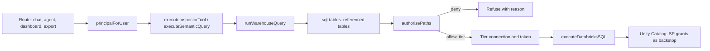

# Data access control: architecture and implementation plan

> **Superseded at runtime on 2026-11-08** by the simplified model ([simplified-access-model.md](simplified-access-model.md)): access rules + protections + groups. Departments, grants, labels and clearance below are kept for history; the request-time check now reads `access_rules`, `access_path_protections` and protections.

Status: **implemented in code** (2026-11-05). Default runtime: `ACCESS_MODE=off` (no enforcement until you enable it). Apply migration `20261105_data_access` before using admin APIs.
Scope: who can see which Databricks data in ALOFT, by department, by catalog / schema / table, with sensitivity labels (Confidential, Restricted) that need an extra clearance even when catalog access is granted.
Method: static reading of the repository on 2026-11-05. No database, Databricks workspace or AWS account was queried. Line numbers refer to the tree on that date.

Related: [data-access-control-design.md](../data-access-control-design.md) (the October proposal). This document keeps its principles (deny by default, one decision point, derived data inherits sensitivity, observe then enforce) and replaces its target model and build plan for the first release. The main differences are listed in §1.3.

---

## 1. What we are building

### 1.1 Agreed requirements

1. **Deny by default.** A signed-in user sees no warehouse data until access is granted.
2. **Departments.** The organisation has many departments (crewing, marine, technical, finance, HR, …). A user belongs to one or more.
3. **Grants on the catalog tree.** Access is granted on a catalog, a schema or a table, to a department or to one user. A grant on a catalog covers its schemas and tables; a grant on a schema covers its tables.
4. **Sensitivity labels.** A steward can label a catalog, schema or table **Confidential** or **Restricted**. A labelled object needs a matching **clearance** in addition to the grant. A catalog grant alone never opens a Confidential table inside it.
5. **Few service principals.** Databricks service principals (SPs) follow the sensitivity tier, not the department. Three query SPs at most.
6. **No confusion with app roles.** App roles (Member, Admin) control features. They never grant data. Data access is managed on its own screens.
7. **Same rules everywhere.** Inspector, saved agents, Automate, dashboards, export, the Data Estate pages and `describe_schema` all apply the same decision.

### 1.2 Deferred (designed for, not built in the first release)

- Company scope (for example DOC as an operating company). Ignored for now.
- Row-level scope (vessel / IMO, fleet, person).
- Column-level labels and masks.
- Per-agent "who may use this agent" grants.

### 1.3 Changes from the October proposal

| October proposal | This design | Why |
|---|---|---|
| Data roles such as `data_viewer`, `analyst`, `analyst_confidential`, `fleet_manager` | **Departments** for scope plus a single **clearance** level for sensitivity | Fewer concepts. "Analyst" roles were being read as "all tables". |
| Department or domain as a tag on data, separate from grants | Mapping a schema to a department **is** a grant to that department | One mechanism instead of two. A schema shared by Marine and Technical is simply two grants. |
| A data tier per role that selects the SP | The **tier is the label of the data being queried**; the SP is chosen per query | A cleared user querying ordinary data still runs on the least-privileged SP. |
| Label inheritance unspecified | Effective label is the **highest label on the path** (catalog, schema, table) | A label can only be raised going down, so a mislabelled table cannot weaken a Confidential schema. |

---

## 2. Current state (verified in code)

### 2.1 How warehouse data is reached today

All live SQL runs as one connection service principal through `getAccessToken(connectionId, workspaceHost)` (`src/lib/databricks/token-client.ts`). The chokepoint `executeDatabricksSQL` (`src/lib/databricks/execute.ts:200`) enforces a read-only verb allowlist and a single-statement rule. It knows nothing about the user.

| Path | Entry | Where the SQL comes from | User identity at execution | Data check today |
|---|---|---|---|---|
| `execute_tool` | Inspector chat, catalog agents, Automate "Try it", workbench test-run, Boost | LLM | **Not passed.** `InspectorToolContext` has no user (`src/lib/inspector/tools.ts:15-22`) | Read-only verbs only |
| Semantic query | `emit_semantic_chart`, dashboards, Teach `verify_claim`, authoring preview | Compiler, from `platform_sem_entities.full_path` (`src/lib/semantic/compiler.ts:296-299`) | Org only; author on preview | Governed or own-draft definitions |
| Dashboard raw-SQL widget | `GET /api/inspector/dashboards/[id]/data` | Saved widget SQL | Viewer | Dashboard role, not data |
| Export | `POST /api/inspector/export` | **Browser request body** (`route.ts:59`) | Session | Session ownership; up to 100,000 rows |
| Connection execute API | `POST /api/databricks/connections/[id]/execute` | Request body | `inspector:use` | Feature permission only |
| Estate column preview | `GET .../context/estate/preview-columns` | Server (`information_schema`) | Session | Login |
| Harvest, inventory, usage, lineage, knowledge samples | `DatabricksAdapter.exec` (`src/lib/context/databricks-adapter.ts`) | Server | Service principal | Pipeline-operator gate on routes |
| Connection test | `src/lib/databricks/test-connection.ts` | `SELECT 1`, direct API call | Admin | Admin only |

### 2.2 How warehouse-derived data is served without a live query

| Artefact | Store | Who can read it today |
|---|---|---|
| Table and column metadata, profiles (`top_k`, min, max, patterns), usage including executor names, lineage | `platform_context_*` | Anyone who can call `describe_schema` (scoped only by `getDefaultOrg()`, `src/lib/context/dispatch.ts:1-3`) or open an estate object page |
| Search over object and column embeddings (column text includes `top_k` values) | `platform_context_embeddings` | Same as above |
| Estate knowledge chunks, optionally with 5 live sample rows | `knowledge_chunks` (`type: DATABASE`) | Not exposed to `search_knowledge` today (`canSee` requires `FILE`, `src/lib/knowledge/access.ts:17`), but stored org-wide |
| Query result snapshots and transcripts | `studio_query_results`, `workbench_sessions` | Owner (fixed in the November security pass) |
| Memory rules learned from sessions | `platform_agent_memory` | Personal, or the whole org after promotion |
| Dashboard widget results | Live response plus in-process cache keyed by connection and query (`src/lib/dashboards/widget-cache.ts:53-55`) | Every viewer of an `org` or `shared` dashboard |

### 2.3 Facts that shape the design

- **Paths are already normalised.** Estate objects store `full_path` as lowercase `catalog.schema.table` (`buildFullPath`, `src/lib/context/types.ts:97-99`). Semantic entities use the same convention. Prefix-based grants fit naturally.
- **No SQL parser exists.** `package.json` has no parsing library, and no code extracts table names from SQL.
- **The allowlist includes discovery verbs.** `READ_ONLY_VERBS` permits `SHOW`, `DESCRIBE`, `DESC`, `EXPLAIN` and `USE` (`execute.ts:59-61`). These reveal or switch scope outside any grant.
- **Identity is available on the routes, but not in the tools.** Chat has `resolveInspectorPrincipal`; agents carry `person.userId`; flows carry `actor.userId`; Boost has none.
- **Feature permissions are loaded fresh per request.** `resolveAuth` reads roles and permissions from the database on every call (`src/middleware/auth.ts`). The JWT carries only a role label, rechecked every 5 minutes (`src/lib/auth.ts`).
- **One org.** Users have no `org_id`; the app runs on `DEFAULT_ORG_ID`. Access tables carry `org_id` for later.
- **Migrations** are dated SQL folders under `prisma/migrations/` (for example `20261027_connections`) applied with `prisma db execute`, with `schema.prisma` edited alongside.

---

## 3. Concepts

Five concepts, each with one job.

| Concept | What it is | What it decides | What it does **not** do |
|---|---|---|---|
| **App role** (exists) | Member, Admin, Platform admin, Read only (`src/lib/rbac.ts`) | Which features and admin screens a person can use. **Changed 2026-11-05:** an app role can also hold data grants, like a department (Member is the baseline for everyone). Grants follow the hierarchy: Member data also applies to Admins; Read only data applies to every role; Platform admin inherits everything mapped to lower roles. Platform admins do not get all data automatically (D3) | A role grant does not open labelled data without clearance |
| **Department** | A named group of people (crewing, marine, …) | Who receives the department's grants | Not a property of a table |
| **Grant** | "This department (or this user) may **discover / query / export** this catalog / schema / table" | Which data is in scope | Does not open labelled data by itself |
| **Label** | Internal (default), Confidential, Restricted, set on a catalog, schema or table | How sensitive the data is | Does not grant anything |
| **Clearance** | A user's highest label: Internal (default), Confidential, Restricted | Whether a labelled object can be used | Does not grant anything |

The service principal is not a concept users manage. It is derived from the label of the data in each query (§9).

### 3.1 Access levels

Levels are ordered; a higher level includes the lower ones.

| Level | Allows |
|---|---|
| `discover` | See that the object exists: name, columns, types, descriptions, relationships |
| `query` | Read rows: `execute_tool`, semantic charts, dashboards, plus stored values such as column profiles (`top_k`, min, max) and sample rows |
| `export` | Download results as CSV |

Column profiles hold real values, so they need `query`, not `discover`.

---

## 4. Decision rules

### 4.1 One object

For a user U, an object at path P (for example `ops_gold.finance.vessel_opex`) and a requested level L:

```text
chain   = [catalog, catalog.schema, catalog.schema.table]      (ancestors of P, and P)
holders = U itself + every department U belongs to

1. If any DENY grant on the chain applies to a holder           -> deny  (explicit_deny)
2. best = highest ALLOW level on the chain for any holder       (expired grants ignored)
   If best < L                                                   -> deny  (no_grant)
3. label = highest label on the chain (default Internal)
   If U.clearance < label                                        -> deny  (needs_clearance)
4. allow, tier = label
```

- **Deny wins anywhere on the chain.** A deny on a schema blocks every table in it, even if a table is granted directly.
- **Grants inherit downward.** A schema grant covers tables added to that schema later (see decision D4).
- **Labels inherit downward and can only rise.** A Confidential schema makes every table in it at least Confidential.
- **Clearance applies to every level, including `discover`.** A user without clearance does not see that a Confidential table exists. This avoids leaking through table names such as `crew_disciplinary_cases` (decision D2).

### 4.2 The case you asked about: Confidential table under a granted catalog

Marine has `query` on catalog `ops_gold`. A steward labels the table `ops_gold.finance.vessel_opex` Confidential.

| User | Departments | Clearance | `ops_gold.marine.inspections` | `ops_gold.finance.vessel_opex` |
|---|---|---|---|---|
| Ana | Marine | Internal | Allowed | **Denied** (`needs_clearance: confidential`). Hidden from `describe_schema` and estate pages |
| Ben | Marine | Confidential | Allowed | Allowed, runs on the Confidential tier |
| Carla | Crewing | Confidential | Denied (`no_grant`) | Denied (`no_grant`). Clearance alone grants nothing |

### 4.3 A query over several tables

Every table referenced by the query must pass the rule. The query's tier is the highest label among them. If one table fails, the whole query is refused, and the reason names only tables the user is allowed to know about.

### 4.4 System principals

Background work is not a user. These principals are created in server code only and can never be built from request input.

| Principal | Used by | Rule |
|---|---|---|
| `system:harvest` | Harvest, inventory, usage, lineage jobs | Its own SP and its configured harvest scope; no user grants |
| `system:knowledge-sync` | Estate knowledge sync | Metadata only; sample rows only for Internal tables |
| `system:benchmark` | Boost runner | An allowlist of test schemas |
| `system:health` | Connection test | `SELECT 1` only |

A service token on the Inspector chat route (`resolveInspectorPrincipal`) must map to a named user principal, or it gets no warehouse access.

---

## 5. Data model

New tables in one migration (`prisma/migrations/2026MMDD_data_access/migration.sql`) plus models in `schema.prisma`. All carry `org_id`.

| Table | Key columns | Notes |
|---|---|---|
| `access_departments` | `id`, `org_id`, `key` (unique per org), `name`, `entra_group_id` (nullable), `archived_at` | `key` examples: `crewing`, `marine` |
| `access_department_members` | PK `(department_id, user_id)`, `source` (`manual` \| `entra`), `added_by`, `added_at` | |
| `access_grants` | `id`, `org_id`, `principal_type` (`user` \| `department` \| `role`; `role` added in `20261106_access_role_grants`, `principal_id` is the role name), `principal_id`, `path` (lowercase `catalog`, `catalog.schema` or `catalog.schema.table`), `path_depth` (1–3), `level` (`discover` \| `query` \| `export`), `effect` (`allow` \| `deny`), `expires_at`, `reason`, `created_by`, `created_at` | Unique on `(principal_type, principal_id, path, effect)`. Index on `path` |
| `access_labels` | `id`, `org_id`, `path`, `path_depth`, `label` (`confidential` \| `restricted`), `reason`, `set_by`, `updated_at` | Unique on `(org_id, path)`. Internal is the absence of a row |
| `access_clearances` | PK `(org_id, user_id)`, `level` (`confidential` \| `restricted`), `reason`, `granted_by`, `expires_at` | Internal is the absence of a row |
| `platform_databricks_credentials` (**built**, §9) | Unique `(connection_id, role)`, `secret_ref`, `warehouse_id`, `status` | One row per service principal role on a connection. Replaces the planned `access_tier_connections` |
| `access_policy_version` | PK `org_id`, `version` (bigint), `updated_at` | Incremented in the same transaction as every change above. Drives cache invalidation (§10) |
| `access_decision_log` | `id`, `ts`, `org_id`, `user_id`, `surface`, `level`, `paths` (text[]), `decision`, `reason`, `mode` (`observe` \| `enforce`), `session_id`, `tier` | High volume; retention job (decision D9) |

Why new tables rather than existing ones:

- `roles` / `permissions` / `user_roles` hold **feature** permissions. Mixing data grants into them is the confusion this design avoids.
- `policy_entry` is untyped JSON with no `org_id` (`schema.prisma:516`). Grants need typed columns, indexes and constraints.
- `platform_context_columns.semantic.pii_flag` is an LLM suggestion. It becomes an input to the steward's labelling queue, not the control.

New feature permissions in `rbac.ts` and `prisma/seed.ts`:

| Permission | Allows | Default holders |
|---|---|---|
| `access:admin` | Departments, members, grants, clearances, tier mapping | Platform admin |
| `access:classify` | Labels | Platform admin; named stewards |
| `access:audit` | Read change and decision logs | Platform admin; security |

**Separation of duties:** nobody can change their own clearance or their own grants. Holding `access:admin` gives no data access by itself.

**Who can use the console (section access, 2026-11-06):** the console APIs check the person's level on Govern → Data access (`src/lib/sections`), not these permission keys: View for reads, Manage for changes. Platform admins have Manage; admins have View; a bundle can give either. See [section-access.md](./section-access.md).

**Labelled data is platform-admin only (2026-11-05):** only a platform admin can widen access to Confidential or Restricted data: an allow grant on a labelled path (or under a labelled parent), raising clearance, lowering or removing a label, or adding a person who already holds clearance to a department that reaches labelled data. Narrowing changes (Block, removing a grant, lowering clearance, raising a label) stay open to every data access admin. Enforced in `src/lib/access/sensitive.ts`.

---

## 6. Enforcement architecture

### 6.1 One module

`src/lib/access/`:

| File | Responsibility |
|---|---|
| `types.ts` | `AccessPrincipal`, `Level`, `Label`, `Decision` |
| `policy-store.ts` | Loads the org's departments, members, grants, labels and clearances into an in-memory snapshot keyed by `access_policy_version` |
| `principal.ts` | `principalForUser(userId)`, `systemPrincipal(kind)` |
| `decide.ts` | The pure function in §4.1. No I/O. All the rule tests target this file |
| `authorize.ts` | `authorizePaths(principal, paths, level, ctx)`, which returns allow with tier, or deny with reason; writes the decision log; honours observe / enforce mode |
| `visibility.ts` | `visibleObjectIds(principal, level)` for Postgres reads (§8.1) |
| `sql-tables.ts` | Extract referenced tables from SQL, failing closed (§7) |
| `warehouse.ts` | `runWarehouseQuery({ principal, statement, purpose, level })`: extract, authorize, pick the tier connection, get the token, execute |

### 6.2 The chokepoint takes a principal

`executeDatabricksSQL` and `beginDatabricksSQLExport` stay as the low-level HTTP layer. Every caller moves to `runWarehouseQuery`, whose `principal` argument is **required by type**. A new call site that forgets identity does not compile. Server jobs pass a `systemPrincipal`. A lint rule (or a test that greps imports) keeps direct calls to the low-level functions inside `src/lib/access/` and `src/lib/context/databricks-adapter.ts`.



### 6.3 Identity threading

`InspectorToolContext` gains a required `principal: AccessPrincipal`. Callers to update:

| Caller | Source of the principal |
|---|---|
| `src/app/api/inspector/chat/route.ts` | `resolveInspectorPrincipal` → user id |
| `src/lib/agents/run-catalog-agent.ts` | `input.person.userId` |
| `src/app/api/agent-lab/flows/agent-try/route.ts` | `flowsRequestContext().actor.userId` |
| `src/app/api/agent-lab/workbench/test-run/route.ts` | Session owner |
| `src/lib/boost/runner.ts` | `systemPrincipal('benchmark')` |
| `src/app/api/inspector/teach/route.ts` (`executeReflectTool`) | Session user |
| `src/lib/context/dispatch.ts` (`handleDescribeSchema`) | New required argument |

### 6.4 Enforcement on each path

| Path | Check | Level |
|---|---|---|
| `execute_tool` | `runWarehouseQuery` on the LLM's SQL | `query` |
| Semantic query (`src/lib/semantic/execute.ts`) | Authorize every entity `full_path` in the join plan before compiling, **and** run the extractor on the compiled SQL. A derived measure expression could contain a sub-query on another table; `compileSafety` only blocks DDL keywords | `query` |
| Dashboard widgets | Authorize **as the viewer**. A denied widget shows "No access"; the rest of the dashboard renders. Authorize before reading the widget cache | `query` |
| Export | Take a server-held `resultId` (`studio_query_results`), not SQL from the browser. Check ownership, then authorize | `export` |
| `POST /api/databricks/connections/[id]/execute` | Restrict to `access:admin`, or remove if unused | n/a |
| `preview-columns`, `row-count`, `scan-coverage` | Authorize the path; pipeline operators keep their gate | `discover` / `query` |
| `describe_schema` (all actions) | Filter by `visibleObjectIds`; `profile`, `usage` and `top_k` need `query` | `discover` / `query` |
| Estate object pages, lists, facets, search, lineage | Same filter. Lineage drops hidden nodes | `discover` / `query` |
| Executor names in usage stats | Shown only to `access:audit` / pipeline operators (privacy) | n/a |
| Agents, Automate | Tools run with the **caller's** principal. A flow runs as its owner, re-authorized at every run; on a denial the run fails and tells the owner | as above |

---

## 7. Raw SQL: knowing which tables a query touches

Authorization on `execute_tool` depends on knowing every table in the LLM's SQL. This is the most delicate piece, so it fails closed.

### 7.1 Contract

`extractTables(sql) → { ok: true, paths: string[] } | { ok: false, reason }`. Any construct it cannot resolve with certainty returns `ok: false`, and the query is refused with a message the model can act on, for example "use fully qualified catalog.schema.table names".

### 7.2 Rules

| Construct | Handling |
|---|---|
| Comments, string literals, backtick identifiers | Stripped or normalised before scanning (the chokepoint already strips them) |
| Three-part names after `FROM`, `JOIN`, comma joins, `LATERAL VIEW`, set operations, sub-queries | Collected and lower-cased |
| CTE names | Excluded from the table set; their bodies are scanned |
| One- or two-part names | Refused; prompts already require fully qualified names (`src/lib/inspector/prompts.ts`) |
| Table-valued functions (`read_files`, `TABLE(...)`, any `name(` in a FROM position), `IDENTIFIER(...)` | Refused unless allowlisted |
| `system.*`, `information_schema`, `samples.*` | Refused for users; `describe_schema` is the discovery tool |
| `SHOW`, `DESCRIBE`, `DESC`, `USE` | Refused for users. `EXPLAIN` is authorized as its inner statement |
| Views | Authorized as their own path. Stewards must label a view at least as high as its sources; harvested lineage suggests labels (§11.3) |

### 7.3 Implementation options (spike in Phase 1)

| Option | Pros | Cons |
|---|---|---|
| **A. Purpose-built tokenizer** for table positions | No dependency; tuned to Databricks SQL; easy to make fail closed | Must be maintained against new syntax |
| B. `node-sql-parser` (Hive/Spark dialects) | Full AST | Databricks syntax coverage unknown; a parse failure on valid SQL means a refusal |
| C. Ask Databricks: `EXPLAIN` and read relations from the plan | Exact, including views | A warehouse round trip on every query; plan text format is not a stable API |

Recommendation: build **A** as the enforcing extractor. In observe mode, run **C** in the background on a sample, and compare to measure A's accuracy before enforcing. The tier service principals (§9) bound the damage of any extractor bypass.

---

## 8. Metadata and derived data

### 8.1 Filtering Postgres reads

Grants are path prefixes, and the org's estate is a bounded list (thousands of objects). `visibleObjectIds(principal, level)` evaluates `decide()` over the org's object paths in memory and caches the result per `(user, policyVersion)`. Queries add `id = ANY($visibleIds)`. This keeps one implementation of the rules: SQL never re-implements inheritance or label logic.

Applies to `listObjects`, `describeObject`, `profileObject`, `searchObjects` (vector and keyword), `relationsObject`, `usageObject` (`src/lib/context/describe.ts`), `getObjectAggregate` (`reads.ts`), estate lists and facets, and lineage APIs. The module-level `sourceMatchCache` (`describe.ts:158`) is keyed by org and connection only. That is acceptable because it resolves connections, not objects; any cache that holds object lists must add the user and policy version to its key.

### 8.2 Derived artefacts

| Artefact | First-release rule | Later |
|---|---|---|
| Estate profiles of Restricted objects | Not stored at harvest: null rate and distinct estimate only | |
| Knowledge sync sample rows | Only for Internal objects | Chunks carry their source path and are filtered by visibility if ever searchable |
| Session transcripts and results | Owner-only (already). A revoked user keeps their own history (decision D7) | |
| Memory rules | Unchanged in the first release | Record the source paths and the highest label; retrieval drops rules about paths the caller cannot query; Confidential-derived rules stay personal |
| Semantic intent embeddings | Filtered by the entity paths of the definition | |
| Dashboard snapshots and caches | Authorize before serving | Add the row-filter fingerprint to the cache key when row scope arrives |
| LLM providers | Unchanged in the first release | Allowed providers per tier; a session that touched Confidential data cannot switch to a non-approved provider |

---

## 9. Service principals per role

**Status: plumbing built 2026-11-05** (`src/lib/databricks/sp-roles.ts`, `token-client.ts`). Until an admin configures a role, it uses the connection's existing service principal, so behaviour is unchanged.

A connection stays one workspace and warehouse. It has a **default credential** (today's SP) and up to six **role credentials**. Every warehouse call names its role. Roles are workloads, never departments.

| Role | Suggested SP name | Used by (code) | Unity Catalog rights (confirm with the UC admin) |
|---|---|---|---|
| `query_internal` | `sp-aloft-query-internal` | Inspector `execute_tool`, semantic queries, raw-SQL dashboard widgets, CSV export, connection SQL console | `SELECT` on everything not labelled Confidential or Restricted. Until labels exist in ALOFT, the same data the current SP reads |
| `query_confidential` | `sp-aloft-query-confidential` | Not routed yet: needs the Phase 1 tier decision | Internal plus Confidential |
| `query_restricted` | `sp-aloft-query-restricted` | Not routed yet | Internal, Confidential and Restricted |
| `metadata` | `sp-aloft-metadata` | Harvest scope and structure (T0, inventory), query history and lineage (T3), estate column preview, scan coverage, pipeline change check | `USE CATALOG`, `USE SCHEMA`, `BROWSE`; `SELECT` on `system_tables.query.query_history` and `system.access.*lineage`. No `SELECT` on business data |
| `profile` | `sp-aloft-profile` | T1 profiles, sample rows, exact row counts (`harvestProfile`, `fetchSampleRows`, `countExactRows`) | `SELECT` on approved schemas, excluding Restricted |
| `publish` | `sp-aloft-publish` | Metric view DDL (`applyMetricViews`), the only write | `CREATE TABLE` (metric views) and `USE` on the target schema only; `SELECT` on the source tables |

How it works:

- **Storage.** Role secrets live at `aloft/databricks/{connectionId}/{role}`; the row in `platform_databricks_credentials` holds only the secret name and an optional `warehouse_id` (cost isolation). Migration: `prisma/migrations/20261105_databricks_sp_roles/migration.sql`.
- **Resolution.** `openDatabricksSession(conn, role)` returns the token and warehouse. Without a role row, the default credential is used and a warning is logged once per connection and role.
- **Lock-down.** `DATABRICKS_SP_REQUIRED_ROLES` (comma list, or `all`) turns fallback into an error for those roles. Set it per role once its SP is tested.
- **Env credentials.** `DATABRICKS_CLIENT_ID` / `_SECRET` still apply to the default credential only. Local dev may set `DATABRICKS_SP_<ROLE>_CLIENT_ID` / `_CLIENT_SECRET`.
- **Admin API** (platform admin): `GET /api/databricks/connections/{id}/credentials`, `PUT` / `DELETE …/credentials/{role}`, `POST …/credentials/{role}/test`. `DELETE` sets `status = disabled` and the role falls back; the secret is kept.
- **The query picks the lowest tier that covers its tables**, not the user's clearance (`queryRoleForTier`). A Restricted-cleared user querying ordinary data runs on `query_internal`. Until Phase 1 decides tiers, every user query is `query_internal`.
- **ALOFT's checks stay the control; role grants are the backstop.** A missing UC grant fails closed with a Databricks permission error.
- **Drift check (not built).** A read-only job compares each role SP's grants (`SHOW GRANTS`) with ALOFT labels and reports differences. Whether the job's identity may run `SHOW GRANTS` on every securable is unverified.

Setup order: see `docs/databricks-auth-and-usage.md` §7.1.

---

## 10. Caching, revocation and performance

- **Policy snapshot.** The org's policy (a few thousand rows at most) lives in memory per app instance, tagged with its version. Each request reads `access_policy_version` (one indexed single-row select). If the version changed, the snapshot reloads. A grant change or revocation therefore applies on the next request on every instance, which meets the October target of 60 seconds.
- **Visible-object cache** per `(user, version)`, bounded LRU.
- **Decision cost.** `decide()` is in-memory: chain length 3, plus the user's departments.
- **Extractor cost.** Linear in SQL length; negligible next to warehouse time.
- **Suspended users** are already blocked by `resolveAuth` and the JWT recheck. The access layer does not duplicate that.

---

## 11. Admin screens and user experience

### 11.1 Admin area "Data access" (separate from Users and Roles)

Under `/agent-staging/access` in the SPA, gated by the permissions in §5.

1. **Departments.** List, members, optional Entra group, member count.
2. **Department → Data.** A tree from the estate (catalog › schema › table) with a level selector (None, Discover, Query, Export) on each node. It shows labels as chips and inheritance ("Query, from schema `marine`"). Mapping a schema to a department is one click here.
3. **Classification.** The same tree with a label per node, bulk set on a catalog or schema, a reason required for every change, and the number of tables affected. A queue shows `pii_flag` suggestions and newly harvested objects.
4. **People.** A user's departments, clearance, direct grants and denies. **Effective access** shows the computed tree. **Why?** on any table shows which grant, deny, label or missing clearance decided it.
5. **Access log.** Denials, observe-mode would-deny entries, and change history.
6. **Service principals** (platform admin). Each role's credential status, test button and the drift report (API built, §9).

Words used in the UI: **App role**, **Department**, **Data access**, **Label**, **Clearance**. Nothing is called a "data role" or "analyst role".

### 11.2 For end users

- **My data access:** what I can query, and why.
- **Inspector and agents:** hidden tables never appear in `describe_schema`. When the model names a table the user cannot use, the tool returns "Table not available to you" without confirming that it exists. The answer tells the user to contact a data access admin.
- **Dashboards:** "No access" tiles instead of errors.

### 11.3 Steward help

- New objects from harvest land in a review queue with their inherited label.
- Lineage suggests labels: a view or table derived from a Confidential source is flagged if it is labelled lower.

---

## 12. Audit and monitoring

- **Every change** (department, member, grant, label, clearance, tier mapping) goes through `writeAudit` (`src/lib/audit.ts`) with before and after values. Today `audit_logs` has no reader; the Access log screen adds one.
- **Every denial** and every allow on Confidential or Restricted data goes to `access_decision_log`. Ordinary Internal allows are not logged by default.
- **Alerts (later):** bursts of denials from one user, exports above a threshold, label downgrades, new connections.

---

## 13. Rollout plan

A switch controls each surface: `ACCESS_MODE=off|observe|enforce`, with `ACCESS_ENFORCE_SURFACES=sql,semantic,dashboard,export,describe,estate`. Observe mode computes and logs decisions but allows the request. This is the pattern already used for `INSPECTOR_AUTH_ENFORCE`.

Sizes are relative (S, M, L), not estimates in days.

| Phase | Scope | Size | Exit criteria |
|---|---|---|---|
| **0. Prerequisites** | Thread a principal through every tool caller (§6.3), no behaviour change; export by `resultId`; restrict the connection execute API; `inspector:use` on the chat and agent routes | M | Every warehouse call site knows its principal; export rejects raw SQL; tests updated |
| **1. Engine and data model** | Migration; `src/lib/access/*`; `decide()` with full unit tests; SQL extractor (option A) with an adversarial test corpus; `runWarehouseQuery`; wire every path in **observe** mode; admin APIs with audit | L | All paths log decisions; extractor accuracy measured against option C on real traffic; no request blocked |
| **2. Admin UI and bootstrap** | Screens in §11.1; create departments and members; map schemas to departments; stewards label Confidential and Restricted objects; grant clearances | M | Observe logs reviewed with stewards for 1–2 weeks; expected-deny list agreed; would-deny rate for legitimate work near zero |
| **3. Enforce on data paths** | Enforce `sql`, `semantic`, `dashboard`, `export` | M | Matrix tests pass (§14); a Marine user cannot read a Confidential table through Inspector, an agent, a dashboard or export |
| **4. Enforce on metadata** | Enforce `describe`, `estate`; lineage and search filtering; executor-name privacy | M | Hidden objects absent from every estate API and from `describe_schema` |
| **5. Role service principals** | **Built 2026-11-05:** role credentials, routing by workload, admin API, fallback and lock-down switch. **Remaining:** create the SPs and UC grants (UC admin); route confidential and restricted tiers from `decide()`; drift check; admin screen | M (plus UC work) | Every role has its own tested SP; `DATABRICKS_SP_REQUIRED_ROLES=all`; drift report clean |
| **6. Derived data and AI** | Memory paths and labels; intent filtering; knowledge sync rules; provider allowlist per tier; flows run-as-owner at run time | M | Derived-data tests pass |
| **7. Columns** | **Redesigned 2026-11-07** (see [pii-protection-backlog.md](pii-protection-backlog.md) §2b, §7): column access by data tag and access group, not clearance; `SELECT *` masks protected columns, other uses are refused; request / approve / audit flow | L | Mask tests and the E10-T4 red-team canary suite pass |

Later, not scheduled: company scope (principal type `company`, label-like company tag), vessel and person row filters (a `conditions` column on grants that binds a table column to a user attribute), per-agent use grants.

### 13.1 Bootstrap without lockout

Today every signed-in user with `inspector:use` reaches all data. In Phase 2, before enforcing, the team must give current users the departments and clearances they need. The observe log produces a list of "who would lose what". Platform admins get data the same way as everyone else, from their app role, their departments, and their own grants (decision D3, changed back 2026-11-06).

---

## 14. Testing

| Test | Proves |
|---|---|
| `decide()` unit and property tests | Deny anywhere on the chain wins; clearance is required for every level; labels only rise; expired grants are ignored; department and user grants combine |
| Extractor corpus | Correct tables for joins, CTEs, sub-queries, unions and backticks; refusal for unqualified names, table functions, `system.*`, `USE`, `SHOW` and `DESCRIBE` |
| Route matrix | For each surface × (granted, ungranted, labelled without clearance): data returned only when allowed; refusals never contain hidden names |
| Dashboard sharing | An org-wide dashboard with a Confidential widget shows "No access" to an uncleared viewer |
| Revocation | A removed grant stops access on the next request, including mid-session and for a scheduled flow |
| Escalation | Nobody can grant themselves clearance; `access:admin` alone returns no data |
| LLM leakage set | Adversarial prompts ("list every table", "query system_tables.query.query_history") never return hidden data |

Tests follow the existing Vitest patterns, for example `src/app/api/__tests__/authz-hardening.test.ts` with the mocked `@/lib/db`.

---

## 15. Risks

| Risk | Mitigation |
|---|---|
| The extractor misses a table reference | Fail closed on anything unrecognised; option C comparison in observe mode; tier SPs as the backstop |
| ALOFT labels and UC grants drift apart | Drift report; one source of truth for labels (decision D1) |
| Lockout of current users at enforcement | Observe mode, a reviewed bootstrap, per-surface switches, fast rollback |
| New sensitive table lands in a granted Internal schema | Review queue for new objects; decision D4 |
| A view hides a Confidential source | Lineage-based label suggestions; stewards label views |
| Performance of estate search with filtering | Cached visible-id set per user and policy version |
| Agents or memory carry data across users | Tools use the caller's principal; memory filtering in Phase 6 |

---

## 16. Decisions needed

| # | Decision | Recommendation |
|---|---|---|
| D1 | Where are labels authored: ALOFT or Unity Catalog tags? | ALOFT for the first release; read UC tags as suggestions; revisit when tier SPs exist |
| D2 | Should a user without clearance see that a labelled table exists? | No, hide it completely |
| D3 | Do platform admins get data access by default? | **No (changed back 2026-11-06).** Platform admins get data like everyone else: from their app role (role grants inherit down the hierarchy), departments, and their own grants, and they need clearance for labelled data. Nobody can grant themselves, so another platform admin gives it. They remain the only people who can open labelled data to others. (2026-11-05 to 2026-11-06 they had all data.) |
| D4 | Do tables added later to a granted schema become visible automatically? | Yes for Internal schemas, with new objects listed in the review queue |
| D5 | Label inheritance | Highest label on the path |
| D6 | Who may use raw SQL (`execute_tool`)? | Anyone with `query`, under the fail-closed extractor; revisit for Restricted |
| D7 | After revocation, can a user still open their own old transcripts? | Yes (they already saw the data); purge only on request |
| D8 | Are department members synced from Entra groups? | Manual in Phase 2; Entra sync once the department list is stable |
| D9 | Retention of `access_decision_log` | 90 days, like `tool_invocation_log` |
| D10 | Who holds Unity Catalog admin rights to create the tier SPs? | Name an owner before Phase 5 |
| D11 | May clearance be given to a whole department? | No in the first release; clearance is per person |

---

## 17. Limits of this document

- Static reading only. Nothing was run, and no database or workspace was queried.
- Unverified: whether the harvester and Inspector share one service principal; whether that principal can read `system.*` tables; the exact UC privilege names for §9.
- Line numbers drift; file paths are the stable reference.
- Legal requirements for crew personal data are not assessed here.
