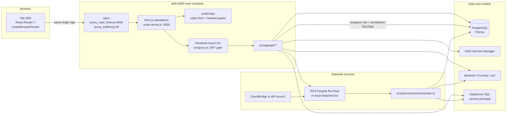
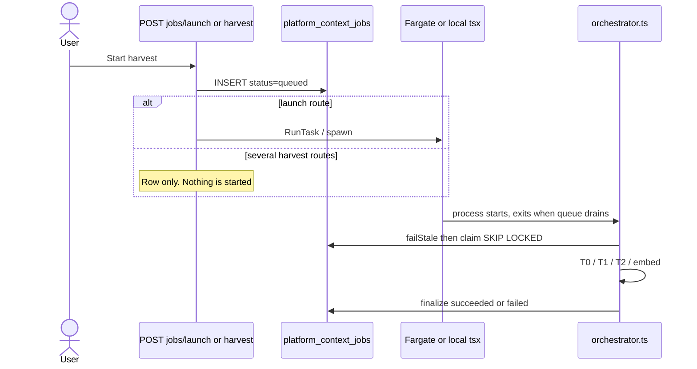
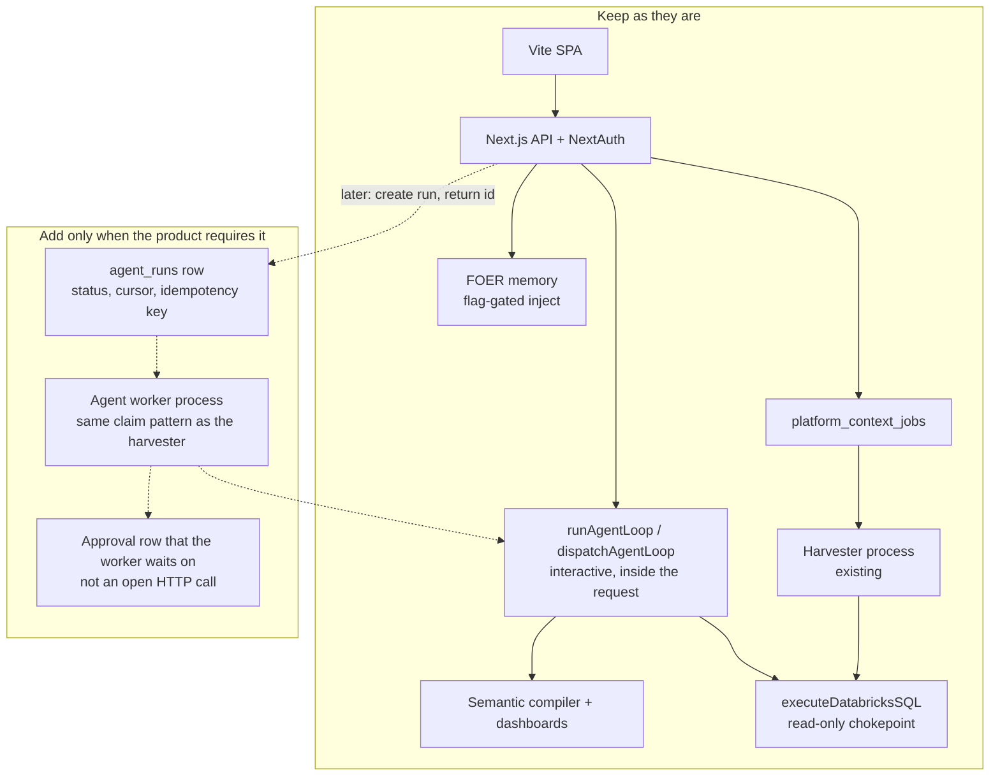

# Business AI Studio — Current-State Architecture Audit

**Date:** 24 October 2026
**Method:** Static reading of this repository. Tests were not executed. No database, AWS account, or live deployment was queried. No application code was changed.
**Repository name in code:** `aloft-d360` (`package.json`). The UI calls itself Data 360 / Agent Lab / ALOFT. “Business AI Studio” does not appear as an implemented product name.

This report separates three things:

1. **Verified** — read in source, with a file and line.
2. **Inference** — a conclusion that follows from that source, but was not observed at runtime.
3. **Unverified** — cannot be proven from the repository (deployment flags, Entra app assignment, which EventBridge rules are actually enabled).

The product vision in the audit brief (multi-agent orchestration, durable autonomous workflows, human approvals that survive a closed browser, organization-wide agent sharing) is **not** the system that runs today. The system that runs is a maritime-specialized data studio: a conversational analyst, a semantic dashboard layer on Databricks, a workbench that saves an agent spec, and a background harvester for warehouse metadata.

---

## Part 1 — Executive Summary

The repository is one application, deployed as two containers.

The browser is a **Vite + React 18 + React Router 7 client-side SPA**. It does not render on the server and it does not use route loaders or actions. In production, the **Next.js 16 standalone server** serves that SPA and owns every `/api/**` route, NextAuth, and Prisma. A second image, **`aloft-context-harvester`**, is a one-shot Node process that claims rows from Postgres and harvests Databricks metadata. It is started by ECS Fargate (`RunTask`) or, in local mode, a detached process. There is no long-lived worker inside the web container, and there is no BullMQ, Redis, Temporal, SQS, or pg-boss in application code.

**What is genuinely operational**

- Sign-in with Microsoft Entra ID (Azure AD) via NextAuth, JWT sessions, and a database role catalogue.
- Inspector: a streamed tool loop (Bedrock Converse, or an OpenAI-compatible path for Azure Foundry, xAI, Bedrock Mantle, and LLM Lite) that can describe schema and run read-only Databricks SQL, then chart results.
- A semantic model compiler that turns governed queries into SQL and feeds dashboards.
- A workbench that drafts an agent and commissions it into `agent_catalog`, plus a thinner `PlatformAgent` row.
- Data Estate: inventory, profiling, semantic enrichment, and embeddings, queued as `platform_context_jobs` and executed by the harvester.
- FOER operating memory: traces during Inspector chat, a manual synthesis sweep, and prompt injection that is off unless environment flags are set.
- Turn-level observability for Inspector and workbench chat (`agent_turn_log`, `agent_loop_log`, sampled `tool_invocation_log`, `agent_cost_log` on Inspector).

**What the schema suggests but the code does not run**

- Multi-agent pipelines (`agent_lab_pipeline_defs` / `runs` / `messages`): no TypeScript callers.
- Platform agent run history (`PlatformAgentRun`): no `create` or `update` anywhere in the repo.
- Human approval tables (`human_decision_requests`, `hitl_interrupt`): no references under `src/`.
- Policy rows (`policy_entry`): CRUD API only. Nothing in the agent loop reads them.
- Platform eval execution: `POST /api/agent-lab/ops/evals` inserts a row with `status: 'queued'` and returns a note to use Performance Lab. It does not run cases.
- Nightly memory DAG (`runDag` in `src/lib/memory/orchestrate.ts`): defined, never called from a route or script in this repo.
- Several harvest kinds (`mapping`, `knowledge_sync`, `t3_connected`, T4) are declared and then skipped or failed inside the orchestrator.

**The architectural verdict in one paragraph**

The current shape is a sound modular monolith for a request-scoped analyst and a separate metadata harvester. It is not a durable agent runtime. Chat dies with the HTTP request. Authorization is a JWT presence check at the edge, with role and ownership enforced only on some routes, and every first-time Entra user is created as `admin`. Those are the problems to fix. Replacing Next.js with Hono, or introducing Temporal, would not fix them and would put the working Inspector, semantic layer, and harvester at risk.

---

## Part 2 — Existing Technology Stack

Verified from manifests, config, and imports. Versions are the ranges or pins in the root `package.json` unless noted.

### Frontend

| Technology | Where | Role |
|---|---|---|
| Vite  (via `@vitejs/plugin-react` ^4.7) | `web/vite.config.ts` | Dev server on port 3000; production build under `/spa/` |
| React 18.2 | root `package.json` | UI |
| React Router 7.18.4 | `web/src/router.tsx` | `createBrowserRouter`. Client-side only |
| Tailwind 3.4 | `tailwind.config.js`, PostCSS at repo root | Styling. Vite points `css.postcss` at the repo root |
| next-auth/react 4.24 | `web/src/RequireAuth.tsx` | Session hook in the SPA. Cookies stay first-party because Vite proxies `/api` |
| Zustand 4.5 | dashboard builder and metrics catalog stores | Local UI state, not app-wide |
| TanStack Query 5 | FOER memory panels only | Each panel creates its own `QueryClient`. There is no app-wide provider |
| ECharts 6, Recharts 2, xyflow, react-grid-layout | dashboards, lineage, estate | Charts and graphs |
| Framer Motion, Phosphor, Lucide | shell and pages | Motion and icons |

There are **no** `src/app/**/page.tsx` files. Next.js is not rendering pages.

### Backend / API

| Technology | Where | Role |
|---|---|---|
| Next.js ^16.4.2, `output: "standalone"` | `next.config.ts` | API, auth, and static hosting of the SPA |
| Route handlers | `src/app/api/**/route.ts` (about 158 handlers) | The HTTP API |
| NextAuth 4, Azure AD provider only | `src/lib/auth.ts`, `src/app/api/auth/[...nextauth]/route.ts` | No credentials provider is wired, despite `passwordHash` on `User` |
| Edge gate | `src/proxy.ts` | Next 16’s replacement for `middleware.ts`. JWT presence only |
| Zod 3.25 | scattered libs | Not a uniform request-contract layer |
| No Hono, Fastify, tRPC, or OpenAPI generator | — | Confirmed by search of `src/` and `package.json` |

`export const maxDuration` is set on long routes (Inspector chat 300s, Boost suite 600s). On this deployment that value is a hint: the process is `node server.js` in Docker, and nginx is configured for 600s read/send timeouts with buffering off (`infra/beanstalk/.platform/nginx/conf.d/timeouts.conf`). A platform kill at exactly `maxDuration` was not verified outside Vercel-style hosting.

### Data

| Technology | Where | Role |
|---|---|---|
| PostgreSQL via Prisma 5.22 | `prisma/schema.prisma` | `DATABASE_URL` + `DIRECT_URL`, `vector` extension |
| ~120 Prisma models | same file, `User` through `agent_loop_log` | Mixed live tables and unused legacy tables |
| Databricks SQL Statement API | `src/lib/databricks/execute.ts` | Read-only verb allowlist, row cap, service-principal OAuth (`all-apis`) |
| AWS Secrets Manager | `src/lib/databricks/secrets.ts` | `{ client_id, client_secret }` at `aloft/databricks/{connectionId}` |

### AI providers

| Path | Code | Used for |
|---|---|---|
| Bedrock `ConverseStream` | `src/lib/inspector/agent-loop.ts` | Default tool loop when `apiType` is not `foundry` |
| OpenAI-compatible Chat Completions and xAI Responses | `src/lib/inspector/providers/foundry-chat.ts` | Azure Foundry, LLM Lite, Bedrock Mantle, direct xAI |
| Dispatch | `src/lib/inspector/providers/factory.ts` | `foundry` → Foundry loop, else Bedrock loop |
| Titan / Azure embeddings | `src/lib/azure/embed-client.ts` | Estate and memory embeddings |
| Model catalogue | `src/lib/boost/models.ts` | Picker entries, not a cost-based router |

There is no separate `openai.ts` provider module. The `openai` npm package is used from the Foundry/xAI client path.

### Background work

| Mechanism | What it is |
|---|---|
| `platform_context_jobs` | The only queue. Rows, not a broker |
| `scripts/context/orchestrator.ts` | Claims with `FOR UPDATE SKIP LOCKED`, runs a tier, finalizes |
| ECS `RunTask` | `src/lib/context/launch-harvester.ts`. Default when `HARVEST_RUNTIME` is not `local` |
| EventBridge rule document | `infra/context/eventbridge-rule.json`. Shape of intended schedules. Not proof they are deployed |
| In-request `void` / `.catch` | Logging and side effects still tied to the request. No Next.js `after()` or `waitUntil` in `src/` |

### Delivery

| Piece | Evidence |
|---|---|
| Web image | `Dockerfile` → `CMD ["node", "server.js"]`, port 3000, user `nextjs` |
| Harvester image | `Dockerfile.harvester` (referenced by CI; command matches `HARVEST_ORCHESTRATOR_COMMAND`) |
| CI | `.github/workflows/ecr-push.yml` builds both images, pushes to ECR in `ap-south-1`, deploys the web image to Elastic Beanstalk on `main`. **The workflow does not run tests, typecheck, or lint** |
| Local dev | `npm run dev` → `web/dev-all.mjs`: Next on 3001, Vite on 3000, proxy `/api` |

### Dependencies that are leftovers relative to the current UI

Still in the root manifest and still used on the server or in shared UI: `next`, `next-auth`, `server-only`, Prisma, AWS SDK, `pg`. `next-themes` is a dependency; theme application in the SPA goes through `src/components/providers/ThemeProvider.tsx` and a boot script, not through Next’s font or metadata pipeline. The root `README.md` is still the create-next-app template and describes `app/page.tsx`, which does not exist. `web/README.md` is the accurate entry point.

`PlatformOrg` still has a `clerk_org_id` lookup helper (`src/lib/platform/agents.ts` lines 67–75). No Clerk SDK is a runtime dependency of the current sign-in path. Treat that helper as a previous-auth leftover.

---

## Part 3 — Repository and Module Inventory

### Top level

| Path | What it is | Completeness |
|---|---|---|
| `web/` | Vite app: `main.tsx`, `router.tsx`, `RequireAuth`, route adapters, compat shims, e2e smoke | The live UI shell. Complete for current routes |
| `src/views/` | Page components, lazy-loaded by the router | Live UI |
| `src/components/` | Inspector, estate, workbench, teach, memory, shell | Live UI, large |
| `src/app/api/` | HTTP API | Live. Uneven auth inside handlers |
| `src/lib/` | Domain logic. See below | Mixed: several modules are the product; several are unused |
| `src/proxy.ts` | API login gate | Live, narrow |
| `prisma/` | Schema, a handful of SQL migrations, seed | Schema is ahead of the code |
| `scripts/context/` | Harvester orchestrator | Live for T0–T3/embed/estate inventory; several kinds are stubs |
| `packages/aloft-shared/` | Shared UI primitives (Radix) built with tsup | Used via Vite alias and Next transpile |
| `infra/` | Beanstalk Docker, nginx timeouts, EventBridge JSON, IAM examples | Deploy descriptors. Live status of AWS resources is unverified |
| `docs/` | Design notes, migration notes, this audit | Uneven. Root README is stale |

### `src/lib` — what each area actually does

| Folder | Purpose | Runtime status |
|---|---|---|
| `inspector` | Tool loop, prompts, SQL tools, teach, chart pipeline, session knowledge | **Live.** The main agent runtime |
| `construction` | Workbench draft schema, builder tools, commission sync | **Live** for drafting and saving an agent |
| `semantic` | Compile semantic queries to SQL, execute, drafts, promotion, lineage | **Live** for query and dashboards. `applyMetricViews` has no caller |
| `dashboards` | Widget specs, preview, permissions, raw SQL charts | **Live** |
| `databricks` | Connections, Secrets Manager, read-only execute, CSV export | **Live** |
| `context` | Estate harvest, queue, enrich, embeddings, mappings | **Live** for structural/profile/semantic tiers. Several job kinds are not |
| `memory` | Trace capture, synthesis, retrieve/inject, teach, reputation | **Partial.** Capture is on the Inspector path. Injection and the nightly DAG are flag- or caller-gated |
| `foer` | Stats and topic clustering for the memory UI | **Live** as read models over memory tables |
| `agent-ops` | Turn metrics, tool-log sampling, redaction, session cockpit | **Live** for Inspector and workbench chat |
| `lifecycle` | Token-cost table and bandit score writes | **Live** from Inspector and Boost |
| `boost` | Fixed benchmark suite and runner | **Live**, but it is a benchmark, not production traffic |
| `marcus` | Reflection prompts and a DAL | **Partial.** Inspector reflection is behind `MARCUS_REFLECT_ENABLED` |
| `bandits` | Scoring math for the model-comparison page | **Live** as analytics over `bandit_observations` |
| `platform` | `PlatformAgent` CRUD and `getDefaultOrg()` | **Partial.** Agents are created at commission. Runs are never written |
| `studio` | Chart DSL, profiler, ECharts theme | **Live** inside Inspector charting |
| `llmlite` / `bedrock` | Model lists and a small Mantle client for side calls | **Live** as a picker and for short completions |
| `rbac` + `src/middleware/auth.ts` | Provisioning, permissions, bearer verification | **Live**, with the default-role problem in Part 9 |
| `agent-lab` | Zod drafts for catalog artifacts | Not the commission path |
| `knowledge` | Chunk and embed helpers | Used by estate knowledge sync |
| `navigation` | `useRouter` / `Link` shaped like Next, implemented on React Router | **Live.** The UI must not import `next/navigation` |

Two different `getDefaultOrg` functions exist:

- Async, by slug: `src/lib/platform/agents.ts` lines 78–89 (`DEFAULT_ORG_SLUG`).
- Sync, by id: `src/lib/org.ts` lines 4–12 (`DEFAULT_ORG_ID`).

Both are process-wide. Neither reads the signed-in user. The file comment in `agents.ts` says org will come from session membership when multi-tenant auth exists. That has not been built.

---

## Part 4 — Current Architecture

### How a request is served



Dev differs only in process layout: Vite listens on `:3000` and proxies `/api` to Next on `:3001` (`web/vite.config.ts` lines 47–101). Production collapses UI and API into one origin via rewrites in `next.config.ts` lines 14–22: every non-API, non-file path serves `/spa/index.html`.

### Frontend shape

- Entry: `web/src/main.tsx` creates one `createBrowserRouter(routes)` and renders `RouterProvider`. No SSR, no loaders, no actions.
- Providers: `web/src/RootLayout.tsx` wraps theme and `SessionProvider`.
- Auth UX: `web/src/RequireAuth.tsx` redirects to `/login` when `useSession()` is unauthenticated. The file’s own comment says this is a UX guard; data protection is server-side.
- Routes: `web/src/router.tsx`. Pages live in `src/views/**` and are `React.lazy`. A few former server components are adapters in `web/src/routes/adapters.tsx` that call `useParams()` or `useJson()` against JSON APIs.
- Server communication: `fetch` to same-origin `/api`. Inspector chat uses SSE (`src/hooks/useInspectorChat.ts`). There is no shared API client, no tRPC, and no generated types. The dashboard adapter imports the `DashboardSummary` type from `src/lib/dashboard/summary.ts`, which also imports Prisma. Whether that value import is tree-shaken out of the client bundle is guarded by `npm run web:check-bundle` (Prisma, AWS SDK, bcrypt). That check was not run for this audit.
- State: mostly component state plus session. Zustand is limited to the dashboard builder and metrics catalog. React Query is local to FOER screens.

### Backend shape

This is a **modular monolith behind one HTTP server**, plus **one specialized worker program**. It is not a microservice mesh, and it is not “Next.js pages with a little API.”

A typical API call:

1. `src/proxy.ts` lines 16–21: `getToken` against `NEXTAUTH_SECRET`. Missing token → JSON 401. Matcher excludes `/api/auth/*` and `/api/health`.
2. The route handler runs in the Node server. Some handlers call `getServerSession`, `resolveAuth`, or `getAgentOpsAuth`. Many do not, and rely on step 1 alone.
3. Domain code in `src/lib/**` uses Prisma (`src/lib/db` or `src/lib/prisma` — both exist) and external clients.
4. The handler returns JSON or an SSE `ReadableStream`.

Service boundaries are folders, not processes. Inspector, semantic, dashboards, and construction import each other directly. That is appropriate at this size. The harvester is the only real process boundary, and it imports the same `src/lib/context` modules.

### Representative flow — Inspector question

```mermaid
sequenceDiagram
  actor User
  participant UI as InspectorShell
  participant API as POST /api/inspector/chat
  participant Loop as runAgentLoop or dispatchAgentLoop
  participant Model as Bedrock or Foundry/xAI
  participant SQL as executeDatabricksSQL
  participant DB as Postgres

  User->>UI: Send message
  UI->>API: SSE POST sessionId, messages, model
  Note over API: guardInspectorChat<br/>observe mode unless INSPECTOR_AUTH_ENFORCE=true
  API->>DB: optional memory select, semantic context
  API->>Loop: inside the same request, maxDuration 300
  loop up to max loops
    Loop->>Model: stream
    Model-->>Loop: text and tool calls
    Loop->>SQL: describe_schema / execute_tool
    SQL-->>Loop: rows capped
    Loop-->>UI: SSE text, tool, query_result
  end
  API->>DB: agent_turn_log, agent_loop_log, cost, bandit
  Note over UI: Client PATCHes workbench_sessions.messages
  API-->>UI: SSE done
```

The chat route does not write the transcript itself. The client autosaves. If the browser dies after the model has run tools but before that PATCH, the database can hold tool logs and a turn row without the transcript the user sees.

### Representative flow — estate harvest



A web-container restart does not stop a Fargate task that has already started. A queued row that nobody launched stays queued. A worker that dies mid-run stays `running` until a later orchestrator calls `failStale` (30 minutes without `updated_at` refresh) and marks it `failed`. `failStale` does not requeue (`src/lib/context/queue.ts` lines 286–304).

---

## Part 5 — Current Feature Implementation Matrix

Status words match the audit brief. “Verified” here means the code path exists and is wired. It does not mean a test run or a production click-through was performed for this audit. Where a path is wired but this audit did not execute it, the status is **Implemented but not verified**.

| Feature / Module | Current implementation | Status | Evidence | Problems / Gaps |
|---|---|---|---|---|
| SPA shell, routing, theme | Vite + React Router 7, lazy views, boot script for theme | Implemented but not verified | `web/src/main.tsx`, `web/src/router.tsx`, `web/vite.config.ts` | Root README still describes Next pages |
| Entra ID sign-in | NextAuth Azure AD, JWT 8h, user provisioned in Postgres | Implemented but not verified | `src/lib/auth.ts`, `src/lib/rbac.ts` | New users receive `admin` (`rbac.ts` line 19). JWT role is not refreshed on ordinary requests. Live Entra assignment is unverified |
| Page login gate | Client redirect | Implemented but not verified | `web/src/RequireAuth.tsx` | Shell HTML is public. Data must be protected by the API, and not all routes do more than check the cookie |
| API login gate | JWT required except auth and health | Implemented but not verified | `src/proxy.ts` lines 16–26 | Does not check role, suspension, or org |
| RBAC catalogue | Roles, permissions, user-role join, audit on user admin | Implemented but not verified | `src/lib/rbac.ts`, `prisma/seed.ts`, `src/app/api/users` | Enforced on user admin routes. Not enforced on policies, catalog writes, session read, or SQL |
| Inspector chat | SSE tool loop, schema + SQL + charts | Implemented but not verified | `src/app/api/inspector/chat/route.ts`, `src/lib/inspector/agent-loop.ts` | In-request only. Ownership check is observe-by-default |
| Model picker | Bedrock, Foundry, xAI, Mantle, LLM Lite | Implemented but not verified | `src/lib/boost/models.ts`, `src/lib/inspector/providers/factory.ts` | Selection is the user’s pick, not cost or policy routing |
| Databricks read-only SQL | Verb allowlist, single statement, row cap | Implemented but not verified | `src/lib/databricks/execute.ts` lines 59–149 | Any signed-in user can run it as the warehouse service principal. `USE` and `EXPLAIN` are allowlisted |
| Semantic models and dashboards | Compile, execute, drafts, promotion, viewer, builder | Implemented but not verified | `src/lib/semantic/compiler.ts`, dashboard routes | Metric-view DDL applier has no caller. Scheduled freshness is treated as live |
| Workbench / agent builder | Construction state, builder tools, readiness | Implemented but not verified | `src/app/api/agent-lab/workbench/chat/route.ts` | No operating-memory injection. Session GET/PATCH has no owner check |
| Commissioned agents | Catalog row + `PlatformAgent`, then a reduced tool loop | Implemented but not verified | `src/app/api/agent-lab/workbench/commission/route.ts`, `agents/chat/route.ts` | Chat uses catalog instructions, not `PlatformAgent`. No run row. Tools limited to `describe_schema` and `execute_tool` |
| Agent templates / fork | Catalog fork and review routes | Partially implemented | `src/app/api/catalog/agents` | Fork accepts `owner_id` from the body and does not check the session |
| Teach / Reflect | Separate Bedrock loop and candidate store | Partially implemented | `src/app/api/inspector/teach/route.ts` | No turn metrics, no cost log, Bedrock only |
| FOER memory | Traces, bullets, retrieve, UI | Partially implemented | `src/lib/memory/retrieve.ts`, Inspector chat lines 239–310 | Injection off unless `MEMORY_INJECT_ENABLED` and class allowlist. Compression unused. Nightly DAG unused |
| Memory synthesis | Sweep reconstructs sessions and writes bullets | Partially implemented | `POST /api/agent-lab/memory/synthesize`, `src/lib/memory/run-sweep.ts` | Manual, capped (20 sessions in the route). Not scheduled from this repo |
| Data Estate harvest | Queue + Fargate/local orchestrator for T0–T2, embed, inventory, parts of T3 | Implemented but not verified | `src/lib/context/queue.ts`, `scripts/context/orchestrator.ts` | See Part 6. Some kinds finalize as success while doing nothing |
| Estate UI | Catalog, entities, jobs, lineage, mapper, silo, object | Implemented but not verified | `web/src/router.tsx` estate children | Job UI can show queued work that no worker will pick up |
| Boost / Performance Lab | Benchmark cases through the same loop | Implemented but not verified | `src/lib/boost/runner.ts` | Not a gate on production agents. Any signed-in user can dispatch |
| Platform evals | List suites; POST inserts `queued` | Scaffold / placeholder | `src/app/api/agent-lab/ops/evals/route.ts` lines 36–46 | Does not execute |
| `agent_eval_run` / golden sets | Tables | Not found as a runtime | `prisma/schema.prisma` models `agent_eval_*`, `agent_lab_golden_sets` | Read only by the audit-log dump, if at all |
| Multi-agent pipelines | Tables with sender/receiver | Not found as a runtime | `agent_lab_pipeline_*`, `agent_lab_messages` | No `.ts` usage |
| Human approval during a run | Tables `human_decision_requests`, `hitl_interrupt` | Not found as a runtime | schema only; no `src/` references | Semantic promotion is a separate admin gate and is implemented |
| Policy engine | `policy_entry` CRUD | Scaffold / placeholder | `src/app/api/policies/route.ts` | Never consulted by tools or the loop. Any JWT can create and edit |
| Goal / progress memory as a product | Session knowledge and construction readiness | Partially implemented | Inspector session-knowledge helpers, workbench `readiness` | Not a durable goal graph that survives a run |
| Cost tracking | Static price table, `agent_cost_log` on Inspector | Partially implemented | `src/lib/lifecycle/log-agent-cost.ts` | Workbench, teach, and agent-use chat do not write it |
| Prompt versioning | `prompt_catalog` snapshot on some catalog PATCHes | Partially implemented | `src/lib/prompt-snapshot.ts` | Commission writes `config.systemPrompt` and does not snapshot. `prompt_templates` are not read by loops |
| Bandits / model comparison | Observations and a UI | Partially implemented | `bandit_observations`, bandits view | Backfill traces are read; this repo does not write `backfill_*` |
| Marcus reflections | DAL + optional Inspector hook | Partially implemented | `src/lib/marcus/` | Off unless `MARCUS_REFLECT_ENABLED=true` |
| Self-improvement loop | Reputation, teach candidates, synthesis | Partially implemented | memory + semantic promotion | No closed loop that edits a production agent from eval scores |
| Org / tenant isolation | One org from env | Partially implemented | `getDefaultOrg` in `agents.ts` and `org.ts` | Not per user. Several queries omit even that filter |
| Background agent workers | None for chat. Harvester only for estate jobs | Implemented but not verified for harvest; Not found for agents | `launch-harvester.ts` | See Part 6 and Part 12 |
| Sharing agents across an organization | Catalog list is global to the database | Partially implemented | `src/app/api/catalog/agents/route.ts` | No tenant boundary and weak write checks |
| Audit trail | `AuditLog` on user admin; semantic audit; tool logs | Partially implemented | `src/lib/audit.ts`, `log-tool-invocation.ts` | Tool success can be sampled away. Login events do not store IP or user agent. `promotion_audit_log` unused |
| CI quality gate | ECR build and Beanstalk deploy | Partially implemented | `.github/workflows/ecr-push.yml` | No test, lint, or typecheck step |
| Tests | ~82 Vitest files, heavy on dashboards, semantic, teach, navigation | Partially implemented | `src/**/__tests__`, `web/src/**/*.test.*` | Not executed for this audit. Agent loop, authz, and queue have little direct coverage relative to their risk |

---

## Part 6 — Agent Execution Deep Dive

### Where execution begins

There is no single “start agent” service. These HTTP handlers are the runtimes:

| Entry | Loop | Persists a run record? |
|---|---|---|
| `POST /api/inspector/chat` | `runAgentLoop` or `dispatchAgentLoop` | Turn and loop logs, cost, tool samples. Not `PlatformAgentRun` |
| `POST /api/agent-lab/workbench/chat` | Same | Turn logs and `construction_state`. No cost log |
| `POST /api/agent-lab/agents/chat` | Same, two tools, 8 loops | Tool samples and `last_activity` only |
| `POST /api/agent-lab/workbench/test-run` | Read-only tools | `construction_state.validation.lastTestRun` |
| `POST /api/inspector/teach` | Bedrock `runAgentLoop` only | Teach candidate store via tools. No turn log |
| Blueprint propose / refine | Short Bedrock loop, JSON not SSE | Draft fields |
| `POST /api/inspector/boost/dispatch` and `run-suite` | `runBenchmarkCase` → `dispatchAgentLoop` | `platform_boost_runs` |
| `POST /api/agent-lab/workbench/commission` | No model call | Inserts catalog + `PlatformAgent` |

The controlling functions are `runAgentLoop` (`src/lib/inspector/agent-loop.ts` line 120) and `dispatchAgentLoop` (`src/lib/inspector/providers/factory.ts` lines 6–13). Tools are injected by the route. The loop does not know about HTTP, orgs, or permissions.

### Answers to the sixteen execution questions

1. **Where does execution begin?** In the route handler that builds messages and calls the loop. Inspector is `src/app/api/inspector/chat/route.ts` `POST` (line 165). A saved agent begins at `src/app/api/agent-lab/agents/chat/route.ts` `POST` (line 52).

2. **What controls execution?** The route, then the while-loop in `runAgentLoop` (line 158: `while (loopCount < maxLoops && !(abortSignal?.value))`). Tool choice is the model’s. Tool implementation is `executeInspectorTool` or the workbench builder tools.

3. **Does execution happen inside an HTTP request?** Yes. The loop runs inside `ReadableStream.start` for SSE routes, or inline for Boost and blueprint. `maxDuration` is 300 on the chat routes (Inspector chat line 52, agent chat line 17).

4. **Can an agent continue after the HTTP response?** No. There is no `after()`, `waitUntil`, or job row for a chat turn. When the stream closes, the turn is over. Fire-and-forget Prisma calls in that handler are logging, not a continuation of the loop.

5. **Can it continue if the user closes the browser?** No. `request.signal` sets `closed.value` and the loop treats that as abort (Inspector chat lines 317–320; agent chat lines 117–119). An in-flight tool call is not passed an `AbortSignal`, so the current tool may finish, and then the loop stops. Inference: the Node process may still be inside `await executeTool` briefly after the client is gone. It will not start another model turn once `abortSignal.value` is seen.

6. **What happens when the API server restarts?** The in-flight request dies. Partial SSE is lost. A turn row is written only if `flush` ran. Nothing resumes the turn. A Fargate harvest that already started keeps running, because it is another process. A local detached harvester is not tied to the request (`launch-harvester.ts`); whether a Windows `shell: true` child dies with the parent is not handled in code.

7. **What happens if a tool fails halfway?** The Foundry path catches tool errors and feeds them back to the model. The Bedrock path records `tool_call_error` and also continues the conversation with the error payload; it does not retry the tool. There is no compensating transaction. Databricks statements that already ran stay run. A later tool in the same parallel batch is independent (`Promise.all` in the Bedrock loop).

8. **Are agent runs persisted?** Not as a first-class run. `PlatformAgentRun` and `agent_run_log` have schema and readers (`_count`, audit log) and **no writers** in this repo (search for `platformAgentRun.create` / `agent_run_log.create` returned nothing). What is persisted for Inspector is `agent_turn_log` + `agent_loop_log` via `TurnMetricsRecorder`, plus optional tool and cost rows.

9. **Are progress and intermediate results persisted?** Tool events go to the SSE client. Query rows are not stored as the run’s checkpoint. The client later PATCHes `workbench_sessions.messages`. Loop metrics are written at the end of the turn, not after each tool, so a crash mid-turn loses the in-memory trajectory.

10. **Are retries supported?** A failed Bedrock call on Inspector and workbench can start a second full loop on Grok when xAI credentials exist. That is a provider fallback, not an idempotent retry. Tools are not retried. `retryable` is only a flag on the error event.

11. **Pause, resume, cancel?** Cancel is client abort only. There is no pause or resume API and no persisted loop cursor.

12. **Can an agent wait for approval without holding HTTP?** No. The HITL tables are unused. Semantic promotion is a human clicking a different route, not a suspended agent.

13. **Can multiple agents execute concurrently?** Yes, as concurrent HTTP requests. Nothing serializes them. Boost’s suite route runs cases one after another to avoid throttling; that limit is local to the benchmark.

14. **Are concurrency and resource limits enforced?** Per turn: `maxLoops` (Inspector default from `getInspectorMaxLoops()`, clamped in code; agent-use hardcodes 8), `maxTokens: 4096` on the Bedrock command (`agent-loop.ts` lines 173–175), and Databricks row caps. There is no per-user or per-org in-flight limit, no queue, and no budget check against `budget_config` on the chat path (that model was not found referenced from the loop).

15. **Queues, workers, workflow engines?** For **chat: none.** For **estate metadata: yes**, the Postgres job table and one-shot harvester described above. That machinery does not run agent conversations. `runDag` for memory is unused. EventBridge JSON targets the harvester, not an agent runner.

16. **Duplicate execution and repeated external actions?** Chat has no idempotency key. A double-submitted message runs the tools twice. Harvest claiming is safe against two orchestrators taking the same top-level row (`FOR UPDATE SKIP LOCKED` in `queue.ts`). It is not safe against two `--child-job` tasks launched for the same id before the row flips to `running`. `enqueue` has no unique key on kind + scope, so sweeps can insert duplicates.

17. **Are permissions rechecked at execution time?** The loop does not recheck role or tool ACL. `executeInspectorTool` resolves `tool_catalog` and uses `config.connection_id` (`src/lib/inspector/tools.ts`). The SQL chokepoint rechecks the verb allowlist on every statement, which is the real safety control. It does not recheck `inspector:use`, the user’s role, or an agent-specific tool grant. `policy_entry` is not loaded.

18. **Failures, timeouts, recovery?** Model errors become SSE `error` and outcome `errored`. Foundry tool calls have a timeout (`FOUNDRY_TOOL_TIMEOUT_MS`, default 45s in `foundry-chat.ts`). Databricks interactive calls are capped; export polling is separately budgeted under the route limit. There is no recovery that restarts a turn from the last successful tool. Harvest recovery is `failStale` → `failed`, then a human `retry-failed` or `kick` for some shapes only.

### Is this suitable for long-running agents?

For the product that exists — a person chatting with an analyst for one turn of a few model/tool rounds — yes, with the 300s nginx budget. For the vision — agents that keep working after the browser closes, wait for approval, or run for hours — no. The missing pieces are a persisted run, a process that is not the HTTP handler, and a way to resume. Those do not exist for chat.

### Do we need separate workers now?

**For Inspector, workbench, and commissioned-agent chat: no.** A worker would not make the current UX better, and it would complicate SSE.

**For estate harvest: the worker already exists** and should stay a separate process. The web container correctly does not poll jobs (`Dockerfile` line 38 is only `node server.js`). The work now is to make launch, claim, and failure consistent, not to add a second queue product.

**For a future long-running agent: a worker becomes necessary at the moment a run must outlive the request.** Not before.

### Comparison, grounded in what is already here

| Approach | Fit |
|---|---|
| Keep request-scoped loops. Fix auth, ownership, and harvest reliability | Matches the code that works. Solves the actual defects. Does not deliver unattended agents |
| Dedicated Node worker, same pattern as the harvester: Postgres row, `SKIP LOCKED`, one-shot or small pool | The smallest design that can run an agent after HTTP returns. Reuses a pattern this repo already operates. No new infrastructure |
| BullMQ + Redis | Adds a broker the repo does not have. The durability you need is already the database. A second source of truth for “is this run queued?” is a new failure mode |
| Temporal | Justified for long-lived sagas with timers, signals, and exactly-once activities across many services. This codebase is one monolith plus one harvester. Temporal would be a new operational platform to solve a problem the current product does not yet have |
| “Just move the loop into Hono” | Same process, same request lifetime. No durability gain |

**Recommendation:** stay on the request-scoped loop for interactive chat. Harden the existing harvest worker. When product requirements include unattended or approval-gated runs, add an `agent_runs` table and a Node worker cloned from the harvester’s claim/finalize style. Do not introduce Redis or Temporal first.

---

## Part 7 — Backend Architecture Assessment

### What the backend actually is

Next.js is used as a standalone API server that also serves static files. From the browser’s point of view the split the brief describes has already happened: the UI is Vite, the API is `/api`. The coupling that remains is deployment (one image, one origin, NextAuth cookies) and the TypeScript path alias (`@/` → `src/`), which lets the SPA import modules that were written for the server. A bundle check script exists specifically because that alias can leak server code.

### Evaluation

**Routing.** File-system routes under `src/app/api`. About 158 handlers. Naming follows product areas (`inspector`, `agent-lab`, `catalog`, `databricks`). There is no version prefix and no central registrar.

**Validation.** Local and inconsistent. Agent-use chat hand-parses history (`agents/chat/route.ts` lines 26–46). Policies POST does `prisma.policy_entry.create({ data: body })` (`policies/route.ts` line 48). Some routes use Zod. There is no shared error shape: some return JSON `{ error }`, some return plain text (`new Response('slug and message required')`).

**Type safety across the wire.** None generated. Client and server share TypeScript only when a view imports a type from `src/lib`. That is convenient and risky. Runtime responses are unchecked `fetch().json()`.

**Auth.** Solid provider setup (Entra, no password login). Weak and uneven enforcement after the cookie exists. Detail in Part 9.

**Errors.** Handlers generally `try/catch` and log. Many return a generic 500; some return `err.message` to the client (Databricks execute). There is no error-reporting SDK in the dependencies (no Sentry).

**Dependencies.** Domain code imports Prisma and AWS SDK directly. Routes are thin in the better modules (Inspector) and fat in others (policies pass the body through). Testability of pure pieces (SQL allowlist, semantic compiler, dashboard specs) is good. Testability of a route that needs NextAuth, Prisma, Bedrock, and Databricks is poor, and those routes are where the risk sits.

**Logging.** `console.error` / `console.warn`. Structured turn metrics in Postgres are the real observability for agents. CloudWatch is used for harvester job logs (`jobs/[id]/logs` SSE). There is no trace id joining an HTTP request to model calls beyond `sessionId` / `runId` strings.

**Database.** Prisma, one client. Transactions are used for turn-log writes and for enqueue-with-children. Chat tool side effects are not transactional with the model turn, which is expected for external SQL. Two Prisma import paths (`@/lib/db` and `@/lib/prisma`) are a small consistency hazard.

**SSE.** Works for chat, teach, and job logs. Nginx buffering is explicitly off. WebSockets are not used (`ws: false` on the Vite proxy).

**Background integration.** Routes sometimes insert a job and sometimes also call `launchHarvesterTask`. That split is the main operational footgun. The API process is not a worker.

**Deployment.** One web container on Beanstalk, one harvester image. Simple and appropriate. CI does not prove the code works before it ships.

### Options

#### Option A — Keep Next.js as the API and improve it

**Benefits.** Zero migration of 158 routes, NextAuth, SSE, Prisma, or the Docker/Beanstalk path. The Vite split already removed Next from the UI. Effort goes to authz, contracts, and the harvester.

**Drawbacks.** Next’s route model and `maxDuration` semantics are a bit opaque on a long-running Node server. The `@/` alias keeps tempting UI code to import server modules. You carry a large framework for what is now “static files + route handlers.”

**Migration effort.** None.

**Compatibility.** Full.

**Breakage risk.** Low, if changes stay inside handlers and `src/lib`.

**Solves.** Nothing by itself. It leaves room to solve the real issues.

**Does not solve.** Durable agents, multi-tenancy, or a uniform API contract. Those are design work, not a framework property.

#### Option B — Hono as a standalone TypeScript API

**Benefits.** A smaller HTTP API, explicit middleware, and a clean place to hang shared auth and validation. Familiar to people who want to leave Next.

**Drawbacks.** Every route, NextAuth (or a replacement), streaming response, cookie, and the SPA hosting rewrite must be re-implemented or fronted. NextAuth 4 is built for Next. Replacing it is a second project. The harvester would still be a separate process. Hono does not make a request-scoped loop durable.

**Migration effort.** High. On the order of the Vite migration that just finished, with more auth risk.

**Compatibility.** Domain modules in `src/lib` can be called from Hono. The route layer cannot be moved mechanically: `NextRequest`, `getServerSession`, and `export const maxDuration` are Next-shaped.

**Breakage risk.** High for sign-in, SSE, and any client that depends on NextAuth’s cookie and `/api/auth/*`.

**Solves.** A desire for a non-Next HTTP framework. Slightly clearer middleware if you rewrite the gate.

**Does not solve.** Admin-by-default, missing ownership checks, in-request agents, unused policy tables, or harvest races. Those would be copied across unless the migration is used as cover to fix them, which is how regressions happen.

#### Option C — Fastify or another server

Same conclusion as Hono. Fastify’s schema validation would be a real improvement **if** you were rewriting contracts anyway. It is not a reason to rewrite. Nothing in the hot path needs Fastify’s raw throughput; the latency is Bedrock and Databricks.

#### Option D — Keep the split you already have

This is Option A plus an explicit decision: Next stays the HTTP API; the harvester stays a plain Node script; future agent workers, if any, are more plain Node scripts using Prisma. Do not unify them into one framework.

**Recommendation: Option D / A. Do not adopt Hono.**

The backend’s problems are authorization, tenancy, validation at a few dangerous routes, and the lack of a durable run. A framework migration solves none of them and risks the Entra login and SSE paths that are already wired. Revisit Hono only if Next itself becomes a blocker (for example, if you must run the API in a runtime where the standalone server is a poor fit). That is not evidenced today: Beanstalk already runs `node server.js`.

---

## Part 8 — AI, Memory, Workflow, and ALOFT Integration

### What ALOFT is, in this repository

ALOFT is the product, not a library waiting to be integrated. `package.json` name is `aloft-d360`. Login copy says Data 360. There is no `src/lib/aloft` and no separate ALOFT service client.

The capabilities the brief calls “the ALOFT foundation” are already this codebase:

- Business semantics: `src/lib/semantic`, `platform_sem_*`, dashboards.
- Continuous learning: FOER memory, teach, reputation, synthesis.
- Organizational data understanding: Data Estate harvest and embeddings.

A future “Business AI Studio” should **call these modules**, not reimplement a semantic layer or a memory store beside them. The gap is an agent runtime with its own run state, not a missing knowledge platform.

### Reasoning and planning

The only planner is the model inside the tool loop. There is no separate plan object, no plan review step, and no stored plan that can be resumed. “Thinking” tokens are streamed when the Bedrock request enables them (`agent-loop.ts` lines 177–180). Workbench “planning” is the construction-state document the builder tools mutate.

### Tool loop

One agent, one model, tools in parallel per step, results appended, repeat until text or `maxLoops`. That is the whole orchestration model. Chart emission can make an extra forced Bedrock call inside a tool (`src/lib/inspector/chart-pipeline.ts`). That is a subroutine, not a second agent.

### Multi-agent

Not implemented. Pipeline tables exist. The word “orchestrator” in `scripts/context/orchestrator.ts` means the harvest worker. `src/lib/memory/orchestrate.ts` means an unused memory job DAG. Neither dispatches collaborating agents.

### Model routing and cost

`routing_mode` on `PlatformAgent` defaults to `'auto'` at commission and is not read when a chat starts. The client sends `model`. `logRoutingDecision` is exported from `src/lib/platform/agents.ts` and has no caller. Cost is a static table written for Inspector completions, not a router.

### Context

Inspector builds a system prompt from a base prompt, optional harvested insights, session knowledge, a governed-entity block, and optional memory (`inspector/chat/route.ts` lines 215–310). History is whatever the client sends (agent-use caps at 30 messages and 8000 characters each). There is no server-side context window manager beyond `measureContext` metrics.

### Memory

- **Write path:** Inspector opens a trace for a UUID session. Bullets appear when synthesis runs.
- **Read path:** `selectMemoryAll` + `formatForInjection`, only if `isMemoryInjectionEnabled('inspector')`.
- **Personal lane:** the chat route resolves the caller by email so personal rules do not leak; on failure it injects org-visible rules only (lines 251–260). That is a sound fail-closed choice.
- **Not wired:** `compressSchemaMaps`, `runDag`, workbench injection, commissioned-agent injection.

Stored memory is concatenated into the system prompt between markers (`formatForInjection`). There is no instruction firewall. If a user can teach a rule, that rule becomes model instruction. That is acceptable only while teaching is limited to trusted users. It is not safe under the current “any Entra user is admin” default.

### Governance

The governance that actually runs is semantic: draft access, a promotion gate for `admin` / `platform_admin`, and `platform_sem_audit`. It governs metric definitions, not agent tool calls.

Agent governance that does **not** run: `policy_entry`, HITL interrupts, budget caps on the loop, per-agent tool allowlists beyond the hardcoded set in each route (agent-use filters to two tools in the route, which is real but not data-driven).

### Boundary check

| Concern | Separated? |
|---|---|
| HTTP vs domain | Mostly, for Inspector and harvest. Policies and some catalog routes are HTTP + Prisma in one function |
| Agent loop vs tools | Yes. The loop takes `executeTool`. This is the right seam to keep |
| Loop vs memory | Yes. The route injects text. The loop does not query memory |
| Loop vs workflow engine | There is no workflow engine. The loop is the workflow |
| Data access | Databricks execute is a real chokepoint. Inspector’s connection lookup does not always go through the org-scoped connection helper |
| Permissions | Not a single boundary. Three styles coexist: proxy only, `getServerSession`, and `resolveAuth` + permission strings |

### Duplication worth knowing about

- Three “agent” stores: `agent_catalog` (what chat runs), `PlatformAgent` (org metadata, runs never written), `workbench_sessions.construction_state` (the draft).
- Two org resolvers.
- Two Prisma clients modules.
- Legacy `backfill_*` and `agent_lab_*` tables from an earlier pipeline product, still in the schema, with readers only for bandit history.
- `bus_contract_catalog` is a catalog entry, not a message bus.

Do not delete those tables in a drive-by cleanup. Confirm they are empty or archived first. Do not build a fourth agent store.

---

## Part 9 — Security, Reliability, Performance, and Maintainability

Severity is practical impact in a deployment where anyone the Entra app allows can sign in. If the Entra app is locked to a handful of operators, the blast radius of “new user is admin” shrinks, but the cross-user session reads do not: those still cross user boundaries inside the org.

### Confirmed

| ID | Severity | Finding | Evidence |
|---|---|---|---|
| S1 | **P0** | First successful Entra login creates the user as `admin`, and `admin` includes `role:assign`. A caller with `role:assign` can assign `platform_admin` with no rank check | `src/lib/rbac.ts` line 19 and lines 167–182. Assignment: `src/app/api/users/[id]/route.ts` |
| S2 | **P0** | Workbench session GET and PATCH load and update any session by id. No session, no owner check. Transcripts and construction state are readable and writable by any signed-in user | `src/app/api/agent-lab/workbench/sessions/[id]/route.ts` lines 10–30 and 67–79 |
| S3 | **P0** | Policy create/update/delete and catalog agent create/fork accept a body and write it. No role check inside the handler | `src/app/api/policies/route.ts` lines 36–48; catalog fork and create routes |
| S4 | **P0** | Any signed-in user can `POST /api/databricks/connections` with `client_id` / `client_secret` (stored in Secrets Manager) and can `POST .../execute` read-only SQL as that connection’s service principal (`all-apis`). No `inspector:use` check | `src/app/api/databricks/connections/route.ts` lines 24–27; `src/lib/databricks/execute.ts` lines 59–61; `src/lib/databricks/token-client.ts` |
| S5 | **P1** | Inspector chat ownership is log-only unless `INSPECTOR_AUTH_ENFORCE=true` | `src/lib/inspector/session-auth.ts` lines 122–139 |
| S6 | **P1** | The edge gate does not check `isUsable`. JWT role refresh runs only when NextAuth `trigger` is set, so demotion and suspension do not apply to an existing 8-hour JWT on ordinary requests | `src/proxy.ts` lines 16–20; `src/lib/auth.ts` refresh block (trigger-gated) |
| S7 | **P1** | `NEXT_PUBLIC_ENABLE_DEV_TAB=true` makes `canViewAgentOpsRole` return true for every role | `src/lib/agent-ops/role-gate.ts` lines 2–4 |
| S8 | **P1** | Memory purge deletes traces and bullets for any `sessionId` in the default org. No ownership check | `src/app/api/agent-lab/memory/purge-session/route.ts` |
| S9 | **P1** | Studio results return stored SQL and rows by client-supplied `sessionId` | `src/app/api/studio/results/route.ts` |
| S10 | **P1** | Single org for every user. `aadTenantId` is stored and not used as a filter | `src/lib/platform/agents.ts` lines 78–89 |
| S11 | **P1** | Tool logs can drop successes via `AGENT_OPS_SAMPLE_SUCCESS_RATE`. SQL text is truncated, not removed. No `org_id` on `tool_invocation_log` | `src/lib/agent-ops/log-tool-invocation.ts`, `redact.ts` |
| S12 | **P1** | Advisory-lock Postgres client sets `rejectUnauthorized: false` | `src/lib/memory/lock.ts` lines 50–54 |
| S13 | **P2** | Prompt injection from taught memory into the system prompt, with no delimiter hardening | `src/lib/memory/retrieve.ts` `formatForInjection`; Inspector chat lines 276–283 |
| S14 | **P2** | `executeDatabricksDDL` skips the verb allowlist. Only `applyMetricViews` would call it, and nothing calls `applyMetricViews`. Latent | `src/lib/databricks/execute.ts`, `src/lib/semantic/metric-views.ts` |
| S15 | **P2** | Semantic compiler interpolates column and table paths. Interactive raw SQL is already available, so this is not a new privilege, but it is a footgun if metric-view DDL is later switched on | `src/lib/semantic/compiler.ts` |

### Reliability

| ID | Severity | Finding | Evidence |
|---|---|---|---|
| R1 | **P1** | Chat turns are not recoverable. Restart or disconnect aborts the turn. Tools already sent to Databricks are not undone and may not be visible in the saved transcript | Part 6 |
| R2 | **P1** | Some harvest APIs enqueue and do not launch. Those rows wait for a later sweep or a manual kick | `queue.ts` `enqueue` only inserts `queued`; launch is a separate call |
| R3 | **P1** | `failStale` marks `running` rows `failed` and does not requeue | `queue.ts` lines 286–304 |
| R4 | **P1** | Unimplemented harvester kinds `mapping`, `silo_scan`, `recompute_entity_tags`, and `knowledge_sync` are finalized **succeeded** | `scripts/context/orchestrator.ts` lines 343–354 |
| R5 | **P1** | T4 jobs are finalized **failed** with “not ported”, while `infra/context/eventbridge-rule.json` still contains a T4 schedule. Whether that rule is enabled in AWS is unverified | orchestrator lines 362–368; `infra/context/eventbridge-rule.json` |
| R6 | **P2** | Child launch paths can start two workers for one queued child because they do not all flip the row to `running` inside the claim transaction. `advanceChildren` does; `kick` and `retry-failed` are looser | `queue.ts` claim vs `launchChildTask` |
| R7 | **P2** | No unique constraint against duplicate jobs for the same scope | `PlatformContextJob` indexes are `(org_id, status)` and `parent_job_id` only (`schema.prisma` lines 2038–2039) |
| R8 | **P2** | Platform eval POST writes `status: 'queued'` and does not run anything. Operators can mistake that for work in progress | `evals/route.ts` lines 36–46 |

### Performance

Not measured in this audit. Structural notes only:

- Each Inspector turn can call Bedrock or xAI several times plus Databricks. That dominates cost and latency. The code already records `llmMs`, `firstTokenMs`, cache tokens, and context size, which is the right data to tune later.
- Parallel tool calls are good. Unbounded concurrent chats are the capacity risk, not the loop itself.
- Dev Vite serves many modules; `web/README.md` already warns about `ERR_INSUFFICIENT_RESOURCES`. Production uses the bundled SPA.
- FOER creates a `QueryClient` per mount. Fine at current size. Not a global cache.

### Maintainability

- The Vite migration is complete enough that no `page.tsx` remains. Compat shims under `web/src/compat` still exist for tests of the old Next import style. The live UI is supposed to use `@/lib/navigation`.
- Schema weight is the largest drag: on the order of 120 models, including a full maritime payroll staging area (`backfill_staging_*`) that this application does not write.
- Documentation contradicts itself: root README vs `web/README.md` vs `docs/platform-services-and-recreation.md`. Trust code, then `web/README.md`.
- CI builds images and deploys. It does not run the ~82 unit test files. That is how an auth or SQL-allowlist regression ships.
- Two org helpers and two Prisma entry points will cause the next tenant bug if someone edits only one.

### Suspected, not confirmed

- `USE` as an allowlisted verb might change Databricks session state. Each call sends one statement; whether the warehouse keeps session state across Statement API calls is not proven here.
- `EXPLAIN <write>` might pass the first-token check. Not proven that Databricks would execute the write.
- CSRF protection is NextAuth’s default cookie behavior. This repo does not set `cookies` or `useSecureCookies` in `authOptions`.
- Bearer Entra tokens accepted by `resolveAuth` never reach that function, because the proxy requires a NextAuth JWT first. Service token `INSPECTOR_SERVICE_TOKEN` has the same shape: it only matters after a NextAuth cookie has passed the gate. That is a functional gap for non-browser callers, and it is also what prevents a raw bearer from bypassing the gate. Do not “fix” it by weakening the proxy.

---

## Part 10 — Architectural Strengths

These should be preserved.

1. **The UI/API split is already done.** Vite SPA, Next as API, one origin, SSE proxy that does not buffer. Another frontend rewrite would be pure cost.

2. **The agent loop is a small, injectable core.** `runAgentLoop` takes `executeTool` and callbacks. Provider dispatch is one function. New model vendors belong behind `factory.ts`, not in new loops.

3. **Databricks access has a real chokepoint.** `enforceReadOnly` strips comments and string literals before the verb and semicolon checks. That is the right place to keep tightening, not a place to bypass per feature.

4. **Semantic compile-then-execute** is a genuine business-intelligence foundation. Dashboards call it. Inspector can receive the governed-entity block. This is the ALOFT semantic layer. Do not rebuild it.

5. **Harvest is already a separate process with a Postgres queue and row locks.** That is the background-job design. Fix its edge cases. Do not replace it to get the same design from a broker.

6. **Turn metrics are unusually concrete** for an app this size: per-loop model time, tool time, cache reads, context growth. `agent_turn_log` / `agent_loop_log` are worth keeping and extending, rather than inventing a new telemetry product.

7. **Memory injection fails closed** on caller resolution and is flag-gated. The personal-vs-org split is the right model when you turn the flag on for real users.

8. **Commission writes one catalog definition** that chat actually reads. The readiness rule (name, class, instructions of at least 40 characters) is a real gate. Keep that as the publish path; do not add a parallel “agent builder” stack.

9. **Secrets for Databricks are in Secrets Manager**, with the database holding `secret_ref`. Keep that. The bug is who is allowed to call the write, not where the secret sits.

10. **Teach session reads always enforce ownership** (`guardSessionRead`), which shows the team already knows observe-mode is unsafe for persisted sessions. Extend that pattern. Do not invent a new one.

---

## Part 11 — Prioritized Improvement Backlog

| ID | Finding | Evidence | Impact | Priority | Recommended action | Effort | Risk |
|---|---|---|---|---|---|---|---|
| S1 | New users are admin; admins can grant platform admin | `rbac.ts:19`, users PATCH | Full control of the app for anyone who can complete Entra login | P0 | Default role `member` or `readonly`. Require an existing admin to grant `admin`. Block assigning a role above the caller | S | Low if Entra is already a small group; confirm before changing seed data in production |
| S2 | Any user can read and PATCH any workbench session | `sessions/[id]/route.ts` | Cross-user disclosure and tampering of chats and drafts | P0 | Use `assertSessionReadable` / owner check on GET, PATCH, and related message saves. Same for studio results and memory purge | S | Medium: Inspector autosave must still be able to write the caller’s own session |
| S3 | Policies and catalog writes are proxy-only | `policies/route.ts:48` | Any user can publish agents and policy rows | P0 | `resolveAuth` plus an explicit permission. Stop passing raw `body` to Prisma | S | Low |
| S4 | Any user can store Databricks secrets and query as the service principal | connections POST, execute route | Warehouse data exposure; secret injection into Secrets Manager | P0 | Gate both routes on a dedicated permission. Keep `enforceReadOnly` | S | Medium: local dev accounts that today rely on “any login works” |
| S5 | Inspector ownership is observe-mode | `session-auth.ts:126` | Cross-user Inspector use when the flag is unset | P1 | Default the code to enforce, or set the flag in every deployed environment and fail boot if it is unset in production | S | Medium: anything that shares session ids across users will start 403ing. That is the desired signal |
| S6 | Suspended users and stale roles survive in the JWT | `proxy.ts`, auth JWT callback | Demotion does not take effect | P1 | On each API request, or on a short interval, re-read `isUsable` and roles. Do it in one helper used by the proxy or a shared wrapper | M | Medium: extra DB read per request. Cache for seconds, not hours |
| S7 | Dev-tab env flag disables Agent Ops role gate | `role-gate.ts:3` | Production misconfiguration opens ops APIs | P1 | Ignore the flag when `NODE_ENV===production` | S | Low |
| R2–R5 | Harvest jobs can sit forever, be marked failed without retry, or be marked succeeded when skipped | `queue.ts`, `orchestrator.ts:343` | Operators trust job status that does not match work | P1 | Launch on every enqueue, or a single in-process dispatcher. Claim-to-running before `RunTask`. Finalize unimplemented kinds as `failed`. Do not mark T4 schedules live until the handler exists | M | Medium: changes launch concurrency. Test against a local `HARVEST_RUNTIME=local` run |
| R1 | Chat is not durable | Part 6 | Cannot build unattended agents on this loop; lost turns on disconnect | P1 | Keep the loop in-request for interactive chat. Add a turn/run row written at start, updated per tool, so history and crash diagnosis exist. Do not move the loop to a worker yet | M | Low if the write is additive |
| S8–S11 | Purge, studio results, sampled audit, single org | cited routes | Data exposure and weak forensics inside the one org | P1 | Owner checks. Always log tool failures; sample only if compliance agrees. Document single-org as an explicit limit | M | Low to medium |
| S12 | TLS verification disabled for advisory locks | `memory/lock.ts` | Connection can be intercepted on the DB path | P2 | Install the RDS CA in the image and turn verification on | S | Medium if the CA bundle is wrong and locks start failing |
| S13 | Memory text is system instruction | retrieve + chat route | Stored prompt injection when teaching is open | P2 | Keep injection off until S1–S4 are fixed. Then wrap memory as data, not as instructions the model must obey | M | Low while the flag stays off |
| Q1 | No CI test/typecheck | `ecr-push.yml` | Regressions deploy | P1 | Add `npm run web:test` and the server vitest/typecheck job before image push. Do not block on a full e2e that needs Azure | M | Low |
| Q2 | Request contracts differ per route | policies vs agent chat | Easy to pass through unexpected columns | P2 | Zod on the mutating routes you touch for S2–S4. Do not boil the ocean | M | Low |
| Q3 | ~120 models, many unused | `schema.prisma` | New engineers wire the wrong table | P2 | Inventory writers vs readers in a follow-up. Do not drop tables in the same change as auth fixes | M | High if you drop a table a script outside this repo still writes. Confirm with the database first |
| Q4 | Two `getDefaultOrg` and two Prisma modules | `org.ts`, `platform/agents.ts` | Tenant bugs will be fixed in one path only | P2 | One resolver. One client import. Do it when you touch tenancy, not before | S | Medium: call-site types differ (async vs sync) |
| V1 | Durable unattended agents, approvals, multi-agent | not in code | Product vision | Later | After P0 and a real run record. See Part 13 | L | High if started before authz |
| V2 | Hono or Fastify migration | no current need | Cost and login risk | Avoid | Do not do | L | High |
| V3 | Temporal, BullMQ, microservices | no current broker | New operations, same bugs | Avoid | Do not do until a run worker exists and has outgrown Postgres claiming | L | High |

---

## Part 12 — Recommended Target Architecture

Reuse the running system. Add a run record only when you need history you can trust. Add a worker only when a run must outlive HTTP.



Solid lines exist today. Dashed lines are proposed and should not be built in the same phase as the P0 fixes.

Target rules:

- Interactive chat stays a streamed HTTP request.
- The loop stays free of HTTP and of Prisma. Routes and, later, the worker call it.
- Tools keep going through `executeDatabricksSQL` and an explicit allowlist per surface (Inspector vs agent-use vs test-run).
- Memory, semantic context, and estate metadata stay behind the functions that already exist. A new agent reads them. It does not copy them.
- One org resolver, fed by the session only when you actually have memberships. Until then, keep the env org and make every query use it, including sessions and policies.
- The harvester remains the template for any new worker: Postgres, `SKIP LOCKED`, heartbeat, finalize, separate container. No Redis until that pattern fails a measured requirement.

---

## Part 13 — Incremental Roadmap

### Phase 0 — Close the authorization holes

**Goal.** A signed-in user can only read and write their own sessions, and only admins can change roles, policies, catalog publications, and warehouse credentials.

**Depends on.** Nothing architectural. Confirm with the Entra owners whether the app registration is already restricted to a group, so the default-role change matches expectations.

**Work.** S1, S2, S3, S4, S7, and owner checks for purge and studio results. Turn Inspector enforcement on in deployed config (S5) once session writes are owner-scoped.

**Acceptance.** A non-owner receives 403 on session GET/PATCH, purge, and studio results. A `member` cannot POST a connection, a policy, or a role change. A new user row is not `admin`. Existing admins are unchanged. `npm run web:test` and the auth-related unit tests pass. One manual pass: sign in, open Inspector, send a message, confirm autosave still updates that user’s session.

**Risk.** Medium, because several screens assume “any session cookie can load any id.” Fix the client only where it was relying on the hole.

**Validation.** Vitest for the allowlist and the new guards. A focused manual or Playwright pass on login, Inspector send, workbench save, and a deliberate cross-user id. This audit did not run those tests.

### Phase 1 — Make job status true

**Goal.** A `queued` harvest is either running or visibly waiting on a worker that will claim it. A skipped kind is `failed`, not `succeeded`. A dead worker becomes `failed` and can be retried without double execution.

**Depends on.** Phase 0 is independent and should land first. Phase 1 can be designed in parallel.

**Work.** R2–R6. One function that enqueues and launches, or a documented sweeper that is actually scheduled. Claim-before-launch for every path that calls `RunTask`. Requeue policy that is explicit (retry count on the row, already sketched as `launch_attempts` on one path).

**Acceptance.** Local `HARVEST_RUNTIME=local`: enqueue a T1 and see the orchestrator claim it. Kill the process: the row becomes `failed` after the stale window (or a test double of `failStale`) and a retry runs once. `mapping` / `knowledge_sync` do not report success. EventBridge T4 target is disabled or the handler exists. Unverified until someone checks the AWS account: which rules are enabled today.

**Risk.** Medium. Concurrency bugs show up only with two workers. Test with two local processes and `SKIP LOCKED`.

### Phase 2 — A run record for the loop you already have

**Goal.** Every Inspector and agent-use turn has a row written at start and updated when tools finish, so a crash is visible and the transcript is not the only history.

**Depends on.** Phase 0, so the run row is not another global read.

**Work.** R1, using `agent_turn_log` or a thin `agent_runs` table. Write it from the route, not from inside `runAgentLoop`. Include an idempotency key the client sends so a double click does not double-execute. Still inside HTTP.

**Acceptance.** Disconnect mid-turn: the row shows `aborted` or `running` older than the request, not silent absence. A replayed key does not call Databricks twice. Cost log still written for Inspector.

**Risk.** Low if additive. Do not block the SSE response on a slow insert; do not swallow a failure that would hide a duplicate execution.

### Phase 3 — Unattended runs, only with a product requirement

**Goal.** A run continues after the browser closes, and an approval is a row the worker polls, not an open HTTP connection.

**Depends on.** Phase 2’s run row. A written product rule for which tools may run unattended. Phase 0 permissions rechecked inside the worker, not only at submit time.

**Work.** A second container patterned on the harvester. The API inserts `queued` and returns the id. The worker claims, calls the existing loop with a persisted message list, heartbeats, and stops on an approval row. The SPA subscribes with the existing SSE log style or a poll.

**Acceptance.** Kill the API process: the worker continues. Kill the worker: the run is `failed` or `queued` for retry, not stuck `running` forever. An approval wait survives both. Two workers do not take the same run.

**Risk.** High if tool side effects are not idempotent. Gate write-capable tools off until they are. The current SQL chokepoint is read-only, which makes the first version of this worker much safer.

**Do not start Phase 3 to “be ready.”** The current product does not need it.

### Phase 4 — Studio capabilities that are still vision

Multi-agent graphs, eval-gated self-modification, template marketplace, per-tenant orgs, cost-based routing. Each one should sit on the run record and the existing semantic and memory modules. None of them should start with a new framework.

---

## Part 14 — Open Questions and Unverified Assumptions

1. **Who can sign in?** The code admits every successful Entra login. Whether the app registration is assigned to a security group is not in the repo. That fact decides how urgent S1 feels in production.
2. **Production flag values** are not in the repo (no `.env` committed, correctly). Unknown: `INSPECTOR_AUTH_ENFORCE`, `NEXT_PUBLIC_ENABLE_DEV_TAB`, `MEMORY_INJECT_ENABLED`, `MEMORY_INJECT_CLASSES`, `MARCUS_REFLECT_ENABLED`, `HARVEST_RUNTIME`, `DEFAULT_ORG_SLUG`, `AGENT_OPS_SAMPLE_SUCCESS_RATE`.
3. **Which EventBridge rules are enabled** in `ap-south-1`? The JSON lists T3 and T4. `src/lib/context/schedules.ts` labels some of those as manual. The AWS account was not read.
4. **Are `backfill_*` and `agent_lab_pipeline_*` tables empty?** Code in this repo does not write them. Another system might. Do not drop them on the basis of this audit.
5. **Does Beanstalk’s load balancer idle timeout match nginx’s 600s?** The instance nginx config does. The ALB in front of it was not inspected. If the ALB is 60s, SSE will die earlier than the code expects.
6. **Tests were not executed.** “Implemented but not verified” means the path is wired, not that `npm test` is green on this checkout.
7. **Clerk.** `clerk_org_id` remains on the org upsert helper. Confirm no remaining Clerk webhook is required for org creation.
8. **The brief’s “ALOFT integration.”** If ALOFT is a separate system outside this repo, it is not referenced here. If ALOFT means this product’s semantic and memory stack, it is already in-process and should be reused.
9. **Business AI Studio scope.** No module by that name exists. Any roadmap that assumes agents, approvals, and multi-agent orchestration are half-built will over-estimate what Phase 3 has to “finish.” They have to be built.
10. **Hono.** Nothing in the repo prototypes it. The consideration in the brief is a proposal, not an in-progress migration.

---

## Part 15 — Final Architectural Verdict

1. **Is the current architecture fundamentally sound?** Yes, for a single-org data studio with a streamed analyst and a separate metadata harvester. No, as a platform for long-running autonomous agents. The structure can grow into that. It has not.

2. **Five biggest technical issues**
   - New users are provisioned as `admin`, and several mutating APIs do not check role at all.
   - Session and result reads are not owner-scoped, so one signed-in user can open another’s agent transcript.
   - Any signed-in user can install Databricks credentials and run warehouse SQL as the service principal.
   - Agent execution is an HTTP request. It cannot continue after disconnect, restart, or an approval wait, and it has no idempotency.
   - The harvest queue can report success for work it skipped, leave jobs queued with no worker, and fail a dead run without a safe automatic retry.

3. **Preserve.** The Vite SPA and Next API split. `runAgentLoop` / `dispatchAgentLoop`. The Databricks read-only chokepoint. The semantic compiler and dashboards. FOER memory and its fail-closed injection. The Postgres + Fargate harvester. Turn and loop logs. Commission into `agent_catalog`. Teach’s always-on session ownership check.

4. **Backend framework.** Keep Next.js as the API server. Do not migrate to Hono or Fastify. The migration would not fix authorization, durability, or harvest correctness, and it would put Entra login and SSE at risk.

5. **Independent agent workers now?** No. The harvester worker should keep doing harvest. Chat should stay in the request.

6. **Job queue or durable workflow engine now?** You already have a job queue for harvest. Do not add BullMQ, Redis, or Temporal. Add an agent-run worker, using the same Postgres claim pattern, only when a run must outlive HTTP.

7. **Improve immediately.** Phase 0 authorization: default role, owner checks on sessions, permission checks on policies, catalog writes, Databricks connection create, and SQL execute. Turn off the dev-tab bypass in production.

8. **Defer.** Multi-agent orchestration, unattended workflows, approval-gated workers, Hono, Temporal, schema drops, multi-tenant redesign, cost-based model routing, and turning memory injection on for a wide user base.

9. **Unnecessary complexity.** A second HTTP framework. A message broker in front of a queue that is already a table. A new agent runtime beside Inspector. Rebuilding semantic models or FOER. Splitting the modular monolith into microservices before the module boundaries are enforced with permissions.

10. **The single most valuable next milestone.** Make authorization match the role model you already stored: a non-admin cannot read another user’s session, cannot publish an agent or a policy, and cannot attach a warehouse. Ship that, with tests in CI, before any new agent architecture.

---

## Audit limits

- Read-only. No tests, migrations, or deploys were run.
- Line references are from this checkout on 24 October 2026.
- Runtime behavior of Bedrock, Databricks, Entra, and ECS was inferred from code, not observed.
- Secret values were not read and are not included.
