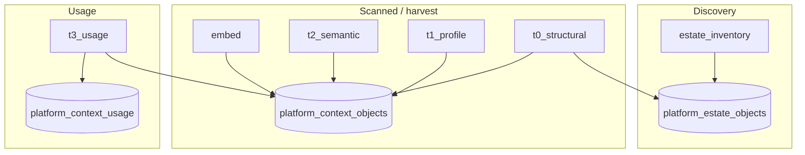

# Harvest & job pipeline — audit (issues register)

**Date:** 2026-10-24  
**Scope:** Estate discovery, structural harvest (T0–T2), embed, T3 usage, job launch/orchestration, and related UI/API entry points in `aloft-ui-redesign`.  
**Status:** Findings only — no fixes applied in this document.

---

## 1. Purpose

Operators experience the Jobs page as a single **pipeline** (inventory → T0 → T1 → T2 → embed → T3). The implementation is **several partially connected systems** with different registries, scope rules, and entry points. This register lists **all identified issues** for prioritization and PR planning.

**Remediation plan (cockpit UX + phased fixes):** [harvest-job-pipeline-remediation-charter.md](./harvest-job-pipeline-remediation-charter.md).  
**Current status, schema harvest, session logs:** [docs/jobs/README.md](../jobs/README.md).

**Related code (primary):**

| Area | Paths |
|------|--------|
| Orchestrator | `scripts/context/orchestrator.ts` |
| Queue / split / chain | `src/lib/context/queue.ts` |
| T0 / T1 | `src/lib/context/harvest.ts` |
| T2 | `src/lib/context/enrich.ts` |
| Embed | `src/lib/context/embed.ts` |
| T3 usage | `src/lib/context/usage.ts` |
| Estate inventory | `src/lib/context/estate.ts` |
| Scope matching | `src/lib/context/scope-match.ts` |
| Launch / plan APIs | `src/app/api/agent-lab/context/jobs/launch/route.ts`, `plan/route.ts`, `trigger/route.ts` |
| Jobs UI | `src/views/agent-lab/estate/jobs.tsx` |
| Object actions | `src/app/api/agent-lab/context/objects/[id]/*`, `estate/harvest/route.ts` |

---

## 2. Architecture (reference)

**Intended happy path:** optional `estate_inventory` → **T0** (creates Scanned rows) → T1 → T2 → embed → optional `t3_usage`.

**Critical vocabulary:**

| Term in UI | Table | Meaning |
|------------|--------|---------|
| Estate / discovery / inventory | `platform_estate_objects` | What exists in Databricks (metadata) |
| Scanned / context objects | `platform_context_objects` | Structural harvest + tiers (`last_t0_at` …) |
| Focus / include patterns | Job `scope.includePatterns` | `catalog.schema.*` globs (modal) |

---

## 3. Issue severity legend

| Level | Meaning |
|-------|---------|
| **P0** | Wrong scope, data loss risk, blocked workflows, or silent full-source runs when user asked for one table/schema |
| **P1** | Major inconsistency, misleading UI, or broken kinds exposed as success |
| **P2** | Edge cases, ops confusion, maintainability |
| **P3** | Documentation / mental model (not necessarily a code bug) |

---

## 4. P0 — Critical

| ID | Issue | Detail |
|----|--------|--------|
| **P0-1** | `scope.path` ignored at runtime | Jobs store `{ path: full_path }` from estate harvest, `reharvest-all`, `enrich`, `refresh`, `change_detect` → T0 enqueue. Orchestrator only applies `includePatterns`, `excludeSchemas`, `partition_*`. **Per-path enqueue can run full-source T0/T1/T2.** |
| **P0-2** | `reharvest-all` runs T0/T1/T2 in parallel | `objects/[id]/reharvest-all/route.ts` fires all tiers in one request. T1/T2 can run before T0 completes. Comment implies sequencing; code does not chain. |
| **P0-3** | T0 launch blocked when Scanned count is 0 | **`planSplit`** (`queue.ts` → `platform_context_objects` only) and **`assertObjectsInScope`** (`launch/route.ts`) run for `t0_structural`. UI sets **`launchBlocked`** when `activePlan.emptyScope` (`jobs.tsx`). After **inventory only** (or first harvest on a schema), rows exist in **`platform_estate_objects`** but not yet in **`platform_context_objects`** → plan returns `totalObjects: 0`, modal shows **“No objects in scope”** and disables **Launch**, even though **`runT0Harvest`** would honor Focus/excludes against Databricks and create Scanned rows. **Not fixed by a valid Focus glob** (e.g. `curated_db.my_schema.*`). |
| **P0-4** | Duplicate job rows for T0 | Orchestrator claims job A; `runT0Harvest` creates and finalizes job B. UI/logs show two rows per run. T1 correctly uses `existingJobId: job.id`. |
| **P0-5** | Duplicate inventory job rows | `runEstateInventory` inserts an extra succeeded `estate_inventory` audit row while orchestrator finalizes the enqueued row. |
| **P0-6** | Sequential chain stops on `partial` | `advanceChain` only after `succeeded` (T0/T1/T2). Split parent `partial` → chain never reaches next kind (e.g. embed). |
| **P0-7** | T3 matches bare `object_name` substring | `usage.ts`: `statement_text.includes(object_name)`. False positives/negatives; unrelated to embed or Focus. |
| **P0-8** | T3 ignores Focus / `includePatterns` | `runT3Usage` loads all context objects for source; orchestrator does not pass job scope patterns. |
| **P0-9** | Outer T0 job may be fail-stale’d | Heartbeats on **inner** T0 job id; **outer** claimed row may have no heartbeat during long runs → `failStale()` can mark launch job failed while inner work continues. |

---

## 5. P1 — Major

| ID | Issue | Detail |
|----|--------|--------|
| **P1-1** | Two registries, one modal | Same dialog shows **“Objects in scope: N”** from estate facets (`platform_estate_objects`, exclude tree) and **“N scanned object(s) match this plan”** from `POST …/jobs/plan` (`platform_context_objects`). Operators read both as the same number; they diverge whenever discovery ≠ Scanned (common before T0). |
| **P1-2** | `embed` ignores Focus | Embeds all active objects with `last_t2_at` on **entire source** after focused T2. |
| **P1-3** | `t3_connected` in UI, no handler | `JobKind` + Jobs group; orchestrator **default → unknown kind** if launched. |
| **P1-4** | Stub jobs report **succeeded** | `mapping`, `knowledge_sync` (orchestrator): “not yet implemented” but status succeeded → green DONE. |
| **P1-5** | T4 fails vs stubs inconsistent | `t4_*` finalize **failed** (“not ported”); UI still promotes T4; `reharvest-all` can enqueue `t4_scan`. |
| **P1-6** | Exclude tree stripped for T1/T2 | `stripExcludeSchemasForKind` → API passes `[]` excludes for T1/T2; UI still shows exclusions for combined launch. |
| **P1-7** | Focus field mislabeled / easy to misread | Label says **“limit to specific tables”**; patterns are **`catalog.schema.*`** or **`catalog.schema.table`** (see `schemaMatchesIncludePatterns` in `queue.ts`, `runT0Harvest` override in `harvest.ts`). Schema-only or wrong catalog → 0 **Scanned** matches. **`catalog.schema*`** (no dot before `*`) often still matches via minimatch but is not documented in the placeholder. |
| **P1-8** | Sequential UI omits embed | Toggle text “T0 → T1 → T2” when embed is often selected as fourth kind. |
| **P1-9** | `/jobs/trigger` enqueue-only | No Fargate launch. HarvestActionBar T0 uses trigger → queue may stall; not single-object. |
| **P1-10** | Stale copy: embed “not implemented” | `TRIGGERABLE_JOBS` in `jobs.tsx` warns embed missing; orchestrator **implements** embed. |
| **P1-11** | Inventory ignores modal Focus | `runEstateInventory` uses source `scope_include` / `scope_exclude` only. |
| **P1-12** | T3 continuation drops Focus | Continuation scope only `since` / `until`. |
| **P1-13** | T3 `skipped` semantics opaque | Means “no query text match”, not “out of schema” or “failed”. |
| **P1-14** | Plan/assert uses `sources[0]` only | Multi-source orgs: other sources ignored for split/assert. |
| **P1-15** | Debounce is source-wide | Per-object refresh/enrich blocked by any T1/T2 job on same source. |
| **P1-16** | Weak estate ↔ scanned link | `platform_estate_objects.context_object_id` not clearly populated in harvest paths reviewed. |
| **P1-17** | `launch` vs `trigger` kind lists differ | `launch` includes `t3_usage`, `t4_scan`; `trigger` does not. |
| **P1-18** | T4 child kinds not launchable from modal | Group lists `t4_entity_propose`, `t4_dim_propose`; `TRIGGERABLE_JOBS` / `VALID_KINDS` only expose `t4_scan` (which then fails). |
| **P1-19** | `knowledge_sync` lib vs orchestrator | Implementation exists in `knowledge-sync.ts`; Jobs path hits orchestrator stub. |
| **P1-20** | Exclude tree looks like “pick schemas” | Copy: **“click schemas to exclude”**; green check = **included**, red X = **excluded**. There is **no** “selected schemas → Focus” wiring. Footer **“Focused scope”** only means the Focus textarea is non-empty (`includePatterns`), not tree selection. |

---

## 6. P2 — Operational / edge

| ID | Issue | Detail |
|----|--------|--------|
| **P2-1** | Focused T0 enables drop pass | `hasIncludeOverride` → `isFirstRun` + drop within listed schemas; bad listing can mark tables `dropped`. |
| **P2-2** | Focus T0 skips `last_sweep_at` update | By design; global `change_detect` delta baseline unchanged — operators may not expect this. |
| **P2-3** | `change_detect` enqueues T0 without worker | Backlog unless orchestrator scheduled / manual `--kind t0_structural`. |
| **P2-4** | T3 50k history cap, newest first | Busy workspace: most tables appear only after continuation jobs. |
| **P2-5** | Query history workspace-wide | No catalog/schema filter in `pullQueryHistoryWindow`. |
| **P2-6** | Lineage row caps (10k) | Truncation easy to miss in logs. |
| **P2-7** | `silo_scan` dual paths | `claimNext` → `runSiloScan`; orchestrator also has stub branch depending on entry. |
| **P2-8** | `recompute_entity_tags` via `dispatchJob` | Not in orchestrator switch — inconsistent with Jobs grouping. |
| **P2-9** | Complex orchestration modes | Top-level `--kind`, `--child-job`, continuations, chain, split — hard to reason about combined behavior. |
| **P2-10** | `claimNext` kind filter SQL interpolation | Safe only if kind is trusted (CLI); fragile if extended. |
| **P2-11** | Hero Reharvest All ≠ Jobs pipeline | T0→T1→T2→T4, excludes T3 and embed; differs from modal. |
| **P2-12** | Auto-exclude large catalogs | Only T0/inventory; threshold 5000 estate rows per catalog in `jobs.tsx`. |
| **P2-13** | Empty-success detection narrow | `isEmptySuccessJob` only splittable kinds; stub “succeeded” not flagged. |
| **P2-14** | T2 skips “already enriched” | `last_t2_at >= last_t1_at` → re-T2 without re-T1 skips tables. |
| **P2-15** | Live schedules vs Focus | Weekly full-source T1, daily change_detect, weekly inventory — no modal Focus. |
| **P2-16** | Modal `includedCount` vs Focus vs plan | **`includedCount`** = estate rows in non-excluded schemas (`jobs.tsx`). **`activePlan.totalObjects`** = Scanned rows after excludes + Focus (`plan/route.ts`). All three can disagree in one modal. |
| **P2-17** | `launchBlocked` only with splittable kind | embed/T3-only selection not blocked on bad Focus. |
| **P2-18** | Embed skip reasons | Unchanged embed text or missing semantic card → skipped; job still “succeeded”. |
| **P2-19** | T3 narratives top-N only | Default 10 objects by query count get LLM narrative pass. |
| **P2-20** | Inventory partial soft-remove | `platform_estate_objects` marked `removed` per catalogs seen in run. |

---

## 7. P3 — Mental model

| ID | Issue |
|----|--------|
| **P3-1** | “Inventory”, “scanned”, and “harvested” used interchangeably in ops. |
| **P3-2** | “Sequential” = job **kind** order, not per-schema or per-table. |
| **P3-3** | T3 = warehouse **query history**, not Aloft harvest activity. |
| **P3-4** | Log silence during Databricks **async statement polling** is normal, not necessarily stuck UI. |

---

## 8. Scope matrix

| Control | estate_inventory | T0 | T1 | T2 | embed | t3_usage |
|---------|------------------|----|----|----|-------|----------|
| Source `scope_include` / `scope_exclude` | Yes | Yes* | No† | No† | No | No‡ |
| Modal exclude tree | Yes (with T0) | Yes | Stripped at API | Stripped at API | — | — |
| Modal Focus (`includePatterns`) | **No** | Yes | Yes | Yes | **No** | Stored, **not applied** |
| `scope.path` on job | No | **No** | **No** | **No** | No | No |
| Auto-split | No | Yes | Yes | Yes | No | No |

\*Unless Focus overrides `scope_include`.  
†T1/T2 filter via Focus/partition in runner; excludes stripped at launch API.  
‡Adapter loads source config but T3 does not filter objects/history by it.

---

## 9. Launch entry points (fragmentation)

| Entry | Launches worker? | Scope honored? | Chain? |
|--------|------------------|----------------|--------|
| `POST /api/agent-lab/context/jobs/launch` | Yes | Focus, exclude, chain (per matrix) | Yes |
| `POST /api/agent-lab/context/jobs/trigger` | **No** | Optional scope (mostly ignored at runtime) | No |
| `POST /api/agent-lab/context/estate/harvest` | Enqueue T0 only | `{ path }` **ignored** | No |
| `POST /api/agent-lab/context/objects/[id]/reharvest-all` | Yes | `{ path }` **ignored**; parallel tiers | No |
| `POST /api/agent-lab/context/objects/[id]/refresh` | **No** | `{ path }` **ignored** | No |
| `POST /api/agent-lab/context/objects/[id]/enrich` | **No** | `{ path }` **ignored** | No |

---

## 10. Orchestrator implementation status

| `job_kind` | Runtime | Notes |
|------------|---------|--------|
| `estate_inventory` | ✅ | Duplicate job row (P0-5) |
| `change_detect` | ✅ | Enqueues path-scoped T0 (P0-1, P2-3) |
| `t0_structural` | ✅ | Duplicate job row (P0-4), heartbeat (P0-9) |
| `t1_profile` | ✅ | Uses `existingJobId` |
| `t2_semantic` | ✅ | Finalize inside `runT2Enrich`; partial blocks chain (P0-6) |
| `embed` | ✅ | No Focus (P1-2) |
| `t3_usage` | ✅ | Source-wide (P0-7, P0-8); continuations |
| `t3_connected` | ❌ | Not in switch → unknown kind |
| `mapping` | ⚠️ Stub success | P1-4 |
| `knowledge_sync` | ⚠️ Stub success | P1-4, P1-19 |
| `silo_scan` | ✅ via `claimNext` | P2-7 |
| `recompute_entity_tags` | ✅ via `claimNext` | P2-8 |
| `t4_scan` / `t4_entity_propose` / `t4_dim_propose` | ❌ Failed | P1-5, P1-18 |

---

## 11. Recommended fix themes (priority)

1. **P0-1** — Map `scope.path` → single-object `includePatterns` (or partition) in orchestrator for T0/T1/T2; fix estate harvest + reharvest-all + change_detect consumers.
2. **P0-3** — For `t0_structural` (and optionally `estate_inventory`): plan/assert against **`platform_estate_objects`** (same exclude + Focus predicates), or skip assert when kind is T0; keep Scanned-only plan for T1/T2. UI: don’t set `launchBlocked` on T0 when estate scope is non-zero; label counts **Discovery** vs **Scanned** (P1-1).
3. **P0-4 / P0-5 / P0-9** — Single job row per run: pass `existingJobId` into `runT0Harvest`; remove duplicate inventory audit insert; heartbeat outer claimed id.
4. **P1-2 / P0-8 / P1-12** — Propagate Focus to embed, T3, and T3 continuations.
5. **P0-2** — `reharvest-all`: sequential chain or wait-for-tier; honor path.
6. **P1-7 / P1-8 / P1-10** — UI copy and validators; hide or disable broken kinds (P1-3, P1-4, P1-18).
7. **P0-6** — Policy for chain on `partial` (advance with warning vs block with UI message).
8. **P1-9** — Deprecate trigger for harvest or auto-launch worker; fix HarvestActionBar T0.

**Suggested first PR bundle:** P0-1 + P0-3 + P0-4 + P1-2 + P0-8 + UI copy (P1-7, P1-8, P1-10).

---

## 12. Symptom → issue map (operator cheatsheet)

| Symptom | Likely IDs |
|---------|------------|
| **Discovery shows N objects, modal says “No objects in scope”, Launch greyed out (T0)** | **P0-3**, P1-1, P2-16 — usually **not** a bad Focus glob; Scanned registry empty for that scope |
| Valid Focus like `curated_db.some_schema.*` but 0 scanned, T0 blocked | P0-3, P1-7 — runtime T0 would work; launch gate would not |
| I “selected” schemas in the tree but Focus ignored them | P1-20, P2-16 — tree only **excludes**; set Focus or clear excludes |
| Inventory done, Focus shows 0 objects | P1-1, P0-3, P1-7, P1-11 |
| T3 one table, thousands skipped | P0-7, P0-8, P2-4, P3-3 |
| Long “query polling” in logs | P3-4, P2-4 |
| Embed/T3 didn’t follow my schemas | P1-2, P0-8, P1-8 |
| Object page reharvest affected whole source | P0-1, P1-9, P2-11 |
| Two job rows for one T0 run | P0-4 |
| Sequential stopped after partial T1/T2 split | P0-6 |
| Green DONE but nothing happened | P1-4, P1-5 |

---

## 13. Operator field report — T0 launch modal (2026-10-24)

**Reported behavior:** Launch **T0 Structural** on Fargate with estate exclude tree leaving ~121 discovery objects; modal footer **“Focused scope”**; red **“No objects in scope”**; **0 scanned object(s) match this plan (Focus applied)**; **Launch** disabled.

**Example Focus (operator-supplied):** `curated_db.db_smac_prod_navitasai_crewing_dashboard_public*`  
**Assessment:** Pattern shape is acceptable for T0 (`catalog` + `schema` + wildcard). Failure is **not** primarily operator error unless catalog/schema names don’t match discovery (`platform_estate_objects` / facets tree).

**Root cause (product):** P0-3 + P1-1 + P1-20. Plan API (`src/app/api/agent-lab/context/jobs/plan/route.ts`) and launch assert (`launch/route.ts`) use **`planSplit` → `platform_context_objects`**. T0 is the tier that **populates** that table; gating launch on Scanned count blocks first-time structural harvest for focused schemas.

**`scopeWarning` when Focus + zero Scanned:** `No objects in Scanned registry match Focus. Fix the glob or run T0 first.` — second clause is impossible via the same modal when launch is blocked (P0-3).

**Code touchpoints for fix PR:**

| Layer | File | Behavior today |
|-------|------|----------------|
| Plan | `src/lib/context/queue.ts` `planSplit()` | `GROUP BY` on `platform_context_objects` |
| Plan API | `src/app/api/agent-lab/context/jobs/plan/route.ts` | `emptyScope`, `scopeWarning` |
| Launch | `src/app/api/agent-lab/context/jobs/launch/route.ts` | `assertObjectsInScope` before enqueue |
| Modal | `src/views/agent-lab/estate/jobs.tsx` | `launchBlocked`, dual counts, Focus textarea |
| Runtime (works) | `src/lib/context/harvest.ts` `runT0Harvest()` | `includePatterns` → `scope_include` |

---

## 14. Document history

| Date | Change |
|------|--------|
| 2026-10-24 | Expanded P0-3, P1-1, P1-7, P2-16; added P1-20; symptom rows and §13 field report (T0 modal / Focus `curated_db…` incident). |
| 2026-10-24 | Initial register from codebase review (conversation audit). |
