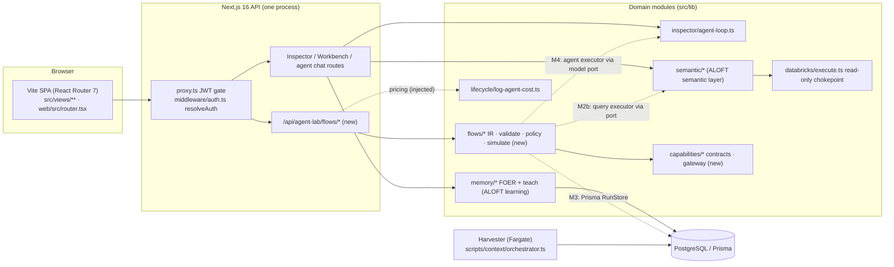

# 00 — Current-state audit

**Date:** 26 Oct 2026 · **Branch:** `feature/ui-redesign` (HEAD `9d72f45` + this session's uncommitted work)
**Method:** I read the source, re-checked the earlier audit's key claims against today's code, and ran the test suite, typecheck, lint, SPA build and bundle guard. I did not query a database, AWS account, Entra tenant or live deployment. The handbook arrived as a PDF in the session. The brief refers to a `.docx` with the same title; I found no `.docx` in the repo, so the PDF is the version reviewed.

This document **extends** [docs/audits/business-ai-studio-current-state.md](../audits/business-ai-studio-current-state.md) (24 Oct, static). That audit's inventory, execution deep-dive and findings S1–S15 / R1–R8 still apply. They are not repeated here, except where today's evidence changes or confirms them.

---

## 1. Summary

1. **No Business AI Studio product existed before this session.** What existed: a Vite + React Router 7 SPA, a Next.js 16 API (160 route handlers), Prisma on PostgreSQL (148 models), an in-request agent loop (Inspector, Workbench, commissioned-agent chat), a governed semantic layer, FOER memory, and a Postgres-queued harvester on Fargate.
2. **A Flows foundation existed** (commit `e031520`): a typed flow schema, validator, ref resolver and resumable runner in `src/lib/flows/`. There was also a migration for four flow tables, `prisma/migrations/20261025_flows`. Its file says "written, not applied", and whether it is applied in any environment is **unverified**. This is the seed of the Studio workflow layer. This session extends it instead of starting a parallel runtime.
3. **The P0 authorization findings from 24 Oct are still open today** (§5). That blocks any milestone that publishes or runs anything for real. It does not block stateless validation and simulation, which is what this session built.
4. **Quality gates are weaker than they look.** CI builds and deploys without running tests. ESLint crashes while loading its config. The repo's own server-code bundle guard fails because of a leak in today's commit. All three are detailed in §6.

## 2. Handbook and brief vs. the live codebase

| Handbook / brief says | Evidence in repo | Consequence |
|---|---|---|
| Frontend is "Vite + React Router 7, not Next.js" | **Partly true.** UI: Vite + RR 7.18.4 (`web/src/router.tsx`, `createBrowserRouter`). API: **Next.js ^16.4.2 route handlers** (`src/app/api/**/route.ts`), NextAuth 4 (Entra), and Next serves the SPA (`next.config.ts` rewrites) | Studio UI lives in the SPA, and Studio APIs are Next route handlers for now. See ADR-002 |
| Hono is a candidate API framework | Not a dependency. No prototype exists (`package.json`) | Deferred, with revisit conditions in ADR-002 |
| `apps/` + `packages/` monorepo (handbook §15) | One app plus one workspace package (`packages/aloft-shared`, UI primitives). Domain code lives in `src/lib/*` | Use module boundaries in `src/lib` (enforced by a test), not a re-layout. Handbook §15 itself says not to move code before dependency analysis |
| ALOFT is a reusable governed semantic foundation, consumed through explicit interfaces | ALOFT **is this codebase**. The semantic layer is in-process (`src/lib/semantic/execute.ts` `executeSemanticQuery`). No service API or SDK exists | The "ALOFT adapter" is an in-process port over existing functions. ADR-001 |
| A separate conversational AI application exists, and Studio must not couple to it | Not in this repo. The in-repo conversational surfaces are Inspector and agent chat (`src/lib/inspector/*`) | **Decision needed:** confirm whether "the conversational AI application" means Inspector or an external product. Either way, the Studio core does not import `@/lib/inspector` (enforced by `src/lib/flows/__tests__/boundary.test.ts`) |
| Temporal or a comparable durable engine should be evaluated | No Temporal, BullMQ, Redis or SQS. The only durable work pattern is `platform_context_jobs` + `FOR UPDATE SKIP LOCKED` + Fargate (`src/lib/context/queue.ts`) | ADR-003 compares the two with explicit benchmark criteria |
| Multi-tenant, tenant scope on every record | Single org from env (`src/lib/org.ts`, `src/lib/platform/agents.ts` `getDefaultOrg`). `aadTenantId` is stored but not used as a filter | Studio records carry `tenantId`/`org_id` now. Real multi-tenancy is a platform project. ADR-006 |
| Personas, approvals, policy engine | `policy_entry` has CRUD only and **no reader outside `src/app/api/policies`**. `human_decision_requests` and `hitl_interrupt` have **no references in `src/`** | Policy and approvals must be built. The schema-only tables stay untouched |

## 3. Capability matrix

Status: **Exists** = wired and used · **Partial** = some pieces wired · **Missing** · **Uncertain** = can't be confirmed from the repo · **New** = added this session (see IMPLEMENTATION_STATUS.md).

| Capability | Status | Evidence | Notes |
|---|---|---|---|
| Sign-in (Entra via NextAuth) | Exists | `src/lib/auth.ts`, `src/proxy.ts` (JWT presence only) | Role and suspension are not checked at the edge (S6) |
| Per-route permission helpers | Exists | `src/middleware/auth.ts` `resolveAuth`, `requirePermission`, `requireOwnerOrPermission` | Used unevenly. Studio routes use them always |
| RBAC catalogue | Partial | `src/lib/rbac.ts` `PERMISSIONS` | New users get `admin` (S1). No flow or connector permissions are seeded |
| Tenant isolation | Partial | single org from env | Not per user |
| Natural-language goal intake | **New (rules only)** | `src/lib/flows/recommend.ts` | Keyword-based template match that abstains when nothing fits. No LLM planner yet |
| Agent creation (draft → commission) | Exists | `src/lib/construction/*`, `workbench/commission/route.ts` | One agent per draft. Three agent stores coexist (`agent_catalog`, `PlatformAgent`, `workbench_sessions`) |
| Workflow definition (typed IR) | Exists → **extended** | `src/lib/flows/schema.ts` | New this session: `tool` step, `when` conditions, semantic `query` mode, `anti_join`, `webhook` trigger, run budget |
| Static validation | Exists → **extended** | `src/lib/flows/validate.ts` | Conditions are now part of the dependency graph |
| Capability (tool) registry with contracts | **New** | `src/lib/capabilities/*` | 5 built-in contracts. Simulation mocks only. No live handlers |
| Policy gateway (per-call checks) | **New** | `src/lib/capabilities/gateway.ts` `invokeCapability` | Input contract, egress, budget, live-mode permission re-check |
| Static policy check | **New** | `src/lib/flows/policy.ts` `checkFlowPolicy` | Approvals, bindings, permissions, budgets |
| Simulation with mocked side effects | **New** | `src/lib/flows/simulate.ts` | Drives the real runner and transforms |
| Durable runtime (persisted runs) | Partial | runner resumes from a `RunStore` (`runner.ts`). The Prisma store is not built | Needs the flow tables applied |
| Triggers: manual / schedule / event / webhook | Partial | schema only. No scheduler tick, event bus or webhook endpoint | M3 |
| Human approvals that survive the request | Missing | the runner returns `waiting_approval`, but there is no approval table or UI | M3 |
| Audit trail | Partial | `src/lib/audit.ts` `writeAudit` | No Studio events yet |
| LLM telemetry and cost | Partial | `agent_turn_log`, `agent_loop_log`, `src/lib/lifecycle/log-agent-cost.ts` `computeCostUsd` | Static price table. Workbench and agent chat do not write cost |
| Budgets | Partial → **New for flows** | `budget_config` model has **no readers in `src/`** | `BudgetMeter` enforces per-run budgets in flows |
| Agent harness (bounded loop) | Partial | `src/lib/inspector/agent-loop.ts` `runAgentLoop` (`maxLoops`, injected `executeTool`) | No plan object, checkpoints, per-run budget or verifier |
| Skills registry and progressive loading | Missing | — | 04 has the design |
| Memory: session and org rules (ALOFT-owned) | Exists / Partial | `src/lib/memory/retrieve.ts`, `teach.ts` (personal → org promotion) | Injection is flag-gated (`isMemoryInjectionEnabled`) |
| Goal & Progress memory | Missing | — | 07 has the design |
| ALOFT semantic adapter port | Partial | the `query` step's semantic config mirrors `SemanticQuery` (`src/lib/semantic/types.ts`) | No executor yet. The connection uses a shared warehouse credential |
| Evaluation harness | Partial | Boost benchmark (`src/lib/boost`). Platform evals are a placeholder (R8) | Studio scenario and security suites are **new** (tests) |
| Design system, light and dark | Exists | `docs/DESIGN_SYSTEM.md`, shell tokens in `src/app/globals.css` (`--ink-*`, `--surface-*`, `--ok/--warn/--bad`) | The Flows view uses these tokens only |
| Accessibility | Partial | some ARIA in the shell | No automated a11y checks |
| Internationalisation | Missing | English strings inline | Out of MVP scope |
| CI quality gate | Missing | `.github/workflows/ecr-push.yml` has no test, lint or typecheck step | P1 |
| Deployed topology | Uncertain | `Dockerfile`, `infra/beanstalk`, `infra/context/*.json` | Live AWS state not read |

## 4. Evidence ledger

Confidence: **High** = read in source, and re-run where possible · **Med** = read in source, not executed · **Low** = inferred.

| ID | Path : symbol | Observation | Conf. | Implication |
|---|---|---|---|---|
| E1 | `package.json` | `next ^16.4.2`, `react-router 7.18.4`, `zod 3.25.76`, `@xyflow/react`, `dagre`, `cron-parser 5.5.0`. No hono or temporal | High | Stack claims verified |
| E2 | `src/lib/rbac.ts:19` `DEFAULT_ROLE = 'admin'` | First login creates an admin | High | S1 still open. Any permission check in Studio is moot until fixed |
| E3 | `src/app/api/agent-lab/workbench/sessions/[id]/route.ts:10-17` | GET loads any session by id with no session or owner check | High | S2 still open |
| E4 | `src/app/api/policies/route.ts:48` | `prisma.policy_entry.create({ data: body })`, no role check | High | S3 still open. Do not build the Studio policy engine on `policy_entry` |
| E5 | `src/app/api/databricks/connections/route.ts:24-25` | POST checks only that a session exists | High | S4 still open. Studio connections need their own permission |
| E6 | `src/lib/inspector/session-auth.ts:126` | Ownership is enforced only when `INSPECTOR_AUTH_ENFORCE === 'true'` | High | Studio routes must not use this flag. They don't |
| E7 | `src/middleware/auth.ts` `resolveAuth`, `requirePermission` | Session or bearer auth with a flattened permission set | High | Reused by the Studio routes |
| E8 | `src/lib/inspector/agent-loop.ts:74-120` `AgentLoopParams` | Loop takes `executeTool`, `maxLoops`, `abortSignal`, `cacheSystemPrompt` | High | Model-gateway adapter target (ADR-004) |
| E9 | `src/app/api/agent-lab/agents/chat/route.ts:20,161` | Agent chat allowlists `describe_schema` and `execute_tool`, with fixed `USE_MAX_LOOPS` | High | Precedent for per-surface tool allowlists |
| E10 | `src/lib/semantic/execute.ts:94` `executeSemanticQuery` | Governed-only by default, org from env, compiles and runs read-only SQL | High | ALOFT adapter for `query` steps. ADR-001 |
| E11 | `src/lib/semantic/types.ts:58` `SemanticQuery` | ID-based query contract | High | Mirrored by the flow `query.semantic` schema |
| E12 | `src/lib/lifecycle/log-agent-cost.ts:45` `computeCostUsd` | Static list prices, defaulting to `claude-sonnet-4` | High | Used for agent-step cost estimates. The module imports Prisma, so the flow core takes it as an injected function |
| E13 | `src/lib/flows/runner.ts` `executeRun` | Sequential and resumable, injected store and executors, retries, timeouts | High | Runtime core reused for simulation and future workers |
| E14 | `prisma/schema.prisma:3104-3156` `PlatformFlow*` | Four flow models with `org_id` | High (file) / Unverified (DB) | Persistence is ready once the migration is applied |
| E15 | `src/lib/context/queue.ts` (claim/heartbeat/`failStale`) | Postgres `SKIP LOCKED` job pattern | Med | Template for a flows worker (ADR-003) |
| E16 | `src/lib/memory/teach.ts:77,141` | Personal rules, then author/admin promotion to org | High | ALOFT-owned learning. Studio must not duplicate it (07) |
| E17 | `prisma/schema.prisma:453` `budget_config` | No readers anywhere in `src/` | High | Budgets were not enforced anywhere before this session |
| E18 | `src/` search for `hitl_interrupt`, `human_decision_requests` | No references | High | Approvals are greenfield |
| E19 | `.github/workflows/ecr-push.yml` | Build, push and deploy steps only | High | Tests do not gate deploys |
| E20 | `eslint.config.cjs` + `npx eslint <any file>` | Crashes with `TypeError: Converting circular structure to JSON` in `@eslint/eslintrc` while loading config | High | **New finding.** `npm run lint` cannot run on this branch |
| E21 | `src/hooks/useInspectorChatModels.ts` → `src/lib/inspector/model-access.ts` (imports `next-auth`, `@/lib/auth`) | `npm run web:check-bundle` reports `PrismaClient` and `NEXTAUTH_SECRET` markers in client chunks | High | **New finding.** Server code reaches the browser bundle (commit `2a04aee`). The variable name is bundled, not its value |
| E22 | Test baseline (`npx vitest run`, before changes) | 80 files / 617 tests pass. `tsc --noEmit` exits 0 | High | Clean starting point |

## 5. Security status relevant to Studio milestones

| Finding (24 Oct ID) | Today | Blocks |
|---|---|---|
| S1 new users are admin | Open (E2) | Anything permission-gated in production: publish, live runs, approvals |
| S2 sessions not owner-scoped | Open (E3) | Reusing workbench sessions to hold Studio drafts |
| S3 policies and catalog writes unguarded | Open (E4) | Using `policy_entry` or the catalog as Studio stores |
| S4 any user can add warehouse credentials | Open (E5) | Studio connections that reuse `databricks/connections` |
| S5 Inspector ownership is observe-only | Open (E6) | Nothing in Studio (Studio routes always enforce) |
| S13 memory text injected as instructions | Open | Injecting memory into Studio agents (07) |

None of these block the stateless slice built this session. It reads no real data, writes nothing and calls nothing external. They do block M1 publish and M3 live runs. See [10-delivery-plan.md](10-delivery-plan.md), decision D1.

## 6. Engineering-gate findings (new today)

> **Update (later on 2026-10-26):** S1–S4, E20 (lint config) and E21 (bundle leak) are fixed in code, and a CI `verify` job was added for E19. See the CHANGELOG entry "Close auth findings S1–S4". The findings below are kept as found.

1. **Lint is broken (E20).** Fix the ESLint flat-config / `eslint-config-next` interop before relying on `npm run lint`.
2. **Bundle guard fails (E21).** A client hook imports a server module. Move `filterChatModelsForRole` into a client-safe module, or fetch the filtered list from an API.
3. **CI runs no tests (E19).** Add `vitest run`, `tsc --noEmit`, `web:typecheck` and `web:check-bundle` before the image push.

## 7. Architecture dependency map

How the existing system connects today, and where Studio attaches. Solid arrows exist. Dashed arrows are proposed.

## 8. Reuse, adapt, or keep apart

| Existing piece | Studio relationship | Why |
|---|---|---|
| `executeSemanticQuery`, `executeDatabricksSQL` | **Reuse through a port** (ALOFT adapter) | Governed definitions and the read-only chokepoint are ALOFT's strengths |
| `runAgentLoop` / `dispatchAgentLoop` | **Reuse behind a model-gateway port** for provider calls only. Planning, budgets, policy and checkpoints belong to Studio | Avoid a second provider stack without coupling to Inspector session logic |
| `resolveAuth`, `requirePermission`, `writeAudit`, `computeCostUsd`, turn-log tables | **Reuse** from the API layer | Already work and are tested |
| FOER memory and teach rules | **Consume read-only** through ALOFT interfaces. Never write | Avoid duplicating ALOFT semantic learning |
| `workbench_sessions.construction_state`, `agent_catalog` | **Do not use as Studio definition stores** | No owner check (S2), mutable, not versioned |
| `policy_entry`, `agent_lab_pipeline_*`, `hitl_interrupt`, `PlatformAgentRun` | **Leave untouched** | No readers or writers. Unguarded (S3). No `org_id` |
| `platform_context_jobs` / harvester | **Copy the pattern, not the table** for a flows worker | Proven claim/lease design (ADR-003) |

## 9. Needs infrastructure access to confirm

- Whether `20261025_flows` is applied in any database.
- Which EventBridge rules are enabled. Whether the ALB idle timeout matches nginx's 600 s.
- Production values of `INSPECTOR_AUTH_ENFORCE`, `MEMORY_INJECT_ENABLED`, `DEFAULT_ORG_ID`, and the new `FLOWS_ENABLED` / `FLOWS_EGRESS_EMAIL_DOMAINS`.
- Whether the Entra app registration is restricted to a group. That decides how urgent S1 is.
- Real connector targets (ERP, HR, order systems, S3 buckets, Teams), with their scopes and rate limits.
