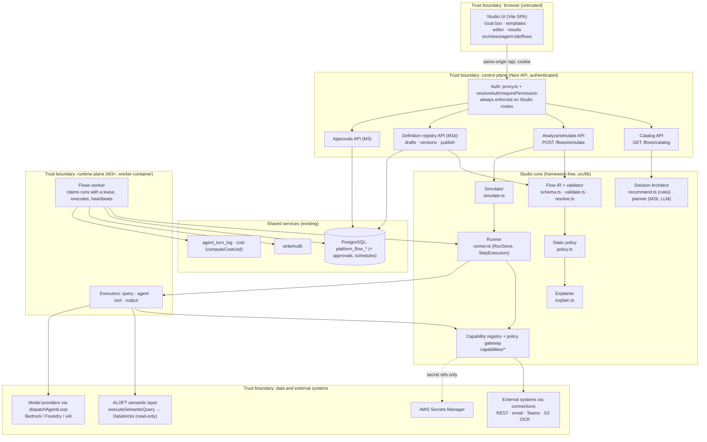

# 02 — Target architecture

**Shape:** a modular control plane inside the existing Next.js API process, a framework-free Studio core in `src/lib`, and, from M3, an isolated flows worker container patterned on the harvester. Microservices only when a measured scaling or security boundary requires them (ADR-002).

## 1. Components and trust boundaries

**What crosses each boundary:**

| Boundary | Crosses | Never crosses |
|---|---|---|
| Browser → control plane | Definitions (JSON), inputs, sample fixtures, goal text | Credentials. Policy context (the server builds it from the session) |
| Control plane → core | Parsed definition, `PolicyContext` built from the session, pricing function | HTTP or framework objects (enforced by `boundary.test.ts`) |
| Core → external (via gateway only) | Validated, egress-checked input, plus an idempotency key | Secrets (handlers resolve them from the connection). Model-visible secrets |
| Run data → definition | Nothing. Run data fills `{{refs}}` only in `data`-binding fields | Connection, method, channel, agent, model (all `literal`) |

## 2. Interfaces (ports)

| Port | Status | Shape (summary) | Implementations |
|---|---|---|---|
| `RunStore` | Implemented | `loadStepRuns`, `saveStepRun`, `setRunStatus`, `isCancelled` | `memory-store.ts` (simulation and tests). Prisma store proposed (M1b/M3) |
| `StepExecutors` | Implemented | one executor per step type → `{done, output}` or `{wait_approval}` | Simulation executors. Live executors proposed |
| `CapabilityRegistry` | Implemented | `get(id, version?)`, `list()` | `builtinCapabilityRegistry`. Per-tenant registry proposed |
| Policy gateway | Implemented | `invokeCapability({def, input, literalInput, policy, mode, idempotencyKey, budget, signal, handlers})` | One gateway for simulation and live calls |
| `PolicyContext` | Implemented | actor, tenant, permissions, egress allowlist | Built by `flowsPolicyContext(req)` |
| `AloftSemanticPort` | Proposed (M2b) | `query(semantic: SemanticQuery, opts: {actorId, tenantId, maxRows}) → {columns, rows, rowCount, sql, isDraft}` | Wraps `executeSemanticQuery` + connection resolution |
| `ModelGateway` | Proposed (M4) | `complete({model, system, messages, tools, maxLoops, budget, signal}) → {text, toolCalls, usage}` | Wraps `dispatchAgentLoop`. Single place for provider fallback, caching and cost |
| `ApprovalService` | Proposed (M3) | `request(runId, stepId, assignee, message)`, `decide(…)` | Prisma `PlatformFlowApproval` |
| `AuditSink`, `CostLedger` | Proposed wiring | `writeAudit(...)`; per-step `costUsd`, tokens | Existing `writeAudit`, `agent_turn_log`, new run columns |

## 3. Deployment topology

| Stage | Topology | Change from today |
|---|---|---|
| **Now (M2)** | One web container on Beanstalk: Next standalone serves the SPA and `/api/**`. Studio simulation runs in-request. Pure CPU, ~0.2–1.3 ms per flow (08 §1) | Two new routes behind `FLOWS_ENABLED` |
| **M3** | Add a `flows-worker` image (same codebase, Fargate `RunTask` or a small service) that claims `platform_flow_runs` with a lease. A single EventBridge minute tick creates scheduled runs. A webhook route verifies a signature and enqueues | Pattern copied from `scripts/context/orchestrator.ts` + `queue.ts` |
| **M5** | Connector handlers run in the worker, with egress through a NAT and an allowlist (VPC egress control or proxy). Handler credentials come from Secrets Manager by reference | Network egress policy is infra work (06 §6) |
| **Later, if measured** | Split the worker per connector class or tenant tier. Consider Temporal if ADR-003 triggers fire | — |

## 4. Failure modes

| Failure | Detection | Behaviour | Status |
|---|---|---|---|
| Invalid definition | `validateFlow` | 422 with issue paths. Nothing runs | Implemented |
| Policy violation (static) | `checkFlowPolicy` | Shown as "blocks publish". Simulation still previews | Implemented |
| Policy denial at call time (egress, contract, budget, permission) | `PolicyDeniedError` | Step fails on the first attempt (no retry). Downstream skipped. Run failed | Implemented |
| Transient connector failure | Executor throws | Retries with exponential backoff up to `retries`, then fails | Implemented (runner) |
| Step hangs | `timeoutMs` | Abort signal plus a timeout error, then a retry | Implemented |
| Condition false | `when` | Step and its dependents skipped, with reasons | Implemented |
| API process restarts mid-run | Lease expiry (M3) | Another worker resumes. Succeeded steps are not re-run | Runner supports it. Lease proposed |
| Duplicate trigger / double click | Unique `(flow_id, scheduled_for)`; request idempotency key | One run | Proposed (M3) |
| External effect done but not recorded (crash between call and save) | Idempotency key `runId:stepId` passed to the handler | Provider dedupes, or the handler checks a send marker | Contract implemented (`idempotency: 'key'`). Handlers proposed |
| Approval never decided | Expiry job | Run cancelled after N days (proposal: 7) | Proposed |
| Model provider outage | Provider error | Step retry. Optional provider fallback in `ModelGateway` | Proposed |
| Budget exhausted mid-run | `BudgetMeter` | Stops before the paid call | Implemented |
| Owner loses permission | Live permission re-check per call | Step fails with `permission` | Implemented in the gateway. Live runs proposed |

## 5. Relationship to existing ALOFT surfaces

- **Inspector and agent chat** stay request-scoped conversational tools. Studio does not import Inspector session code. Provider calls go through a model-gateway port, which wraps the same provider dispatch function so there is one provider stack (ADR-004).
- **Workbench** remains the agent builder. Its construction-state scaffolding (patch tools, readiness, user locks) is the pattern for the Studio flow planner (04 §5). Studio does not store definitions in `workbench_sessions`.
- **Semantic layer and FOER memory** are ALOFT-owned. Studio reads through ports and never writes semantic mappings or lessons (07).
