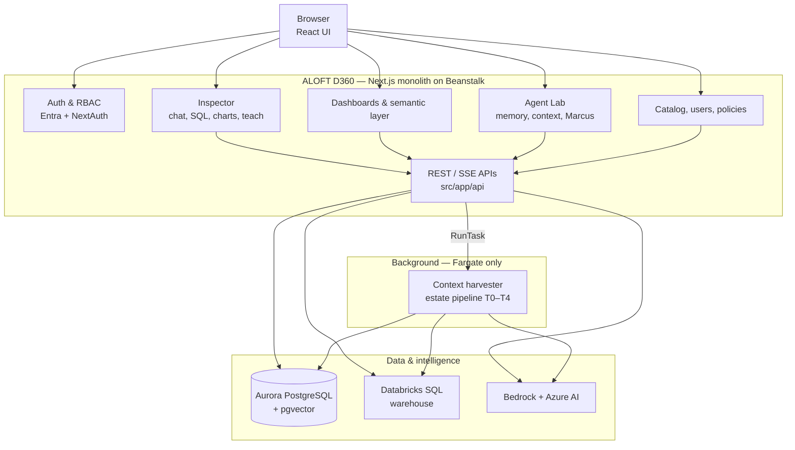
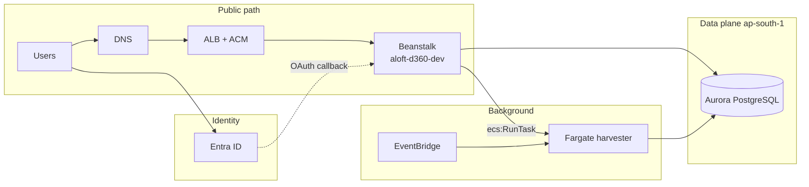
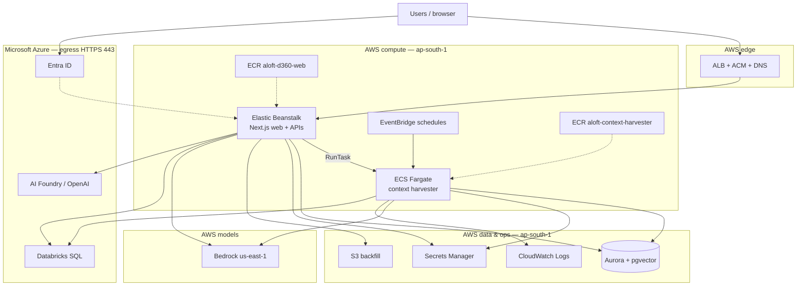
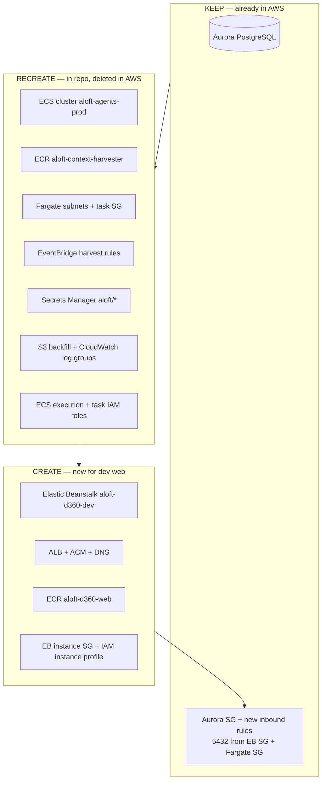

# ALOFT D360 — Cloud architecture & AWS dev request

| | |
|---|---|
| **Scope** | Dev environment only |
| **AWS account** | `454073573537` |
| **Regions** | App **`ap-south-1`** · Bedrock **`us-east-1`** |
| **Return form** | [aws-cloud-handoff-checklist.md](./aws-cloud-handoff-checklist.md) |
| **New account (full build + DB move)** | [aws-new-account-migration-guide.md](./aws-new-account-migration-guide.md) |
| **MAP / portfolio** | [map-migration-high-level-overview.md](./map-migration-high-level-overview.md) (`.docx`) |

**Document map**

| § | Content |
|---|---------|
| [0](#0-application-architecture-simple) | Application architecture (simple) |
| [1](#1-platform-overview) | Infrastructure overview — glance, flows, full map, runtimes |
| [2](#2-cloud-actions) | Cloud actions — summary board, detail table, checklist map |
| [3](#3-services-by-layer) | Services by layer — where each is used |
| [4](#4-aws-provisioning-status) | AWS provisioning (repo vs today) |
| [5](#5-dev-specifications) | Dev specifications (Beanstalk, ECS, network, IAM) |

---

## 0. Application architecture (simple)

ALOFT D360 (**Agent Lab**) is one **full-stack Next.js** application: React UI and **~140 HTTP APIs** in the same codebase (`aloft-d360`). Users sign in with **Entra**; the app stores configuration, memory, catalog, and job state in **Aurora**; it runs **read-only SQL** on the customer warehouse via **Databricks**; it calls **Bedrock** and **Azure AI** for chat, enrichment, and embeddings.

### 0.1 Logical view

### 0.2 Product areas (what the app does)

| Area | What users get | Main dependencies |
|------|----------------|-------------------|
| **Inspector** | Natural-language analytics, tool calls, charts, export | Databricks, Bedrock/Foundry, Aurora |
| **Dashboards** | Governed dashboards and widgets | Aurora, Databricks |
| **Semantic layer** | Metrics, dimensions, intents, promotion | Aurora, Bedrock |
| **Agent Lab** | Memory, teach mode, reputation, reflections | Aurora (pgvector), Bedrock |
| **Data estate** | Catalog of tables, profiles, harvest jobs | Aurora, Databricks, Fargate harvester, Bedrock |
| **Platform admin** | Users, RBAC, audit, agent catalog | Aurora, Entra |

### 0.3 Shape in one sentence

**Single web app on Beanstalk** serves all interactive features; **long-running harvest work** runs on **ECS Fargate** so warehouse scans and LLM batches are not limited by HTTP timeouts.

---

## 1. Platform overview

**Infrastructure view:** the same application deployed on **Elastic Beanstalk** (web) and **ECS Fargate** (harvester), sharing **Aurora**. Identity is **Microsoft Entra**; warehouse SQL is **Databricks**; models are **Bedrock** + **Azure AI**.

### 1.1 At a glance

| | |
|---|---|
| **User traffic** | Browser → DNS → **ALB (HTTPS)** → **Beanstalk** `aloft-d360-dev` → Docker **Next.js :3000** |
| **Sign-in** | Browser → **Entra ID** → OAuth callback to Beanstalk URL |
| **Batch jobs** | **EventBridge** (cron) and web **`RunTask`** → **Fargate** `aloft-context-harvester` |
| **Data** | **Aurora PostgreSQL** (+ pgvector) — Prisma from Beanstalk and harvester |
| **Not on Beanstalk** | Harvester containers (long SQL/LLM work runs on Fargate only) |

### 1.2 Request & job flow

### 1.3 Full platform map

### 1.4 Two runtimes (do not merge)

| Runtime | AWS host | Responsibility |
|---------|----------|----------------|
| **Web** | Beanstalk `aloft-d360-dev` | UI, REST/SSE APIs, Inspector (up to **~600 s** HTTP), Agent Lab, admin |
| **Harvester** | Fargate `aloft-context-harvester` | Estate / context pipeline (T0–T4), scheduled sweeps |

After DNS exists: app team adds Entra redirect `https://<dev-host>/api/auth/callback/azure-ad` and sets `NEXTAUTH_URL`.

---

## 2. Cloud actions

**Context:** Git still has infra config; most AWS resources except **Aurora** were removed and must be rebuilt. Beanstalk for the web app was never in this account.

### 2.1 Summary board

Suggested order: confirm **Aurora** → **recreate ECS stack** (harvester) → **create Beanstalk** → **wire security groups** on Aurora → return IDs on checklist.

### 2.2 Action detail

| Action | AWS status today | What Cloud delivers | Repo / app follow-up |
|--------|------------------|---------------------|----------------------|
| **KEEP** | Aurora **exists** | No new DB. On **Aurora SG**: inbound **TCP 5432** from **dev Beanstalk instance SG** and **Fargate task SG** only. | `DATABASE_URL` unchanged if endpoint unchanged. |
| **RECREATE** | ECS-related resources **deleted** | Cluster `aloft-agents-prod`, ECR `aloft-context-harvester`, task networking, EventBridge rules, Secrets `aloft/aurora` + `aloft/databricks`, S3 backfill bucket, log groups, ECS IAM roles. | App updates `infra/context/task-definition.json`, `eventbridge-rule.json`, `ECS_*` env vars with **new** ARNs/IDs. |
| **CREATE** | Beanstalk / web ECR **none** | Env **`aloft-d360-dev`**: Docker AL2023, **t3.medium** ×1, ALB, ACM cert, DNS name, ECR **`aloft-d360-web`**, instance profile (Bedrock, RunTask, Secrets, S3, Logs). ALB/nginx **600 s** idle (see `infra/beanstalk/`). | App pushes image, `eb deploy`, env vars, Entra callback, `prisma migrate deploy`. |

### 2.3 Checklist mapping

| Cloud action | Fill in checklist section |
|--------------|---------------------------|
| KEEP — Aurora + SG | **B** (database), **B6–B7** (5432 rules) |
| RECREATE — ECS / harvester | **C** (ECS), **D–G** (secrets, S3, EventBridge, logs) |
| CREATE — Beanstalk / web | **L** (Elastic Beanstalk dev), **D1** (web ECR) |

---

## 3. Services by layer

### 3.1 User & edge

| Service | Used for | Used from |
|---------|----------|-----------|
| **DNS + ALB + ACM** | Public HTTPS, **600 s** idle timeout (Inspector / SSE) | Internet → Beanstalk |
| **Elastic Beanstalk** | Next.js UI and ~140 API routes (Inspector, dashboards, Agent Lab, catalog, RBAC) | Container **:3000** on EC2 |
| **ECR `aloft-d360-web`** | Web Docker image | Deploy → Beanstalk |
| **Microsoft Entra ID** | SSO (NextAuth), optional admin groups | Browser; OAuth callback on Beanstalk URL |

### 3.2 AWS data & platform (shared)

| Service | Used for | Used from |
|---------|----------|-----------|
| **Aurora PostgreSQL** (+ pgvector) | All app data, memory embeddings, context job metadata | **Beanstalk** (Prisma) + **Fargate** |
| **Secrets Manager** | `aloft/aurora`, `aloft/databricks`; app-created `aloft/databricks/{id}` | **Fargate** task injection; web via EB env + Databricks admin |
| **Amazon S3** | Backfill bucket (`BACKFILL_S3_*`), IAM / smoke | Beanstalk instance profile |
| **CloudWatch Logs** | Harvester logs; optional EB streaming | **Fargate** (+ optional Beanstalk) |
| **IAM** | EB profile: Bedrock, RunTask, Secrets, S3, Logs; ECS execution + task roles | Beanstalk EC2 + Fargate tasks |

### 3.3 AWS compute — batch

| Service | Used for | Used from |
|---------|----------|-----------|
| **ECS Fargate** `aloft-context-harvester` | Estate / context pipeline, inventory, sweeps (`scripts/context/orchestrator.ts`) | **EventBridge** + **`RunTask`** from web (`HARVEST_RUNTIME=ecs`) |
| **ECR `aloft-context-harvester`** | Harvester image | ECS task definition |
| **EventBridge** | Daily / weekly harvest rules (`infra/context/eventbridge-rule.json`) | Starts Fargate tasks only |

### 3.4 AI & analytics (API calls)

| Service | Used for | Used from |
|---------|----------|-----------|
| **Amazon Bedrock** (`us-east-1`) | Inspector, semantic layer, memory synthesis, Marcus, context LLM steps | **Beanstalk** + **Fargate** |
| **Azure Databricks** | SQL — Inspector, dashboards, harvester, admin APIs | **Beanstalk** + **Fargate** (443) |
| **Azure AI Foundry / OpenAI** | Tool chat, boost; **embeddings only via Azure** | **Beanstalk** APIs (443) |

---

## 4. AWS provisioning status

| Service | Repo config | AWS today | Action |
|---------|-------------|-----------|--------|
| Aurora PostgreSQL | `prisma/` | **Available** | **Keep** — SG only |
| Beanstalk + ALB + ACM + DNS | `infra/beanstalk/` | None | **Create** |
| ECR `aloft-d360-web` | `Dockerfile`, `Dockerrun.aws.json` | None | **Create** |
| ECR `aloft-context-harvester` | `Dockerfile.harvester` | Deleted | **Recreate** |
| ECS cluster + Fargate networking | `infra/context/task-definition.json` | Deleted | **Recreate** |
| EventBridge rules | `infra/context/eventbridge-rule.json` | Deleted | **Recreate** |
| Secrets Manager (`aloft/*`) | task def, `scripts/infra/` | Deleted | **Recreate** |
| S3 backfill bucket | `infra/aws/env.template` | Deleted | **Recreate** |
| CloudWatch Logs (ECS) | task definition | Deleted | **Recreate** |
| Bedrock | `BEDROCK_REGION` | Reconfirm IAM/models | **EB + ECS task IAM** |

After recreate: app team updates `task-definition.json`, `eventbridge-rule.json`, and Beanstalk environment properties with **new** IDs from the checklist.

---

## 5. Dev specifications

### 5.1 Technology

| Layer | Choice |
|-------|--------|
| Web | **Node 20**, **Next.js 15**, Docker → ECR `aloft-d360-web`, port **3000** |
| Database | **Prisma** → Aurora (+ pgvector) |
| Harvester | Docker → ECR `aloft-context-harvester`, **512** CPU / **1024** MiB |

### 5.2 Non-functional (dev)

| Topic | Requirement |
|-------|-------------|
| Scale | **1 × t3.medium** Beanstalk; &lt;100 active users |
| Long HTTP | ALB + nginx **600 s** idle; health **`/api/health`** → 200 |
| Security | ACM HTTPS; Aurora private; credentials via instance profile / Secrets Manager |

### 5.3 Elastic Beanstalk (`aloft-d360-dev`)

| Item | Value |
|------|--------|
| Platform | Docker, Amazon Linux 2023, load balanced |
| Instance | **t3.medium** × **1** (max 2 optional) |
| Config | `infra/beanstalk/` |

Do **not** attach Aurora to Beanstalk lifecycle.

### 5.4 ECS harvester

| Item | Value |
|------|--------|
| Cluster / task | `aloft-agents-prod` / `aloft-context-harvester` |
| Config | `infra/context/task-definition.json`, `eventbridge-rule.json` |

### 5.5 Security groups

**Security groups** are AWS virtual firewalls (inbound/outbound port rules). They are **not** Entra or IAM — they control **network** reachability only. Aurora must accept PostgreSQL only from app compute, not the open internet.

| From | To | Port | Purpose |
|------|-----|------|---------|
| Dev Beanstalk SG | Aurora SG | 5432 | Web app (Prisma) → database |
| Fargate SG | Aurora SG | 5432 | Harvester → database |
| Beanstalk + Fargate | Internet (egress) | 443 | Bedrock, Secrets Manager, Databricks, Azure APIs |

Return **EB instance SG ID**, **Fargate task SG ID(s)**, and **Aurora SG ID** on [aws-cloud-handoff-checklist.md](./aws-cloud-handoff-checklist.md) (sections **B**, **C**, **L**).

### 5.6 IAM (Beanstalk instance profile)

Bedrock (**us-east-1**), ECS RunTask (**ap-south-1**), Secrets Manager `aloft/*`, S3 backfill, CloudWatch Logs read.

---

Complete [aws-cloud-handoff-checklist.md](./aws-cloud-handoff-checklist.md) and return values via a secure channel.
