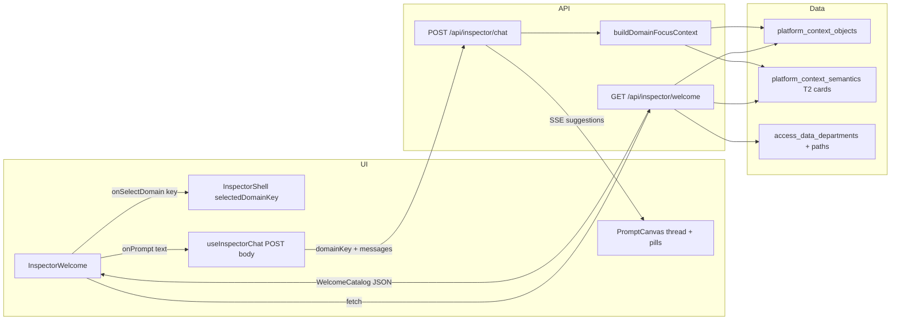

# Inspector: business-domain welcome cards and suggestion flows

**Status:** describes shipped behavior on the Inspector empty chat and post-reply pills  
**Last updated:** 2026-11-12  
**Audience:** product, engineering, and context/harvest owners who need to know how domain starters are built and how they reach the model.

---

## 1. What this is

Inspector has **two related “suggestion” surfaces**:

| Surface | When it appears | What it suggests |
|--------|-----------------|------------------|
| **Domain welcome cards** | Empty chat (`InspectorWelcome`) | Business areas (Crewing, Marine, Finance, …) and, after drill-in, up to **12 starter questions** per domain |
| **Follow-up suggestion pills** | After each completed assistant turn (`SuggestionPills` in `PromptCanvas`) | Up to **3** next questions parsed from the model’s closing bullets or prose (“I can X, Y, or Z”) |

This document focuses on **domain welcome and drill-in** end-to-end, with a shorter section on **follow-up pills** because they share the same goal: grounded, clickable next steps without warehouse jargon in the UI.

**Out of scope here:** Agent Lab workbench starters, dashboard empty states (`EmptyStatePrompts`), governed semantic model chips, and the static fallbacks in the chat route demo/dev path.

---

## 2. User journey (end-to-end)

### 2.1 Empty chat → pick a domain → pick a question → chat



1. User opens **Inspector** with no messages. `InspectorShell` renders `InspectorWelcome` as the chat empty state.
2. **GET `/api/inspector/welcome`** returns a cached **org-wide** `WelcomeCatalog` (same domains and starter questions for every signed-in user). SQL / discover access is still enforced per user at query time.
3. User clicks a **domain card** (e.g. HR). UI drills in: tagline, **Brief me on {Area}**, subtopic pills, and a **2-column grid** of question buttons (6 visible, “Show more” for the rest).
4. Clicking a question calls `onPrompt` → `submitText` → a normal chat turn. `selectedDomainKey` stays set on the shell.
5. Each **POST `/api/inspector/chat`** includes `domainKey` when a domain was selected. The route appends **`## DOMAIN FOCUS — …`** to the system prompt (soft scope, not a table lock).
6. When the turn completes, the API may emit **`{ type: 'suggestions', items: string[] }`**; the client shows pills under the last assistant message.

### 2.2 What “soft domain focus” means

- **Not** a hard filter on SQL or `describe_schema`.
- **Is** a ranked starting path: top datasets in that domain, summaries, and sample T2 intents, plus explicit **HR vs Crewing** separation notes.
- The model is instructed to start from those paths and still answer cross-domain questions if the user asks.

Resolution order for which domain applies (`resolveSessionDomainKey`):

1. Latest user message if it explicitly names a domain (“In HR …”, “Brief me on crewing”, Darwinbox/shore-office wording, etc.).
2. `domainKey` from the welcome drill-in (`InspectorShell` → `useInspectorChat`).
3. Earlier user messages in the session (sticky context for follow-ups).

---

## 3. Business domains (not `catalog.schema`)

Domains are **stakeholder-facing** buckets. Tables are assigned per object:

1. **Registered department paths** (`access_data_departments` + `access_department_paths`): longest matching path prefix on `full_path` wins.
2. **Path heuristics** if no department match (`welcome-departments.ts`): tokens like `crewing`, `darwin`, `pms`, `qhse`, etc.
3. **`explore`** (“More to explore”) for everything else.

Canonical display order and labels:

| Key | UI label |
|-----|----------|
| `crewing` | Crewing |
| `marine` | Marine |
| `technical` | Technical |
| `qhse` | QHSE |
| `finance` | Finance |
| `hr` | HR |
| `explore` | More to explore |

Test sources are excluded (`isTestSourceDisplayName`). The welcome catalog includes **all** production objects in the org (not filtered by per-user discover).

---

## 4. Welcome API: how the catalog is built

**Route:** `src/app/api/inspector/welcome/route.ts`  
**Cache:** `src/lib/inspector/welcome-cache.ts` — in-memory per org (~5 min fresh, stale-while-revalidate up to ~30 min). Invalidated on T0/T1/T2/T3 harvest success and on department path edits.

**Steps (on cache miss):**

1. Load active `platform_context_objects` for the org.
2. Load department definitions and path grants.
3. Filter to production objects (exclude test sources).
4. Batch-load latest T2 semantic cards (`platform_context_semantics`, `subject_kind: 'object'`).
5. Map each row to `WelcomeObject` (path, keywords, row estimates, `has_t3`, parsed semantic).
6. Call **`buildWelcomeCatalog(enriched, { departments, maxAreas: 12 })`** and cache the result.

**Response shape** (`WelcomeCatalog`):

- `totalTables`, `totalAreas`, `lastRefreshedAt` (from latest `last_t0_at` among visible objects)
- `areas[]`: each `WelcomeArea` has `key`, `label`, `tableCount`, `topics`, `tagline`, `covers`, `offers`, `subtopics`

`normalizeWelcomeCatalog()` on the client guards missing arrays so the UI never crashes on partial JSON.

---

## 5. Catalog logic: scoring, questions, and copy hygiene

**Module:** `src/lib/inspector/welcome-catalog.ts`  
**Semantics parser:** `src/lib/inspector/welcome-semantics.ts` (T2 `usage_patterns[].intent`)

### 5.1 Grouping

Every visible object → `resolveObjectDepartmentKey(full_path, departments)` → increment bucket count, merge `domain_keywords`, ingest semantic card.

### 5.2 Which tables influence starters (scoring)

`scoreObjectForDomain` prefers:

- T3-queried tables (`has_t3`)
- Larger row counts
- Curated / reporting paths
- Penalizes tiny Fivetran lookups, `_old` / `_bkp`, scratchpad, masters_crewing noise, etc.

`scoreBusinessIntent` scores each T2 intent string:

- Must be stakeholder-facing (`isStakeholderFacingLine`, `scrubStakeholderLine`)
- Rejects ETL/schema noise (`TECHNICAL_INTENT_NOISE_RE`, `NON_QUESTION_PREFIX_RE`)
- Boosts analytic phrasing (breakdown, headcount, trend, …)
- Penalizes single-record lookup intents

This replaced an earlier approach that used raw `domain_keywords` (often column/schema tokens like `prod`, `user`, `category`) and unweighted intent counts—which produced irrelevant starters.

### 5.3 Picking up to 12 questions per domain

`selectTopDomainCandidates`:

- Pool = all scored intent candidates from objects in the domain
- Greedy pick up to 12 with diversity: penalize reusing the same entity and subtopic (`intentsTooSimilar` dedupes near-duplicates)
- Each candidate gets a **subtopic** label via `DOMAIN_SUBTOPIC_RULES` (regex on intent + entity + path)

`buildDomainOffers`:

- Turns each intent into `{ label, prompt, topic? }`
- Prompt template: `In {DomainLabel}, {intent}.` (or `show …` if the intent doesn’t start with a verb)
- Always adds **`Brief me on {label}`** with a plain-English briefing prompt (no table names)
- Caps at 13 offers; UI shows 6 initially

`buildDomainSubtopics` counts offers per `topic` for the filter pills.

### 5.4 Taglines and “covers”

- `covers`: up to 4 short bullets for drill-in copy (intents + top entities), stakeholder-scrubbed
- `tagline`: fixed `DOMAIN_TAGLINES` per canonical key, or composed from covers
- UI never shows raw `catalog.schema.table` in welcome copy; `WAREHOUSE_TOKENS` and path-like strings are stripped

### 5.5 Subtopic examples (configured rules)

Examples of pill labels users see (counts depend on live data):

- **Crewing:** Manning & Reliefs, Contracts & Pay, Competency & Certificates, Seafarer Profiles
- **HR:** Headcount & Offices, Org & Reporting Lines, Payroll & Costing, Tenure & Audit Changes
- (Full rule table: `DOMAIN_SUBTOPIC_RULES` in `welcome-catalog.ts`)

---

## 6. Welcome UI: domain cards and drill-in

**Component:** `src/components/inspector/InspectorWelcome.tsx`  
**Styles:** `src/app/globals.css` (`.iw-*`)

### 6.1 Hero

- Companion avatar, time-of-day greeting + first name (session), subtitle “What should we dig into today?” when data exists.

### 6.2 Domain grid (suggest cards)

- Up to **6** areas on first view; “Show N more” if `maxAreas` capped below `totalAreas`.
- Each card: **domain illustration** (`DOMAIN_VISUALS`: Crewing crew/Gantt, Marine ship/route, Technical gear/PMS list, etc.) + title + accent color.
- Click → `selectDomain(key)` → `onSelectDomain(key)` on the shell (sets `selectedDomainKey` for chat).

### 6.3 Drill-in

- Back control clears domain selection and `domainKey`.
- Lead paragraph from `tagline` (scrubbed).
- **Brief me on {Area}** button (dedicated offer, not mixed into the grid).
- Subtopic pills (`role="tablist"`) filter `offers` by `topic`.
- **iw-offers-grid**: 2 columns; topic chip on each card when viewing “All”.
- **Show more questions** when more than 6 filtered offers.

### 6.4 Wiring in the shell

```text
InspectorShell
  selectedDomainKey state
  useInspectorChat({ domainKey: selectedDomainKey })
  emptyState = <InspectorWelcome onPrompt={submitText} onSelectDomain={setSelectedDomainKey} />
```

`domainKey` is sent on every chat POST while the user remains in that drill-in context (until Back).

---

## 7. Domain focus in chat (server)

**Module:** `src/lib/inspector/domain-context.ts`  
**Hook-in:** `src/app/api/inspector/chat/route.ts` — `buildDomainFocusContext` merged into system prompt with insights and session knowledge.

When a domain resolves:

1. Re-query visible objects in that domain (same rules as welcome).
2. Score and take top **8** paths (drop redundant `_old` variants when canonical exists).
3. Emit markdown section:
   - Scope note (especially **HR** vs **Crewing**)
   - Bullet list: `` `full_path` `` + entity/row hint + summary snippet + up to 3 intents
   - Instructions: soft scope, plain language in replies, use `describe_schema` on best paths

Failures are **non-fatal** (logged, empty string).

**Related search fixes** (so “Brief me on HR” doesn’t pull crewing tables): `src/lib/context/keywords.ts`, `src/lib/context/describe.ts` — short tokens like `hr`, catalog aliases for `darwin_box`, conversational word stripping in catalog search.

---

## 8. Follow-up suggestion pills (after a reply)

**Extract:** `src/lib/inspector/extract-suggestions.ts`  
**Emit:** `src/app/api/inspector/chat/route.ts` on `outcome === 'completed'`  
**Store:** `inspector-chat-live.ts` → `suggestions`  
**Render:** `PromptCanvas` → `SuggestionPills` under the last assistant message (Inspector `chatStyle`)

### 8.1 Parsing rules

1. Scan last ~16 lines for markdown bullets after cue phrases (“next step”, “follow-up”, …) → up to 3 items.
2. Else scan last paragraphs for prose offers matching `I can / We can / Want me to …` → `parseProseOfferLine` splits on `, or`, `;`, and ` or <verb>` boundaries.
3. Clean labels: cap length 8–120 chars, strip `**bold**` titles, sentence-case.

### 8.2 Prompting

`src/lib/inspector/prompts.ts` asks the model for **2–3 specific markdown-bullet follow-ups** grounded in the answer.

### 8.3 Important limitations

- Suggestions are **streamed once per turn**; reloading an old session does **not** re-parse pills from saved assistant text.
- If the model offers no follow-ups, **no pills** are shown (generic “Show table columns” fallback was removed).
- Loop-limit turns get fixed pills: “Continue from where you left off”, etc.

---

## 9. Data dependencies and operations

| Dependency | Role |
|------------|------|
| Harvest T0 | Objects in catalog, `last_t0_at`, row estimates, `domain_keywords` |
| Harvest T2 | `platform_context_semantics.card` → entity, summary, `usage_patterns` intents |
| Harvest T3 | `last_t3_at` boosts object scoring |
| Access | Department paths define domain assignment; discover visibility gates welcome |
| Auth | Welcome route requires signed-in user (`resolveInspectorPrincipal`) |

**Quality of starters** rises when:

- More objects in a domain have T2 cards with stakeholder-style intents
- Curated/reporting tables are harvested and T3-queried
- Department paths correctly cover warehouse layout

**Backfill note:** Keyword indexing improvements for HR/Darwinbox apply on new keyword extraction; domain focus and search already bias to `darwin_box` employee masters without waiting for a full re-backfill.

---

## 10. File map (implementation index)

| Concern | Primary files |
|---------|----------------|
| Welcome API | `src/app/api/inspector/welcome/route.ts` |
| Catalog build | `src/lib/inspector/welcome-catalog.ts` |
| Department resolution | `src/lib/inspector/welcome-departments.ts` |
| T2 parse | `src/lib/inspector/welcome-semantics.ts` |
| Welcome UI | `src/components/inspector/InspectorWelcome.tsx` |
| Domain prompt injection | `src/lib/inspector/domain-context.ts` |
| Chat route | `src/app/api/inspector/chat/route.ts` |
| Client domain key | `src/components/inspector/InspectorShell.tsx`, `src/hooks/useInspectorChat.ts` |
| Follow-up extract | `src/lib/inspector/extract-suggestions.ts` |
| Tests | `src/lib/inspector/__tests__/welcome-catalog.test.ts`, `welcome-departments.test.ts`, `domain-context.test.ts`, `extract-suggestions.test.ts` |

---

## 11. What we changed (timeline summary)

Changelog entries in `docs/CHANGELOG.md` (2026-11-11 cluster) capture the iteration:

1. **Welcome rebuild** — real data areas, capability previews, then **business domains** instead of schema groupings.
2. **Browse → drill-in** — domain cards, then question offers; stakeholder copy scrubbing; crash hardening via `normalizeWelcomeCatalog`.
3. **Per-domain illustrations** and shorter hero copy.
4. **HR vs Crewing** — scoring, T2-based offers, `domain-context` soft focus, catalog search/keyword fixes.
5. **Richer drill-in** — 12 questions, subtopic pills, 2-column grid, show more.
6. **Follow-up pills** — prose “I can …” parsing; removed generic SQL jargon fallbacks.

---

## 12. Verification checklist

- **Unit:** `npx vitest run src/lib/inspector/__tests__/welcome-catalog.test.ts src/lib/inspector/__tests__/domain-context.test.ts src/lib/inspector/__tests__/extract-suggestions.test.ts`
- **Manual:** Sign in → Inspector empty state → each domain shows illustration → drill-in shows subtopics and domain-specific questions (not schema tokens) → pick HR starter → answer uses shore-office framing → assistant close with bullets or “I can …” → pills match text.
- **API (auth):** `GET /api/inspector/welcome` returns 401 without session; with session returns `areas[].offers` length up to 13 per domain with data.

---

## 13. Known gaps / not done

- Browser QA was not always recorded after each welcome tweak (noted in changelog).
- `lastRefreshedAt` is still computed server-side but **not shown** in the current welcome UI.
- Workbench / Agent chat does not yet share the follow-up suggestion SSE path (Inspector-only).
- Governed semantic “Questions your team asks” (`EmptyStatePrompts` + `modelId`) is parallel to domain welcome; `InspectorWelcome` currently receives `modelId` but domain flow does not depend on it.
