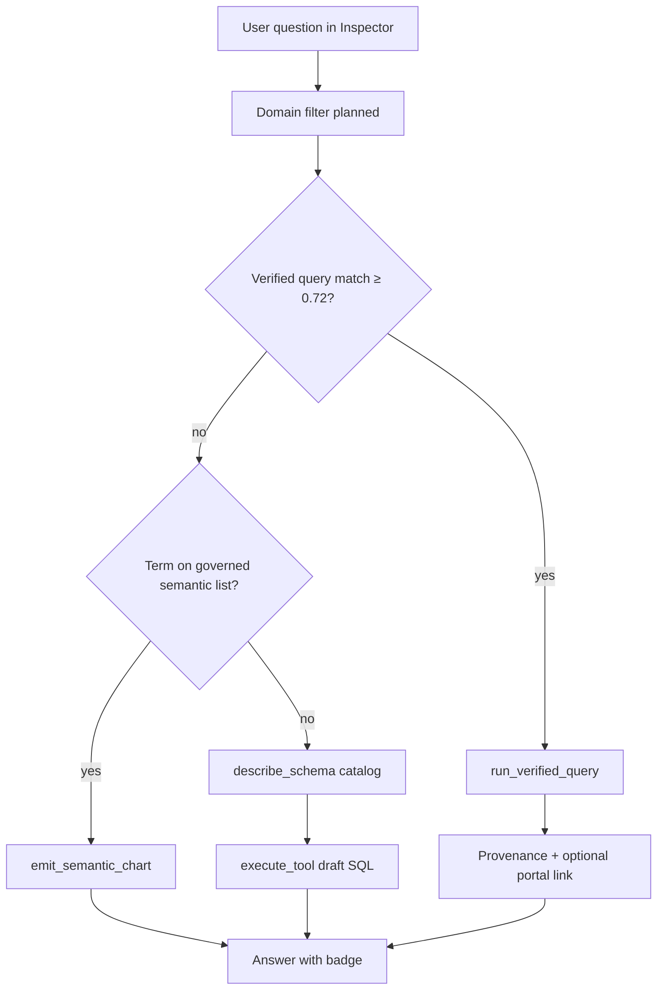

# Inspector: semantic layer and Power BI together

**Audience:** Product owners, data stewards, engineers wiring Inspector and the Power BI bridge.  
**Status:** Describes behaviour on `feature/powerbi-bridge` as of 2026-11-13.  
**Related:** [powerbi-harvest-build-plan.md](../powerbi-harvest-build-plan.md) §1, §10.3 · [powerbi-integration-validation.md](../powerbi-integration-validation.md) · [jobs/powerbi-implementation-tracker.md](../jobs/powerbi-implementation-tracker.md)

---

## 1. Summary

Aloft already has a **governed semantic layer** on Databricks (promoted metrics and dimensions in `platform_semantic_*`). The **Power BI bridge** adds a second, complementary path: harvest report semantics, translate DAX to SQL, prove parity, and publish **verified queries** that Inspector can run without inventing SQL.

Both paths execute **read-only warehouse SQL**. They differ in **definition ownership** and **trust badge**, not in infrastructure.

Synergy also operates a **separate Power BI portal** for interactive reports. Aloft does **not** need to embed those reports to deliver value. The portal remains the canonical viewer; Inspector delivers **numbers with provenance** and (planned) **deep links** back to the portal.

---

## 2. Two layers, one warehouse

| | Governed semantic layer | Power BI verified queries |
|--|-------------------------|---------------------------|
| **What it is** | Org-curated metric/dimension definitions promoted in Aloft | Measures from Power BI models, translated to SQL, **parity-checked**, steward-published |
| **Primary store** | `platform_semantic_models`, measures/dimensions, optional `platform_nl_intent_embeddings` | `kb_verified_queries` (+ `pbi_translations`, `pbi_measures`, `pbi_models`) |
| **Inspector tools** | `emit_semantic_chart`, `emit_disambiguation` | `run_verified_query` |
| **How chat discovers it** | `buildSemanticContext` → **GOVERNED SEMANTIC MODEL** block in the system prompt | `buildVerifiedQueryContext` → **VERIFIED QUERIES** table (match on user message) |
| **Typical user ask** | “Chart governed fleet consumption by month” | “Fleet CII AER YTD — **same as the CII report**” |
| **Trust story** | Promotion gate, refuse/guess rules, governed IDs | Parity vs Power BI oracle; cite model/measure from tool provenance |
| **Fallback** | Catalog + draft SQL only for data **not** in the governed list | Catalog + draft SQL when **no** verified row matches (score &lt; 0.72) |
| **Portal** | Aloft dashboards / semantic charts | External Power BI portal via `pbi_reports.web_url` (deep link — see §7) |

Power BI is **not** a replacement semantic layer in Postgres. It is a **report-aligned, parity-backed shortcut**. The governed layer remains the long-term vocabulary on Unity Catalog.

---

## 3. Separate Power BI portal

| Embed reports in Aloft | Link to existing portal |
|------------------------|-------------------------|
| Embed tokens, licensing, RLS identity in the app | Portal keeps existing SSO and RLS |
| Second place to maintain report UX | One canonical viewer |
| `powerbi-client` + token API | `web_url` + optional page-level URLs later |

**Recommended split:**

- **Portal:** full report experience (slicers, bookmarks, exports).
- **Aloft Inspector:** Q&A, verified numbers, lineage, catalog, governed charts.
- **Estate → Power BI:** operator browse (models, measures, conflicts, **Open in Power BI**).

Estate report rows already expose `web_url` from inventory (`src/lib/powerbi/inventory.ts`). Verified-query answers should add the same style of link once portal resolution is implemented (§7).

---

## 4. Retrieval order in Inspector

### 4.1 Target order (product design)

From [powerbi-harvest-build-plan.md](../powerbi-harvest-build-plan.md) §10.3 — **trust decreases down the ladder**:

1. **Domain inference** (scope verified queries and conflicts by business domain).
2. **Verified-query match** — vector (and keyword fallback) on `kb_verified_queries`; threshold ≥ **0.72** → `run_verified_query`.
3. **`matchIntents`** on governed measures (`src/lib/semantic/intent-match.ts`) → `emit_semantic_chart`.
4. **Harvested catalog** — `describe_schema` search, describe, profile.
5. **Draft SQL** — `execute_tool`, clearly labelled as neither verified nor governed.

### 4.2 What runs today (2026-11-13)

On each Inspector chat request (`src/app/api/inspector/chat/route.ts`):

| Step | Implemented? | Mechanism |
|------|----------------|-----------|
| Inject verified-query hints | **Yes** | `buildVerifiedQueryContext(orgId, firstUserMessage)` → appended to system prompt |
| Prompt priority for VQ | **Yes** | Step 0a in `INSPECTOR_SYSTEM_PROMPT` / warehouse-only variant (`src/lib/inspector/prompts.ts`) |
| Governed semantic block | **Yes** (when model wired to connection) | `buildSemanticContext` + `buildSemanticPromptSection` |
| Semantic chart tools | **Yes** when semantic entities exist | `buildToolConfig(..., includeSemanticChart)` |
| Domain filter on VQ match | **No** | Tracker: “Domain filter on VQ match — Not started” |
| Automatic `matchIntents` in chat route | **Partial** | Used on Metrics / resolve-intent APIs; chat still relies on LLM + prompt sections |
| Portal URL in provenance | **No** | `run-verified-query.ts` returns model/measure only (§7) |

The model **chooses** among injected blocks using prompt order. Hardening means server-side routing (explicit first-hit path) for steps 1–3.

### 4.3 Context modes

| Mode | Catalog (`describe_schema`) | Verified queries | Semantic chart |
|------|----------------------------|------------------|----------------|
| **Harvested** | Yes — Step 1 in main workflow | Yes | Yes if semantic model attached |
| **Warehouse only** | No — direct `execute_tool` / SHOW | Yes | Yes if semantic model attached |

---

## 5. “Match `kb_verified_queries`” explained

**Match** means: before the model answers, the server searches published rows in `kb_verified_queries` for questions **semantically or textually** similar to the user’s message.

**Flow:**

```text
User message
    → matchVerifiedQueries(orgId, message, limit=3)
    → hits with score ≥ 0.72 (vector) or text fallback
    → formatVerifiedQueryBlock(hits) in system prompt
    → model calls run_verified_query(verified_query_id)
    → warehouse runs stored SQL; provenance returned to UI
```

**Implementation:**

| Piece | Path |
|-------|------|
| Match + embed | `src/lib/powerbi/verified-query-match.ts` |
| Prompt block | `src/lib/inspector/verified-query-format.ts` |
| Context builder | `src/lib/inspector/verified-query-context.ts` |
| Tool | `src/lib/inspector/tools.ts` (`run_verified_query`) |
| Execute | `src/lib/powerbi/run-verified-query.ts` |
| Publish rows | `src/lib/powerbi/publish.ts` → `kb_verified_queries` after parity pass |

**Row requirements:** `status = 'verified'`, `origin = 'powerbi'`, embedding present for vector match (filled at publish via `verified-query-embed.ts`).

If nothing matches, the VERIFIED QUERIES section is empty and Inspector follows catalog / semantic / draft SQL as usual.

---

## 6. Governed semantic layer in the same turn

When `buildSemanticContext` returns entities, the prompt adds **GOVERNED SEMANTIC MODEL** (`buildSemanticPromptSection` in `prompts.ts`):

- Prefer **`emit_semantic_chart`** with exact measure/dimension IDs.
- **`emit_disambiguation`** when the term is ambiguous or not in the list — do not guess via raw SQL.
- Raw `execute_tool` is for exploration **outside** the governed list (harvested mode: after catalog search).

Verified queries and semantic charts can both appear in one system prompt. **Steward policy** (§8) should decide precedence when both could apply.

---

## 7. Deep links to the Power BI portal (planned)

High-value follow-up **without** `powerbi-client` embed: after a verified hit, show **View in Power BI portal** using harvested metadata.

### 7.1 Fields already stored

| Store | Fields useful for linking |
|-------|---------------------------|
| `pbi_reports` | `pbi_report_id`, `pbi_model_id`, `model_id`, `name`, **`web_url`** |
| `pbi_reports.props.parse` | `measure_refs[]`, `page_count` (from `pbi_parse` + legacy `report.json`) |
| `pbi_workspaces` | `pbi_workspace_id` (build URL if `web_url` missing) |
| `pbi_usage` | views per report (tie-break among multiple reports on one model) |
| `kb_verified_queries` | `pbi_measure_id`, `props` (`model_name`, `measure_name`, `pbi_model_id`) — **no `pbi_report_id` yet** |

### 7.2 Resolver logic (not built)

Given `verified_query_id`:

1. Load `pbi_measure_id` → measure `name`, `model_id`.
2. List `pbi_reports` for that model.
3. Prefer report where `props.parse.measure_refs` contains the measure name; else usage or steward hint (`pbi_report_hint` in eval templates).
4. Return `web_url` (v1); optional `ReportSection{pageGuid}` when page ids are harvested (v2).

### 7.3 Suggested implementation steps

| Step | Action |
|------|--------|
| A | `resolvePowerBiPortalLink(orgId, verifiedQueryId)` server helper |
| B | Extend `runVerifiedQueryForPrincipal` provenance + `query_result` event with `portal_url`, `report_name` |
| C | Optional: stamp `pbi_report_id` on `kb_verified_queries.props` at publish when unambiguous |
| D | Steward override: `props.portal_report_id` or report name hint on the verified query row |

---

## 8. Steward policies when both layers know a metric

When the same business concept (e.g. CII AER) exists in **governed semantic** and **published verified query**, pick one **canonical policy** per family:

| Policy | When to use |
|--------|-------------|
| **Reports win** | User asks for parity with Power BI / named report → verified query first |
| **Semantic wins** | Self-serve analytics and Aloft dashboards → `emit_semantic_chart` first; VQ when user names Power BI |
| **Converge** | Promote aligned definitions; link semantic intent to Power BI measure in lineage UI |

Document conflicts in Estate → Power BI **measure conflicts**; do not let Inspector silently pick divergent definitions.

---

## 9. What to say in answers (provenance)

Train responses (and UI badges) on **source**, not internal tool names:

| Path | User-facing framing |
|------|---------------------|
| Verified query | Matches Power BI model *X*, measure *Y* (parity-checked at publish). Link to portal when available. |
| Semantic chart | From governed model *Z*, measure *label* (`msr_…`). |
| Catalog / draft SQL | Exploratory query on named tables — **not** parity-checked or governed. |

Boost / eval: record `path = verified_query` vs `catalog_llm` vs semantic in question banks ([powerbi-integration-validation.md](../powerbi-integration-validation.md) §5.2).

---

## 10. CII pilot rollout (operator checklist)

1. Run harvest pipeline: Inventory → Definitions → Parse → (domains) → Translate → Oracle → Parity → **Publish**.
2. Confirm `kb_verified_queries` rows with `status = verified` and embeddings.
3. Ask Inspector pilot questions from `eval/powerbi/suites/cii-pilot-questions.template.json`; expect `run_verified_query` for published measures.
4. Keep governed semantic models for questions **outside** the published set.
5. Record baseline vs after in `powerbi-integration-validation.md` §5.
6. Add portal links (§7) when stewards confirm canonical report per measure.

---

## 11. Code map

| Concern | Location |
|---------|----------|
| Chat assembly | `src/app/api/inspector/chat/route.ts` |
| Workflow + semantic prompt | `src/lib/inspector/prompts.ts` |
| Tools | `src/lib/inspector/tools.ts` |
| Semantic context | `src/lib/semantic/context-builder.ts` |
| Intent match (Metrics APIs) | `src/lib/semantic/intent-match.ts` |
| VQ match / run / publish | `src/lib/powerbi/verified-query-match.ts`, `run-verified-query.ts`, `publish.ts` |
| Report URLs in estate | `src/views/agent-lab/estate/powerbi.tsx`, `src/lib/powerbi/inventory.ts` |
| Schema | `KbVerifiedQuery`, `PbiReport`, `PbiMeasure` in `prisma/schema.prisma` |

---

## 12. Gaps and next engineering work

| Item | Tracker / plan |
|------|----------------|
| Domain-scoped verified-query match | `powerbi-implementation-tracker.md` Phase 3 |
| Server-side retrieval ladder (not LLM-only) | Build plan §10.3 |
| `matchIntents` in main Inspector chat route | Build plan §10.3 |
| Portal deep links after verified hit | This doc §7 |
| RLS models: publish skip + embed identity N/A for portal link | `publish.ts` skips `rls_required` models today |

---

## 13. Diagram



---

*Questions or steward policy decisions for CII / Finance should be recorded in the implementation tracker and question bank metadata (`pbi_report_hint`, tolerance, oracle).*
