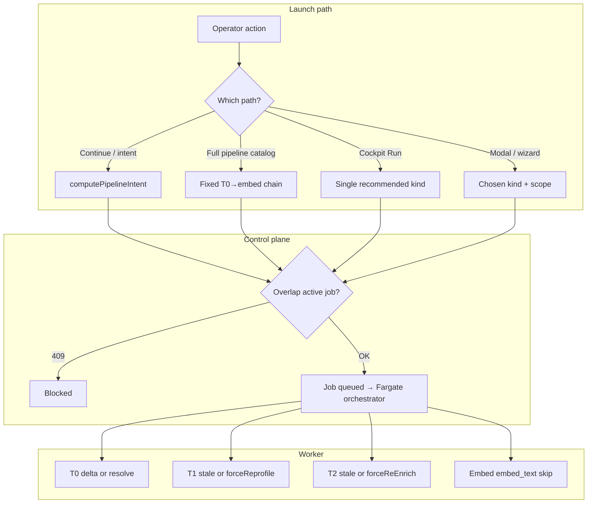

# Redundancy, stale skips, and launch paths

**Audience:** Operators, product, engineering  
**Last updated:** 2026-10-28  
**Related:** [efficient-pipeline-playbook.md](./efficient-pipeline-playbook.md) (golden paths + brainstorm) · [current-status.md](./current-status.md) · [versioning-and-incremental.md](./versioning-and-incremental.md) · [schema-harvest-guide.md](./schema-harvest-guide.md) · [phase-0-chain-deploy.md](./phase-0-chain-deploy.md)

---

## 1. What this document answers

Estate harvest runs in **tiers** (inventory → T0 → T1 → T2 → embed → T3). Operators often ask:

- If a tier **already ran**, do we **run it again**?
- When we click **Continue**, **Run on Fargate**, or **Run full pipeline**, what actually gets enqueued?
- Where can we still pay for a **job / Fargate task** even when **little warehouse work** happens?

This doc separates two ideas:

| Concept | Meaning |
|--------|---------|
| **Warehouse redundancy** | Re-querying Databricks, re-profiling, re-enriching, or re-embedding when the latest data is already valid. |
| **Orchestration redundancy** | Starting a job row, orchestrator, or Fargate task when most objects in scope are skipped inside the worker. |

**Default product stance:** avoid warehouse redundancy; accept some orchestration cost when launch scope is wider than the stale set.

---

## 2. Freshness model (single source of truth in Postgres)

**Plain-language guide with timestamp examples:** [tier-timestamps-and-staleness.md](./tier-timestamps-and-staleness.md).

All T1+ tiers operate on **`platform_context_objects`** (Scanned registry). Discovery rows live in **`platform_estate_objects`** and are unrelated to stale T1/T2 logic.

Per object, the worker and UI intent logic use timestamps on the context object row:

| Field | Set by | Meaning |
|-------|--------|---------|
| `last_t0_at` | T0 structural | Object exists in Scanned registry with current structural metadata |
| `last_t1_at` | T1 profile | Last successful profile for this object |
| `last_t2_at` | T2 semantic | Last successful semantic card for this object |
| Embedding presence | `embed` job | Row in `platform_context_embeddings` with non-null vector (object-level check in intent SQL) |

**Stale for T1 (profile):** never profiled, or profile older than last structural scan:

```text
needs_profile  ⇔  last_t0_at IS NOT NULL
                 AND (last_t1_at IS NULL OR last_t1_at < last_t0_at)
```

**Stale for T2 (enrich):** has profile, semantic missing or older than profile:

```text
needs_enrich   ⇔  last_t1_at IS NOT NULL
                 AND (last_t2_at IS NULL OR last_t2_at < last_t1_at)
```

**Gap for embed in UI/intent (coarse):** scanned object without object-level embedding:

```text
needs_embed    ⇔  last_t0_at IS NOT NULL AND no object embedding row
                 (aggregate: needs_embed = scanned_objects - embedded_objects)
```

The **embed worker** is finer-grained: it still loads all in-scope subjects with semantic data, then **skips** when computed `embed_text` equals the stored `embed_text` (`src/lib/context/embed.ts`). So intent may show “needs embed” while the job stats show high `skipped`.

**If embeddings “went inactive” catalog-wide:** usually **`platform_context_objects.lifecycle = 'dropped'`** (T0 drop pass), not deletion of embedding rows — see [embeddings-lifecycle-and-drops.md](./embeddings-lifecycle-and-drops.md).

Implementation references:

- Worker T1 stale filter: `runT1Profile` in `src/lib/context/harvest.ts`
- Worker T2 stale filter: `runT2Enrich` in `src/lib/context/enrich.ts`
- Scoped health + Continue chain: `computePipelineIntent`, `aggregateHealthFromRows` in `src/lib/estate/pipeline-intent.ts`
- Plan preview stale count: `countStaleObjectsForKind` in `src/lib/estate/pipeline-intent.ts`

---

## 3. Per-tier worker behavior (what gets skipped)

### 3.1 `estate_inventory`

| Behavior | Detail |
|----------|--------|
| Incremental | Re-runs discovery against source scope; soft-removes unseen estate rows per catalog rules |
| Skip | No per-table “already discovered” skip — expect metadata refresh work |
| Overwrite | N/A |

### 3.2 `t0_structural`

| Mode | When | What runs |
|------|------|-----------|
| **Full resolve** | First source sweep (`last_sweep_at` null), **`forceFullScan`**, **Focus `includePatterns`**, or **exclude-only** modal scope | Lists in-scope objects; may run lifecycle drop on full sweeps |
| **Delta** | Subsequent runs without the above | `detectChanges` since last sweep — **only altered** tables |

Important: **Focus / Limit globs force resolve**, not delta, because delta would miss unaltered tables in the subset (`runT0Harvest` comments in `harvest.ts`).

| Force flag | Effect |
|------------|--------|
| `forceFullScan` on job scope | Full resolve instead of delta (Jobs modal checkbox; not all entry points expose it) |

T0 does **not** use `last_t1_at` / `last_t2_at`. A delta T0 that touches a table updates `last_t0_at` and can **invalidate** downstream tiers for that table (T1 becomes stale vs new T0).

### 3.3 `t1_profile`

| Default | **Stale-only** — profile only objects where `last_t1_at < last_t0_at` (or never profiled) |
|---------|-------------------------------------------------------------------------------------------|
| **All fresh in scope** | Job **succeeds** with `objects_profiled: 0` and `skipped_stale: N` — no Databricks profile queries |
| **Overwrite** | `forceReprofile: true` on job scope → every active object in scope is profiled; **new** profile version row per object (`platform_context_profiles`) |

### 3.4 `t2_semantic`

| Default | **Stale-only** — enrich only if `last_t2_at < last_t1_at` (or never enriched) |
|---------|----------------------------------------------------------------------------------|
| **Overwrite** | `forceReEnrich: true` → all profiled objects in scope (still requires `last_t1_at`) |
| **Versions** | Each enrich appends semantic card version (`platform_context_semantics`) |

### 3.5 `embed`

| Scope | Orchestrator applies job `includePatterns` / exclude schemas when loading object/column IDs |
|-------|---------------------------------------------------------------------------------------------|
| **Skip** | Subject skipped when stored `embed_text` equals newly composed text |
| **Stats** | `skipped`, `objects_embedded`, `columns_embedded` on job completion |

No `forceReEmbed` flag — to refresh vectors after semantic change, run embed; unchanged text is skipped.

### 3.6 `t3_usage`

Separate continuation / usage model. Intent may surface **T3** when profile/enrich/embed gaps are zero org-wide; running T3 does **not** use the T1/T2 stale timestamps above. See [current-status.md](./current-status.md) §3.6.

---

## 4. Force / overwrite flags (launch scope)

Stored on the job’s JSON **scope** and passed through launch → orchestrator:

| Flag | Tiers | UI today |
|------|-------|----------|
| `forceFullScan` | T0 | Jobs modal — “Full structural rescan” |
| `forceReprofile` | T1 | Jobs modal |
| `forceReEnrich` | T2 | Jobs modal |

Helpers: `readJobScopeRunnerFlags`, `mergeJobScopeRunnerFlags` in `src/lib/context/job-scope-flags.ts`.

**Guided launch wizard** does not replace these checkboxes for deep overwrite; advanced modal still owns explicit overwrite.

---

## 5. Control plane: what we enqueue before the worker runs

### 5.1 APIs

| API | Role in redundancy story |
|-----|---------------------------|
| `GET …/jobs/plan` | **`staleObjectCount`** for T1/T2 (same rules as workers); **`humanSummary`** references stale counts |
| `GET …/pipeline/intent` | Scoped **`needs_*`**, **`recommendedKinds`**, blockers |
| `POST …/pipeline/continue` | Builds launch payload from intent (Continue on Scanned) |
| `POST …/jobs/launch` | Creates job(s); **409** if active job overlaps scope + kind |
| `GET …/jobs/cockpit` | Org or scoped health + optional **`intent`** |

### 5.2 Duplicate / overlap protection

**`findScopedLaunchConflict`** + **`includePatternsOverlap`**: if an **active** job of the same kind overlaps your Limit patterns, launch returns **409** (`ACTIVE_JOB_OVERLAP`).

This blocks **concurrent** duplicate work, not “you ran T1 yesterday.” It does **not** block launching T1 again when everything is fresh (worker exits cheaply).

### 5.3 Pipeline Continue (minimum tier chain)

When Scanned **Continue pipeline** asks to run **through embed**, `computePipelineIntent` builds a **chain** only for tiers with gaps:

```text
if needs_profile > 0     → include t1_profile
if needs_enrich > 0      → include t2_semantic   (when through ≥ T2)
if needs_embed > 0       → include embed         (when through = embed)
```

- **Does not** enqueue T0 if Scanned rows already exist (unless discovery-not-scanned path applies).
- **`sequential: true`** when multiple kinds → launch stamps shared **`pipeline_run_id`** and runs jobs in order (see [phase-0-chain-deploy.md](./phase-0-chain-deploy.md)).
- Button disabled / **IDLE** blocker when no stale tiers in scope.

### 5.4 Cockpit “Recommended next step”

**`getJobRecommendations`** (org-wide **`getPipelineHealth`**) picks **one** primary action by priority:

1. `estate_inventory` if no discovery  
2. `t0_structural` if discovery_not_scanned  
3. `t1_profile` if needs_profile  
4. `t2_semantic` if needs_enrich  
5. `embed` if needs_embed  
6. else T3 / idle

**Run on Fargate** launches that recommendation. For T1/T2/embed, **`includePatterns` is often empty** → **full source** scope. Workers still **skip stale-safe objects**, but the job walks the whole source filter set.

T0 gap recommendations may include **sample schema Limit globs** (`catalog.schema.*`).

### 5.5 Catalog “Run full pipeline (from T0)”

Always launches a **fixed sequential chain** T0 → T1 → T2 → embed for the schema (not “minimum gaps only”).

| Tier in chain | Enqueue | Worker may still skip |
|---------------|---------|------------------------|
| T0 | Always in chain | Delta vs full per §3.2 |
| T1–embed | Always in chain | Stale-only / embed_text skip per §3 |

Use this when you **intentionally** refresh the whole pipeline for a schema; prefer **Continue** when only T1+ gaps exist.

### 5.6 Other entry points

| Entry | Redundancy note |
|-------|-----------------|
| Jobs L1 kind cards + modal | You choose kind + scope; plan shows stale for T1/T2 |
| **Guided launch** wizard | Intent-driven kinds + scope; worker rules unchanged |
| Object/catalog **Refresh / Reharvest / Enrich** routes | Launch scoped jobs via `includePatterns` |
| Scheduled / **Run scheduled now** | Same workers; scope from schedule definition |

Phase 5 remediation targets **unifying** these entry points ([remediation-master-plan.md](./remediation-master-plan.md)).

---

## 6. Two-layer summary table

| Tier | Avoids warehouse redo by default? | Can still start empty-ish job? |
|------|-----------------------------------|--------------------------------|
| Inventory | No (refresh discovery) | Yes |
| T0 | Delta after first sweep | Yes — delta may sweep 0 rows |
| T1 | **Yes** — stale-only | **Yes** — full source launch, all fresh → `skipped_stale` |
| T2 | **Yes** — stale-only | **Yes** — same |
| Embed | **Yes** — embed_text match | **Yes** — loads subjects, skips in process |
| Continue chain | Enqueues **only gap tiers** | Each tier still a separate job |
| Full pipeline (T0→embed) | Partial — T0 always queued | **Yes** — by design |

---

## 7. Reading job outcomes

| Signal | Interpretation |
|--------|----------------|
| T1 `skipped_stale` in stats | All in-scope objects already profiled vs last T0 — **success, no warehouse profile work** |
| T1 `objects_profiled: 0`, no `skipped_stale`, **failed** | No objects matched scope (empty Limit / filters) |
| T2 `objects_enriched: 0`, succeeded | All candidates stale vs profile |
| Embed `skipped` high | Semantic text unchanged vs stored embedding text |
| Job **succeeded** with zeros | Often **expected** incremental success — not necessarily a bug (charter: honest EMPTY UI still partial) |

---

## 8. Operator playbooks

### 8.1 One schema, tables already scanned, only some need profile

**Prefer:** Scanned → select schema → **Continue pipeline** (or Guided launch with `catalog.schema.*` Limit).

**Avoid:** Catalog **Run full pipeline (from T0)** unless you need structural refresh.

**Avoid:** Cockpit **Run on Fargate** for T1 when counts are small but recommendation is **full source** — scope manually with Limit first.

### 8.2 Structural change in Databricks

1. T0 on affected scope (Focus / schema Limit).  
2. Continue or launch T1 — only objects with **new** `last_t0_at` vs `last_t1_at` profile.  
3. T2 / embed follow stale rules automatically.

### 8.3 Deliberate full re-profile / re-enrich

Jobs modal → enable **forceReprofile** / **forceReEnrich** (and **forceFullScan** if structural full list needed).

Expect **new version rows** for T1/T2 — see [versioning-and-incremental.md](./versioning-and-incremental.md).

### 8.4 “Nothing to do” but UI still suggests work

| Symptom | Check |
|---------|--------|
| Continue disabled, IDLE | Scoped health shows no `needs_*` |
| Scanned tier pills green but embed gap | Object embedding missing vs embed_text already current — run embed once; stats may show skips |
| Discovery vs Scanned mismatch | Run inventory + T0 on unscanned discovery paths |

---

## 9. Engineering notes and known gaps

| Topic | Status |
|-------|--------|
| T1 stale-only | **Shipped** — `versioning-and-incremental.md` §2 table was written before this; treat **current-status** + this doc as authoritative |
| `needs_embed` vs embed skip | Intent uses **presence**; worker uses **embed_text** equality — counts can diverge slightly |
| Cockpit launch without stale pre-check | Worker handles; may spin Fargate for no-op T1 |
| T0 in full pipeline | Always enqueued even when schema structurally current |
| Phase 5 | Entry-point unification, stronger preflight, EMPTY job UX |

Tests: `src/lib/estate/pipeline-intent.test.ts`, `src/lib/context/job-scope.test.ts`.

---

## 10. Quick reference diagram



---

## 11. Related code map

| Area | Path |
|------|------|
| T0 runner | `src/lib/context/harvest.ts` — `runT0Harvest` |
| T1 runner | `src/lib/context/harvest.ts` — `runT1Profile` |
| T2 runner | `src/lib/context/enrich.ts` — `runT2Enrich` |
| Embed | `src/lib/context/embed.ts`, `scripts/context/orchestrator.ts` (`embed` case) |
| Intent / stale counts | `src/lib/estate/pipeline-intent.ts` |
| Cockpit recommendations | `src/lib/estate/cockpit.ts` |
| Launch overlap | `src/lib/context/enqueue-and-launch.ts` |
| UI Continue | `src/components/estate/ScannedPipelineScopeBar.tsx` |
| UI Active Runs | `src/components/estate/ActiveRunsPanel.tsx` |
