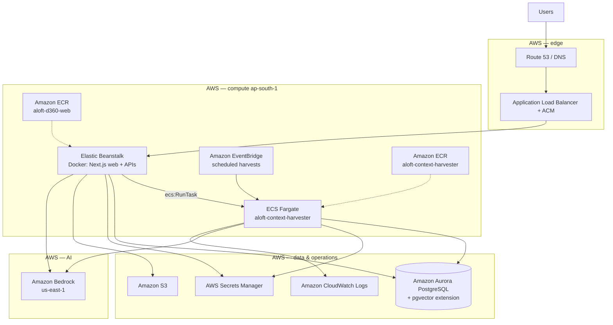

# ALOFT D360 — High-level overview (MAP / portfolio evaluation)

| | |
|---|---|
| **Product** | ALOFT D360 (Agent Lab) — enterprise AI analytics and agent-operations platform |
| **Repository** | `aloft-d360` (Next.js monolith + shared packages) |
| **Primary AWS region** | `ap-south-1` (application, ECS, Aurora) |
| **Bedrock region** | `us-east-1` (model inference) |
| **Document date** | October 2026 |

**Purpose:** Basic high-level material for **AWS MAP** migration portfolio evaluation. Detailed AWS provisioning steps are in [cloud-team-architecture-handoff.md](./cloud-team-architecture-handoff.md).

**Hybrid note:** The workload is **AWS-centric** for compute and application data (Beanstalk, ECS, Aurora, Bedrock, S3, Secrets Manager). **Microsoft Entra ID** (identity), **Azure Databricks** (warehouse SQL), and **Azure AI Foundry / OpenAI** (tool-calling chat, boost, embeddings) are integrated over **HTTPS (443)** and remain outside AWS.

---

## 1. Architecture diagram (AWS)

### 1.1 AWS deployment view (target)



### 1.2 Traffic and integration flows

| Flow | Path |
|------|------|
| **Interactive app** | User → **ALB (HTTPS)** → **Elastic Beanstalk** (container port **3000**) |
| **Authentication** | User → **Microsoft Entra ID** → OAuth callback to Beanstalk public URL |
| **Application database** | Beanstalk and Fargate → **Aurora PostgreSQL** (TCP **5432**, private) |
| **Background harvest** | **EventBridge** and web **RunTask** → **ECS Fargate** harvester task |
| **Generative AI (AWS)** | Beanstalk + Fargate → **Bedrock** (`us-east-1`) |
| **Warehouse analytics** | Beanstalk + Fargate → **Databricks SQL API** (Azure, egress **443**) |
| **Chat / embeddings (Azure)** | Beanstalk → **Azure AI Foundry / OpenAI** (egress **443**) |

### 1.3 ASCII reference (for print / Word)

```
Users ──HTTPS──► DNS ──► ALB + ACM ──► Elastic Beanstalk (Next.js :3000)
  │                                      │
  │ SSO (Entra)                          ├──► Aurora PostgreSQL (5432)
  └──► Microsoft Entra                   ├──► Amazon Bedrock (us-east-1)
                                         ├──► ECS RunTask ──► Fargate harvester
                                         ├──► Secrets Manager, S3
                                         ├──► Azure Databricks (443)
                                         └──► Azure AI Foundry / OpenAI (443)

EventBridge ──► Fargate harvester ──► Aurora, Databricks, Bedrock, CloudWatch
```

### 1.4 AWS services in scope (summary)

| Category | Services |
|----------|----------|
| **Compute** | Elastic Beanstalk, ECS Fargate, ECR |
| **Networking & security** | ALB, ACM, Route 53 (or corporate DNS), VPC security groups, IAM roles |
| **Data** | Aurora PostgreSQL (pgvector), S3 |
| **Integration & ops** | EventBridge, Secrets Manager, CloudWatch Logs |
| **AI** | Amazon Bedrock |

---

## 2. Technology stack details

### 2.1 Application

| Layer | Technology | Role |
|-------|------------|------|
| **UI** | React 18, Next.js 15 App Router, TypeScript, Tailwind CSS | Web client and server-rendered pages |
| **APIs** | Next.js Route Handlers (`src/app/api`, ~140 routes) | REST and SSE (streaming) backends |
| **Auth** | NextAuth.js, Microsoft Entra ID (Azure AD) | SSO; optional admin group mapping; RBAC in app |
| **ORM / DB access** | Prisma 5.x | Schema, migrations, queries to Aurora; raw SQL where needed (vectors, queues) |
| **Monorepo** | npm workspaces (`packages/aloft-shared`) | Shared UI/types |

### 2.2 Data stores

| Store | Technology | Contents |
|-------|------------|----------|
| **System of record** | Aurora PostgreSQL + **pgvector** | Users, catalog, Inspector sessions, dashboards, semantic definitions, memory embeddings, context jobs |
| **Warehouse** | Azure Databricks (SQL Statements API) | Read-only analytics and harvester warehouse access |
| **Object storage** | Amazon S3 | Backfill / staging bucket (configured per environment) |

### 2.3 AI & analytics

| Capability | Provider | Usage |
|------------|----------|--------|
| **LLM (primary AWS path)** | Amazon Bedrock | Inspector agent loop, semantic layer, memory synthesis, Marcus, context enrichment |
| **Tool-calling chat / boost** | Azure AI Foundry / Azure OpenAI | Inspector tools, boost scorers |
| **Embeddings** | Azure (not Bedrock Titan) | Memory and semantic vector features |

### 2.4 AWS runtime (containers)

| Component | Image / platform | Sizing (dev reference) |
|-----------|------------------|-------------------------|
| **Web** | Docker on Elastic Beanstalk (Amazon Linux 2023), **Node 20** | **t3.medium** × 1; ALB + **600 s** idle timeout for long SSE |
| **Harvester** | Docker on ECS Fargate | **512** vCPU units, **1024** MiB; cluster `aloft-agents-prod`, task `aloft-context-harvester` |

### 2.5 Supporting AWS services

| Service | Role |
|---------|------|
| **ECR** | `aloft-d360-web`, `aloft-context-harvester` container images |
| **EventBridge** | Cron schedules for estate / context harvest jobs |
| **Secrets Manager** | Database and Databricks credentials for Fargate; per-connection secrets from app |
| **IAM** | EC2 instance profile (Beanstalk); ECS task execution and task roles |
| **CloudWatch Logs** | Harvester and optional Beanstalk log streaming |

### 2.6 External (non-AWS) dependencies

| Service | Role |
|---------|------|
| **Microsoft Entra ID** | Enterprise SSO |
| **Azure Databricks** | Data warehouse SQL |
| **Azure AI Foundry / OpenAI** | Chat, boost, embeddings |

---

## 3. Functional & non-functional overview

### 3.1 Functional overview

ALOFT D360 helps teams explore governed data estates, ask questions in natural language, build dashboards, and operate AI agents that **remember** and improve over time.

| Capability | Description | Primary users |
|------------|-------------|---------------|
| **Inspector** | Conversational analytics: NL → SQL/semantic queries → charts, teach mode, export | Data analysts |
| **Dashboard builder** | Versioned, shareable dashboards from semantic definitions | Analysts, stewards |
| **Semantic layer** | Governed metrics, dimensions, intents, lineage, promotion workflows | Data stewards |
| **Agent Lab** | Memory (FOER), reputation, teach mode, Marcus reflections, bandit scoring | Agent operators |
| **Data estate / context** | Automated cataloging: inventory, profile, enrich, embed (T0–T4 pipeline) | Stewards, platform |
| **Catalog & platform admin** | Agent/tool catalog, users, policies, RBAC, audit | Platform admins |

**Architectural pattern:** One **monolithic Next.js** deployable for all interactive features; **long-running harvest and batch LLM** work runs on **ECS Fargate** (not on the web tier) to avoid HTTP timeout limits.

### 3.2 Non-functional overview

| Attribute | Description (current / dev target) |
|-----------|-----------------------------------|
| **Availability** | Load-balanced Beanstalk (ALB); health check `GET /api/health`. Production can scale to multiple instances with session stickiness for Inspector state. |
| **Performance** | Interactive APIs on Beanstalk; warehouse queries via Databricks; streaming SSE for Inspector (ALB/nginx **600 s** max idle). API routes declare up to **300–600 s** server duration for heavy LLM paths. |
| **Scalability** | Web: horizontal scale on Beanstalk. Harvester: independent Fargate tasks; EventBridge and `RunTask` concurrency controls in application config. Dev sizing: **&lt;100** concurrent active users, **1 × t3.medium** web instance. |
| **Security** | HTTPS (ACM); Entra SSO; Aurora in private subnets; **security groups** restrict DB access to Beanstalk and Fargate SGs; secrets via **Secrets Manager** and instance profile (avoid long-lived keys on disk). |
| **Identity & access** | Entra + app RBAC; optional Entra admin groups; audit logging for sensitive operations. |
| **Data residency / regions** | Application and Aurora in **ap-south-1**; Bedrock calls in **us-east-1**; Azure services per tenant configuration. |
| **Observability** | CloudWatch Logs (ECS); optional Beanstalk log streaming; application health endpoint for load balancer. |
| **Maintainability** | Prisma migrations; Docker images in ECR; infrastructure config in repo (`infra/beanstalk/`, `infra/context/`). |
| **Disaster recovery** | Follow organizational Aurora backup / RPO-RTO standards (not application-specific). |

### 3.3 MAP-relevant workload characteristics

| Topic | Summary |
|-------|---------|
| **Migration shape** | Containerized web on **Elastic Beanstalk**; batch on **ECS Fargate**; **Aurora PostgreSQL** as persistent tier; heavy use of **Bedrock** and AWS data services. |
| **Lift-and-shift vs refactor** | Application already packaged as **Docker**; target is AWS-native hosting (not serverless edge). Some historical infra may need **recreate** in account while Aurora is retained. |
| **Cross-cloud** | Identity and warehouse remain on **Microsoft Azure**; MAP scope is primarily **AWS compute, data, and AI** integration. |

---

## Related documents (repository)

| Document | Audience |
|----------|----------|
| [cloud-team-architecture-handoff.md](./cloud-team-architecture-handoff.md) / `.docx` | Cloud engineering — dev build-out, security groups, IAM |
| [aws-cloud-handoff-checklist.md](./aws-cloud-handoff-checklist.md) | Cloud return form (IDs, ARNs) |
| [ARCHITECTURE.md](../ARCHITECTURE.md) | Full internal architecture reference |
| [platform-services-and-recreation.md](./platform-services-and-recreation.md) | Service-by-service map and env vars |

---

*Spinor Labs — ALOFT D360. For MAP evaluation use; confidential.*
