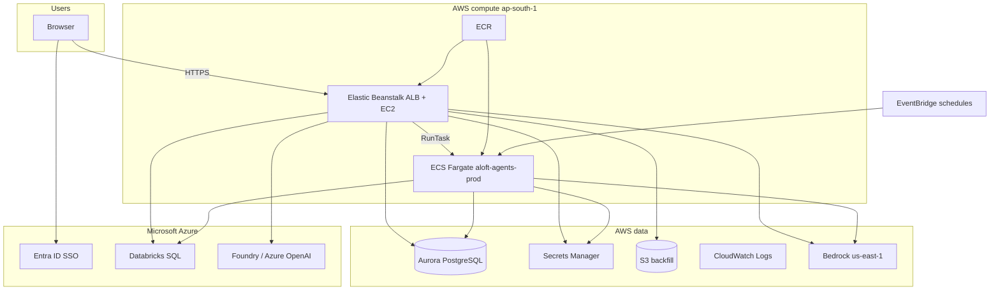

# ALOFT D360 — Platform services, usage, and AWS recreation

**Audience:** Cloud platform team + application team  
**Repository:** `aloft-d360` (Next.js 15 monolith, npm workspaces with `packages/aloft-shared`)  
**Last updated:** 2026-10-04  

This document is the **single map** of every external service the app uses, how the codebase calls it, what must be configured per environment, and how to **recreate AWS resources** after deletion. It was written against the full app tree (`src/`, `scripts/`, `infra/`, `prisma/`, `docs/`).

**Companion docs (detail, not duplicated here):**

| Document | Use when |
|----------|----------|
| [cloud-team-architecture-handoff.md](./cloud-team-architecture-handoff.md) | **Share with Cloud** — dev architecture & AWS request |
| [aws-cloud-handoff-checklist.md](./aws-cloud-handoff-checklist.md) | Cloud **return form** (fill-in values) |
| [aws-recreate-and-configuration.md](./aws-recreate-and-configuration.md) | Step-by-step AWS rebuild + provisioning scripts |
| [aws-cloud-handoff-checklist.md](./aws-cloud-handoff-checklist.md) | Cloud team return form (IDs, ARNs, secrets channel) |
| [deploy-beanstalk.md](./deploy-beanstalk.md) | Web app on Elastic Beanstalk (Docker + ECR) |
| [external-apis-and-providers.md](./external-apis-and-providers.md) | LLM providers, operational status, code paths |
| [endpoint-inventory-and-health.md](./endpoint-inventory-and-health.md) | Smoke tests + dependency matrix |
| [databricks-auth-and-usage.md](./databricks-auth-and-usage.md) | Databricks OAuth M2M + Secrets Manager |
| [ARCHITECTURE.md](../ARCHITECTURE.md) | Subsystems, data flows, API surface |

**Historical AWS account (in infra JSON):** `454073573537`  
**Primary AWS region:** `ap-south-1`  
**Bedrock model region (typical):** `us-east-1`  

---

## 1. Target deployment shape

| Tier | Service | Notes |
|------|---------|--------|
| **Web** | **AWS Elastic Beanstalk** (recommended) or legacy Vercel | ~140 API routes; long SSE up to **300–600s** — needs ALB/nginx **600s** idle timeout on AWS |
| **Identity** | **Microsoft Entra ID** | NextAuth `AzureADProvider`; no AWS Cognito required |
| **Database** | **Amazon Aurora PostgreSQL** + **pgvector** | Prisma; never attach DB to EB lifecycle |
| **Background harvest** | **ECS Fargate** + **EventBridge** | `Dockerfile.harvester`, `scripts/context/orchestrator.ts` |
| **LLM (AWS)** | **Amazon Bedrock** | Inspector, memory, Marcus, context enrich/mapping |
| **LLM / embed (Azure)** | **Azure AI Foundry**, **Azure OpenAI**, optional **xAI** | Tool-calling chat, boost scorers, **embeddings only via Azure** (not Titan) |
| **Warehouse** | **Azure Databricks** | SQL Statements API from web + harvester |
| **Secrets** | **AWS Secrets Manager** | Aurora + Databricks for ECS; per-connection secrets from app |
| **Object storage** | **Amazon S3** | Backfill bucket; IAM + smoke probe today (no `S3Client` in `src/` yet) |
| **Logs** | **CloudWatch Logs** | ECS harvester; optional EB log streaming |



---

## 2. Application map (what runs where)

### 2.1 Product capabilities → code

| Capability | Primary locations | External deps |
|------------|-------------------|---------------|
| **Inspector** (chat, teach, export, charts) | `src/app/api/inspector/**`, `src/lib/inspector/**` | Bedrock, Foundry/xAI, Databricks |
| **Semantic layer** | `src/app/api/inspector/semantic/**`, `src/lib/semantic/**` | Bedrock, Aurora |
| **Dashboards** | `src/app/api/inspector/dashboards/**` | Aurora, Databricks |
| **Boost / bandit** | `src/app/api/inspector/boost/**`, `src/lib/boost/**` | Foundry (`llm-client.ts`) |
| **Agent Lab / memory (FOER)** | `src/app/api/agent-lab/memory/**`, `src/lib/memory/**` | Bedrock, Aurora, pgvector |
| **Marcus reflections** | `src/lib/marcus/**`, agent-lab API routes | Bedrock |
| **Data estate / context pipeline** | `src/app/api/agent-lab/context/**`, `src/lib/context/**`, `scripts/context/` | ECS, Databricks, Bedrock, Aurora |
| **Databricks admin** | `src/app/api/databricks/**`, `src/lib/databricks/**` | Databricks API, Secrets Manager |
| **Catalog, RBAC, users** | `src/app/api/catalog/**`, `users`, `policies`, `src/lib/rbac.ts` | Aurora, Entra |
| **Studio insights** | `src/app/api/agent-lab/studio/**`, `src/lib/studio/insights.ts` | xAI / Foundry |
| **Health (load balancer)** | `src/app/api/health/route.ts` | None |

### 2.2 API surface

- **~140** route handlers under `src/app/api/**/route.ts` (see `docs/api-routes.generated.md` from `npm run check:api-routes`).
- Long-running routes set `export const maxDuration` (e.g. Inspector chat **300s**, boost run-suite **600s**). Hosting must allow **≥600s** ALB/nginx idle timeout for worst case (`infra/beanstalk`).

### 2.3 Monorepo layout

| Path | Role |
|------|------|
| `src/app/` | Next.js App Router UI + API |
| `src/lib/` | Domain logic (inspector, memory, context, databricks, aws, azure) |
| `packages/aloft-shared` | Shared UI/types (no cloud credentials) |
| `prisma/` | Schema, migrations, seed |
| `scripts/context/` | Harvester orchestrator (runs on ECS or locally) |
| `scripts/infra/` | AWS provision helpers |
| `infra/context/` | ECS task def, EventBridge JSON |
| `infra/beanstalk/` | EB Docker bundle, nginx/ALB tuning |
| `staging/` | Local pgvector Postgres (`docker-compose.staging.yml`) |

---

## 3. Configuration model

There is **no** central `env.ts` or Zod schema for environment variables. The app reads `process.env` directly. **Zod** validates HTTP request bodies in API routes, not env.

**Load order (local):** `.env` then `.env.local` (overrides). Harvester loads via `scripts/context/noserver.cjs`.

**Templates:**

| File | Purpose |
|------|---------|
| `infra/aws/env.template` | AWS, ECS, S3, Bedrock skeleton |
| `staging/env.staging.example` | Local staging Postgres on port **5434** |

Never commit real secrets. Rotate credentials if they ever appeared in git or chat logs.

---

## 4. Service reference

### 4.1 Microsoft Entra ID (Azure AD)

| Item | Detail |
|------|--------|
| **Purpose** | SSO; optional admin group mapping |
| **Code** | `src/lib/auth.ts`, `src/app/api/auth/[...nextauth]/route.ts`, `src/middleware.ts`, `src/middleware/auth.ts`, `src/lib/rbac.ts` |
| **Env** | `AZURE_AD_CLIENT_ID`, `AZURE_AD_CLIENT_SECRET`, `AZURE_AD_TENANT_ID`, `AZURE_AD_ADMIN_GROUP_IDS` |
| **Aliases** | `AAD_TENANT_ID`, `AAD_CLIENT_ID` in middleware |
| **Session** | `NEXTAUTH_SECRET`, `NEXTAUTH_URL` (must match public URL) |
| **Callbacks** | `https://<host>/api/auth/callback/azure-ad` (and `http://localhost:3000/...` for local) |
| **Also** | **Credentials** provider for password users in DB (local/dev); Entra users provisioned via `provisionUserByOid` |

**AWS recreation:** Register new redirect URIs when EB hostnames exist. No AWS resource required.

---

### 4.2 AWS Elastic Beanstalk (web application)

| Item | Detail |
|------|--------|
| **Purpose** | Host Next.js standalone Docker image with ALB + HTTPS |
| **Artifacts** | `Dockerfile` (`output: "standalone"`), `infra/beanstalk/Dockerrun.aws.json`, `.platform/nginx/conf.d/timeouts.conf`, `.ebextensions/` (ALB idle **600s**, health `/api/health`, sticky sessions) |
| **Guide** | [deploy-beanstalk.md](./deploy-beanstalk.md) |
| **ECR repo** | `aloft-d360-web` |
| **Instance** | **t3.medium** suggested; prod 2+ instances with stickiness |
| **Harvester** | Set `HARVEST_RUNTIME=ecs` on EB; harvester does **not** run on EB instances |

**IAM:** Prefer **EC2 instance profile** with: Bedrock (`us-east-1`), `ecs:RunTask` + `Describe*` (`ap-south-1`), Secrets Manager `aloft/*`, S3 backfill bucket, CloudWatch Logs read.

**Networking:** Aurora security group must allow **inbound 5432** from **EB instance security group** (in addition to Fargate SG).

**Scaling note:** Inspector keeps `pendingCorrectionNodeBySession` in memory on `inspector/chat/route.ts` — use **sticky sessions** when running more than one instance (`infra/beanstalk/.ebextensions/03-sticky-sessions.config`).

**Gap vs older docs:** [aws-recreate-and-configuration.md](./aws-recreate-and-configuration.md) was written around Vercel IAM user keys; add EB, ALB, ACM, Route53, `aloft-d360-web` ECR, and EB↔Aurora SG rules.

---

### 4.3 Amazon RDS Aurora PostgreSQL

| Item | Detail |
|------|--------|
| **Purpose** | All application data; **pgvector** for memory embeddings |
| **Code** | `prisma/schema.prisma`, `src/lib/db.ts`, `src/lib/prisma.ts` |
| **Env** | `DATABASE_URL`, `DIRECT_URL` (`sslmode=require` in production) |
| **Migrations** | `npm run db:migrate` (dev), `npx prisma migrate deploy` (EB/prod) |
| **Locks** | `src/lib/memory/lock.ts` prefers `DIRECT_URL` for advisory locks |

**If cluster deleted:** New writer endpoint → update EB env, `.env.local`, and Secrets Manager `aloft/aurora`.

**Security groups:** Allow **5432** from Beanstalk instance SG + Fargate task SG.

---

### 4.4 Amazon ECS Fargate (context harvester)

| Item | Detail |
|------|--------|
| **Purpose** | T0–T4 context pipeline, estate inventory, scheduled sweeps |
| **Cluster** | `aloft-agents-prod` (default) |
| **Task family** | `aloft-context-harvester`, container `context-harvester` |
| **Resources** | **512 CPU / 1024 MB** (`infra/context/task-definition.json`) |
| **Image** | `aloft-context-harvester` in ECR; build `Dockerfile.harvester` |
| **Entry** | `scripts/context/orchestrator.ts` via `tsx` + `noserver.cjs` |
| **Launch** | `src/lib/context/launch-harvester.ts` → `RunTask` or local spawn |
| **Config** | `src/lib/aws/ecs-runtime-config.ts` |

| Env var | Purpose |
|---------|---------|
| `HARVEST_RUNTIME` | `local` = spawn on host; `ecs` or unset = Fargate (production) |
| `ECS_CLUSTER_NAME` | Cluster name |
| `ECS_CONTEXT_TASK_DEFINITION` | Task definition family |
| `ECS_CONTEXT_CONTAINER_NAME` | Container name for overrides |
| `ECS_SUBNET_IDS` | Comma-separated (2+ AZ) |
| `ECS_SECURITY_GROUP_IDS` | Task SG |
| `ECS_ASSIGN_PUBLIC_IP` | `ENABLED` if subnets lack NAT (historical setup) |
| `ECS_EXECUTION_ROLE_ARN`, `ECS_TASK_ROLE_ARN` | IAM roles |

**Scheduled task env in task def:** `DEFAULT_ORG_SLUG`, `DEFAULT_ORG_ID` must match your tenant (`infra/context/deploy-notes.md`).

**Legacy fallbacks:** `ecs-runtime-config.ts` embeds old subnet/SG IDs if `ECS_*` unset — **always set env** after VPC rebuild.

**API triggers (examples):** `agent-lab/context/jobs/launch`, `estate/harvest`, `objects/[id]/reharvest-all`, queue in `src/lib/context/queue.ts` (`T2_MAX_CONCURRENT`).

---

### 4.5 Amazon ECS Fargate (agent runner)

| Item | Detail |
|------|--------|
| **Purpose** | Separate agent execution image (lab / runners) |
| **Provision** | `scripts/infra/provision-aloft-agents.sh` |
| **Env** | `AGENT_BASE_IMAGE`, `AGENT_RUNNER_SG_ID` |
| **ECR** | `aloft-agent-runner` |
| **Logs** | `/ecs/aloft-agent-runner` |

---

### 4.6 Amazon EventBridge

| Rule name | Schedule (UTC) | Orchestrator override |
|-----------|----------------|------------------------|
| `aloft-context-harvester-daily` | `cron(0 4 * * ? *)` | `--sweep` |
| `aloft-context-harvester-weekly` | `cron(0 3 ? * SUN *)` | `--kind t1_profile` |
| `aloft-estate-inventory-weekly` | `cron(0 6 ? * MON *)` | `--kind estate_inventory` |
| `aloft-t4-semantic-bootstrap-weekly` | `cron(0 8 ? * SUN *)` | `--kind t4_scan` |
| `aloft-t3-usage-weekly` | `cron(0 5 ? * 7 *)` | `--kind t3_usage` |

**Source of truth:** `infra/context/eventbridge-rule.json`  
**Apply:** `scripts/infra/apply-eventbridge.ps1` after replacing subnet/SG/cluster/task ARN/`RoleArn`.

**In-app cron display:** `src/lib/context/schedules.ts` (cron-parser) — does not replace AWS rules.

`CRON_SECRET` appears in docs only; not used in `src/` for these schedules.

---

### 4.7 Amazon ECR

| Repository | Consumer |
|------------|----------|
| `aloft-context-harvester` | ECS task definition |
| `aloft-agent-runner` | Agent runner tasks |
| `aloft-d360-web` | Beanstalk `Dockerrun.aws.json` |

Push `:latest` or pin tags per release. Storage cost is typically negligible at your scale.

---

### 4.8 AWS Secrets Manager

| Secret | JSON keys | Used by |
|--------|-----------|---------|
| `aloft/aurora` | `DATABASE_URL`, `DIRECT_URL` | ECS harvester task `secrets` |
| `aloft/databricks` | `DATABRICKS_CLIENT_ID`, `DATABRICKS_CLIENT_SECRET`, `DATABRICKS_HOST`, `DATABRICKS_HTTP_PATH` | ECS harvester |
| `aloft/databricks/{connectionId}` | `client_id`, `client_secret` | App-created per `PlatformDatabricksConnection` |

**Code:** `src/lib/databricks/secrets.ts`  
**Create:** `scripts/infra/create-secrets.ps1`

Web tier on EB usually sets DB/Databricks via environment properties; ECS uses SM injection in `infra/context/task-definition.json` (update ARNs after recreate).

---

### 4.9 Amazon S3

| Env | Purpose |
|-----|---------|
| `BACKFILL_S3_BUCKET`, `BACKFILL_S3_REGION` | Primary backfill bucket |
| `BACKFILL_S3_BROWSE_BUCKET`, `BACKFILL_S3_BROWSE_REGION` | Browse (often same bucket) |

Historical bucket name in template: `pbc-vessel-data`.  
**Today:** `@aws-sdk/client-s3` is used in `scripts/check-external-endpoints.mjs` (HeadBucket), not in `src/`. IAM still required for future backfill features and smoke tests.

---

### 4.10 Amazon Bedrock

| Item | Detail |
|------|--------|
| **Region** | `BEDROCK_REGION` (default `us-east-1`) |
| **Credentials** | `AWS_ACCESS_KEY_ID`, `AWS_SECRET_ACCESS_KEY` (or instance profile on EB) |
| **Optional** | `BEDROCK_SONNET_MODEL_ID` |
| **Mantle (OpenAI-compatible)** | `BEDROCK_MANTLE_REGION`, `BEDROCK_MANTLE_API_KEY` |

**Code paths:** `src/lib/inspector/agent-loop.ts`, `chart-pipeline.ts`, `src/lib/memory/synthesis/reflect.ts`, `src/lib/marcus/reflect.ts`, `src/lib/context/enrich.ts`, `mapping.ts`, `silo.ts`, `usage.ts`, etc.

**IAM:** `bedrock:InvokeModel`, `bedrock:InvokeModelWithResponseStream` in model region (Converse / ConverseStream in code).

**Embeddings:** Application embeddings use **Azure** (`src/lib/azure/embed-client.ts`) — not Bedrock Titan.

---

### 4.11 Amazon CloudWatch Logs

| Log group | Purpose |
|-----------|---------|
| `/ecs/aloft-context-harvester` | Harvester stdout (task definition) |
| `/ecs/aloft-agent-runner` | Agent runner |

**UI:** `src/app/api/agent-lab/context/jobs/[id]/logs/route.ts` streams/filters logs (needs `AWS_*` + `logs:FilterLogEvents`).

Enable EB **log streaming** for web troubleshooting.

---

### 4.12 Azure Databricks

| Item | Detail |
|------|--------|
| **Purpose** | SQL warehouse queries (Inspector, dashboards, estate harvest) |
| **Code** | `src/lib/databricks/execute.ts`, `token-client.ts`, `secrets.ts` |
| **Auth** | OAuth M2M service principal; per-connection secrets in SM |
| **Env** | `DATABRICKS_CLIENT_ID`, `DATABRICKS_CLIENT_SECRET`, `DATABRICKS_HOST` / `DATABRICKS_SERVER_HOSTNAME`, `DATABRICKS_HTTP_PATH`, `DATABRICKS_WORKSPACE_ID`, `DATABRICKS_MAX_ROWS`, `DATABRICKS_MAX_WAIT_SECS` |

**Not recreated on AWS.** Ensure **443 egress** from EB and Fargate to `*.azuredatabricks.net`.

Detail: [databricks-auth-and-usage.md](./databricks-auth-and-usage.md).

---

### 4.13 Azure AI Foundry & Azure OpenAI

| Item | Detail |
|------|--------|
| **Purpose** | OpenAI-compatible chat with tools; boost scorers; some fallbacks |
| **Code** | `src/lib/inspector/providers/foundry-chat.ts`, `src/lib/boost/scorers/llm-client.ts`, `src/lib/studio/insights.ts` |
| **Foundry env** | `FOUNDRY_API_KEY`, `FOUNDRY_ENDPOINT`, `FOUNDRY_EMBEDDING_*`, `FOUNDRY_TOOL_TIMEOUT_MS` |
| **Classic OpenAI env** | `AZURE_OPENAI_API_KEY`, `AZURE_OPENAI_ENDPOINT`, `AZURE_OPENAI_DEPLOYMENT_NAME`, `AZURE_OPENAI_API_VERSION`, embedding vars, `AZURE_O3_REASONING_MODEL` |

---

### 4.14 xAI (Grok)

| Item | Detail |
|------|--------|
| **Purpose** | Direct Grok API when configured (Inspector / studio paths) |
| **Env** | `XAI_API_KEY`, `XAI_BASE_URL`, `XAI_MODEL` |
| **Code** | `foundry-chat.ts`, `inspector/chat/route.ts`, `src/lib/studio/insights.ts` |

---

### 4.15 Optional / documented integrations

| Service | Env (examples) | Code usage |
|---------|----------------|------------|
| PostHog | `NEXT_PUBLIC_POSTHOG_*`, `POSTHOG_*` | Documented; not wired in `src/` |
| PBC promotion API | `PBC_PROMOTION_API_URL`, `ALOFT_PROMOTION_SECRET` | Probe in smoke script |
| Email alerts | `NOTIFICATION_FAILURE_ALERT_EMAIL` | Docs only |
| Vercel | Dashboard env mirror | Legacy hosting; no `vercel.json` in repo |

---

## 5. IAM summary

### 5.1 Web tier (Beanstalk instance profile or IAM user)

| API | Region | Actions (representative) |
|-----|--------|---------------------------|
| Bedrock | `us-east-1` (or `BEDROCK_REGION`) | Converse, InvokeModel, stream |
| ECS | `ap-south-1` | `RunTask`, `DescribeTasks`, `DescribeTaskDefinition` on `aloft-agents-prod` |
| Secrets Manager | `ap-south-1` | `GetSecretValue`, `CreateSecret`, `PutSecretValue` on `aloft/*` |
| S3 | `ap-south-1` | List/Get/Put on backfill bucket |
| CloudWatch Logs | `ap-south-1` | `FilterLogEvents`, `DescribeLogGroups` |

### 5.2 ECS task execution role

ECR pull, write logs, read Secrets Manager keys referenced in task definition.

### 5.3 ECS task role

Runtime AWS access from harvester if needed (align with your org standard).

### 5.4 EventBridge role

`ecs:RunTask` on cluster; often named like `ecsTaskExecutionRole` in historical JSON — confirm with Cloud team.

---

## 6. Environment matrix

| Concern | Local dev | Cloud dev (EB) | Production (EB) |
|---------|-----------|----------------|-----------------|
| `NEXTAUTH_URL` | `http://localhost:3000` | `https://d360-dev…` | `https://d360…` |
| Entra redirects | localhost callback | dev hostname | prod hostname |
| `HARVEST_RUNTIME` | `local` optional | `ecs` | `ecs` |
| `ECS_*` | Required if testing RunTask | Required | Required |
| `DEFAULT_ORG_SLUG` / `DEFAULT_ORG_ID` | **Required** (all envs) | Same | Same |
| AWS credentials | Keys or SSO profile | Instance profile preferred | Same |
| DB | `.env.local` or staging compose | Aurora | Aurora |
| Migrations | `db:migrate` | `migrate deploy` per release | Same |
| Instances | 1 | 1–2 × t3.medium | 2–6 + stickiness |

**Org resolution:** Missing `DEFAULT_ORG_*` causes immediate failures in async/sync resolvers (`src/lib/platform/agents.ts`, `src/lib/org.ts`).

**Seed admin (local only):** `SEED_ADMIN_EMAIL`, `SEED_ADMIN_PASSWORD` (or `ADMIN_*`) in `prisma/seed.ts`.

---

## 7. AWS recreation playbook

### 7.1 Is existing repo config enough?

| Area | Status | Action |
|------|--------|--------|
| ECS harvester task def + EventBridge JSON | **Valid pattern**; IDs may be **stale** | Replace account/subnet/SG/ARNs if VPC was rebuilt |
| `infra/aws/env.template` | **Partial** | Covers AWS/ECS/S3/Bedrock; extend with Entra/NextAuth/Databricks from secure store |
| Handoff checklist §J | Says Vercel | Use **EB environment properties** instead |
| `ARCHITECTURE.md` §13 | Says Vercel | See this doc + [deploy-beanstalk.md](./deploy-beanstalk.md) |
| Aurora endpoint | OK if cluster survived | Else new URLs in SM + env |
| IAM access keys | Often **invalid** after teardown | New keys or instance profile only |

### 7.2 Provisioning order (Cloud team)

1. VPC — subnets (2+ AZ); NAT vs **public IP on Fargate** (`AssignPublicIp=ENABLED` in JSON).  
2. Security groups — Fargate SG; **EB instance SG**; Aurora ingress from both on **5432**.  
3. IAM — web instance profile; ECS execution + task roles; EventBridge RunTask role.  
4. Secrets Manager — `aloft/aurora`, `aloft/databricks`.  
5. S3 — backfill bucket.  
6. CloudWatch log groups for ECS.  
7. ECR — `aloft-context-harvester`, `aloft-agent-runner`, `aloft-d360-web`.  
8. ECS cluster `aloft-agents-prod`.  
9. Register task definitions; build/push images.  
10. EventBridge — update `eventbridge-rule.json`; `apply-eventbridge.ps1`.  
11. Bedrock model access in `us-east-1`.  
12. Aurora — if deleted, new cluster + secrets.  
13. Beanstalk — ALB, ACM **600s**, deploy `infra/beanstalk`, set env properties.  
14. Entra — HTTPS redirect URIs for new hostnames.

### 7.3 App team after handoff

1. Fill [aws-cloud-handoff-checklist.md](./aws-cloud-handoff-checklist.md) values into `.env.local` and EB.  
2. Update `infra/context/task-definition.json` and `eventbridge-rule.json`.  
3. `aws ecs register-task-definition --cli-input-json file://infra/context/task-definition.json`  
4. `npm run check:integrations`  
5. Smoke: `/api/health`, Entra login, Inspector chat **>3 minutes**, one manual harvester launch.

**Scripts:**

| Script | Purpose |
|--------|---------|
| `scripts/infra/provision-aloft-agents.sh` | Cluster, agent ECR, SG, agent task def — edit VPC constants first |
| `scripts/infra/create-secrets.ps1` | Aurora + Databricks secrets |
| `scripts/infra/apply-eventbridge.ps1` | EventBridge rules |
| `infra/context/deploy-notes.md` | Manual CLI for harvester |

Full narrative: [aws-recreate-and-configuration.md](./aws-recreate-and-configuration.md).

### 7.4 Cloud ticket (short)

> Recreate ALOFT D360 in **454073573537 / ap-south-1**: ECS **aloft-agents-prod**, ECR **aloft-context-harvester**, **aloft-agent-runner**, **aloft-d360-web**, task definitions, log groups **/ecs/aloft-context-harvester** and **/ecs/aloft-agent-runner**, Secrets Manager **aloft/aurora** and **aloft/databricks**, S3 backfill bucket, EventBridge per **`infra/context/eventbridge-rule.json`**, IAM for Bedrock (**us-east-1**) and ECS/Secrets/S3/Logs (**ap-south-1**). Provision **Elastic Beanstalk** (load-balanced, **t3.medium**, ALB idle **600s**, health **`/api/health`**, HTTPS via **ACM**). Return: **subnet IDs**, **Fargate SG**, **EB instance SG**, **instance profile ARN**, Aurora writer (if new), confirm **RDS SG** allows EB + Fargate on **5432**.

---

## 8. Verification commands

```bash
npm run check:api-routes    # regenerate route inventory
npm run check:postgres      # DATABASE_URL connectivity
npm run check:endpoints     # external probes (AWS, Databricks, etc.)
npm run check:integrations  # all of the above
```

Operational status over time: [ops-failure-log.md](./ops-failure-log.md).

---

## 9. Repo file index (infrastructure)

| Path | Role |
|------|------|
| `docs/platform-services-and-recreation.md` | **This document** |
| `docs/aws-recreate-and-configuration.md` | AWS rebuild steps |
| `docs/aws-cloud-handoff-checklist.md` | Handoff form |
| `docs/deploy-beanstalk.md` | Web deploy |
| `infra/aws/env.template` | Env skeleton |
| `infra/context/task-definition.json` | Harvester Fargate task |
| `infra/context/eventbridge-rule.json` | Schedules + network |
| `infra/beanstalk/*` | EB bundle |
| `Dockerfile` / `Dockerfile.harvester` | Images |
| `src/lib/aws/ecs-runtime-config.ts` | ECS network from env |
| `src/lib/context/launch-harvester.ts` | RunTask / local spawn |
| `src/app/api/health/route.ts` | Load balancer health |

---

## 10. Feature-flag environment variables (reference)

Inspector, memory, Marcus, and reputation subsystems honor many `MEMORY_*`, `MARCUS_*`, `INSPECTOR_*`, `BOOST_*`, `STUDIO_INSIGHTS_*`, `REPUTATION_*` variables. Defaults are code-defined when unset. For a full list, search `process.env` under `src/lib/memory`, `src/lib/marcus`, `src/lib/inspector`, and `src/app/api/inspector`.

Staging example flags: `staging/env.staging.example` (`MEMORY_REPUTATION_ENABLED`, `REPUTATION_SEASON`, etc.).
