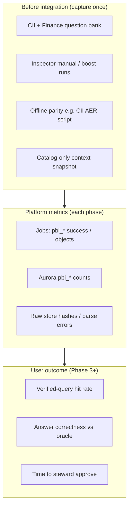

# Power BI bridge — before / after validation

**Purpose:** Prove what changed in the application when the Power BI harvest track ships, and avoid claiming user-facing wins before Inspector uses verified queries (Phase 3).

**Related:** [powerbi-harvest-build-plan.md](./powerbi-harvest-build-plan.md) §0, §10.3, §13.2 exit gates · [powerbi-implementation-tracker.md](./jobs/powerbi-implementation-tracker.md) · [Inspector: semantic layer and Power BI](./inspector/semantic-layer-and-powerbi.md) (positioning, retrieval order, portal links) · [Vessel pilot issues & wiring](./jobs/powerbi-vessel-pilot-issues-and-wiring.md) (CII translate/parity retrospective)

---

## 1. What “improved” means (by phase)

| Phase | Operator / platform | End user (Inspector, agents) |
|-------|---------------------|------------------------------|
| **0 — Baseline** | Scorecard of today’s answers on steward-written questions | Same product; you **measure** wrong/plausible-wrong rate |
| **1 — Store & inventory** | Jobs **Power BI** group; `pbi_*` rows; optional browse tab | **No change** to chat retrieval yet |
| **2 — Catalog & domains** | Catalog “used by N models”; domain labels; lineage | Slightly better catalog context; still no verified SQL |
| **3 — CII pilot** | Review queue; parity jobs; publish | **Verified-query path first**; answers cite metric, parity, refresh |
| **4+** | Finance wave, drift, RLS | Domain-scoped trust badges; fewer cross-domain mistakes |

Do **not** expect Inspector accuracy to move until **Phase 3 publish**. Phase 1–2 validation is **pipeline fidelity + coverage**, not Q&A uplift.

**Baseline timing:** Phase 0 Inspector/CII boost recording can happen **in parallel** with implementation (tooling is on the branch). Capture `before-phase3` when convenient; it does not block migration or jobs.

---

## 2. Validation layers (stack)



---

## 3. Phase 0 — baseline (do **before** Phase 3)

Aligns with build plan **§13.2 Phase 0** exit gate: *baseline score per domain; stewards named; blocked items listed*.

### 3.1 Question banks

| Domain | Target size | Source |
|--------|-------------|--------|
| QHSE / CII | 50–100 | Top visuals on CII SDK-2026, CII, vessel reports (usage-weighted) |
| Finance | 20 | Planned OPEX / budget / variance visuals (when in scope) |

Template and schema: [`eval/powerbi/suites/cii-pilot-questions.template.json`](../eval/powerbi/suites/cii-pilot-questions.template.json). Copy to `cii-pilot-questions.json` (gitignored if it contains internal names) and fill `oracle` after stewards agree.

Each case should record:

- `question` — natural language as a user would ask  
- `domain` — `qhse` \| `finance` \| …  
- `grain` — e.g. vessel, fleet, month  
- `oracle` — how to check truth (Power BI visual export, DAX query id, or held-out SQL)  
- `acceptable_tolerance` — e.g. numeric ±1%  

### 3.2 Score Inspector **today** (before bridge)

For each question, run in **dev** with the same role stewards will use later. Record per case:

| Field | Values |
|-------|--------|
| `outcome` | `correct` \| `wrong_number` \| `wrong_grain` \| `refused` \| `draft_sql` \| `hallucinated_object` |
| `path` | `catalog_llm` \| `semantic_intent` \| `other` |
| `notes` | One line |

**Tools:**

- Manual: Inspector UI, save session id for audit.  
- **Automated CII pilot (recommended):** `POST /api/inspector/boost/run-suite` with body `{ "suiteVersion": "cii_pilot_v1" }` — six cases in [`src/lib/boost/suite-cii.ts`](../src/lib/boost/suite-cii.ts), same prompts as the rubric (`boost_case_id` on each template row). Default models/context modes match the main boost matrix.  
- Export DB runs to validation JSON: `node --env-file=.env scripts/powerbi/export-cii-boost-baseline.mjs --label before-phase3` (stewards still override `outcome_automated`).  
- Trend: **Performance Lab** (`agent_turn_log` aggregates) — compare median latency and tool steps before vs after (no correctness signal alone).

Store runs under `eval/powerbi/runs/<date>-baseline-inspector.json` (gitignored).

### 3.3 Technical parity baseline (already proven offline)

CII model AER 2026 by vessel:

```powershell
node --env-file=.env scripts/compare_cii_pbi_databricks.mjs
```

Record the printed **match %** and row counts in your baseline run file. This validates **Databricks SQL vs Power BI numbers**, not the app UI — it is the oracle method Phase 3 will automate as `pbi_parity`.

---

## 4. Phase 1 — before / after (integration you are starting now)

### 4.1 Before snapshot (pre-migration / pre-inventory)

Run once on `dev` **or** locally against repo state:

```powershell
node scripts/powerbi/record-baseline-snapshot.mjs --label before-phase1
```

Captures (no secrets):

- Git branch and commit  
- Counts of harvested files under `powerbi-estate/` (if present)  
- Optional Aurora counts when `DATABASE_URL` is reachable (see SQL below)  
- Whether `pbi_*` tables exist  

Manual checklist:

| Check | Before expectation |
|-------|-------------------|
| Jobs UI **Power BI** group | Absent on `dev` without branch |
| `platform_context_sources` with `connection_kind = powerbi` | 0 rows |
| Inspector retrieval order | Catalog / intents only (no verified queries) |
| `pbi_workspaces` rows | Table missing or empty |

Read-only SQL (safe on shared dev):

```sql
-- See eval/powerbi/snapshot-queries.sql
SELECT COUNT(*) AS context_sources FROM platform_context_sources WHERE connection_kind = 'powerbi';
```

### 4.1b Local 5-report pilot (before Fargate)

Run the full Power BI chain **on your machine** with `report_ids` / `model_ids` scope (orchestrator reads `job.scope`). No `HARVEST_RUNTIME=local` needed — the script spawns the orchestrator per job.

1. Ensure `PBI_*` creds and an active `powerbi` context source in Estate.
2. List report GUIDs already in Aurora (after a one-time inventory, or from the portal):

   ```bash
   npx tsx --require ./scripts/context/noserver.cjs scripts/powerbi/run-pilot-local.ts --list-reports
   ```

3. Pick **five** `pbi_report_id` values (CII / QHSE pilot).

4. Run the pilot (replace UUIDs), or use the preset CII five from offline inventory:

   ```bash
   npx tsx --require ./scripts/context/noserver.cjs scripts/powerbi/run-pilot-local.ts --use-cii-pilot-five
   ```

   Manual IDs: see [`eval/powerbi/cii-pilot-five-reports.json`](../eval/powerbi/cii-pilot-five-reports.json).

   ```bash
   npx tsx --require ./scripts/context/noserver.cjs scripts/powerbi/run-pilot-local.ts ^
     --source-id <powerbi-context-source-uuid> ^
     --report-ids <id1>,<id2>,<id3>,<id4>,<id5>
   ```

   Add `--skip-inventory` if inventory already ran for that source. After a VPN/RDS drop mid-run:

   ```bash
   npx tsx --require ./scripts/context/noserver.cjs scripts/powerbi/run-pilot-local.ts --use-cii-pilot-five --skip-inventory --from-kind pbi_definitions
   ```

   One-time source bootstrap (dev): `scripts/powerbi/ensure-powerbi-source.ts`.

5. Watch stdout; each job is enqueued then executed via `orchestrator.ts --child-job <id>`.

6. Confirm rows in Estate → Power BI and (if Phase 3 completed) `kb_verified_queries`.

For **UI launch** without the script: set `HARVEST_RUNTIME=local` in `.env`, enqueue jobs manually with scope JSON `report_ids` + `model_ids` (Jobs API does not expose those fields in the modal yet).

### 4.2 After snapshot (post Phase 1 exit gate)

Repeat the snapshot script with `--label after-phase1`.

| Metric | Phase 1 exit (build plan §13.2) | How to verify |
|--------|-----------------------------------|---------------|
| Inventory job | `pbi_inventory` **DONE**, non-zero stats | Jobs run drawer; `pbi_workspaces` / `pbi_models` / `pbi_reports` populated |
| Scope | Models match workspace `scope_include` | Compare API inventory to Power BI portal |
| Usage window | `pbi_usage` rows when usage model fresh | Check `captured_at` / refresh metadata on job |
| User-visible Q&A | **Unchanged** | Re-run 5–10 baseline questions; outcomes should match **before** (proves you didn’t regress) |

**Regression guard:** After Phase 1, rerun a **subset** of the Phase 0 question bank. Scores should be **equal** unless you changed unrelated code.

---

## 5. Phase 3+ — application improvement metrics

These are the metrics that justify “how it improved our application” to product and domain owners.

### 5.1 Primary KPIs (per domain)

| KPI | Definition | Before | After target (CII pilot) |
|-----|------------|--------|---------------------------|
| **Benchmark pass rate** | % of question bank with `outcome = correct` at agreed tolerance | Record in Phase 0 | **Higher** than baseline; build plan asks for measured gain |
| **Verified-query routing** | % of pilot questions where answer `path = verified_query` | 0% | Meaningful share of CII bank |
| **Wrong-but-plausible rate** | `wrong_number` + `wrong_grain` | Baseline % | **Lower** |
| **Published cards** | Approved `pbi_metric_cards` → `kb_verified_queries` | 0 | ≥ **15** with parity at tested grains/periods |
| **Steward cost** | Minutes from draft card → approve | n/a | Record mean; sizes later waves |

### 5.2 Inspector behaviour (Phase 3)

Expected **after** publish (build plan §10.3):

1. Domain inference  
2. **Verified-query match** (new)  
3. `matchIntents` on governed measures  
4. Catalog search  
5. Draft SQL (labelled)

Validation: for each published card, add 2–3 paraphrases to the question bank; expect `path = verified_query` and citation block with model/report/parity.

### 5.3 Ongoing evaluation

- Nightly / scheduled `pbi_parity` on published items — pass / fail / regression by domain.  
- Held-out oracle rows **not** used in translation prompts (build plan §11 Evaluation).  
- Demote or block publish when parity drifts after model refresh.

---

## 6. Where results live

| Artifact | Path | Git |
|----------|------|-----|
| Question templates | `eval/powerbi/suites/*.template.json` | Yes |
| Filled question banks | `eval/powerbi/suites/*-questions.json` | Optional (often gitignore) |
| Run outputs | `eval/powerbi/runs/*.json` | **Gitignored** |
| Snapshot script output | `eval/powerbi/runs/*-snapshot.json` | Gitignored |
| Design exit gates | `docs/powerbi-harvest-build-plan.md` §13.2 | Yes |

---

## 7. Roles

| Role | Responsibility |
|------|----------------|
| **Platform admin** | Run jobs, snapshots, migration; attach run ids to validation JSON |
| **Domain steward (CII)** | Author question bank, label oracle, approve cards |
| **QHSE owner** | Resolve canonical model conflicts (build plan §14) |
| **Engineering** | Extend boost suite, wire `pbi_parity` → benchmark reports |

---

## 8. Quick start checklist

1. **Today:** `record-baseline-snapshot.mjs --label before-phase1`  
2. **Today:** Copy CII question template; stewards add 10 questions → score in Inspector → save `eval/powerbi/runs/…-baseline-inspector.json`  
3. **Today:** Run `compare_cii_pbi_databricks.mjs`; paste stats into baseline file  
4. **After Phase 1:** Backup (or RDS snapshot) → migration → `pbi_inventory` → `after-phase1` snapshot  
5. **After Phase 3:** Rerun full bank; compare pass rate and `verified_query` share; document in `docs/CHANGELOG.md` and tracker
