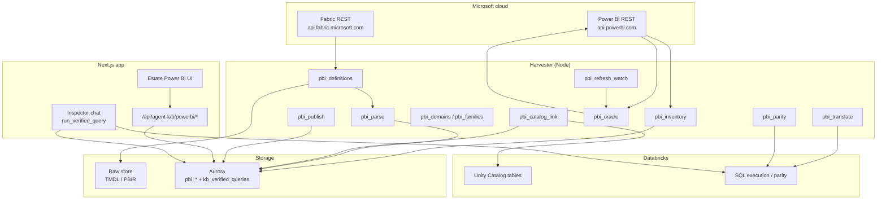

# Power BI module — layered architecture, APIs, and examples

**Audience:** Engineers, stewards, and reviewers who need one place to see what we built, how the layers connect, which Microsoft and Aloft APIs we call, and why we chose them over alternatives.

**Status:** Reflects `feature/powerbi-bridge` as of 2026-11-16.

**HTML (browse in browser):** [powerbi-module-layered-guide.html](./powerbi-module-layered-guide.html) — regenerate with `node scripts/docs/build-pbi-layered-guide-html.mjs`.

**Data formats & fields (what we get from PBI):** [powerbi-data-formats-and-fields.md](./powerbi-data-formats-and-fields.md) (also embedded in the HTML guide).

**Related (deeper dives):**

| Topic | Doc |
|--------|-----|
| Original product design | [powerbi-harvest-build-plan.md](./powerbi-harvest-build-plan.md) |
| Recreation pipeline (7 layers) | [powerbi-recreation-architecture.md](./powerbi-recreation-architecture.md) |
| Measure compiler history | [powerbi-measure-recreation.md](./powerbi-measure-recreation.md) |
| Inspector + verified queries | [inspector/semantic-layer-and-powerbi.md](./inspector/semantic-layer-and-powerbi.md) |
| Implementation checklist | [jobs/powerbi-implementation-tracker.md](./jobs/powerbi-implementation-tracker.md) |
| Offline / IT notes (Scanner 401, etc.) | [powerbi-semantic-schema.md](./powerbi-semantic-schema.md) |

---

## 1. What we built (one paragraph)

ALOFT’s **Power BI bridge** harvests workspaces, semantic models, and reports from Microsoft Fabric/Power BI, stores structured metadata in Aurora (`pbi_*` tables) and encrypted raw TMDL/PBIR in object storage, binds model tables to Unity Catalog, compiles DAX measures to Databricks SQL, compares results to Power BI (“oracle”), and publishes parity-approved rows into `kb_verified_queries` so **Inspector** can answer questions with report-aligned SQL. Operators browse and debug everything on **Estate → Power BI** (`/agent-lab/estate/powerbi`). Harvest and recreation run as **context jobs** in the Node harvester (`scripts/context/orchestrator.ts`), not as ad-hoc Python in production.

---

## 2. End-to-end picture



**Trust direction:** Power BI numbers are the judge. Nothing is published to agents until parity passes (and RLS models stay unpublished until identity mapping exists — see build plan D12).

---

## 3. Layers (how we built it)

### Layer A — Product & access control

| Piece | Path / ID | Role |
|--------|-----------|------|
| Section | `estate.powerbi` (`view` / `manage`) | Gates Estate tab and APIs |
| Browse UI | `src/views/agent-lab/estate/powerbi.tsx` | Workspaces, models, domains, conflicts, model detail |
| Jobs UI | `src/views/agent-lab/estate/jobs.tsx` | Launch `pbi_*` jobs; Power BI job group |
| Context source | `connection_kind: "powerbi"` on `platform_context_sources` | Workspace scope (`scope_include`: GUID list) |

**Why a dedicated section:** Power BI metadata can include RLS filters and personal file paths; access is org-scoped and separate from generic Estate catalog permissions.

**Example — register a Power BI source (operator):**

```http
POST /api/agent-lab/context/sources
Content-Type: application/json

{
  "connection_kind": "powerbi",
  "connection_ref": "<Azure AD tenant id>",
  "scope_include": [
    "xxxxxxxx-xxxx-xxxx-xxxx-xxxxxxxxxxxx"
  ]
}
```

Env on harvester: `PBI_TENANT_ID`, `PBI_CLIENT_ID`, `PBI_CLIENT_SECRET`. Optional: `PBI_RAW_STORE_ROOT` for encrypted definition files.

---

### Layer B — Estate UI (presentation)

The Power BI page is a client component that loads summary stats, filters models, and opens a detail drawer.

| UI area | Component | Data source |
|---------|-----------|-------------|
| KPI chips | `powerbi.tsx` | `GET /api/agent-lab/powerbi/summary` |
| Workspace filter | same | `GET /api/agent-lab/powerbi/workspaces` |
| Model table | same | `GET /api/agent-lab/powerbi/models?workspace_id=&domain_key=` |
| Domains sidebar | same | `GET /api/agent-lab/powerbi/domains` |
| Metric conflicts | same | `GET /api/agent-lab/powerbi/conflicts?status=proposed` |
| Model detail | same | `GET /api/agent-lab/powerbi/models/:id` |
| Full DAX + SQL | measure expand | `GET …/models/:id/measures/:measureId` |
| TMDL snapshot | `ModelDefinitionCard` | `GET …/models/:id/definition` |
| UC bindings | `ModelDataSources` | `GET …/models/:id/sources` |
| Refresh / owner | `ModelOwnershipCard` | `GET …/models/:id/ownership?refresh=1` |
| Dependency graph | `ModelDependencyGraph` | `GET …/models/:id/graph?measure=…` |
| Model overview graph | `ModelOverviewGraph` | `GET …/models/:id/graph?view=overview` |
| Run pipeline | `PbiPipelineRunButton` | `POST /api/agent-lab/context/jobs/launch` |
| Harvest definitions | `PbiReportHarvestMenu` | same launch API |

**Example — browser loads model list after picking a workspace:**

```javascript
// Simplified from powerbi.tsx
const qs = new URLSearchParams({ workspace_id: workspaceUuid });
const res = await fetch(`/api/agent-lab/powerbi/models?${qs}`);
const { models } = await res.json();
// Each row: id, name, answerability, domain_key, table_count, measure_count, rls_required, …
```

**Example — steward acknowledges a domain conflict:**

```http
PATCH /api/agent-lab/powerbi/conflicts/<conflict-uuid>
Content-Type: application/json

{ "status": "acknowledged" }
```

Requires `estate.powerbi` **manage** (not just view).

---

### Layer C — Aloft HTTP APIs (Next.js App Router)

All routes live under `src/app/api/agent-lab/powerbi/`. They are **read-mostly**; job launches go through context jobs API.

| Method | Path | Purpose |
|--------|------|---------|
| GET | `/summary` | Estate-wide counts: workspaces, models, parsed/answerable, bindings |
| GET | `/workspaces` | Workspace list + model/report counts |
| GET | `/domains` | Business domains + model counts |
| GET | `/models` | Model list; query: `workspace_id`, `domain_key` |
| GET | `/models/[id]` | Model detail + recreation summary per measure (200 measures cap in list) |
| GET | `/models/[id]/definition` | Raw / parsed definition metadata |
| GET | `/models/[id]/sources` | Grouped datasource + UC binding status |
| GET | `/models/[id]/ownership` | Owner, refresh, gateway; cached 6h in `props.ownership` |
| GET | `/models/[id]/graph` | L0 fidelity + L1 graph: summary, `?view=overview`, or `?measure=Name` |
| GET | `/models/[id]/measures/[measureId]` | Full DAX + generated SQL + parity tier |
| GET | `/conflicts` | Cross-model metric name clashes; query: `status` |
| PATCH | `/conflicts/[id]` | Steward status update |

**Example — summary response (shape):**

```json
{
  "workspaces": 3,
  "models": 503,
  "reports": 494,
  "tables": 4200,
  "measures": 18500,
  "source_bindings": 890,
  "models_with_definition": 12,
  "reports_with_definition": 8,
  "models_parsed": 6,
  "models_answerable": 4,
  "models_caveated": 1,
  "raw_store_root": "(configured)"
}
```

**Example — model detail (truncated):**

```json
{
  "recreation": {
    "measures_total": 73,
    "uc_resolved": 73,
    "sql_drafted": 68,
    "parity_pass": 63,
    "parity_fail": 5,
    "published": 63,
    "recreation_pct": 86.3,
    "cause_precision_pct": 92.0
  },
  "model": {
    "id": "550e8400-e29b-41d4-a716-446655440000",
    "pbi_model_id": "b7d7e779-15df-4c75-9c8a-27764fd889d2",
    "name": "Vessel Internal Audit",
    "rls_required": false,
    "measures": [
      {
        "id": "…",
        "name": "Managed_Vsl_Status_Count",
        "dax_preview": "CALCULATE(COUNTROWS(…",
        "recreation_stage": "published",
        "parity_verdict": "pass",
        "verified_query_status": "verified",
        "root_cause": null
      }
    ]
  }
}
```

**Example — measure graph for debugging:**

```http
GET /api/agent-lab/powerbi/models/550e8400-e29b-41d4-a716-446655440000/graph?measure=Managed_Vsl_Status_Count
```

Response includes nodes for warehouse table → Power Query steps → calc columns → measure → reports that reference the measure.

**Why we did not add write APIs for SQL or publish:** Steward approval and batch jobs keep a single audit trail on `context_jobs`. The UI triggers harvest via launch, not ad-hoc PATCH on translations.

---

### Layer D — Harvest jobs (orchestrator)

Job kinds are implemented in `scripts/context/orchestrator.ts` (harvester container). Stages and chaining rules are defined in `src/lib/powerbi/pipeline-stages.ts`.

| Job kind | What it does | Main library entry |
|----------|----------------|-------------------|
| `pbi_inventory` | Workspaces, datasets, reports, datasources | `inventory.ts` |
| `pbi_definitions` | Download TMDL + report definitions to raw store | `definitions.ts`, `fabric.ts` |
| `pbi_parse` | Parse TMDL → `pbi_tables`, `pbi_measures`, … | `parse.ts`, `tmdl-parse.ts` |
| `pbi_catalog_link` | Match tables to UC; `pbi_source_bindings` | `catalog-link.ts`, `source-origin.ts` |
| `pbi_domains` | Domain scores + `pbi_conflicts` | `domain-score.ts` |
| `pbi_families` | Year-variant model clustering | `families.ts` |
| `pbi_translate` | DAX → SQL (compiler, rules, LLM) | `dax-sql-compile.ts`, `translate.ts` |
| `pbi_oracle` | Power BI reference values | `dax-query.ts`, `client.executeDatasetQueries` |
| `pbi_parity` | Run SQL on Databricks vs oracle | `parity.ts`, `sliced-parity.ts` |
| `pbi_publish` | Upsert `kb_verified_queries` | `publish.ts`, `verified-query-embed.ts` |
| `pbi_refresh_watch` | Scheduled: models due for re-oracle → chain parity/publish | `refresh-watch.ts` |

**Recommended order (full recreation on one model):**

```
pbi_inventory → pbi_definitions → pbi_parse → pbi_catalog_link → pbi_domains
  → pbi_translate → pbi_oracle → pbi_parity → pbi_publish
```

**Example — launch translate for one model from Jobs UI / API:**

```http
POST /api/agent-lab/context/jobs/launch
Content-Type: application/json

{
  "kind": "pbi_translate",
  "sourceId": "<context-source-uuid>",
  "props": {
    "model_ids": ["b7d7e779-15df-4c75-9c8a-27764fd889d2"],
    "chain": ["pbi_oracle", "pbi_parity", "pbi_publish"],
    "ui_surface": "estate.powerbi.model"
  }
}
```

The **Run pipeline** control expands `chain` using `PBI_STAGES` so parse always pulls catalog_link + translate when definitions changed, etc.

**Why TypeScript in the harvester (not Python):** One Node image already runs catalog harvest; Fabric TMDL and REST are JSON/text; avoids a second runtime (build plan D7).

**Why separate inventory from definitions:** Inventory is cheap and safe to run often; `getDefinition` is heavy and rate-limited — skip when content hash unchanged.

---

### Layer E — Domain library (`src/lib/powerbi/*`)

Grouped by responsibility (not an exhaustive file list).

#### E1 — Microsoft connectivity

| Module | External API | Token scope |
|--------|------------|-------------|
| `credentials.ts` | Azure AD OAuth2 client credentials | — |
| `client.ts` | **Power BI REST** `https://api.powerbi.com/v1.0/myorg` | `https://analysis.windows.net/powerbi/api/.default` |
| `fabric.ts` | **Fabric REST** `https://api.fabric.microsoft.com/v1` | `https://api.fabric.microsoft.com/.default` |

**Power BI REST calls we use in production code:**

| Call | Used for |
|------|----------|
| `GET /groups` | List workspaces |
| `GET /groups/{ws}/datasets` | Models (datasets) |
| `GET /groups/{ws}/reports` | Reports + `webUrl` |
| `GET /groups/{ws}/datasets/{id}/datasources` | Connection strings / gateways |
| `GET /groups/{ws}/datasets/{id}/refreshes` | Last refresh time (parity freshness) |
| `POST /groups/{ws}/datasets/{id}/executeQueries` | DAX oracle (non-RLS SP; RLS via elevated path in `execute-dax.ts`) |

**Fabric calls we use:**

| Call | Used for |
|------|----------|
| `POST /workspaces/{ws}/semanticModels/{id}/getDefinition?format=TMDL` | Full model: tables, DAX, M partitions, relationships |
| `POST /workspaces/{ws}/reports/{id}/getDefinition` | PBIR / legacy report JSON (visuals, filters) |

**Example — inventory flow (simplified):**

```typescript
const workspaces = await listWorkspaces(); // GET groups
for (const ws of workspaces) {
  const datasets = await listDatasets(ws.id);
  const reports = await listReports(ws.id);
  for (const ds of datasets) {
    await prisma.pbiModel.upsert({ /* … */ });
    if (fetchDatasources) {
      const dss = await listDatasetDatasources(ws.id, ds.id);
    }
  }
}
```

#### E2 — Parse & fidelity (L0)

| Module | Role |
|--------|------|
| `tmdl-parse.ts`, `parse.ts` | TMDL → relational rows; reconcile by `lineageTag` for stable IDs |
| `partition-kind.ts`, `m-lineage.ts` | Classify partitions; walk Power Query steps |
| `fidelity-gate.ts` | Block compile when DAX broken, replica drift, empty measures |
| `report-parse-legacy.ts` | Legacy PBIR measure refs for graph “consumers” |

#### E3 — Model graph (L1)

| Module | Role |
|--------|------|
| `model-graph.ts` | Typed dependency graph + content hashes |
| `model-graph-view.ts` | API-friendly summaries and measure subgraphs |
| `measure-logic-analyze.ts` | Complexity, strategy, block_automated_sql flags |

#### E4 — Compiler & rules (L2)

| Module | Role |
|--------|------|
| `dax-parse.ts` | DAX → AST |
| `dax-sql-compile.ts` | AST → Spark SQL (filter context, relationships, BLANK, etc.) |
| `rule-store.ts`, `rule-builtin-specs.ts` | Verified function templates |
| `rule-difftest.ts` | Prove rules against Power BI |
| `rule-gap-fill.ts`, `rule-synthesize.ts` | On missing scalar fn: synthesize → difftest → install → recompile |
| `translate.ts`, `translate-rule.ts`, `translate-llm.ts` | Orchestrate compile-first, then rule/LLM |
| `expand-validate.ts` | Execute or EXPLAIN SQL on warehouse |

**Example — conceptual compile path for a measure:**

```text
DAX: CALCULATE(SUM(Fact[Amount]), Dim[Year] = 2026)
  → dax-parse → dax-sql-compile
  → SQL: SELECT sum(amount) FROM fact JOIN dim … WHERE year = 2026
  → expand-validate (execute on Databricks)
  → save pbi_translations (tier: expand, pattern: dax_compile)
```

#### E5 — Oracle, parity, publish (L3–L4)

| Module | Role |
|--------|------|
| `dax-query.ts` | Batch `EVALUATE { [Measure] }` style oracle |
| `oracle.ts` | Persist `pbi_oracle_results` |
| `parity.ts`, `sliced-parity.ts` | Typed compare (number, date, text, BLANK) |
| `publish.ts` | Write `kb_verified_queries`, demote on regression |
| `verified-query-embed.ts`, `verified-query-match.ts` | Embeddings for Inspector retrieval |

#### E6 — Estate helpers

| Module | Role |
|--------|------|
| `recreation-summary.ts` | Per-model stages, root causes, patterns |
| `recreation-detectors.ts`, `investigator.ts` | Automated diagnosis |
| `pbi-ownership.ts` | Dataset owner, refresh schedule via REST |
| `domain-score.ts`, `families.ts` | Domain assignment and year families |
| `catalog-link.ts` | UC path resolution (native SQL + `Databricks.Catalogs` navigation) |
| `raw-store.ts` | Encrypted files under `PBI_RAW_STORE_ROOT` |

---

### Layer F — Database (Aurora / Prisma)

Parsed harvest and recreation state live in `pbi_*` tables; agent-facing SQL lives in `kb_verified_queries`.

| Table | Holds |
|-------|--------|
| `pbi_workspaces` | Workspace id, name, content hash |
| `pbi_models` | Model metadata, `props` (definition, parse, classification, fidelity, ownership) |
| `pbi_model_datasources` | REST datasource rows |
| `pbi_reports` | Report id, `web_url`, link to model |
| `pbi_usage` | Usage metrics (when harvested) |
| `pbi_tables`, `pbi_columns`, `pbi_measures` | Parsed schema |
| `pbi_relationships`, `pbi_roles` | Joins and RLS role DAX |
| `pbi_source_bindings` | Power BI table → UC full path |
| `pbi_domains`, `pbi_conflicts`, `pbi_families` | Steward domain model |
| `pbi_translations` | Generated SQL, tier, parity_verdict, telemetry |
| `pbi_oracle_results` | Power BI scalar answers |
| `pbi_translation_rules` | Registry of proven DAX→SQL fragments |
| `kb_verified_queries` | Published SQL + embedding (`origin: powerbi`) |

**Example — find published verified query for a measure:**

```sql
SELECT id, natural_language_question, sql_text, status
FROM kb_verified_queries
WHERE org_id = :org
  AND pbi_measure_id = :measure_uuid
  AND status = 'verified'
  AND origin = 'powerbi';
```

**Why raw TMDL is not in Postgres:** Size, PII in embedded tables, and agent safety — stewards use Estate; agents get curated SQL only.

---

### Layer G — Inspector integration

| Step | Implementation |
|------|----------------|
| Match user question | `verified-query-match.ts` (vector + text, threshold ≥ 0.72) |
| Prompt injection | `verified-query-context.ts` → system prompt block |
| Tool | `run_verified_query` in `src/lib/inspector/tools.ts` |
| Execute | `run-verified-query.ts` → Databricks read-only SQL |

**Example — user question that should hit a verified query:**

```text
User: "What is fleet CII AER YTD — same as the CII report?"
  → matchVerifiedQueries(org, message)
  → hit: kb_verified_queries.natural_language_question ~ 0.81
  → model calls run_verified_query(id)
  → SQL runs on warehouse; UI shows provenance (model name, measure name)
```

**What we did not wire yet:** Domain-filtered VQ match; automatic portal deep link in provenance (see inspector doc §7).

---

## 4. External APIs — what we use, what we skipped, and why

### 4.1 Used in the shipped module

| API | Why we need it |
|-----|----------------|
| Power BI REST (datasets, reports, datasources, executeQueries, refreshes) | Discovery, oracle, operational metadata |
| Fabric `getDefinition` (TMDL + PBIR) | Full DAX/M without Admin Scanner |
| Azure AD client credentials | Unattended harvester |
| Databricks SQL statements API | Parity and Inspector execution |

### 4.2 Deliberately not depended on

| API / approach | Why not |
|----------------|---------|
| **Admin Workspace Scanner** (DAX/M at tenant scale) | Returns **401** for current service principal (`Tenant.Read.All` + admin-consent issues — see [powerbi-semantic-schema.md](./powerbi-semantic-schema.md)). TMDL per model works without it. |
| **XMLA / TMSL** | Needs Premium capacity + Build; not required for pilot; heavier ops. |
| **Write-back to Power BI** | Read-only product decision (build plan non-goals). |
| **Embedding reports in Aloft** | Licensing + duplicate UX; we link `web_url` to the existing portal. |
| **Scanner for synonyms** | Synonyms already in TMDL `cultures/en-US.tmdl`. |
| **User-delegated DAX in harvester** | No interactive login in worker; RLS models use workspace-admin SP path or are skipped for publish. |
| **INFO.VIEW.TABLES()** via executeQueries | Convenient when it works; **undocumented** — not a hard dependency. |

### 4.3 RLS and executeQueries (important example)

| Model type | Oracle behavior |
|------------|-----------------|
| No RLS (`isEffectiveIdentityRolesRequired: false`) | `executeQueries` as harvester SP works |
| RLS required | SP often gets `PowerBINotAuthorizedException`; code uses elevated **executeDaxQueries** (Arrow) where configured; otherwise oracle skipped and measures not published |

This is why Estate shows `rls_required` and why build plan **D12** blocks agent publish for secured models until Aloft maps identities.

---

## 5. Recreation layers L0–L6 (implementation map)

This aligns with [powerbi-recreation-architecture.md](./powerbi-recreation-architecture.md).

| Layer | Name | Key files | Estate surface |
|-------|------|-----------|----------------|
| L0 | Harvest + fidelity | `definitions.ts`, `fidelity-gate.ts`, `parse.ts` | Model health / blocked measures |
| L1 | Model graph | `model-graph.ts`, `model-graph-view.ts` | Graph APIs + `ModelDependencyGraph` |
| L2 | Compiler | `dax-sql-compile.ts`, `rule-store.ts` | Measure detail: SQL, tier |
| L3 | Execution | warehouse client in expand/parity | Job logs, translation props |
| L4 | Verification | `parity.ts`, `oracle.ts`, `pbi-ownership.ts` | Parity badges, ownership card |
| L5 | Investigator | `recreation-detectors.ts`, `decompose-run.ts` | Root cause + `cause_precision_pct` |
| L6 | Learning | `rule-difftest.ts`, docs + regression tests | Rule registry growth |

**Per-measure lifecycle (simplified):**

```text
harvested → fidelity_ok → compiled → executed → verified(pass) → published
                │              │                    │
                └─ blocked     └─ parity_fail ───────► investigating → root_cause on Estate
```

---

## 6. Worked examples

### 6.1 First-time estate onboarding (operator)

1. Create context source (tenant + workspace GUIDs).
2. Jobs → **PBI Inventory**.
3. Jobs → **PBI Definitions** (scoped models or whole workspace).
4. Jobs → **PBI Parse**.
5. Jobs → **PBI Catalog Link** (requires catalog harvest for UC paths).
6. Open **Estate → Power BI** → confirm models show tables/measures.
7. For a pilot model → **Run pipeline** → Publish.
8. Inspector → ask a question that matches a published verified query.

### 6.2 Debugging one failing measure

1. Estate → model → measure shows `parity_verdict: fail`, `root_cause` JSON.
2. Open graph: `GET …/graph?measure=Attained_CII`.
3. Check fidelity: replica drift on a column? → fix UC or column override.
4. `GET …/measures/:id` → compare full DAX vs SQL.
5. Re-run chain: `pbi_translate` → `pbi_oracle` → `pbi_parity` for that `model_ids` only.
6. CLI (dev): `npx tsx scripts/powerbi/investigate.ts --model "<name>"`.

### 6.3 Catalog link fixing “No SQL”

**Symptom:** Measures stuck at `no_uc` / `skipped_no_binding`.

**Cause:** Partition used `Databricks.Catalogs` navigation without native SQL text.

**Fix (2026-11-16):** `catalog-link.ts` resolves `{[Name=cat,Kind="Database"],…}` paths. Re-run `pbi_catalog_link` then `pbi_translate`.

### 6.4 Compiler rule synthesis (missing DAX function)

**Symptom:** Compile error `dax_fn` for e.g. uncommon scalar.

**Flow:** `translate.ts` → `rule-gap-fill.ts` → LLM template → `rule-difftest` against Power BI → insert `pbi_translation_rules` → recompile measure.

**Why:** Avoid one-off hand SQL; estate-wide reuse after proof.

---

## 7. Configuration reference

| Variable | Where | Purpose |
|----------|--------|---------|
| `PBI_TENANT_ID`, `PBI_CLIENT_ID`, `PBI_CLIENT_SECRET` | Harvester / server | Microsoft auth |
| `PBI_RAW_STORE_ROOT` | Harvester | Base path for TMDL/PBIR blobs |
| `PBI_EXPAND_TEST` | Translate | `execute` \| `explain` \| `off` |
| `PBI_DEFER_ON_EXPLAIN_TIMEOUT` | Translate | Keep large SQL for parity if EXPLAIN times out |
| `PBI_COLUMN_RESOLVE_EMBED` | Translate | Optional embedding column match (last resort) |
| Databricks connection env | App + harvester | Parity + Inspector (existing `DATABRICKS_*`) |

Never commit secrets; names only in docs per repo rules.

---

## 8. Testing and verification

| Layer | How we verify |
|-------|----------------|
| Parsers | `src/lib/powerbi/__tests__/*` (vitest) |
| Compiler | Golden measures per pilot model; `COMPILER_VERSION` lock file |
| APIs | `src/app/api/agent-lab/powerbi/__tests__/routes.test.ts` |
| End-to-end | Jobs on dev + Estate UI + `docs/powerbi-integration-validation.md` question bank |
| Parity baseline | `scripts/powerbi/run-cii-boost-baseline.ts`, export baselines |

---

## 9. Not done yet (intentional gaps)

| Item | Tracker / doc |
|------|----------------|
| Domain filter on verified-query match | Implementation tracker Phase 3 |
| Portal deep link in Inspector provenance | inspector doc §7 |
| Admin Scanner / tenant-wide lineage | Blocked on IT Entra permissions |
| RLS identity mapping for agent publish | Build plan D12 |
| Finance-scale rollout, full estate RLS | Phase 4+ |
| `pbi_families` migration on some envs | `apply-phase2-families-migration.mjs` pending operator |

---

## 10. Quick file index

| Concern | Start here |
|---------|------------|
| UI | `src/views/agent-lab/estate/powerbi.tsx` |
| APIs | `src/app/api/agent-lab/powerbi/**/route.ts` |
| Jobs | `scripts/context/orchestrator.ts`, `src/lib/powerbi/pipeline-stages.ts` |
| Microsoft | `src/lib/powerbi/client.ts`, `fabric.ts` |
| SQL generation | `src/lib/powerbi/dax-sql-compile.ts`, `translate.ts` |
| Inspector | `src/lib/powerbi/verified-query-match.ts`, `src/lib/inspector/tools.ts` |
| Schema | `prisma/schema.prisma` (`Pbi*`, `KbVerifiedQuery`) |

---

*When behavior changes, update this guide, [powerbi-implementation-tracker.md](./jobs/powerbi-implementation-tracker.md), and [CHANGELOG.md](./CHANGELOG.md).*