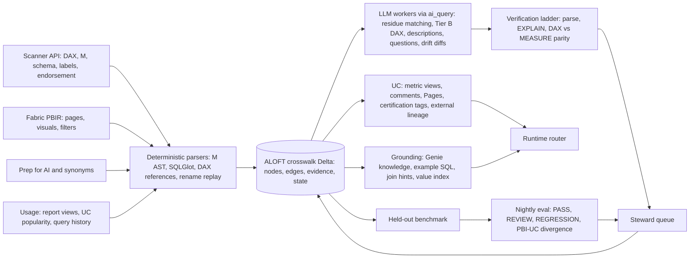

# Harvest Power BI's curation, then verify every number

ALOFT gets the most from LLMs by treating its 503 Power BI semantic models and 494 reports ([ALOFT estate harvest](../powerbi-estate/20261110T122619Z/manifest.json)) as a body of business intent that people have already curated and labelled. That body holds governed measures, approved joins, filter conventions, visual-level "query shapes", synonyms and approved questions. It should not be treated as code to bulk-translate. Independent research shows this is exactly the knowledge enterprise text-to-SQL lacks. On the BEAVER enterprise benchmark, giving an agent the right tables, join keys, column mappings and domain rules raised execution accuracy from **10.8% to 30.1%** ([BEAVER](https://arxiv.org/abs/2409.02038)). AT&T researchers found that **25% of the joins real queries use were not documented** in the schema ([AT&T, arXiv 2505.19988](https://arxiv.org/abs/2505.19988)).

The pattern that works has three rules: deterministic first, LLM for the residue, execution as the judge. Parse Power Query M and DAX deterministically into a crosswalk to Unity Catalog that ALOFT owns. Use LLMs only where parsing stops: ambiguous column matches, complex DAX, descriptions, generating questions from existing SQL ("back-generation"), and explaining metric drift. Promote nothing until the translated metric reproduces the Power BI number at several grains. That makes Power BI's most valuable role a **numeric oracle**: each heavily used visual becomes a (question, filters, expected table) test case that scores ALOFT's NL-to-SQL every night.

DAX translation is only partly automatable. Mercedes-Benz Korea automated **40% of measure conversions across 600+ models** even with a purpose-built transcompiler ([Databricks session](https://answers.databricks.com/from-power-bi-dax-metric-views-building-trusted-ai-databricks-genie-QYqSo2x49I0)). The plan therefore has to budget steward time, order the work by report usage, and fold near-duplicate families (per-client `BV Report_*`, per-year `CII SDK-20xx`) into parameterized metric views before translating anything. The things to avoid are bulk auto-publishing, gating on an LLM's own confidence, and running agent SQL under a service principal that bypasses row-level security.

## Power BI already encodes the knowledge text-to-SQL is missing

The bottleneck in enterprise NL-to-SQL is knowledge, not SQL fluency. On BEAVER, built from real query logs and production reports, an agentic GPT-5.2 scores 10.8%. Supplying oracle hints for subtasks (which tables, which join keys, which column a phrase means, which domain rule applies) triples that, and the remaining errors sit in grouping, windowing and scalar functions ([BEAVER](https://arxiv.org/abs/2409.02038)). AT&T reached the same conclusion from the metadata side. On BIRD MiniDev, GPT-4o rose from **49.8% with no metadata to 61.2% with profiling-derived metadata and 72.6% with hints**. Mining a query log surfaced join paths, computed keys and named formulas that the schema never declared ([AT&T](https://arxiv.org/abs/2505.19988)). TailorSQL turned a past query workload into compact "hint documents" (join paths, filter expressions, group-by clauses). It reported up to **2× execution accuracy** and **1.8× to 15× fewer prompt tokens** at equal accuracy, with the largest gains on cryptic, finance-style schemas ([TailorSQL](https://arxiv.org/html/2505.23039v1)).

Semantic layers turn that knowledge into a contract. dbt's open 2026 rerun of the ACME Insurance benchmark found text-to-SQL at **84–90%** on well-modeled data versus **98–100%** for the semantic layer. The more important finding was the failure mode: "with text-to-SQL, failure looks like a plausible but incorrect answer. With the Semantic Layer, failure looks like an error message" ([dbt Labs](https://docs.getdbt.com/blog/semantic-layer-vs-text-to-sql-2026)). Databricks reports internal Genie accuracy rising from **65 to 85** after metrics were encoded in UC metric views ([Databricks talk](https://answers.databricks.com/supercharging-genie-performance-metric-views-6rEl8md1kT8)). Its worked Genie example climbed from 0% to 54% with metadata, joins and value matching, then to **77%** once example SQL was added, which was the largest single gain ([Databricks blog](https://www.databricks.com/blog/how-build-production-ready-genie-spaces-and-build-trust-along-way)). Both of those are vendor numbers on small sets. They point the same way as the independent work.

The Power BI estate maps onto those gaps almost one-for-one. Each PBIR visual records which measures, columns and filters an analyst combined, and what they titled the result. That is a pre-linked query shape, closer to TailorSQL's sub-component hints than to free-form ad-hoc SQL, and denser in signal per artifact.

| Power BI artifact | Gap it fills in NL-to-SQL | Destination on Databricks |
|---|---|---|
| DAX measures | Domain rules, metric formulas | UC metric view measures |
| Model relationships | Join keys and paths | Metric view joins; Genie join relationships; UC PK/FK |
| Power Query M navigation and native SQL | Physical table and column mapping | ALOFT crosswalk; UC external lineage |
| PBIR visuals (fields, grain, title) | Query shapes; candidate questions | Example SQL; join and filter hints; benchmark items |
| Report, page and visual filter literals; slicers | Literal formats; definitional filters | Metric view filters; value index |
| Synonyms, descriptions, AI instructions, verified answers | Business vocabulary and phrasings | Metric view `synonyms`/`display_name`/`comment`; UC comments; Pages |
| Endorsement, sensitivity label, RLS roles | Authority and access constraints | Certification tags; governed tags; security gating |
| View counts, report references | Which columns and metrics matter | Retrieval priors; work prioritization |

This estate has an unusual structure. Its file names show families of near-copies: `BV Report`, `BV Report_GENCO`, `BV Report_GERMANY`; `CII SDK-2024` through `CII SDK-2026`; and per-client vessel performance reports for BP, BOCOM and CDBL ([ALOFT estate harvest](../powerbi-estate/20261110T122619Z/semantic_models.csv)). The number of distinct business metrics is therefore far below 503. The copies most likely differ by a hard-coded client filter or year, the kind of measure Measure Killer warns will "silently return wrong results next year" ([Measure Killer](https://measurekiller.com/docs/how-tos/governance-and-monitoring)). This is the clearest consolidation opportunity in the estate, and it is one where LLMs are well suited to doing the diffing.

The estate does not make everything SQL-answerable on Databricks. Excel/SharePoint-sourced tables need an ingested, owned copy. The managed SharePoint connector is append-only and "doesn't pick up edits to a file it already ingested" ([Databricks SharePoint FAQ](https://docs.databricks.com/aws/en/ingestion/lakeflow-connect/sharepoint-faq)). Snowflake-sourced models need federation or ingestion into UC first. The research did not evaluate Lakehouse Federation, so that path is an open question. The Scanner also has blind spots. Models that were never refreshed return no expressions. Models with object-level security, and Excel full-fidelity datasets, return `schemaRetrievalError` ([Microsoft Learn](https://learn.microsoft.com/en-us/fabric/governance/metadata-scanning-run)).

## Nineteen use cases ranked: LLMs as drafters and verifiers, not bulk translators

The table ranks every LLM use case the research surfaced by two things: value to the semantic layer and NL-to-SQL accuracy, and strength of evidence. "Strong" means independent research or mature deterministic tooling. "Moderate" means vendor documentation or a single production case. "Weak" means no source demonstrates it end to end.

| # | Use case | What the LLM does | Value | Evidence | Phase |
|---|---|---|---|---|---|
| 1 | Lineage crosswalk from Power BI columns to UC columns | Resolves only the M expressions and dynamic SQL that parsers can't | Very high (prerequisite) | Strong | 1 |
| 2 | Benchmark built from visuals, reconciled against Power BI numbers | Writes questions from visuals; diagnoses mismatches | Very high (measures everything else) | Strong method; no Power BI-specific ablation | 0–2 |
| 3 | DAX to metric views, tiered by difficulty and checked for result parity | Translates mid-difficulty DAX; explains each decline | Very high | Moderate | 2–3 |
| 4 | Merging near-duplicate reports and detecting KPI drift | Clusters measures, judges equivalence, extracts the client/year parameter, writes the diff | High | Weak for the LLM step; strong for exact dedupe | 2–3 |
| 5 | Example SQL and query-shape hints from visuals | Turns SQL back into questions; dedupes them | High | Strong | 2 |
| 6 | Harvesting human-written language (synonyms, AI instructions, verified answers) | Normalizes and dedupes; maps to UC targets | High, cheap | Moderate; Scanner exposure unverified | 1 |
| 7 | Descriptions for UC columns and metrics, drawn from how they are used | Drafts from DAX, M, visual usage and data profiles | Medium–high | Strong | 3 |
| 8 | Value index seeded from slicers and filter literals | Pairs display labels with stored codes | Medium–high | Strong in general; none slicer-specific | 3 |
| 9 | Usage priors for pruning and ranking schema | None (deterministic) | Medium | Weak | 1–3 |
| 10 | Detecting where Power BI and UC security diverge | Summarizes RLS DAX for stewards | High (reduces risk) | Strong (gaps are documented) | 1 |
| 11 | Improvement loop driven by benchmark failures | Proposes diffs to synonyms, descriptions and metrics | High once evaluation exists | Moderate (vendor) | 3 |
| 12 | Answering from an existing visual first; "matches Power BI" badge | Matches the question to a visual or metric | Medium–high (trust) | Moderate (vendor design) | 4 |
| 13 | Matching ambiguous columns for Snowflake, Excel or renamed sources | Reranks retrieved candidates with per-candidate scores | Medium (residue only) | Strong; accuracy modest | 1–2 |
| 14 | Impact analysis and change notes | Writes a change note for each affected report owner | Medium (operations) | Plumbing documented; LLM step weak | 3–4 |
| 15 | Inducing maritime vocabulary and entities | Clusters names into canonical entities with synonym sets | Medium | Moderate; nothing maritime-specific | 3 |
| 16 | Report intent cards, onboarding questions, domain routing, personalization | Generates from PBIR, optionally with screenshots | Medium | Moderate; roughly 36% of questions survive review | 3–4 |
| 17 | Live Power BI second opinion via the Fabric IQ MCP server | Composes DAX on the signed-in user's behalf | Low–medium | Tooling documented; no case study | 4 |
| 18 | Writing descriptions back into Power BI via the Authoring MCP server | Nothing beyond #7 | Low for NL-to-SQL | Moderate | 4 |
| 19 | Migrating reports to AI/BI dashboards via `/importBI` | Plans and builds the dashboard | Low for NL-to-SQL | Moderate; heavy manual rework | Optional |

### The top tier compounds: crosswalk, oracle, governed metrics

The first three items depend on each other, and together they produce most of the value. The crosswalk (#1) is mostly not an LLM job. Microsoft's open-source `powerquery-parser` ([GitHub](https://github.com/microsoft/powerquery-parser)) and Python's `pbi_parsers` ([GitHub](https://github.com/douglassimonsen/pbi_parsers)) both produce M syntax trees. Catalog vendors use the same approach: they follow `Databricks.Catalogs` and `Snowflake.Databases` navigation chains and parse `Value.NativeQuery` SQL. Matia keeps column lineage through name-preserving steps and drops to table level after renames, pivots or added columns, "rather than guessing" ([Matia](https://docs.matia.io/docs/connectors/bi-tools/power-bi)). That choice matters, because parsing fails without warning. DataHub found three valid Databricks M shapes that "silently produced no lineage" ([DataHub PR #19364](https://github.com/datahub-project/datahub/pull/19364)). ALOFT should record a parse status for every expression and send only the failures to an LLM.

The oracle (#2) is the item most teams skip, and it is the one that makes everything else measurable. BI-Bench already treats a Power BI visual's exported data as ground truth across **3K+ real `.pbix` files**. It scores on table shape, which enforces the aggregation grain, plus cell values within `rtol=1e-2, atol=0.5`, and frontier LLMs score **below 50%** ([BI-Bench](https://arxiv.org/pdf/2609.20886)). Mercedes-Benz Korea used the same idea in production, with "44 quality gates" and a suite validating "100% alignment" between Genie answers and Power BI report figures ([Databricks session](https://answers.databricks.com/from-power-bi-dax-metric-views-building-trusted-ai-databricks-genie-QYqSo2x49I0)). The session does not say how alignment was scoped.

Governed metric translation (#3) is where accuracy gains come from, and also where errors compound if verification is weak (see the next section). One translated and verified measure improves every question that touches it, and the benchmark from #2 is what shows whether it really did.

### The second tier turns curation into retrieval context

Visual-derived example SQL (#5) follows the consensus method for building question–SQL pairs: start from known SQL and generate the question, because SQL-to-text is easier than text-to-SQL. AT&T found that starting from logged SQL gives "perfect schema linking". The questions it generated were nearly as good as human-written ones, and with metadata they were "significantly better" ([AT&T](https://arxiv.org/abs/2505.19988)). OmniSQL adds the quality controls worth copying. It executes and filters, generates several candidate questions and keeps the most central one, and majority-votes by execution result. Where regenerated SQL differed, it was preferred in **93.98%** of cases, so the process also repairs bad gold SQL ([OmniSQL](https://www.vldb.org/pvldb/vol18/p4695-li.pdf)).

Harvesting human-written language (#6) is cheap and high-signal, with one uncertainty. Prep-for-AI content (AI instructions and verified answers) is readable through the MCP `GetSemanticModelSchema` call, but "you cannot make changes to Prep for AI programmatically" ([Fabric.guru](https://fabric.guru/programmatically-retrieve-prep-data-for-ai-configuration-of-semantic-models)). Whether the admin Scanner returns it is unverified. Sources also disagree on the future of the Q&A linguistic schema. Microsoft's documentation still says Copilot relies on it ([Microsoft Learn](https://learn.microsoft.com/en-us/power-bi/natural-language/q-and-a-tooling-advanced)), while a consultancy says `.lsdl` files "will become inert" ([EPC Group](https://www.epcgroup.net/blog/power-bi-qa-deprecation-migration-playbook)). ALOFT should harvest synonyms now, whatever happens to Q&A. They go into metric view YAML 1.1 `synonyms` (up to 10 per field), which Genie imports automatically ([Databricks](https://docs.databricks.com/aws/en/uc-semantics/agent-metadata)).

Description generation (#7) has the best independent evidence in this tier. LLM-generated column descriptions "significantly improve Text-to-SQL execution accuracy, especially when columns are uninformative". They struggle with inherently ambiguous columns, and LLM-as-judge grading "does not align well with human evaluations" ([arXiv 2408.04691](https://arxiv.org/abs/2408.04691)). With retrieved examples, **87–88% of descriptions were accepted as-is or with minor edits** by data stewards ([arXiv 2503.09003](https://arxiv.org/abs/2503.09003)). UC's built-in AI comments see only "the table schema and column names" ([Databricks](https://docs.databricks.com/aws/en/comments/ai-comments)). ALOFT can give the model more: the DAX that uses a column, the M steps that derive it, and the visual titles that display it, all on top of a deterministic data profile ([AutoDDG](https://arxiv.org/html/2502.01050)). That should produce better business descriptions than schema-only generation. This is an inference, not a measured result.

Merging near-duplicates (#4) ranks high on value despite weak evidence. Exact duplicate detection is a solved problem, but the tools only catch identical normalized DAX. Soterre states that "measures with the same name but different expressions are not flagged" ([Soterre](https://help-soterre-pbi-analyzer.com/flags/duplicate-measures/)). Measure Killer's advice for checking that "a KPI is calculated the same way everywhere" is to compare definitions by hand ([Measure Killer](https://measurekiller.com/docs/faq/find-duplicate-dax)). An LLM fills the semantic gap. It can cluster `BV Report_*` measures, label pairs as equivalent, equivalent apart from a filter, or conflicting, and propose one parameterized metric. No published evaluation of LLM judgments of DAX equivalence exists. The judgment therefore has to be confirmed by executing both measures on the same grain. The only quantified LLM rationalization claim, 4,000 reports reduced to 18, is self-reported marketing ([Hakkoda](https://hakkoda.io/3-phase-bi-rationalization-migration-with-hakkoda-ai/)).

### The lower tiers are useful but should wait

The value index (#8) and usage priors (#9) are sound engineering without specific evidence. Value grounding in general is well supported: removing entity and context retrieval cost CHESS **4.76 points** ([CHESS](https://arxiv.org/html/2405.16755v3)). However, no source measures the gain from slicer-derived values or from usage-weighted column ranking in a modern LLM pipeline. Use both as priors combined with question similarity, never as hard filters. Keep two kinds of prior separate: design-time references from PBIR and run-time view counts. A measure used in 40 reports nobody opens is weaker evidence than one used in three heavily viewed reports.

Ontology induction (#15) and report intent cards (#16) produce drafts that need heavy review. Fabric IQ's generated ontologies are "structurally complete and semantically mute" ([Edru](https://ravichanduedru.me/articles/fabric-iq/generate-ontology-from-semantic-model)). In ChartAct, only 1,440 of 4,038 LLM-generated chart questions survived manual review ([ChartAct](https://arxiv.org/html/2605.26994)).

Migrating reports via `/importBI` (#19) is GA. It handles bulk imports of up to 100 files ([Databricks](https://docs.databricks.com/gcp/pt/ai-bi/release-notes/2026)) and reuses existing UC metric views that already match ([Databricks](https://docs.databricks.com/aws/en/dashboards/manage/import-bi)). It does not handle calculation groups, field parameters, cross-fact measures or `USERPRINCIPALNAME()`, and it put some measures on the wrong fact table. One practitioner's verdict was "expect a significant amount of manual work" ([Databricks Community](https://community.databricks.com/t5/genie-hub/how-good-is-the-new-importbi-genie-skill/td-p/162083)). It is better used as one candidate translator inside ALOFT's verification harness than as the strategy.

### Four alternative strategies, and why each falls short

**"Run `/importBI` on everything."** It is first-party and GA. However, it consumes `.pbit` or `.tmdl` files, not Scanner JSON. It publishes no conversion statistics. It is a chat skill whose batch API is unconfirmed. And it only matches existing metric views; it does not reconcile conflicting ones.

**"Skip semantics; give a long-context model the schema and query logs."** dbt's numbers show raw SQL closing the gap. Two things weaken the case. dbt gave the model "the entire schema", which is impractical at this estate's scale ([dbt Labs](https://docs.getdbt.com/blog/semantic-layer-vs-text-to-sql-2026)). And AT&T argues schema linking remains "a necessity" for industrial databases with hundreds of tables ([AT&T](https://arxiv.org/abs/2505.19988)).

**"Keep answering in Power BI through Fabric IQ MCP or Copilot."** Fabric IQ MCP has no service-principal or app-only auth. Each query reaches one model only, and answers are only as fresh as the last refresh ([Microsoft Learn](https://learn.microsoft.com/en-us/fabric/iq/connectors/fabric-iq-mcp)). In one measured build, AI meters made up **71% of the bill at about ₹40 per question** ([Edru](https://ravichanduedru.me/articles/fabric-iq/generate-ontology-from-semantic-model)).

**"Use Snowflake Semantic View Autopilot for the Snowflake-backed models."** It is GA and preserves DAX measures and relationships. However, it does not yet fully support time intelligence ([Snowflake](https://docs.snowflake.com/en/user-guide/views-semantic/power-bi-ingestion)), and it emits Snowflake semantic views, not UC objects. It only fits if those models' data stays in Snowflake permanently.

## Translation rates mislead; execution parity sets confidence

DAX has no context-free SQL equivalent. In DAX, every measure reference is implicitly wrapped in `CALCULATE`. That means calling `[Measure]` inside an iterator triggers context transition (DAX turning the current row into a filter) without any visible syntax. Time-intelligence functions do the same with their date column ([SQLBI](https://www.sqlbi.com/articles/understanding-context-transition-in-dax/)). A metric view measure is also evaluated at query grain, which makes metric views a closer target than flat views. Their window measures cover running totals, year-over-year offsets and semi-additive measures ([Databricks](https://docs.databricks.com/aws/en/uc-semantics/metric-views/advanced-techniques)). Semantic gaps remain. A documented period-to-date measure returns the latest year *with data*, not the current calendar year, and putting `CURRENT_DATE()` in the YAML breaks materialized metric views ([Databricks Community](https://community.databricks.com/t5/warehousing-analytics/metric-views-window-period-to-date-not-working/td-p/153551)). Snowflake's Power BI ingestion likewise excludes time intelligence and anything that depends on reader selection ([Snowflake](https://docs.snowflake.com/en/user-guide/views-semantic/power-bi-ingestion)). The measures that fail to convert are often the most-used finance and operations KPIs.

The research supports routing measures into three tiers.

**Tier A** is auto-candidate, though still steward-approved: plain aggregates, `DIVIDE` of two such aggregates, and `CALCULATE` with simple equality filters. These go through a deterministic template.

**Tier B** goes to an LLM with strict verification: variable chains, single-table `SUMX`, and year-to-date or prior-year logic expressed as window measures.

**Tier C** is declined with an explanation: context transition inside iterators, `ALL`/`ALLSELECTED` share-of-total, `USERELATIONSHIP`, `TREATAS`, `LOOKUPVALUE`, `TOPN`, calculation groups, and RLS-dependent logic.

Kasal, from Databricks Labs, encodes this approach. It uses a regex fast path for trivial patterns, an LLM with pattern and edge-case "skill files" for the rest, and an `UNSUPPORTED.md` list of what "to decline, not fake". Its guards reject any translation that drops a prior-year window, a `DIVIDE` denominator, an exclusion or an additive term ([Kasal](https://github.com/databrickslabs/kasal/blob/main/src/docs/powerbi/ucmv-pipeline-architecture.md)). Kasal's own claim illustrates the trap. An LLM fallback "can push translation rate from 70% to 85%+ on complex models, at the cost of non-determinism" ([Kasal tool-86](https://github.com/databrickslabs/kasal/blob/main/src/docs/powerbi/tool-86-uc-metric-view-generator.md)). Translation rate is not verified correctness.

Research on SQL code translation shows how far "it runs" sits from "it is right". On PostgreSQL→MySQL, CrackSQL scored 87.1% on executing and 74.19% on returning identical results. GPT-4o alone scored 61.29% ([CrackSQL](https://github.com/OpenDataBox/CrackSQL)). On PARROT, which includes real business services, LLMs average **under 38.53%** on dialect translation. Its failure examples include missing `NULLIF` divide-by-zero guards ([PARROT](https://proceedings.neurips.cc/paper_files/paper/2025/file/269f1e26da3fd01d0d463765a934553f-Paper-Datasets_and_Benchmarks_Track.pdf)). Execution feedback is the lever with the largest measured effect: DialectEvo raised PostgreSQL→Oracle accuracy from **86.10% to 98.19%** by adding it. The same authors warn that execution equivalence is "empirical evidence… not a complete guarantee", because different queries can agree on current data ([DialectEvo](https://www.vldb.org/pvldb/vol19/p4850-ma.pdf)). Google's large-scale code migrations used an ordered validation ladder and found that **reviewer throughput, not generation, was the bottleneck**. They deliberately throttled the weekly change volume as a result ([Google](https://arxiv.org/html/2501.06972)).

For ALOFT, that becomes a five-rung validation ladder per measure:

1. **Component check.** The DAX parses, and every referenced column, measure and filter appears in the output.
2. **SQL parse.** The generated SQL parses in the Databricks dialect.
3. **Read-only dry run.** `EXPLAIN` against the warehouse succeeds.
4. **Result parity.** The original DAX runs on the Power BI model and `MEASURE()` SQL runs on UC, compared at total, by month, by one key dimension, and under several slicer contexts taken from the report's own filters.
5. **Steward review.** A named person approves.

Testing at multiple grains matters specifically for DAX, because filter-context errors often show up only at subtotals. Non-additive measures such as distinct counts and ratios must be recomputed at each grain, not summed ([Databricks Community](https://community.databricks.com/t5/community-articles/power-bi-on-metric-views-why-the-totals-go-wrong-and-a-live/td-p/175719)). Running several slicer contexts also guards against "false positives on lucky data", where a query missing `status='paid'` passes because every row happens to be paid ([Agent Evals](https://sarangk90.github.io/awesome-agent-evals-and-guardrails/02-offline-evals/05-text-to-sql-evals/)).

Column matching follows the same logic. The best-evidenced design is retrieve-then-rerank: embedding retrieval narrows the candidates, then an LLM scores each candidate between 0 and 1 ([Magneto](https://www.vldb.org/pvldb/vol18/p2681-freire.pdf)). Accuracy on realistic benchmarks is modest. ReMatch reached **0.424 top-1 accuracy** on MIMIC→OMOP, and retrieving more candidate tables *lowered* accuracy ([ReMatch](https://arxiv.org/html/2403.01567v2)). Across real datasets, F1 ranged from 0.364 to 0.800 ([Parciak et al.](https://arxiv.org/html/2407.11852)). ALOFT's task is easier than those benchmarks, because M usually names the physical table, so the LLM only needs to rank columns within one table. Even so, no LLM-only match should auto-accept.

Confidence must come from evidence, not from the model's self-report. Verbalized LLM confidence saturates into a few values, so "no confidence threshold that accepts at least one claim can avoid accepting a substantial proportion of false claims" ([DiNCo](https://arxiv.org/html/2509.25532)). LLM judges are "systematically" overconfident ([arXiv 2512.22245](https://arxiv.org/html/2512.22245v1)). Model upgrades can also regress: GPT-4o scored below GPT-4-0613 on entity matching ([Peeters et al.](https://arxiv.org/html/2310.11244)).

The composite ALOFT should use is a set of verifiable signals:

- deterministic lineage hit
- type compatibility
- value overlap
- reranker margin between the top two candidates
- agreement across multiple samples
- multi-grain parity pass

Auto-accept only deterministic edges whose type and value checks pass. Calibrate thresholds against logged steward decisions until precision on a local labelled set reaches the target, which this report suggests should be at least 99%. Re-run calibration whenever the model version changes.

## One crosswalk, three outputs, with Power BI as the oracle

The architecture centers on a crosswalk that ALOFT owns: a Delta graph of Power BI objects, UC objects, the edges between them, the evidence for each edge, and a review state. The rest of the system feeds that graph or projects out of it.

### Harvest

Harvest runs incrementally. A full scan of 503 models fits in a handful of `getInfo` calls at up to 100 workspaces each ([Microsoft Learn](https://learn.microsoft.com/en-us/rest/api/power-bi/admin/workspace-info-post-workspace-info)). After that, `modifiedSince` drives the incremental scans, limited to 30 requests per hour and a 30-minute to 30-day window ([Microsoft Learn](https://learn.microsoft.com/en-us/rest/api/power-bi/admin/workspace-info-get-modified-workspaces)). Every object is keyed by its Power BI ID plus a hash of its expression, and an item is re-enriched only when that hash changes. Prep-for-AI content is pulled through a user-delegated MCP call until Scanner coverage is confirmed.

### Crosswalk, not UC lineage, as the system of record

The crosswalk is the source of truth because UC lineage can't play that role. External lineage is not recorded in `system.access.table_lineage`. It is capped at **10,000 external metadata objects and 100,000 relationships** per metastore ([Databricks](https://docs.databricks.com/aws/en/data-governance/unity-catalog/external-lineage)). Creating an object grants BROWSE to all account users by default ([Databricks API](https://docs.databricks.com/api/uc-external-metadata/v1/create-external-metadata-v2.md)). UC lineage also "is not preserved for renamed" objects ([Microsoft Learn](https://learn.microsoft.com/en-us/azure/databricks/data-governance/unity-catalog/data-lineage)). ALOFT should therefore project to UC external lineage at semantic-model and table granularity for human browsing, and check whether the default BROWSE grant exposes sensitive model names. Visual-level detail stays in the crosswalk.

### LLM workers

The LLM workers run as one `ai_query` batch over a Delta table of pending items, using batch-optimized `system.ai` models with `failOnError => false` ([Databricks](https://docs.databricks.com/aws/en/large-language-models/ai-query)). Descriptions and classification use a cheap model. Tier B DAX uses a strong one.

### Verification identity

Verification identity is the main source of friction. `executeQueries` does not support service principals on models with RLS or SSO ([Microsoft Learn](https://learn.microsoft.com/en-us/rest/api/power-bi/datasets/execute-queries)). `executeDaxQueries` works only on Premium or Fabric capacity, and `effectiveUsername` is limited to workspace admins ([Microsoft Learn](https://learn.microsoft.com/en-us/rest/api/power-bi/datasets/execute-dax-queries)). Unattended parity checks therefore need a dedicated, least-privilege oracle identity per model, and RLS models need either a monitoring role or user-delegated runs. Every gold value is stored with the model's refresh timestamp. Without it, a mismatch can't be attributed to the agent, the translation, or refresh lag. All Databricks-side checks stay read-only, per ALOFT's workspace rules.

### Publishing

Publishing targets native objects. Translated metrics become UC metric views with YAML 1.1 `display_name`, `synonyms` and `comment`. YAML `#` comments are stripped under spec 1.1, so the original DAX goes in `comment` or in the crosswalk ([Databricks](https://docs.databricks.com/aws/en/uc-semantics/agent-metadata)). Business terms become Pages, and `system.certification_status` marks canonical versus deprecated variants. Genie Ontology ranks "human-asserted and reviewed" context above inferred context ([Databricks](https://www.databricks.com/blog/operationalizing-genie-ontology-your-data-stack)).

Genie's own scopes are tight. An agent holds 50 tables or views and 200 knowledge-store snippets, and entity matching covers 120 columns of up to 1,024 values each ([Databricks](https://docs.databricks.com/aws/en/genie-agents/tune-quality)). The ~500-model breadth therefore lives in ALOFT's own retrieval index, built from the crosswalk, with domain-scoped Genie agents as consumers. Visual-derived pairs are split before publication. A pair used as runtime example SQL never also serves as evaluation gold, following Snowflake's hold-out design ([Snowflake](https://docs.snowflake.com/en/user-guide/snowflake-cortex/cortex-analyst-evaluations)).

### Runtime routing

At runtime the router follows Power BI Copilot's order: check whether "the answer can be found in the report visuals" before generating anything new ([Microsoft Learn](https://learn.microsoft.com/en-us/Power-Bi/create-reports/copilot-reports-overview)). ALOFT's order is:

1. A verified visual or trusted asset.
2. A metric view queried through `MEASURE()`.
3. Retrieved-context SQL, using join hints, the value index and usage priors.
4. An explicit refusal or caveat when the metric depends on non-ingested Excel data, un-federated Snowflake data, or a model whose security diverges from UC.

SQL always runs as the end user. If the app service principal runs it instead, every UC row filter is bypassed. Import-mode Power BI RLS does not exist in Databricks at all unless it is rebuilt as UC row filters or ABAC policies, because Entra SSO reaches Databricks only in DirectQuery ([Databricks](https://docs.databricks.com/aws/en/partners/bi/power-bi/fed-sso)). The crosswalk therefore flags every Import-mode model with RLS as security-divergent. Its metrics are blocked from agents until a UC policy exists and a test proves parity.

### Two semantic layers, permanently

One consequence makes this bridge permanent rather than transitional. Microsoft removed Metric View BI Compatibility Mode from the Power BI connector, and "reports that use it no longer function" ([Databricks](https://docs.databricks.com/aws/en/partners/bi/power-bi/)). Power BI cannot transparently consume what ALOFT publishes. Both semantic layers will coexist, and drift between them is a standing risk. The nightly evaluation therefore needs a fourth verdict alongside TechFabric's PASS, REVIEW and REGRESSION ([TechFabric](https://www.techfabric.com/blog/we-caught-a-genie-metric-change-its-own-benchmark-missed)): **PBI–UC divergence**, raised when the UC answer stays stable but disagrees with Power BI. Divergences feed the drift backlog.

## Pilot one KPI family, then scale by report traffic

The plan starts by measuring, puts the deterministic foundation in before any generation, and scales only at the rate stewards can absorb.

| Phase | Window | Scope | LLM work | Exit gate |
|---|---|---|---|---|
| 0. Resolve unknowns, set a baseline | Weeks 0–3 | Confirm Scanner coverage of Prep for AI, RLS roles and PBIR; test oracle identity on capacity and RLS models; check whether Power BI-issued SQL lands in `system.query.history`; classify all 503 models by M connector; build 50–100 visual-derived questions from top-traffic reports and score current ALOFT | Write questions from visuals | Baseline accuracy published; source mix known; blocked capabilities listed |
| 1. Deterministic crosswalk | Weeks 2–8 | Parse M, DAX references and PBIR into the crosswalk; record parse status; flag security divergence; harvest synonyms, instructions and verified answers; compute usage priors; project to UC external lineage | Resolve M residue only | Every model tagged answerable, caveated or blocked; parse-failure rate measured |
| 2. One-family pilot | Weeks 6–14 | Highest-traffic Databricks-sourced family (CII or BV Report are candidates): merge copies, translate Tier A and B, run multi-grain parity, steward review, publish metric views, generate example SQL and hints | Tier B DAX, equivalence diffs, descriptions, questions | Improvement on the held-out benchmark over baseline; parity pass rate; steward minutes per approved measure; zero security-divergent metrics exposed |
| 3. Scale by traffic | Months 4–9 | Family by family in usage order, throttled to steward capacity; value index, vocabulary induction, nightly four-verdict evaluation, improvement loop | Descriptions, drift diffs, improvement proposals | Benchmark above 80% before user acceptance testing ([Databricks](https://www.databricks.com/blog/how-build-production-ready-genie-spaces-and-build-trust-along-way)); measured auto-accept precision at or above target |
| 4. Runtime trust features | Month 6+ | Visual-first routing, "matches Power BI" badge, optional per-user Fabric IQ second opinion, impact notes, intent cards, optional write-back and `/importBI` | Routing, change notes, intent cards | Lower escalation rate; adoption |

Phase 0 is short but decisive, and it has a hard prerequisite inside ALOFT. The repo's own log records that the Scanner `getInfo` probe currently returns HTTP 401 until Fabric admin service-principal settings are enabled. The existing estate harvest covers the 3 workspaces the app can reach, not the whole tenant ([ALOFT changelog](../docs/CHANGELOG.md)). Until IT turns on the read-only admin API settings, including "DAX and mashup expressions", ALOFT has model and report inventories but not the DAX and M that the crosswalk depends on.

Beyond that prerequisite, three unresolved conflicts in the research each change the design:

- Microsoft's documentation says `executeQueries` does not support INFO functions, while Kasal claims to run `INFO.MEASURES()` through it ([Microsoft Learn](https://learn.microsoft.com/en-us/rest/api/power-bi/datasets/execute-queries); [Kasal](https://github.com/databrickslabs/kasal/blob/main/src/docs/powerbi/tool-73-measure-conversion.md)).
- Whether the Scanner exposes Prep-for-AI content is unknown.
- Whether Power BI DirectQuery SQL appears in query history with attribution is unknown. If it does, it gives a second, SQL-level view of the report workload for TailorSQL-style mining.

The pilot should pick a family that is both heavily used and Databricks-sourced. Per-year families such as CII give the cleanest test of LLM-driven parameter extraction (one metric with a year dimension instead of three copies). Per-client families test whether "equivalent apart from a filter" can be judged reliably. Rank by actual view counts, not by name.

The pilot measures three things: accuracy gain on held-out items, parity pass rate, and steward minutes per approved measure. Steward minutes is what sets the scaling rate in Phase 3. Steward acceptance rate is the quality KPI for generated descriptions, not LLM-judge scores. Every LLM-proposed item carries its evidence, the original DAX, and a diff, so the steward is reviewing a case rather than re-deriving it ([arXiv 2610.31553](https://arxiv.org/html/2610.31553)).

## Fifteen shortcuts that quietly corrupt the semantic layer

Most failure modes here produce plausible wrong numbers rather than visible errors, which is why each is listed with its evidence.

| Don't | Why it fails | Evidence |
|---|---|---|
| Bulk-translate every model and publish | Translation rate overstates correctness; at best partial automation | [Mercedes-Benz Korea 40%](https://answers.databricks.com/from-power-bi-dax-metric-views-building-trusted-ai-databricks-genie-QYqSo2x49I0); [CrackSQL execute-vs-result gap](https://github.com/OpenDataBox/CrackSQL) |
| Translate before merging near-duplicates | Hundreds of conflicting metric views; Genie scope caps | [Databricks one-metric CI rule](https://answers.databricks.com/supercharging-genie-performance-metric-views-6rEl8md1kT8) |
| Gate on LLM self-reported confidence | Saturated, overconfident scores | [DiNCo](https://arxiv.org/html/2509.25532) |
| Grade descriptions with an LLM judge only | Poor alignment with humans | [arXiv 2408.04691](https://arxiv.org/abs/2408.04691) |
| Use the same visual pairs as few-shot examples and evaluation gold | Leakage inflates scores | [Snowflake evaluations](https://docs.snowflake.com/en/user-guide/snowflake-cortex/cortex-analyst-evaluations) |
| Run agent SQL as the app service principal | Bypasses per-user row filters | [Databricks ABAC](https://docs.databricks.com/gcp/en/security/auth/rbac/abac-interaction) |
| Publish metrics from Import-mode RLS models | Power BI RLS has no UC counterpart | [Databricks Entra SSO](https://docs.databricks.com/aws/en/partners/bi/power-bi/fed-sso) |
| Use UC lineage as the system of record | Lost on rename; absent from system tables; capped | [Databricks external lineage](https://docs.databricks.com/aws/en/data-governance/unity-catalog/external-lineage) |
| Have GUI agents read reports to answer | Best agent 38.69% | [DashboardQA](https://arxiv.org/abs/2508.17398) |
| Use Fabric IQ or Copilot as the runtime answer layer | No service principal, one model per query, refresh lag, cost | [Fabric IQ MCP](https://learn.microsoft.com/en-us/fabric/iq/connectors/fabric-iq-mcp) |
| Auto-promote thumbs-up answers to verified | Stale patterns from deprecated tables resurface | [Pinterest](https://medium.com/pinterest-engineering/unified-context-intent-embeddings-for-scalable-text-to-sql-793635e60aac) |
| Write directly to production Power BI models | The Authoring MCP server changes "hundreds of objects at once" | [Microsoft Learn](https://learn.microsoft.com/en-us/power-bi/developer/mcp/power-bi-authoring-mcp) |
| Answer from silently stale Excel copies | Append-only ingestion misses in-place edits | [Databricks SharePoint FAQ](https://docs.databricks.com/aws/en/ingestion/lakeflow-connect/sharepoint-faq) |
| Define a term in two places | Conflicting grounding | [Looker guidance](https://docs.cloud.google.com/looker/docs/conversational-analytics-looker-best-practices) |
| Use AI comments for PII classification | Explicitly unsupported | [Databricks](https://docs.databricks.com/aws/en/comments/ai-comments) |

Three risks remain even with careful execution.

**The evidence base is thin where it matters most.** There is no public DAX→SQL benchmark. No study measures gains from visual-derived few-shot examples or from slicer-derived values. Every accuracy number for Genie, `/importBI` and Snowflake Autopilot is vendor-run. ALOFT's own held-out benchmark is the only number it should trust.

**The products change quickly.** Fabric IQ replaced the earlier Power BI MCP endpoint and dropped its `GenerateQuery` tool. Turning on Fabric IQ stops Copilot from returning verified answers ([Microsoft Learn](https://learn.microsoft.com/en-us/power-bi/create-reports/copilot-prepare-data-ai-verified-answers)). Compatibility mode was removed outright. Pin model and prompt versions, and re-run evaluation whenever any of them changes.

**Steward attention is the binding constraint.** Google throttled its weekly change volume for exactly this reason ([Google](https://arxiv.org/html/2501.06972)). A pipeline that generates faster than stewards can review produces a backlog, not a semantic layer.

## Conclusion

Treating Power BI as a migration source understates its value. It is ALOFT's best supply of ground truth: the one place where the business has already agreed on what the numbers should be. Used as an oracle, it gives ALOFT something no vendor benchmark can, which is a continuously refreshed, domain-specific accuracy score for its own NL-to-SQL. Migrated metrics, example SQL, synonyms and descriptions then fall out as by-products of making that score go up. Because Power BI can no longer consume UC metric views natively, the two layers will coexist indefinitely. The bridge's lasting job is to keep them in agreement, and divergence detection is a permanent operating function, not a cutover task.

The useful measure of LLM value here is how much each steward decision costs, not how many DAX measures convert. An LLM that turns three near-identical `CII SDK` models into one parameterized metric, with a diff, a parity result and the original DAX attached, saves more than one that converts 85% of measures unverified. ALOFT should report success as held-out benchmark gains and steward acceptance rates. Translation coverage is a vanity metric, and the near-duplicate structure of this estate means the right number of governed metrics is much smaller than 503.
