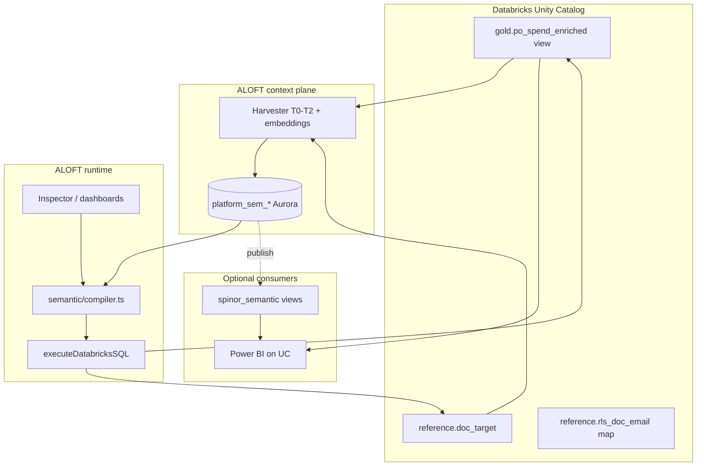

# PO Spend Analytics — Semantic Layer Migration & Ontology Plan

**Status:** Draft analysis (2026-11-09)  
**Scope:** Reverse-engineer `PO_Spend_Analytics.pbix`, align with **Databricks Unity Catalog**, and implement **governed business metrics** in **ALOFT** (`platform_sem_*`).  
**Artifacts:** `reports/pbix_semantic_metadata/PO_Spend_Analytics/`, `scripts/analyze_pbix_mac.py`

---

## 1. Executive summary

### What we are trying to do

We want **one authoritative definition** of procurement spend, vendor preference, **compliance vs leakage**, and DOC-level targets—so that **ALOFT Inspector**, dashboards, and (eventually) **Power BI** all read the **same numbers from Databricks**, not from ad hoc Fabric SQL buried in a PBIX file.

Today, business users consume **PO Spend Analytics** through Power BI. That report’s **semantic model** (tables, joins, 119 DAX measures, row-level security) was built against **Microsoft Fabric SQL** endpoints. The underlying business data **also exists in Databricks**, but ALOFT does not yet register the analytics objects (`po_spend_analysis`, etc.) or govern the KPIs from that report.

### How we are trying to do it

| Layer | Role |
|--------|------|
| **PBIX extract** | Reverse-engineering **spec**: SQL transforms, column grain, joins, measure names, RLS pattern |
| **Databricks** | **System of record** for data; target **gold view(s)** that port Fabric M-query logic to Spark SQL |
| **Harvester (T0–T2 + embed)** | Discovery, column descriptions, embeddings for “find table by meaning” |
| **ALOFT semantic layer (Aurora)** | **Governed** entities (`full_path`), dimensions, measures, joins → `compiler.ts` → SQL |
| **Runtime** | `execute.ts` → Databricks only for production analytics |
| **Power BI (later)** | Thin consumer on same UC objects or `spinor_semantic` views—not Fabric as source of truth |

This document is the **program blueprint**: as-is architecture, to-be architecture, gap analysis, and a phased build plan.

---

## 2. Problem statement

### Symptoms

1. **Duplicate semantics:** Compliance %, leakage value, and preference buckets are defined in **Fabric SQL + DAX** in the PBIX. ALOFT has a separate **governed semantic layer** that does not include PO Spend objects today.
2. **Wrong door for BI:** Power BI connects to `*.fabric.microsoft.com` warehouses/databases. Engineers treat **Databricks UC** as the lakehouse of record, creating confusion about “where truth lives.”
3. **ALOFT under-utilized for this domain:** Harvest knows many `curated_db.sp_purchase_module.*` ERP tables (55 semantic entities, all **candidate**), but **not** the analytics layer names from the PBIX (`po_spend_analysis`, `preference_data`, `FDL_abstract`).
4. **Governance gap:** Only **5 of 697** bootstrapped entities are **governed** (voyage/vessel domain). **Zero** purchase-module entities are governed. Production Inspector/dashboard queries for PO spend are not possible through governed metrics yet.

### Goals (measurable)

| Goal | Success criteria |
|------|------------------|
| **G1 — Ontology** | UC tables/views for PO spend line + targets + (optional) RLS maps are **harvested** and described |
| **G2 — Semantic model** | At least **1 governed fact entity** + **doc_target** (or equivalent) with **DOC join** |
| **G3 — Core KPIs** | **8–15 governed measures** matching PBIX headline metrics (amount, compliance, leakage, counts) |
| **G4 — Application use** | Inspector / dashboard widgets answer compliance/leakage questions via `SemanticQuery` |
| **G5 — BI alignment (phase 2)** | Power BI repointed to Databricks **or** retired in favor of ALOFT dashboards |

### Non-goals (phase 1)

- Parity with all **119 DAX measures** (rankings, conditional formatting, week-over-week UI helpers).
- Running analytics through **Fabric** from ALOFT.
- Replacing Power BI on day one without user sign-off.

---

## 3. Current state (as-is)

### 3.1 Power BI / Fabric (from PBIX extract)

**Connection pattern:** Power Query uses `Sql.Database` against Fabric hosts (warehouse + SQL DB), not Databricks connector.

| ALOFT / PBIX table | Connection | Source objects |
|--------------------|------------|----------------|
| `Purchase_History` | Fabric warehouse `BS_Data_Repository` | Custom T-SQL: `po_spend_analysis` LEFT JOIN `preference_data`, `FDL_abstract` |
| `doc_target` | Fabric SQL DB `po_data_repository-…` | `dbo.doc_target` |
| `PIC_Mapping`, `RLS_Mapping` | Embedded in PBIX (Base64 M) | Small static lookup tables |
| `CALENDAR` + date hierarchies | DAX calculated / auto date tables | Fiscal year Apr–Mar, week-of-month logic |

**Model size (extracted):**

| Asset | Count |
|--------|--------|
| Tables (incl. date helpers) | 13 |
| Columns on fact (`Purchase_History`) | 33 business columns (+ schema.csv 116 total incl. CALENDAR) |
| Relationships in model | 2 (`DOC` → `RLS_Mapping`, `DOC` → `doc_target`) |
| DAX measures | 119 |
| RLS roles | 1 (`BS_User`: `Email = USERPRINCIPALNAME()`) |

**Business grain:** One row per **PO line** (keyed by `PONO` and related attributes), enriched in SQL with preference/compliance/category flags before DAX aggregation.

**Critical SQL logic (lives in Fabric today, must move to Databricks):**

- **Status whitelist** → `status_flag` (Y/N for in-flight PO statuses).
- **Preference normalization** → `preference_flag`, `compliance_flag` (Compliance vs Leakage), `preference_sort`.
- **Category whitelist** → `category_flag` (CHEMICAL, SPARE, etc.).
- **Shippalm V3** → `DOC` from `FDL_abstract` when `Source = 'Shippalm V3'`.
- **Leakage narrative** → `reason_for_leakage`, `remarks` from `preference_data`.

Full M-query text: `reports/pbix_semantic_metadata/PO_Spend_Analytics/power_query.csv`.

### 3.2 Databricks (expected)

Data is **present** in UC per stakeholder input, but **Fabric table names in the PBIX do not match** what harvest has indexed under those names.

**Indexed today (ALOFT Aurora, 2026-11-09 read-only check):**

| Domain | In harvest / semantic layer |
|--------|-----------------------------|
| ERP purchase module | `curated_db.sp_purchase_module.*` — **55** entities, **0 governed** |
| PO spend analytics names | **No** `po_spend_analysis`, `preference_data`, `fdl_abstract`, `doc_target` |
| “Spend” substring | `open_analytics_zone.vom.fact_optimal_spends` (unrelated optimal-spend analytics) |

**Implication:** The PBIX analytics layer is likely a **different catalog/schema** (e.g. `BS_Data_Repository` mirror, `open_analytics_zone`, or `reporting_layer`) that must be **discovered, harvested, and named** in UC.

### 3.3 ALOFT semantic layer (application DB snapshot)

| Item | Value |
|------|--------|
| Semantic models | **1** — `Auto-Bootstrap Model` (`source_type: auto_bootstrap`) |
| Model status | **governed** |
| Entities | 697 (**5 governed**, rest mostly **candidate**) |
| Measures | 3,134 total (**28 governed**) |
| Governed entities (production-ready) | Voyage itinerary, position book, weekly bunker, vessel, vessel particulars — **maritime ops, not procurement analytics** |

**Runtime path (ALOFT):**

```text
User / Agent → SemanticQuery (modelId, entityId, dimensions[], measures[], filters[])
  → load governed model + access filter
  → compileSemanticQuery() → SQL
  → executeDatabricksSQL()
  → rows to Inspector / dashboard
```

Embeddings (`platform_context_embeddings`) power **discovery** (Data access search, intent matching). They do **not** execute queries or replace governed definitions.

**Optional BI publish:** `src/lib/semantic/metric-views.ts` can emit `CREATE OR REPLACE VIEW` into `catalog.spinor_semantic` — **not wired to UI** as of this writing.

---

## 4. Target state (to-be)

### 4.1 Architecture diagram



### 4.2 Design principles

1. **Single transform home:** Port Fabric `Purchase_History` SQL to **one UC gold view** (or table) so PBIX, ALOFT, and future jobs share one definition.
2. **Governed metrics in Aurora:** Business names (“Compliance percentage”, “Leakage value”) live in `platform_sem_measures` with synonyms / NL intent—not only in DAX.
3. **Entity status before measure status:** Promote **entities** to `governed` before measures (enforced in `promotion-gate.ts`).
4. **Harvest before author:** Tables must exist in `platform_context_objects` with T2 descriptions so stewards and search can find them.
5. **Progressive DAX parity:** Phase 1 = sums, counts, filtered amounts, simple ratios; Phase 2 = YTD/fiscal calendar; Phase 3 = ranking / slicer-specific measures stay in BI or derived expressions.

### 4.3 Recommended UC object model

| UC object | Purpose | Maps from PBIX |
|-----------|---------|----------------|
| `{catalog}.gold.po_spend_enriched` | Fact at PO line grain with all SQL flags | `Purchase_History` query |
| `{catalog}.reference.doc_target` | DOC → target % | `doc_target` |
| `{catalog}.reference.rls_doc_email` | DOC → user email (RLS) | `RLS_Mapping` (extract from PBIX) |
| `{catalog}.reference.pic_doc` | DOC → PIC | `PIC_Mapping` |

Using **one fact view** avoids multi-hop joins in the compiler for v1. `preference_data` and `FDL_abstract` should be **folded into the gold view**, not separate semantic entities, unless reused elsewhere.

### 4.4 ALOFT semantic model (logical)

**Model container:** Continue on **Auto-Bootstrap Model** for v1, or add a dedicated **`PO Spend Analytics`** model when multi-model UX exists.

**Entities (minimum):**

| entity_label | full_path (placeholder) | status target |
|--------------|-------------------------|---------------|
| PO Spend Line | `*.gold.po_spend_enriched` | governed |
| DOC Target | `*.reference.doc_target` | governed |
| DOC RLS Map (if not solely in Power BI) | `*.reference.rls_doc_email` | candidate → governed |

**Joins:**

```text
po_spend_enriched.DOC = doc_target.DOC     (M:1, as PBIX)
po_spend_enriched.DOC = rls_doc_email.DOC  (for entitlements / future row filters)
```

**Dimensions (from `schema.csv`, fact entity):**  
`DOC`, `IMONO`, `VESSELNAME`, `total_vessel`, `VENDORNAME`, `VENDORCODE`, `COUNTRY`, `preference`, `compliance_flag`, `Final_Category`, `CATEGORY`, `STATUS`, `status_flag`, `category_flag`, `PORTNAME`, `DOC Head`, `Procurement Manager`, `Tech Superintendent`, temporal: `PODATE`, `new_po_date`, `needdate`.

**Measures (phase 1 governed set):**

| Business label | PBIX reference | Type |
|----------------|----------------|------|
| Total PO spend (USD) | `Total Amount` | simple `SUM(final_amount_usd)` |
| Distinct PO count | `Total PO` | `COUNT_DISTINCT(pono)` |
| Distinct vendors | `Total Vendors` | `COUNT_DISTINCT(vendorcode)` |
| Distinct vessels | `Total Vessels` | `COUNT_DISTINCT(imono)` |
| Preferred spend | `Preferred amount` | filtered sum by preference values |
| In-house spend | `InHouse amount` | filtered sum |
| Not preferred spend | `Not Preferred amount` | filtered sum |
| Leakage spend | `Leakage Value` | sum where `compliance_flag = Leakage` (or equivalent) |
| Compliance spend | `Compliance Amount` | preferred + in-house |
| Compliance % | `Compliance percentage` / `comp perc2` | ratio (phase 1b) |
| Leakage % | `Leakage Percentage` | ratio vs `Grand Total new` definition |

**`Grand Total` vs `Grand Total new` (PBIX nuance):**  
Older measures divide by `[Grand Total]`; newer leakage % uses `[Grand Total new]` (explicit preference filter list). **Pick one denominator** in ALOFT and document it in measure descriptions to avoid “two compliance definitions.”

**Targets:** PBIX has `Target Compliance perc = 0` (placeholder) and `doc_target[target_percentage]`. In ALOFT, treat targets as **dimensions/measures on `doc_target` entity** or a **ratio measure** joining fact to target—do not hard-code zero.

---

## 5. Deep dive: PBIX semantic model

### 5.1 Table taxonomy

| Category | Tables | Action in migration |
|----------|--------|---------------------|
| **Fact** | `Purchase_History` | → UC gold view |
| **Reference** | `doc_target` | → UC table + entity |
| **Security / org** | `RLS_Mapping` | → UC table; align with ALOFT access + PBI RLS |
| **Lookup** | `PIC_Mapping` | → UC table |
| **Time (DAX)** | `CALENDAR`, `LocalDateTable_*`, `DOC Slicer Table` | Replace with **temporal dimensions** on fact + `timeGrain`; optional fiscal dim table in UC later |
| **Template** | `DateTableTemplate_*` | Ignore |

### 5.2 Fact column catalog (`Purchase_History`)

| Column | Type | Semantic role |
|--------|------|----------------|
| `PONO` | string | Grain / count |
| `IMONO`, `VESSELNAME`, `total_vessel` | string | Vessel dimensions |
| `PORTNAME`, `COUNTRY` | string | Geo / port |
| `VENDORNAME`, `VENDORCODE` | string | Vendor dimensions |
| `DOC`, `DOC Head`, `Tech Superintendent`, `Procurement Manager` | string | Org / accountability |
| `CATEGORY`, `Final_Category`, `category_flag` | string | Category slices |
| `STATUS`, `status_flag` | string | PO lifecycle filter |
| `preference`, `preference_flag`, `preference_sort`, `compliance_flag` | string/int | **Core compliance/leakage logic** |
| `BASEAMOUNT_USD`, `FINAL_AMOUNT_USD`, `DISCOUNTPERCENT`, `Avg rebate` | numeric | Spend / rebate |
| `PODATE`, `new_po_date`, `needdate`, `last_mod_date` | datetime | Time intelligence |
| `reason_for_leakage`, `remarks` | string | Qualitative leakage (PII / access review) |
| `PO_DESCRIPTION`, `PRNO` | string | Detail / search |

### 5.3 DAX measure domains (119 measures)

Group for prioritization:

| Domain | Examples | ALOFT phase |
|--------|----------|-------------|
| **Core amounts** | Total Amount, Preferred/InHouse/… amounts, Grand Total | Phase 1 |
| **Compliance / leakage** | Compliance %, Leakage Value/%, Compliance Amount | Phase 1–2 |
| **YTD / fiscal** | Spend YTD, Compliance % YTD, ALLEXCEPT on `CALENDAR[FINANCIAL_YEAR]` | Phase 2 (needs fiscal calendar policy) |
| **Week / period compare** | Compliance perc Selected/Previous Week, trends | Phase 2–3 |
| **Rankings / TOPN** | Highest Leakage Vendor/Vessel/Category | Phase 3 or BI-only |
| **UI / slicer helpers** | DOC Row Highlight, conditional labels, format strings | BI-only |
| **Vendor leaderboards** | Top preferred/in-house vendors | Phase 3 |

### 5.4 Security model

```text
Role: BS_User
Filter: RLS_Mapping[Email] = USERPRINCIPALNAME()
Relationship: Purchase_History[DOC] → RLS_Mapping[DOC] (M:1, single cross-filter)
```

**ALOFT alignment:**

- **Table-level Use** + department/DOC tagging (`docs/access/feature-map.md`).
- Harvested columns like `remarks`, `reason_for_leakage` may need **column protections**.
- PBI RLS remains until Entra + DOC entitlements are replicated in UC or semantic access rules.

---

## 6. How ALOFT pieces fit together

### 6.1 Three systems (same question, three layers)

| Question | Harvester | Semantic layer | Databricks |
|----------|-----------|----------------|------------|
| What is it? | Metadata scan + AI column/table descriptions | Governed dims/measures in Aurora | Storage + SQL execution |
| Storage | `platform_context_*` | `platform_sem_*` | Delta / UC tables |
| PO spend example | “Table X has `final_amount_usd`” | “Total PO spend = SUM(final_amount_usd) on PO Spend Line” | Runs `SELECT … FROM gold.po_spend_enriched` |

### 6.2 Authoring lifecycle

```text
1. Harvest object appears in estate
2. T4 proposes entity (candidate) on Auto-Bootstrap Model
3. Steward authors dimension/measure drafts (Metrics catalog)
4. submit → candidate
5. promote entity → governed (required before measure promote)
6. promote measure → governed
7. Inspector / dashboard uses SemanticQuery with measure IDs
```

### 6.3 What embeddings do and do not do

| Do | Do not |
|----|--------|
| Find “purchase order spend” tables in Data access search | Define official KPI formulas |
| Enrich prompts for Inspector intent resolution | Replace `full_path` on entities |
| Help stewards pick columns when authoring | Connect Power BI to Aurora |

---

## 7. Gap analysis

| Gap | Impact | Mitigation |
|-----|--------|------------|
| UC path for `po_spend_analysis` unknown in harvest | Cannot create entities | Databricks search + steward workshop; expand harvest scope |
| SQL only in Fabric M-query | Transform not in lakehouse | Port to gold view; code review vs Fabric row samples |
| 692 candidate-only entities | Noise in catalog | Faceted model or dedicated PO model; don’t govern all 697 |
| Fiscal calendar in DAX only | YTD parity hard | Phase 2: UC calendar table or document FY rule (Apr–Mar) |
| RLS/PIC embedded in PBIX | Ops can’t edit without republish | Extract to CSV (`scripts/analyze_pbix_mac.py` + decode M) → UC tables |
| `applyMetricViews` unwired | External BI can’t auto-consume | Manual DDL or future UI for spinor_semantic |
| ERP `purpo*` vs analytics fact | Wrong table if stewards pick module only | Name “PO Spend **Analytics**” entity; description links to PBIX |

---

## 8. Methodology: step-by-step execution

### Step 0 — Stakeholder alignment

- Confirm **canonical UC catalog** for analytics vs `curated_db.sp_purchase_module`.
- Agree **single compliance denominator** (`Grand Total` vs `Grand Total new`).
- Agree **fiscal year** rule (PBIX: April start).
- Name **owners** for promote (admin vs reputation gate).

### Step 1 — PBIX as specification (done)

- Run: `python3 scripts/analyze_pbix_mac.py ~/Downloads/PO_Spend_Analytics.pbix reports/pbix_semantic_metadata`
- Review: `power_query.csv`, `schema.csv`, `dax_measures.csv`, `relationships.csv`, `rls.csv`

### Step 2 — Discover Databricks objects

- SQL discovery on UC (`system.information_schema`, `SHOW TABLES`).
- Row-count / key match vs Fabric (sample `PONO`, amounts).
- Document mapping worksheet (Section 10).

### Step 3 — Implement gold view

- Port M-query to Spark SQL pipeline (dbt/notebook/job).
- Unit test: column list matches PBIX `schema.csv` for `Purchase_History`.
- Deploy to UC; grant warehouse read for app service principal.

### Step 4 — Harvest & enrich

- Add catalog/schema to estate scope.
- Run T0 → T1 → T2 → embed.
- Optional T4 entity/join propose for cluster containing gold + doc_target.

### Step 5 — Semantic entities & joins

- Verify `full_path` on entities matches UC.
- Promote **PO Spend Line** + **DOC Target** entities to **governed**.
- Create `platform_sem_joins` for `DOC`.

### Step 6 — Dimensions & measures

- Batch author dimensions from fact schema.
- Author phase-1 measures; add **synonyms** from PBIX measure names (`nl_intent` / embedding where supported).
- `authoring-preview` → validate compiled SQL.
- submit → promote measures.

### Step 7 — Application validation

- Inspector: “Compliance percentage by DOC last quarter” (example).
- Dashboard widget on governed defs.
- Compare totals to Power BI for same filters (parity sign-off).

### Step 8 — Power BI / Fabric decommission path

- New dataset: Databricks → gold view (+ doc_target).
- Retire Fabric credentials in dataset.
- Keep ranking/formatting DAX thin; core metrics from UC or spinor views.

---

## 9. Phased delivery plan

| Phase | Duration (indicative) | Deliverables | Exit criteria |
|-------|----------------------|--------------|---------------|
| **P0 Discovery** | 1–2 weeks | UC mapping sheet; signed gold view design | Stewards approve paths + SQL spec |
| **P1 Foundation** | 2–3 weeks | `gold.po_spend_enriched`; harvest T2; 2 governed entities | Preview query returns rows in ALOFT |
| **P2 Core metrics** | 2–3 weeks | 10–15 governed dims; 8 governed measures | Inspector answers spend/compliance/leakage |
| **P3 Time & targets** | 2–4 weeks | Fiscal YTD measures; target % from `doc_target` | YTD within tolerance vs PBI |
| **P4 Access & BI** | 2+ weeks | RLS map in UC; PBI on Databricks; column protections | Security review passed |

---

## 10. Mapping worksheet (fill in during P0)

| PBIX / logical | Fabric / legacy name | UC full_path (TBD) | Harvested? | Semantic entity | Governed? |
|----------------|---------------------|--------------------|------------|-----------------|-----------|
| Fact | `po_spend_analysis` (+ joins in SQL) | | ☐ | PO Spend Line | ☐ |
| Targets | `dbo.doc_target` | | ☐ | DOC Target | ☐ |
| RLS | `RLS_Mapping` | | ☐ | DOC RLS Map | ☐ |
| PIC | `PIC_Mapping` | | ☐ | optional | ☐ |
| ERP (related) | `purpo`, `purpoitems` | `curated_db.sp_purchase_module.*` | ☑ partial | 55 candidates exist | ☐ |

---

## 11. Risks & open questions

| # | Risk / question | Owner |
|---|-----------------|--------|
| 1 | Is `po_spend_analysis` a view in UC or only in Fabric warehouse? | Data platform |
| 2 | Lag between Databricks gold and Fabric mirror? | Data platform |
| 3 | Are `remarks` / leakage fields restricted under column access? | Security / FOER |
| 4 | Dedicated semantic model vs single auto-bootstrap? | Product + data steward |
| 5 | Who signs off PBI parity tests? | Business + analytics |

---

## 12. Appendix A — File references

| Path | Description |
|------|-------------|
| `reports/pbix_semantic_metadata/PO_Spend_Analytics/` | Extracted metadata CSVs + README |
| `scripts/analyze_pbix_mac.py` | Local PBIX semantic extractor (pbixray) |
| `docs/semantic-layer-guide.html` | End-to-end semantic layer program |
| `src/lib/semantic/compiler.ts` | SQL compilation |
| `src/lib/semantic/execute.ts` | Governed execution gate |
| `src/lib/context/t4/entity-propose-logic.ts` | Harvest → entity bootstrap |
| `src/lib/semantic/metric-views.ts` | Optional UC view publish |

---

## 12. Appendix B — Current ALOFT DB snapshot (2026-11-09)

Verified via read-only Prisma query against app Aurora:

- **Models:** 1 (`Auto-Bootstrap Model`, **governed**)
- **Entities:** 697 total, **5 governed** (voyage/vessel)
- **Measures:** 3,134 total, **28 governed**
- **Purchase module entities:** 55 (**candidate**, 0 governed)
- **PO spend analytics names:** not present in harvest or semantic entities

This snapshot should be re-run after P1 harvest completes.

---

## 13. Summary

We are **not** “connecting Power BI to ALOFT” directly. We are **re-establishing the PO Spend Analytics ontology on Databricks**, registering it in the **harvest + governed semantic layer**, and using the **PBIX extract as the authoritative requirements document** for columns, joins, security, and KPI names. Fabric becomes optional legacy plumbing; **ALOFT + Databricks** become the path for governed analytics; Power BI can follow as a **thin client** on the same UC objects once core metrics are trusted.

---

*Document maintained with the PO Spend / procurement analytics workstream. Update mapping worksheet and DB snapshot as phases complete.*
