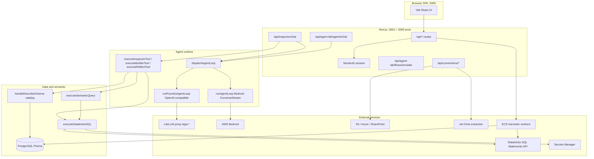

# Comprehensive Architecture Audit: AI Tools, MCP, Connectors, Data Access, and Execution Infrastructure

**Repository:** `aloft-ui-redesign` (package name `aloft-d360`)  
**Audit date:** 2026-11-01  
**Mode:** Read-only investigation (no code, config, or dependency changes)  
**Confidence legend:** **High** = traced call path in source; **Medium** = partial trace or tests/docs align; **Low** = design-only or not exercised in runtime paths; **Unknown** = not verified in this session.

---

## 1. Executive summary

ALOFT/D360 is a **Next.js 16 API + Vite/React Router SPA** monolith deployed as a **single Docker container** (Elastic Beanstalk/ECS). The application’s production AI loop is **custom agent runtime code** (`runAgentLoop` / `runFoundryAgentLoop`) with **Bedrock Converse (stream)** or **OpenAI-compatible chat completions** via the org’s **external LiteLLM proxy** (`LLMLITE_BASE_URL`), not an in-repo LiteLLM SDK.

**Tool execution is centralized** in a few dispatchers:

| Runtime | Dispatcher | Model tool format |
|---------|------------|-------------------|
| Inspector chat | `executeInspectorTool` | Bedrock `Tool[]` / Foundry `ChatCompletionTool[]` |
| Catalog agents / Automate | Same + `runCatalogAgent` | Subset + optional `search_knowledge`, `submit_answer`, `record_inspection` |
| Agent Lab workbench | `executeBuilderTool` | Construction draft tools |
| Teach / Marcus Reflect | `executeReflectTool` | Allowlisted reflect tools only |
| Flows (Automate) | `invokeCapability` + `executeRun` | Capability contracts (Zod), not LLM tools |
| Boost benchmarks | `executeInspectorTool` (phantom catalog) | Same as Inspector |

**MCP:** There is **no** `@modelcontextprotocol` dependency, **no** MCP client/server/transport implementation in this repo. “MCP” appears as a **catalog/tool tier label** and in **Business AI Studio design docs** (planned import of MCP/OpenAPI as capability contracts). **Confidence: High.**

**LiteLLM:** Used as an **external HTTP gateway** for chat, model listing, and OCR (`/v1/chat/completions`, `/v1/models`, `/v1/ocr`). The app does **not** embed LiteLLM as a library or MCP gateway. **Confidence: High.**

**Databricks** is the only warehouse execution path for agent SQL; all interactive SQL goes through **`executeDatabricksSQL`** (Statement Execution API `POST/GET /api/2.0/sql/statements`). Harvested schema discovery uses **`describe_schema`** → Prisma catalog (no warehouse). **Confidence: High.**

**Reusable for Business AI Studio:** `executeDatabricksSQL`, `executeSemanticQuery`, `describe_schema` / context harvest, capability registry + policy gateway pattern, connection service (S3/Azure/SharePoint), knowledge search, agent loop abstraction, LiteLLM client config—not MCP plumbing.

**Simplest production-ready target for Studio:** Keep internal tool dispatch; add **thin MCP servers** that delegate to existing functions (Databricks describe/execute, knowledge search) behind the same auth/policy gates; use **existing LiteLLM gateway** for models unless Studio needs features the proxy already lacks (fallbacks, unified MCP—**Unknown** without inspecting the external gateway deployment).

---

## 2. Current architecture

### 2.1 Stack

| Layer | Technology | Evidence |
|-------|------------|----------|
| UI | Vite + React 18 + React Router 7 (`web/`) | `package.json`, `web/dev-all.mjs` |
| API | Next.js 16 App Router (`src/app/api/**`) | ~380 `route.ts` files |
| ORM / app DB | PostgreSQL via Prisma | `prisma/schema.prisma`, `src/lib/db.ts` (pool_limit 15) |
| Auth | NextAuth (Azure AD + optional credentials) | `src/lib/auth.ts` |
| LLM (primary path) | LiteLLM HTTP proxy | `src/lib/llmlite/config.ts`, `foundry-chat.ts`, `chat.ts` |
| LLM (secondary) | AWS Bedrock Runtime ConverseStream | `src/lib/inspector/agent-loop.ts` |
| LLM (other) | Direct xAI for document extraction | `src/app/api/connections/[id]/extract/route.ts` |
| Embeddings | Amazon Titan via Bedrock (knowledge) | `docs/knowledge/setup.md` (cited in repo) |
| Object storage | S3, Azure Blob, SharePoint (Graph) | `src/lib/connections/` |
| Background harvest | ECS Fargate tasks + orchestrator script | `scripts/context/orchestrator.ts`, `enqueue-and-launch.ts` |
| Deploy | Docker multi-stage → Next standalone | `Dockerfile` |

`packages/aloft-shared` is **UI components only** (no AI/tool code). **Confidence: High.**

### 2.2 Architecture diagram (implemented)



### 2.3 AI request lifecycle (Inspector chat)

1. **POST** `/api/inspector/chat` — `guardInspectorChat` (session ownership / service token). **High**
2. Resolve model via `fromLlmLiteModelKey` → `llmLiteInspectorRuntimeConfig` or legacy Bedrock map (empty). **High**
3. Build system prompt: `buildSystemPrompt`, memory injection, semantic context, session knowledge. **High**
4. `buildToolConfig(contextMode, includeSemanticChart)` → Bedrock-shaped tools. **High**
5. `dispatchAgentLoop` → `runFoundryAgentLoop` (LiteLLM) or `runAgentLoop` (Bedrock). **High**
6. Loop: stream model → collect `toolUse` blocks → **`Promise.all` parallel tool execution** → append `toolResult` messages → repeat until `maxLoops` (default 15, env `INSPECTOR_MAX_LOOPS` 1–32). **High** (`agent-loop.ts` ~258–267)
7. Tools call `executeInspectorTool` with optional `withAgentOpsToolLog`. **High**
8. Side effects: SSE events (`query_result`, `chart_spec`, etc.), persistence to `studio_query_results`, memory/trace hooks. **Medium** (partial trace in chat route)

```mermaid
sequenceDiagram
  participant U as User
  participant API as inspector/chat
  participant LLM as LiteLLM or Bedrock
  participant Loop as runAgentLoop
  participant T as executeInspectorTool
  participant C as describe_schema
  participant D as executeDatabricksSQL
  U->>API: messages + sessionId
  API->>Loop: systemPrompt + tools + executeTool closure
  loop up to maxLoops
    Loop->>LLM: ConverseStream / chat.completions + tools
    LLM-->>Loop: tool_use blocks
    par parallel tools
      Loop->>T: execute_tool / describe_schema / ...
      T->>C: Prisma catalog reads
      T->>D: SQL via token + warehouse
    end
    Loop->>LLM: tool results in messages
  end
  Loop-->>API: finalText + trajectory
  API-->>U: SSE stream
```

---

## 3. Complete tool inventory

Tools are **not** registered in one global registry. They are **composed per surface** from Bedrock `Tool` specs and executed via named dispatchers.

### 3.1 Inspector / data studio tools (`executeInspectorTool`)

| Tool name | Category | Implementation | Input | Output | Execution | AuthZ | Side effects |
|-----------|----------|----------------|-------|--------|-----------|-------|--------------|
| `execute_tool` | Database | `tools.ts` → `resolveToolCatalogEntry` → `executeDatabricksSQL` | `tool_name`, `args.statement` | JSON result set | HTTP Statement API | Connection active in DB; read-only SQL enforced | Read warehouse |
| `describe_schema` | Catalog | `context/dispatch.ts` | `action`, `connection`, `path`, `query`, … | JSON catalog | Prisma only | Org via `getDefaultOrg` | Read PG |
| `export_query_result` | Export | `tools.ts` + `export-sql.ts` | optional `statement`, `filename` | JSON + SSE `export_ready` | Defers to export route | Session SQL reuse rules | Read (export path separate) |
| `emit_chart` | Visualization | `tools.ts` → validator/compiler or `chart-pipeline` | Chart DSL JSON | JSON + SSE | May call Bedrock in pipeline | Uses in-turn query results | None on DB |
| `emit_semantic_chart` | Semantic + viz | `chart-pipeline` → `runSemanticChartPipeline` | `SemanticQuery` | JSON + SSE | `executeSemanticQuery` | Requires `connectionId` | Read warehouse |
| `emit_disambiguation` | UX / semantic | `tools.ts` | candidates, message | JSON + SSE | None | N/A | None |

**Unknown at runtime:** Tools registered in `tool_catalog` with `type !== 'db_query'` are rejected by Inspector (`tools.ts` ~457). **High**

### 3.2 Catalog agent tools (`runCatalogAgent`)

| Tool name | When present | Handler |
|-----------|--------------|---------|
| `describe_schema`, `execute_tool` | Always (filtered `INSPECTOR_TOOLS`) | `executeInspectorTool` |
| `search_knowledge` | Linked KBs + actor access | `runSearchKnowledgeTool` |
| `record_inspection` | `captureInspection: true` | In-process parse only |
| `submit_answer` | Custom answer fields | In-process; aborts loop |

**Confidence: High** (`run-catalog-agent.ts`)

### 3.3 Workbench builder tools (`executeBuilderTool`)

| Tool name | Purpose |
|-----------|---------|
| `update_agent_draft` | Patch construction state |
| `add_assumption` | Assumption ledger |
| `add_datasource` | kb / databricks / mcp / api refs |
| `select_agent_class` | feynman / fermi / grossmann / rama |
| `select_agent_tools` | Maps catalog tool IDs to tiers including **`mcp` tier label** |

Execution: in-memory state + SSE patches. **No MCP wire protocol.** **High**

### 3.4 Reflect / Teach tools (`executeReflectTool`)

Allowlist (`reflect-tools.ts`): **`recall_memory`**, **`capture_learning`**, **`verify_claim`**. Withholds all Inspector mutation tools by design. **High**

### 3.5 Flow copilot

`propose_flow_changes` — flow edit proposal tool (LLM loop in `flows-copilot/propose.ts`). **Medium**

### 3.6 Dashboard / other LLM tools

- `PROPOSE_BLUEPRINT_TOOL` — dashboard blueprint (`dashboards/blueprint-propose.ts`)
- Chart recommender tools in `chart-emitter.ts` / `chart-pipeline.ts` (internal Bedrock calls, not always exposed as agent tools)

### 3.7 Flow capabilities (not LLM tools)

Registered in `builtinCapabilityRegistry` (`capabilities/registry.ts`):

| Capability ID | Provider tag | Live handler in repo |
|---------------|--------------|----------------------|
| `http.request` | http | **None** (simulate only) |
| `email.send` | email | **None** |
| `notify.message` | teams | **None** |
| `object_store.list` | s3 | **None** |
| `document.extract` | ocr | **Separate** `/api/connections/:id/extract` (not wired as capability handler) |

`invokeCapability` in live mode requires `handlers[def.id]` — **no `handlers` passed from any `src/app` route** (grep). Flow **simulation** uses mocks. **High**

### 3.8 `tool_catalog` (Postgres)

Admin CRUD: `/api/catalog/tools`. Schema fields include `type`, `slug`, `config`, `input_schema`, `tier`. Databricks connections auto-sync via `databricks/tool-registration.ts`. Types used in code: `db_query`, and UI/construction labels `mcp`, `skill`, `api`. **MCP type is metadata only today.** **High**

### 3.9 Summary by category

| Category | Count (active patterns) | Central dispatcher |
|----------|-------------------------|-------------------|
| Databricks SQL | 1 (`execute_tool`) | `executeDatabricksSQL` |
| Schema catalog | 1 (`describe_schema`) | `context/dispatch.ts` |
| Knowledge RAG | 1 (`search_knowledge`) | `knowledge/search.ts` |
| Semantic/chart | 3 emit_* | `tools.ts` + semantic/chart pipelines |
| Agent construction | 5 | `builder-tools.ts` |
| Learning/teach | 3 | `reflect-tools.ts` |
| Flow capabilities | 5 contracts | `capabilities/gateway.ts` |
| Document extraction | API route | `extraction/service.ts` |

---

## 4. MCP implementation audit

| Question | Answer | Evidence |
|----------|--------|----------|
| 1. Does the app support MCP? | **No runtime MCP protocol** | No `@modelcontextprotocol` in `package.json`; grep only docs/design/tier labels |
| 2. Client, server, or both? | **Neither** | — |
| 3. Third-party MCP servers? | **No** | — |
| 4. Expose app functions as MCP tools? | **Not implemented**; natural wrap targets: `executeInspectorTool`, `handleDescribeSchema`, `runSearchKnowledgeTool` | — |
| 5. Dynamic remote tool discovery? | **No** | Tools are compile-time / prompt-built lists |
| 6. Shared MCP connections across agents? | **N/A** | — |
| 7. MCP permissions scoped? | **N/A**; app uses RBAC (`inspector:use`, proposed `connector:*`) | `capabilities/builtin.ts`, `rbac` |
| 8. Connection lifecycle? | **N/A** | — |
| 9. Remote MCP failure handling? | **N/A** | — |
| 10. Production-ready MCP? | **No MCP implementation** | `docs/business-ai-studio/06-connectors-security.md` §1: "Not built" |

**Resemblance to MCP (conceptual only):** Bedrock `Tool` + JSON Schema ≈ MCP tools; capability registry ≈ curated tool catalog; `describe_schema` ≈ application-controlled context (MCP resources pattern in docs). **Not wire-compatible.**

**Confidence: High**

---

## 5. Connector and integration inventory

| Integration | SDK / protocol | Connection | Auth | Operations in repo | Live agent/flow use | MCP-ready wrap |
|-------------|----------------|------------|------|---------------------|----------------------|----------------|
| **Databricks** | Statement Execution REST | `platform_databricks_connections` | OAuth M2M client creds (Secrets Manager or env) | SQL read, export, harvest | **Yes** (agents) | **Yes** — wrap `executeDatabricksSQL` |
| **PostgreSQL** | Prisma / `pg` | `DATABASE_URL` | App-level | All app state, catalog, vectors | **Yes** (indirect) | Low value as MCP SQL |
| **AWS S3** | `@aws-sdk/client-s3` | `platform_connections` | Access keys in Secrets Manager | list/read/browse/test | Extraction + flows **contract** | Wrap connection service |
| **Azure Blob** | `@azure/storage-blob` | Same | Connection string | Same | Same | Same |
| **SharePoint** | Microsoft Graph HTTPS | Same | Entra app secret | Same; host allowlist | Same | Same |
| **AWS Bedrock** | `@aws-sdk/client-bedrock-runtime` | Env/instance profile | AWS creds | Converse, embed, harvest LLM | **Yes** | N/A |
| **LiteLLM gateway** | OpenAI-compatible HTTP | Env `LLMLITE_*` | Bearer API key | chat, models, OCR | **Yes** | External product |
| **xAI** | HTTP (extraction) | Env | API key | Vision extraction | **Yes** (connections API) | Optional |
| **AWS ECS** | `@aws-sdk/client-ecs` | Platform | IAM | Launch harvester tasks | Background | N/A |
| **AWS Secrets Manager** | SDK | — | IAM | Databricks + connection secrets | **Yes** | N/A |
| **CloudWatch Logs** | SDK | — | IAM | Logging | **Unknown** depth | N/A |
| **Snowflake / Salesforce / Jira / etc.** | — | UI label only on estate cards | — | **Not implemented** | No | — |

**Common abstractions:**

- **Storage:** `StorageProvider` + `connections/service.ts` (**High**)
- **Warehouse:** single `executeDatabricksSQL` chokepoint (**High**)
- **Flow connectors:** capability contracts + `invokeCapability` policy gateway (**High**)
- **No generic HTTP connection type wired to `http.request` live handler** (**High**)

---

## 6. Database and SQL execution

### 6.1 Databricks (traced)

| Concern | Implementation |
|---------|----------------|
| API | `POST https://{host}/api/2.0/sql/statements`, poll `GET .../statements/:id`, chunks for export |
| Auth | `getAccessToken` → OIDC token endpoint, in-process cache per `connectionId` |
| Read-only | `READ_ONLY_VERBS`, comment/string stripping, multi-statement guard |
| Limits | `MAX_ROWS` (env, cap 10k), `MAX_WAIT_SECS`, async poll up to 10 min |
| Export | `beginDatabricksSQLExport`, `EXPORT_MAX_ROWS`, EXTERNAL_LINKS allowed on export path |
| Unity Catalog | Via SQL paths in statements; no separate UC SDK |
| SQL generation | Agent-generated; semantic via `compileSemanticQuery` |
| Centralized? | **Yes** — `src/lib/databricks/execute.ts` header documents chokepoint |

### 6.2 Other engines

No Snowflake/BigQuery/SQL Server drivers in `package.json`. App DB is PostgreSQL for metadata only (not exposed as agent SQL tool). **High**

### 6.3 Exposure via MCP without duplicating logic

**Recommended wrap surface:** export functions already centralized:

- `handleDescribeSchema` / `runDescribeSchema`
- `executeDatabricksSQL` (with same guards)
- `executeSemanticQuery`

MCP adapter should call these, not reimplement SQL validation. **High**

---

## 7. AI model and tool-calling flow

| Concern | Implementation |
|---------|----------------|
| Providers | LiteLLM proxy (primary for Inspector/agents), Bedrock direct (loop fallback paths, harvest, charts), xAI (extraction) |
| Routing | Model keys `llmlite:*` via `fromLlmLiteModelKey`; admin settings in `model-settings-store` |
| Tool schema | Bedrock `Tool.toolSpec.inputSchema.json` or OpenAI tools in `foundry-chat.ts` |
| Tool selection | Model decides; app filters available tools per route |
| Parallel calls | `Promise.all` on tool blocks per loop |
| Streaming | SSE from chat routes; ConverseStream tokens |
| Retries | Tool errors marked `retryable`; flow runner exponential backoff |
| Cost | `logAgentCost`, bandit/lifecycle scoring |
| LiteLLM in repo | HTTP client only — **not** embedded proxy |

**Common LLM abstraction:** Partial — `dispatchAgentLoop` + `BoostModel` + LiteLLM Foundry shim; not a unified provider interface like LiteLLM Python. **High**

---

## 8. ALOFT semantic intelligence boundaries

| Responsibility | Location | Agent interaction |
|----------------|----------|-------------------|
| Harvest T0–T3 | `scripts/context/orchestrator.ts`, `lib/context/harvest*` | Populates catalog for `describe_schema` |
| Schema cards / search | `lib/context/describe*` | `describe_schema` actions |
| Governed semantic models | `lib/semantic/*` | `emit_semantic_chart`, `executeSemanticQuery`, authoring APIs |
| SQL compile | `compileSemanticQuery` | Deterministic, not LLM |
| Memory / teach | `lib/memory/*`, `reflect-tools` | Personal rules, not warehouse |
| Session knowledge | `session-knowledge*.ts` | Prompt injection for Inspector |
| Learning attribution | `lib/memory/attribution`, FOER, Marcus | Post-turn |

**Boundary:** Business AI Studio should **call governed interfaces** (semantic execute, catalog describe, memory retrieve/teach APIs), not re-harvest or recompile semantics. **High**

---

## 9. Security assessment

| Control | Enforcement point | Notes |
|---------|-------------------|-------|
| User auth | NextAuth | Azure AD primary |
| Inspector session ownership | `guardInspectorChat`, `INSPECTOR_AUTH_ENFORCE` | Service token bypass |
| RBAC | `lib/rbac`, permissions on capabilities | `connector:write` / `connector:external` **proposed, not seeded** |
| Databricks SQL | `executeDatabricksSQL` read-only allowlist | Shared **service identity** (connection OAuth), not end-user UC identity |
| Tool catalog | DB registration + connection status | Any signed-in user can create Databricks connections per docs (S4) |
| Connection secrets | Secrets Manager; redaction helpers | Owner-scoped storage connections |
| Capability egress | `checkEgress`, `isSafeRelativePath`, email domain allowlist | On `invokeCapability` |
| Knowledge tool | `canSearch`, org/personal scope | Prompt warns prompt-injection in docs |
| Flow live handlers | Disabled (no handlers) | Reduces blast radius |
| MCP | N/A | — |

**Gaps (severity):**

1. **Medium:** Warehouse queries run as **platform Databricks SP**, not per-user UC grants — row-level security depends on warehouse config, not app OAuth delegation.
2. **Medium:** `INSPECTOR_AUTH_ENFORCE` observe mode can allow cross-session attribution if misconfigured.
3. **Medium:** Document extraction sends images to **xAI** outside AWS (documented).
4. **Low:** Parallel tool calls multiply warehouse load without global per-user concurrency cap (describe_schema capped at 2 — `dispatch.ts`).

Tools execute with **platform credentials** for Databricks; storage connections enforce **connection owner/sharing** on API routes. **High**

---

## 10. Throughput, scalability, performance

| Mechanism | Config | Evidence |
|-----------|--------|----------|
| Inspector tool loops | Default 15, max 32 | `max-loops.ts` |
| Parallel tools per loop | All tools in batch | `agent-loop.ts` |
| describe_schema concurrency | 2 | `dispatch.ts` |
| Prisma pool | connection_limit 15, pool_timeout 30s | `db.ts` |
| Databricks token cache | Per connectionId in-process | `token-client.ts` |
| Route max duration | 300s Inspector chat | `chat/route.ts` |
| Harvest workers | ECS Fargate | `launch-harvester.ts` |
| Flow forEach concurrency | Per-step config | `runner.ts` |

**No measured benchmarks in repo.** Proposed load test plan (safe environments):

1. **10 / 50 concurrent** Inspector sessions calling `describe_schema` search only (no warehouse).
2. **10 / 50 / 100** concurrent `execute_tool` with identical read-only SELECT LIMIT 10 (watch warehouse queue).
3. **100 / 500** simulated capability invokes (mock handlers) through `invokeCapability` to test policy gateway CPU.
4. **1000** — only with explicit Databricks capacity review and circuit breaker.

Bottlenecks likely at: **(5) Databricks warehouse**, **(2) LiteLLM gateway**, **(1) Next.js single container** if many long SSE streams, not MCP (absent).

---

## 11. Tool architecture vs MCP

| Existing capability | MCP adds? | Notes |
|--------------------|-----------|-------|
| JSON Schema tools | Interop with external hosts | Already Bedrock/OpenAI shaped |
| Registries | Standard discovery | Today: per-route composition |
| Policy gateway | Could sit in MCP server or gateway | `invokeCapability` is strong pattern |
| Auth | MCP OAuth spec | Not implemented |
| Telemetry | OpenTelemetry MCP | App has agent_ops logging |

**Smallest MCP adapter:** One server process exposing `describe_schema`, `execute_tool` (guarded), `search_knowledge` as thin wrappers calling existing TS modules via internal import or HTTP to same app **internal** routes with service token.

Keep **direct in-process** calls for Inspector latency inside monolith; MCP for **cross-product** (Business AI Studio separate deploy). **Medium**

---

## 12. LiteLLM evaluation

### A. LLM gateway

| Criterion | Existing | LiteLLM (external proxy) |
|-----------|----------|---------------------------|
| Routing | Model key + admin settings | Already used for chat/OCR |
| Fallbacks | Not evident in app code | **Unknown** on gateway config |
| Cost tracking | `logAgentCost` | Gateway may add; not wired in app |
| Observability | agent_ops, lifecycle | Gateway logs **Unknown** |

**Verdict:** App **already depends** on LiteLLM HTTP for primary chat. Embedded LiteLLM library in this repo adds little; operational gateway remains external. **High**

### B. MCP gateway

LiteLLM MCP gateway features **not used**; no MCP in repo. Would add network hop and ops surface unless Studio is MCP-native. **High (absence)**

### Architecture comparison (summary)

| # | Architecture | Benefits | Risks / cost |
|---|--------------|----------|--------------|
| 1 | Current (no MCP) | Simplest, lowest latency | No cross-app tool standard |
| 2 | + MCP adapters | Studio interop | Extra deploy, auth complexity |
| 3 | + LiteLLM MCP GW | Central MCP registry | **Unknown** benefit without MCP clients; duplicate policy layer |
| 4 | LiteLLM for both | Single vendor ops | Tight coupling; gateway SPOF |

---

## 13. Business AI Studio integration

**Reuse (governed interfaces):**

- `executeDatabricksSQL` + connection/token management
- `handleDescribeSchema` / harvest APIs
- `executeSemanticQuery` + semantic model APIs
- `runSearchKnowledgeTool` + KB access rules
- `invokeCapability` + capability registry (when live handlers exist)
- LiteLLM env-based model access
- Memory/teach HTTP APIs (`/api/inspector/teach`, memory routes)

**Keep independent:**

- Studio agent runtime (orchestration, multi-agent)
- Studio-specific tool discovery UI
- MCP client if Studio standardizes on MCP

**Do not duplicate:** Harvest pipeline, semantic compiler, memory synthesis.

---

## 14. Recommended target architecture

1. **Connector registry:** Extend `platform_connections` + provider adapters (existing); add REST/OpenAPI connection kind before `http.request` live handler.
2. **Tool layer:** Keep `executeInspectorTool`-style dispatchers; version tools in `tool_catalog`.
3. **MCP:** Optional **separate lightweight MCP servers** per domain (data, knowledge, capabilities) delegating to shared libraries; **no pass-through**.
4. **MCP gateway:** **Defer** until multiple MCP servers and Studio clients exist; use service mesh or API gateway auth first.
5. **LLM:** Continue **external LiteLLM proxy**; app stays thin HTTP client.
6. **Policy:** Unify capability gateway checks with any MCP tool entry (same Zod contracts).
7. **Observability:** Extend `withAgentOpsToolLog` pattern to MCP calls.

---

## 15. Prioritized roadmap

| Priority | Item | Effort |
|----------|------|--------|
| P0 | Document and stabilize internal tool surfaces for Studio (OpenAPI on existing routes) | Medium |
| P1 | Live handlers for P0 capabilities (`object_store.list`, `http.request`) using connection service | High |
| P1 | Per-user or per-role Databricks auth evaluation (UC) | High |
| P2 | MCP adapter server for data + knowledge tools | Medium |
| P3 | LiteLLM MCP gateway evaluation **only if** Studio requires centralized MCP | Low until requirement clear |
| P3 | Seed `connector:write` / `connector:external` in RBAC | Low |

---

## 16. Risks, unknowns, validation

| Unknown | Validation needed |
|---------|-------------------|
| LiteLLM gateway fallbacks, rate limits, MCP features | Inspect gateway deployment config (out of repo) |
| Production Bedrock vs LiteLLM traffic split | Metrics / env in EB |
| Databricks warehouse concurrency limits | Load test with DBAs |
| All 380 API routes for auth consistency | Automated route audit (not done this session) |

---

## 17. Capability matrix

| Capability | Existing implementation | MCP benefit | LiteLLM benefit | Recommendation |
|------------|-------------------------|-------------|-----------------|----------------|
| Database connectivity | Databricks via `executeDatabricksSQL` + OAuth (**High**) | Interop for Studio | None for DB | **Keep**; wrap for MCP |
| Tool registration | `tool_catalog` + prompt-built lists (**High**) | Standard discovery | None | **Keep** + optional MCP mirror |
| Tool execution | Central dispatchers (**High**) | Cross-process | None | **Keep** internal; **Wrap** for Studio |
| Tool discovery | Per-route composition (**High**) | High for external agents | Low | **Build** MCP catalog when Studio splits |
| Authentication | NextAuth + service tokens (**High**) | MCP OAuth spec | API keys via gateway | **Keep**; extend for MCP auth |
| Authorization | RBAC + capability gateway (**Medium**) | Policy export | Key scoping on models | **Improve** connector permissions |
| LLM routing | LiteLLM HTTP + Bedrock paths (**High**) | None | Already using proxy | **Keep** external LiteLLM |
| Observability | agent_ops, lifecycle (**Medium**) | Standard tool spans | Gateway logs | **Extend** unified trace IDs |
| Rate limiting | Partial (describe concurrency) (**Medium**) | Gateway quotas | Gateway quotas | **Measure** then add |
| Scalability | Monolith + ECS workers (**Medium**) | Extra hop if MCP remote | Gateway SPOF | **Horizontal** replicate app; watch DBX |

---

## 18. Final decision questions

1. **Tools/connectors today:** Inspector tools (SQL, catalog, charts, export); agent tools (+ knowledge, submit_answer); builder tools; reflect tools; five flow capability contracts; storage connections (S3/Azure/SharePoint); Databricks platform connections; extraction API.
2. **How they work:** LLM loop → named dispatcher → Prisma catalog or `executeDatabricksSQL` or knowledge search or in-memory state; flows → `invokeCapability` (simulate/live handlers mostly absent).
3. **Reusable across agents:** `executeInspectorTool`, `runCatalogAgent`, capability registry/gateway, connections service, semantic execute, LiteLLM client config.
4. **Resemble MCP:** Tool JSON schemas + registry patterns; **not** MCP protocol.
5. **MCP implemented:** **No.**
6. **MCP would add:** Standard third-party tool wiring, Studio separation, OAuth for tools — at cost of complexity and latency.
7. **Databricks via MCP without rebuild:** **Yes**, wrap existing execute/describe functions.
8. **Dedicated MCP gateway needed?** **Not yet** — only if many MCP servers and clients; otherwise in-process or single adapter server.
9. **LiteLLM vs existing:** Already use LiteLLM as **HTTP LLM gateway**; in-repo LiteLLM library redundant; MCP gateway value **Unknown** without Studio MCP requirements.
10. **Bottlenecks:** Databricks warehouse, LiteLLM proxy, long SSE on monolith, parallel tool fan-out.
11. **Preserve/wrap/build:** Preserve semantic/harvest/memory; wrap data/knowledge tools for Studio; build live capability handlers + MCP adapters when Studio splits.
12. **Simplest production architecture:** **Monolith tool dispatch + external LiteLLM + optional thin MCP servers** delegating to shared libs; **no** LiteLLM MCP gateway until multiple MCP endpoints require it.

---

## 19. Evidence appendix (selected)

| Topic | Path | Lines / symbol |
|-------|------|----------------|
| Tool execution chokepoint | `src/lib/inspector/tools.ts` | `executeInspectorTool` ~111–488 |
| Inspector tools schema | `src/lib/inspector/prompts.ts` | `INSPECTOR_TOOLS` ~133–225 |
| Agent loop + parallel tools | `src/lib/inspector/agent-loop.ts` | `runAgentLoop`, ~258–267 |
| LiteLLM config | `src/lib/llmlite/config.ts` | `getLlmLiteBaseUrl` ~146+ |
| Provider dispatch | `src/lib/inspector/providers/factory.ts` | `dispatchAgentLoop` |
| Foundry/LiteLLM chat loop | `src/lib/inspector/providers/foundry-chat.ts` | `runFoundryAgentLoop` |
| Databricks SQL | `src/lib/databricks/execute.ts` | header ~1–23; API ~227+ |
| Token client | `src/lib/databricks/token-client.ts` | `getAccessToken` |
| describe_schema | `src/lib/context/dispatch.ts` | `DESCRIBE_SCHEMA_CONCURRENCY = 2` |
| Semantic execute | `src/lib/semantic/execute.ts` | `executeSemanticQuery` |
| Catalog agent | `src/lib/agents/run-catalog-agent.ts` | `runCatalogAgent` |
| Capability gateway | `src/lib/capabilities/gateway.ts` | `invokeCapability` |
| Builtin capabilities | `src/lib/capabilities/builtin.ts` | `BUILTIN_CAPABILITIES` |
| Flow runner | `src/lib/flows/runner.ts` | `executeRun` |
| MCP not built (design) | `docs/business-ai-studio/06-connectors-security.md` | §1 MCP/OpenAPI |
| No MCP SDK | `package.json` | dependencies (no modelcontextprotocol) |
| Session auth | `src/lib/inspector/session-auth.ts` | `guardInspectorChat` |
| Harvest orchestrator | `scripts/context/orchestrator.ts` | entry |
| Deploy | `Dockerfile` | multi-stage Next standalone |

---

## 20. Coverage checklist

| Area | Inspected | Notes |
|------|-----------|-------|
| `src/lib/inspector/*` | Yes | Core agent loop |
| `src/lib/databricks/*` | Yes | Execute path |
| `src/lib/semantic/*` | Partial | Execute/compiler traced |
| `src/lib/context/*` | Partial | Dispatch + orchestrator entry |
| `src/lib/capabilities/*` | Yes | |
| `src/lib/flows/*` | Partial | Runner/simulate; not every route |
| `src/app/api/*` | Sampled | ~380 routes; auth not per-route |
| `web/*` UI | Partial | Dev topology only |
| `packages/aloft-shared` | Yes | UI only |
| External LiteLLM/K8s config | **No** | Out of repo |
| Production metrics | **No** | |

---

*End of audit.*
